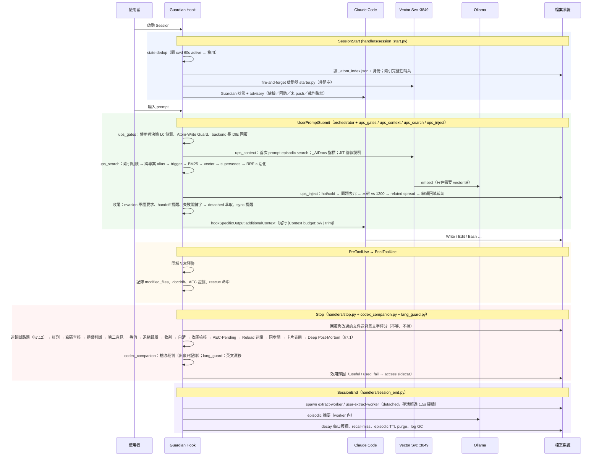

# 原子記憶系統 — 技術深度文件

> 本文件對應系統**當前代碼實況**；與代碼不符以代碼為準並回報修正。版本標識見 `version.json`。
> 讀者定位：**人讀為主**（想弄懂這套東西怎麼跑、為什麼這樣設計），**Claude Code 讀來建立自我認知為輔**。
> 章節按「現況」邏輯排：理念 → 差異 → 一個回合 → 資料層 → 檢索注入 → 寫入積累 → 守門收尾 → 可觀測 → 服務 → 目錄 → 流程與耗損 → 設定 → 協作 → 版本歷史與已停產機制 → 深度參考。只想知道「AI 寫程式時一路會被問什麼、擋什麼」，直接讀 §7.0。
> 閱讀鐵則：每個機制在它所屬章節講完要點；要深入只指到**單一**檔案或**單一** DevHistory 檔，不做「A 見 B、B 見 C」。每一節開頭第一句說這節解決什麼。

---

## 1. 設計理念

這一節回答：這套系統為什麼存在、做取捨時照哪幾條原則。

### 1.1 使用者最高原則

LLM 的 context window 是**工作記憶**，天生沒有**長期記憶**。這套系統要做到的是：

| 原則 | 白話 | 落地在哪 |
|------|------|---------|
| 全積累 | 值得記的知識一顆都不漏，且不刪只歸檔 | atom 卡片 + `_distant/` 封存 + JSONL 審計 |
| 分門別類 | 每顆知識有明確範疇，分不出就不准寫 | Lv1 閉合清單 `memory/_meta/taxonomy.json` + 寫入閘 `domain` 必填 |
| 高精準零浪費 | 只注入這一句真正需要的知識，不塞、不重複、不截成廢紙 | trigger/BM25/vector 三路 RRF + 預算三閘 + 同題去冗 |
| 跨 session | 上個 session 學到的，下個 session 自動帶著 | 每 prompt hook 注入 + episodic 摘要 + 回訪機制 |
| 自動分層 | 用過有效就升、久沒用就淡出，人不用手動整理 | [臨]→[觀]→[固] 效用 Wilson 晉升 + ACT-R 活化衰減 |
| 分使用者 | 我的偏好是我的，專案共識是專案的 | 四層 scope（global / shared / role / personal） |

### 1.2 六原則

| # | 原則 | 實際展現 |
|---|------|---------|
| 1 | **精確度 > Token 節省** | 寧多注入確保正確；預算閘裁切時「回填」而非整塊丟 |
| 2 | **漸進式信任** | `[臨]`→`[觀]`→`[固]`，靠效用統計晉升，不靠人工拍腦袋 |
| 3 | **最小侵入** | 全走 Claude Code hooks（11 個事件）+ MCP tool，主程式零修改 |
| 4 | **雙 LLM 分工** | Claude 做決策；本地 Ollama 做萃取、分類（gemma4:e4b / qwen3:1.7b）、embedding（qwen3-embedding）與文字評分裁判（§7.11） |
| 5 | **可審計** | JSONL audit trail 全程記錄；知識只歸檔不刪 |
| 6 | **對齊原生** | 採 skills / MCP / hooks / auto-memory 原生機制，自製只做原生做不到的部分 |

### 1.3 治理鐵律（`rules/core.md`）

- **Native-first**：原生機制優先；自製只做「結構化 · 可稽核 · 跨 session 高價值」的事。過度工程的正解是誠實化＋修剪，不是推倒重來。
- **可觀測性鐵律**：所有 fail-open「不阻斷但要告知」——降級／靜默失敗必浮出訊號（stderr / advisory / 收尾報告 / statusline），不得無聲吞掉。反例是向量服務曾靜默死 27 天沒人知道。

---

## 2. 與 Claude Code 原生／與業界的差異

這一節回答：已經有 Claude Code 原生記憶和業界產品，為什麼還要自己做、差在哪。

### 2.1 與 Claude Code 原生記憶

| 面向 | Claude Code 原生 | 原子記憶系統 | 差異的意義 |
|------|------|------|------|
| 真源 | `projects/<slug>/memory/MEMORY.md` + 自由 md，模型自己決定寫什麼 | Markdown atom 卡片 + `memory/_atom_index.json` 機器索引；每顆有 Trigger / Confidence / Scope | 有索引才能程式化檢索；有欄位才能程式化晉升 |
| 跨專案 | **無**——記憶綁 project slug | `memory/<範疇>/` 全專案注入；他專案只在提到其別名時帶入 MEMORY.md 目錄（上限 20 專案） | 個人偏好、通用踩坑不必每個專案重學；專案層知識不外洩 |
| 載入方式 | 啟動只載 MEMORY.md 前 200 行／25KB，其餘靠模型按需 Read | 每個 prompt 由 hook 主動挑選注入 | 「有存無用」是業界通病；主動注入直接對治 |
| 檢索 | 無 | trigger → BM25 → vector → RRF 融合 × 活化 | 模型不必自己想起要去讀哪個檔 |
| 品質分級 | 無 | [臨]/[觀]/[固] + Wilson 效用晉升 | 未驗證的猜測不會和已驗證的事實平起平坐 |
| 回饋迴路 | 無 | access sidecar、rescue-log、recall-miss、效果報表、回訪 | 知道「哪顆記憶真的被用到」 |
| 接點 | — | `tools/native-memory-bridge.py` 把核心 atom 索引鏡像成 `projects/<slug>/memory/atom-index-bridge.md`（只有指標）；反向：atom 的 `- Source:` 指回原生 transcript（`session:<sid8>#<uuid8>`），`atom_source` 撈出原句與前後文（§5.8） | 原生路徑找得到 atom、atom 也指得回原對話，且不違反 200 行硬牆 |
| Hook 硬牆 | UserPromptSubmit 預設 30s；SessionEnd 全部 hook 預設共 1.5s（settings 設較長 per-hook timeout 可把預算提高到最多 60s——官方規格，本機未實跑） | UPS 實設 8s；SessionEnd 的 LLM 萃取（~60s）仍走 detached worker | 60s 上限貼著本地 LLM 耗時，detached 才不受預算左右 |

原生規格查證版：`_AIDocs/ClaudeCodeInternals/cc-native-memory-hooks-mcp.md`。

### 2.2 與業界主流（Zep / Mem0 / Mastra / claude-mem 等）

| 面向 | 業界主流 | 原子記憶系統 | 評語 |
|------|------|------|------|
| 檢索 | hybrid BM25+vector+RRF 為共識；cross-encoder rerank 再進一步 | 同款三路 RRF；rerank 只有離線路徑（`tools/memory-vector-service/reranker.py`，Ollama 逐條打分），hook 檢索鏈不呼叫；本機實測（2026-10，175 題回歸集）cross-encoder 只抬 R@1 +3.4 點、R@3 反降、每句 +1.2 s，判定不進 hook、只作讀取端可選項——評估全文 `_AIDocs/DevHistory/rerank-cross-encoder-evaluation-2026-10.md`。hook 直譯器已有 sentence-transformers＋torch CPU（vector service 的 bge-m3 fallback 用），fastembed 未裝 | 方向一致；每回合 rerank 實測後判定不做（收益在前三名內換序、每句 +1.2 s），讀取端可選 |
| 新鮮度 | 決定性規則（timestamp）勝 LLM 判斷（82% vs 18%） | `supersedes` 規則式過濾；衝突裁決先看證據等級再看 recency | 符合 |
| 注入 | 每 prompt ≤6 條、SessionStart ~1,200 tok；單一干擾項即傷精度 | per-turn 硬頂 1200 tok、同題去冗、總額分級 | 符合 |
| 積累 | 原文勝萃取物；入場閘以內容型別先驗最有效 | 顯式策展 `atom_write` 為主，自動萃取為輔；每顆 atom 帶 `- Source:`（session 指標）與 `- Quote:`（使用者原話 ≤200 字）：寫入當下 PostToolUse 自動填、舊顆由回填 worker 補；`atom_source` 回讀原對話（§5.8） | 已補：原文可回看——transcript 還在就撈原句前後文，30 天後被清掉仍有 Quote 留住原句 |
| 信任 | 多數產品無分級 | 三級 + Wilson | 領先 |
| 回饋 | 多數只有「存了多少」 | 有「用了多少」（rescue-log / useful / used_fail） | 領先 |
| 部署 | 多數雲端 API | 全本地：Ollama + LanceDB | 無 OAuth／連線故障類問題 |
| prompt cache | Mastra 固定前綴達 SOTA | 每輪注入段變動不進 cache，但前綴仍命中 | 影響限於注入段本身 |

業界調查全文：`_AIDocs/Research/agent-memory-industry-survey.md`；三方比對與優缺點判讀：`_AIDocs/DevHistory/memory-system-review-2026-08.md`。

---

## 3. 一個回合發生什麼

這一節回答：你打一句話到 Claude 回完，背後哪些程式在什麼時刻跑、各做什麼。

### 3.1 settings.json 十一個事件

Python hook 的指令型式是 `"$LOCALAPPDATA/Python/bin/pythonw.exe" -c "import runpy...run_path(~/.claude/hooks/xxx.py)"`；bash 類 hook（`user-init.sh`、`webfetch-guard.sh`）是 `pythonw.exe "$HOME/.claude/hooks/run-bash-hidden.py" xxx.sh`；statusLine 用 `python.exe` 直接跑 `tools/statusline.py`。Claude Code 在 Windows 用 Git Bash 跑 hook 與 statusLine 指令，`$VAR`／`~` 展開、`%VAR%` 不展開（實測），settings.json 因此不帶機器專屬路徑；Python 不在該位置的機器跑 `python tools/fix-hook-python.py --write`（仍以 `$LOCALAPPDATA/…`／`$HOME/…` 形式寫入）。

| 事件 | matcher | 掛的 hook（timeout 秒） | 職責 |
|------|---------|------|------|
| SessionStart | — | `user-init.sh`(12，經 `run-bash-hidden.py`) → `workflow-guardian.py`(20) → `ensure-mcp.py`(5) → `codex_companion.py`(5) | 還原 USER/IDENTITY、state 建立、讀索引前 spawn vcs-sync worker 拉取（`_spawn_pull_sync`，`reason=pull`，detached 不等；§6.3）、索引完整性哨兵、vector 啟動器、advisory（健檢／回訪／未 push〔`_unpushed_advisory` 查 `workflow/vcs-sync/roots.json` 全部 root：領先 upstream 或有 `.unpushed` 標記〕／拉取〔`_pull_advisory_lines`：上次拉入 N 筆、候選池以本次載入快照為準；`.behind` 標記或 `pull_error` → 理由〕／裁判後端） |
| UserPromptSubmit | — | guardian(8)、codex(3) | **記憶注入主路徑**（§5）+ 各種 guard 提醒 |
| PreToolUse | `WebFetch` | `webfetch-guard.sh`(20) | 抓網頁前置護欄 |
| PreToolUse | `Bash` | `plan_bash_guard.py`(5) | Plan Mode 彈窗攔截：必彈窗寫法 deny＋改寫提示（§7.5） |
| PreToolUse | `Write\|Edit\|MultiEdit\|NotebookEdit\|Bash\|PowerShell\|Agent\|Task\|AskUserQuestion\|ExitPlanMode\|mcp__workflow-guardian__{second_opinion_start,atom_write,atom_edit_meta,atom_retire,atom_move,need_goal}` | guardian(5) | 一開頭先問連鎖斷路器：中止停手中，讀與問以外的呼叫先擋下；連鎖段開著時，放行的改檔先存快照（§7.12；MCP 的寫卡、搬卡、目標樹工具掛在這裡也是為了這兩件）。改檔前的閘：沒有需求目標樹不准改程式（§7.7）、部位導讀卡與定位行（§7.6 OverviewHub）、改資料檔／改舊測試要先宣告、繞閘嫌疑要宣告、改判準卡留帳（§7.5 DataFileAsk／OldTestDeclare／GateBypass／JudgeCardDeclare；atom 工具掛在這裡是因為 MCP 行程沒有 session 與 transcript，宣告只能在 hook 核對）；commit 前的閘：隱私硬閘、口令閘、病形閘（§7.5 SmellGate）、svn 提交測試路徑閘（§7.5 SvnTestBlock，預設關）；跨 session 同檔互寫預警、`svn add` 中文路徑 SvnEncoding advisory（§7.5）、索引三檔合併驅動自動安裝與解衝突（§4.5）；問使用者前（AskUserQuestion／ExitPlanMode）查每題附推薦、掛目標節點（§7.7）；`second_opinion_start` 補 session_id；派子代理時注入記憶（預算 700 tok，`_SUBAGENT_INJECT_BUDGET`）與判準卡 |
| PostToolUse | `Edit\|Write\|MultiEdit\|NotebookEdit\|ExitPlanMode\|Bash\|PowerShell\|Read\|Agent\|Task\|mcp__workflow-guardian__{anti_evasion_report,atom_write,atom_retire,knowledge_harvest_report,need_goal}` | guardian(5) | 記錄改檔與讀檔（導讀卡注入、讀到 Depends 指向的檔召回卡片，§7.6）、驗證收據與紅測入帳（§7.6）、docdrift、AEC 證據蒐集（讀 Stop 留下的 evasion_flag 做 cross-check）、late-collision、rescue 命中、工具結果體積提示（§8）；atom 工具 receipt 入帳 `state.atom_ops[sid]`、Source／Quote 自動填（§8）、收割回報 items ↔ receipt 核對（§6.3 階段收割）；`need_goal` 套用到目標樹、`verify_scope` 收件、Read 到續接單時匯入目標樹（§7.7、§7.9）；one-writer：MCP 只回 chip，state／ledger 由此寫；連鎖段開著時記這次的 AI 動作（§7.12）；write_state 後同程序呼叫 `version_guard.run()`／`acceptance_spec.run()`（原兩支獨立 hook，併入省每事件兩個 Python 啟動 ≈161ms） |
| PostToolUse | `Edit\|Write\|Bash\|ExitPlanMode\|EnterPlanMode` | codex(3) | Codex Companion 審計觸發 |
| PostToolUseFailure（dispatcher 接到 `handlers/post_tool_use.handle_post_tool_use_failure`） | `Bash\|PowerShell` | guardian(5) | 工具失敗時 Claude Code 不送 PostToolUse、改送這個（`error` 欄＝「Exit code N」＋stderr＋stdout 換行串起，查 2.1.304 執行檔）：指令非零結束時前段已寫下去的檔照樣記進 `modified_files` 與目標樹待對照改動（同一支 `write_paths_from_tool`；只記現在存在、而且在這次工具呼叫開始之後才改過的檔（開始時間取 transcript 那筆 tool_use 的時間，找不到就只看存在並印 stderr），目標不明的不記；閱讀路徑量尺與寫碼查核都讀它）；測試指令紅了記紅測（`failing_tests`）與驗證收據，跟成功路徑同一套函式；`error` 讀不到結束碼（指令沒跑或沒跑完，例：被 hook 擋下）不算測試結果；紅的重跑也記成連鎖斷路器的 AI 動作（§7.12）。只記帳不擋；裁判子 session 只記改檔與收據 |
| PreCompact / PostCompact / PostToolBatch | — | guardian(5) | 壓縮前存 handoff stub 與 OverviewHub 摘要、生成 episodic；壓縮後 stash、由下一個 PostToolBatch 一次性重注入 atom、每部位綜觀與需求目標樹（atom 先、綜觀後）；PostToolBatch 另送需求目標的批次提醒（讀入範圍變大、同一處改了好幾次、PreToolUse 沒攔到的提問）、同伴訊息與 handoff 提示 |
| Stop | — | guardian(20)、codex(150)、`lang_guard.py`(5) | 先把回覆送背景文字評分（§7.11）、問連鎖斷路器（§7.12），再依序：紅測、寫碼查核、拐彎判斷、第二意見、等值與熱路徑、退縮歸屬、知識收割、收尾自清、收尾檢核、Reload 建議、同步閘、卡片表態、深度檢討、順手點出最該修；效用歸因；驗收裁判在 codex_companion 那支（出廠只記錄不擋，§7.4）；英文漂移在 lang_guard（閘序與哪些目前關著見 §7.1） |
| SubagentStop | — | guardian(20) | 子代理收尾只跑寫碼查核（對帳 (a)～(d)＋驗證範圍＋寫入目標不明，用該 agent 自己的改檔與收據帳；自己沒宣告就沿用主 session 的範圍）；沒人能回答放行詢問：跟主 session 同一份預算，擋滿就放行並留帳（§7.1、§7.3） |
| SessionEnd | — | guardian(30)、codex(5) | 清連鎖斷路器的快照與帳（§7.12）、spawn 萃取 worker、episodic 生成與過期清除、decay、晉升 sweep、realm 自動搬移掃描（§4.3）、recall-miss、Auto-Handoff 兜底、log GC；最後 spawn 一次 vcs-sync worker（`reason=promotion|session_end`，§6.3 階段收割） |

本表的真源是 `settings.json` 的 `hooks` 區塊；`workflow-guardian.py` 是 1 行 shim → `hooks/dispatcher.py` → `hooks/handlers/{event}.py`（9 個檔接 11 個事件：PostToolUseFailure 走 `post_tool_use.py`、SubagentStop 走 `stop.py`），bash 類 hook 經 `hooks/run-bash-hidden.py` 包一層。dispatcher 開頭起表、結尾落帳（hook 分段計時與超時降級，§7.1 表下）。裁判子 session（環境變數 `CLAUDE_COMPANION_JUDGE=1`）走縮減版 `JUDGE_HANDLERS`：只留 PreToolUse（寫入目標判不出的指令留帳）、PostToolUse／PostToolUseFailure（最小記帳）、Stop（只跑寫碼查核），不注入記憶、不跑其他閘。守門總開關關著時（出廠，見 §7 開頭），dispatcher 不分派 v6 才有的事件（PostToolUseFailure、SubagentStop）與 v6 才掛的工具（Read、AskUserQuestion…），裁判子 session 也一律早退。安裝時由 `tools/install.py` 把這段合併進使用者的 `settings.json`（§9.5）。

### 3.2 序列圖



---

## 4. 記憶資料層

這一節回答：一條知識存成什麼樣子、放在哪、誰看得到。

### 4.1 atom 卡片格式

一顆 atom = 一個 `.md` 檔，檔名即 slug（`lib/atom_spec.py slugify`）。頭部是 metadata 條列，正文是 `## 知識` / `## 行動`（可有 `## 印象`）。

| 欄位 | 必填 | 值 | 用途 |
|------|------|-----|------|
| `Scope` | 是 | `global` / `shared` / `role:{name}` / `personal:{user}` | 可見範圍（§4.4） |
| `Confidence` | 是 | `[固]` / `[觀]` / `[臨]` | 信任等級；注入時 [固]/[觀] 優先保留 |
| `Trigger` | 是 | 逗號分隔關鍵字 | 檢索主路（§5.1）；ASCII 整詞邊界、CJK 子字串 |
| `Author` | 否 | 提出者帳號 | `wg_roles.get_current_user()`（AD 帳號；§13.1） |
| `Source` | 否 | 標準格式三態：`session:<sid8>#<uuid8> <YYYY-MM-DD>`（uuid 可缺；寫入時自動填）／B 級 `commit:<hash7> <日期>（原對話已逾保留期）` 或 `unknown <日期>（原對話已逾保留期）`（回填補）／自由值（檔案路徑、URL、會議逐字稿路徑） | 來源可追溯；`atom_write(provenance=)`，渲染在 Author 後；`lib/provenance.parse_source` 解析 |
| `Quote` | 否 | 觸發這張卡片的使用者原話：單行 ≤200 字（`provenance.quote_max_chars`），消毒後以「」包住；只放使用者原話，AI 自動萃取的顆只補 Source、不寫 Quote | transcript 被清掉後仍留得住原句；`atom_write(quote=)`、PostToolUse 自動填（§8）、回填 worker 補舊顆；渲染在 Source 後、Confidence 前；不注入（`_FRONTMATTER_KEEP_RE` 不含 Source／Quote，每回合 token 增量 0） |
| `Related` | 否 | 其他 atom 名 | related spread（depth 1）與 broken_refs 健檢。**只寫自己連出去的**；反向由索引在注入時反轉（`wg_atoms.load_link_graph`），不寫進被連的那顆檔 |
| `Aka` | 否 | 這顆用過的舊檔名 | 連結以檔名為鍵，改名時在**自己這顆**加一行，連進來的舊連結照樣解析（`build_alias_map`）；不得與現存 atom 同名 |
| `Supersedes` | 否 | 被取代的 atom 名 | 規則式過濾舊版，不交 LLM 判 |
| `Depends` | 否 | `path:<路徑>` 或自由文字 | **壞滅緣**：path 型可機器驗存在性，指向消失 → 標 stale；反向也用：讀到它指的檔時召回這張卡（`[Guardian:Depends]`，§7.6）；`atom_write(depends=)`，渲染在 Created-at 後、Related 前 |
| `Entry` | 否 | 切入點代號（`workflow/entrypoints.json`），逗號分隔，如 `E04, E08` | 這顆是哪幾個切入點的判準卡（§7.10）；`atom_write(entry=)`／`atom_edit_meta(entry=)`，渲染在 Depends 後、Related 前；索引 `entry` 欄跟著檔走（`write_index` 讀落檔的行、`sync-atom-index` 重建時帶）。replace 三態同 Depends；append 忽略 |
| `Evidence` | 否 | `實證` / `引述` / `推測` | 衝突裁決權重 3/2/1（未標 0） |
| `Status` / `Audience` / `Created-at` / `Pending-review-by` / `Merge-strategy` / `Decided-by` | 否 | — | 狀態（如工具卡進入點消失標 `deprecated`）、受眾（`architecture/decision` 寫 shared 進待審，§6.1）、建立日、待審裁決與合併策略；`lib/atom_spec.py` 定義 |
| `Expires-at` / `Tags` / `Quality` | 否 | — | 輔助 |
| access sidecar | 自動 | `<atom>.access.json` | read_hits（純曝光）、useful/used_fail（α/β）、Wilson 下界、decay、last_decay_date |

**Source／Quote／Depends 的 replace 三態**（與 Supersedes 同）：未給＝保留原行、`""`／`[]`＝清除、非空＝替換；append 不動檔頭，卡沒有 `## 行動` 段（導讀卡、索引卡、手寫舊卡）就先在檔尾補最低要求的行動段當拼接錨點（`lib/atom_io._build_append_content`，py `write_atom` 與 MCP append 共用）。**replace 只換呼叫者給的部分**（`lib/atom_io.carry_replace_header`，py `write_atom` 與 MCP js 經 `atom_io_cli build existing_path` 共用）：舊格式卡（標題 slug≠檔名，例：標題中文、檔名英文）沿用舊標題，新格式照舊用 title 參數；舊卡沒有 Created-at 就不補；Related／Status／Audience 沒給、以及 build 不認得的舊鍵（Confirmations、Last-used、Tags、Type…）原行帶回（同鍵多行全帶）。渲染順序與 py↔js byte parity 的單一來源：`lib/atom_spec.build_atom_content` ↔ `atom-render.js buildAtomContent`（`verify_atom_io_equivalence.py` test_31–33）。

**為什麼反向連結不落檔**：A → B 就代表兩顆相連，把它也寫進 B 的檔等於每新增一顆連到 hub 的 atom 就要改 hub 那個檔——那是別人的檔，多人共用同一個版控庫時必衝突。索引（`related` 欄）只存正向，注入端讀進來反轉；索引沒有 `related` 欄的舊版本退回讀檔解析，行為不變。

**為什麼 Depends 與 Evidence 都是 optional**：向後相容鐵則——既有 atom 缺欄靜默通過。**為什麼 access 是 sidecar 不是 frontmatter**：計數每回合都在變，寫回 atom 本體會讓 git diff 全是噪音、也會和人手編輯互撞。

### 4.2 分類階層（core realm）

- 核心 atom 只住 `memory/<Lv1>/[<Lv2>/]`，根下**不容平鋪**（`sync-memory-index --check` 直接 exit 1）。
- Lv1 是**閉合清單**（`memory/_meta/taxonomy.json` `core` 節）：版控 / 工作流 / 思考與決策 / 驗證與實證 / dotnet / OS-Windows / 文字與格式 / 設計通則 / 行為契約 / CC與原子記憶契約；別名（如 `vcs/git`）自動 snap 回正名。
- 失敗家族 `memory/Failures/<主題>/`：feedback-* 與失敗模式 atom；主題沿用同一套 Lv1 名。
- 每層有自動生成的 `_INDEX.md`；`memory/MEMORY.md` 只列 Lv1 目錄。

**為什麼 MEMORY.md 只列 Lv1 目錄**：它經 `CLAUDE.md @memory/MEMORY.md` 每 session always-load，行數上限 40（`atom_spec.INDEX_MAX_LINES`；專案層 150 `PROJECT_INDEX_MAX_LINES`——專案層不生成各範疇 _INDEX.md，逐顆列表住在 MEMORY.md 本身）。列到 atom 明細，always-load 會隨 atom 數線性膨脹（百顆 atom ≈ 數千 tok 每輪白付）；列到 Lv1 只有約 20 行（Lv1 加 Failures 一列一個範疇，另兩行指向 `_local_catalog.md` 與 `_by_language/`）、約 300 tok，且 atom 再多也不長胖——真正的檢索靠 trigger/BM25，不靠模型讀目錄。

**為什麼分不出範疇就拒寫**：沒有「其他／未分類」桶。一旦有 Else，所有懶得分的東西都會掉進去，範疇就形同虛設；拒寫逼寫手當下決定它屬於哪裡。

### 4.3 realm：core vs local

| | core | local |
|--|------|-------|
| 物理位置 | `memory/<範疇>/`、`memory/Failures/<主題>/` | `_AIDocs/_atoms/<domain 多段路徑>/`（詞庫已知根 World / Tools / MemDev，分不出歸 `Else`；磁碟上另有 OS、Vision、工作流等手動建的根） |
| 注入範圍 | 全專案 | **只在 cwd ∈ ~/.claude** 時注入（`wg_core._is_under_claude_dir`） |
| Scope 欄 | global | 仍是 global（realm 由索引 path 前綴推導，不存欄位） |
| 該放什麼 | 任何專案的 AI 都用得到（使用面） | 只在 ~/.claude 有用：記憶系統開發、本機特定 |
| 索引 | 同一份 `_atom_index.json` | 同一份 |
| 目錄 | `memory/MEMORY.md` | `memory/_local_catalog.md` |
| 分類器 | — | `lib/atom_locations.classify_realm`（決定性詞庫；LLM fallback 預設關） |

判定三問：別的專案會碰到嗎？→ core。只有在改記憶系統本身時才用到？→ local。分不出？→ 先 `dry_run`。看知識段的判準或通則，不看實例：例子取自記憶系統開發、Source 裡有 `~/.claude` 路徑，都不代表它是 local；拿不準就放 core。

**程式怎麼自動判**（`lib/atom_locations.classify_realm`；建卡時 scope=global、沒給 realm、不是 feedback 路由才用，SessionEnd 的 realm 自動搬移掃描也用）：realm 不存欄位，看索引路徑前綴（`_AIDocs/_atoms/` 是 local，其餘 core）。只看卡名與 trigger、不看知識內文：① 卡名命中核心保護清單（decisions、workflow-、feedback-、atom- 等前綴與精確名單）→ core 且永不搬、永不喚 LLM；② 其餘用實例詞庫計分（卡名權重大於 trigger），沒命中 → core（安全預設）。詞庫與保護清單在 `memory/_meta/realm-lexicon.json`（py 與 js 共用；壞了退內建最小清單、全判 core）；自學詞庫 `realm-lexicon-learned.json` 只有 SessionEnd 掃描用。SessionEnd 掃描的開關 `realm.auto_migrate`（true）、`realm.llm_fallback.enabled`（false：詞庫沒命中就不判）、每 session 最多搬 `max_per_session` 5 顆。另一道獨立的閘 `lib/realm_gate.py` 管「專案專名不得落 global」（§6.1）。

**綁 Entry 的卡不自動搬**（有名規則 `ENTRY_BOUND_STAYS_CORE`，判定只在 `lib/atom_locations.entry_bound_ids`）：檔頭 `- Entry:` 非空（讀不到檔才看索引 `entry` 欄）的卡是切入點判準卡，要在任何專案的那個切入點送到；SessionEnd 的 realm 自動搬移遇到它本來要照詞庫搬、或要喚 LLM 分類時，改成不搬、不喚，留帳一行在 `memory/_meta/atom_io_audit.jsonl`（`op=realm_hold`，含規則名、卡名、Entry 代號、本來會怎麼搬）。建卡時的自動 realm 同一條規則：`atom_write` create 帶 `entry` 而卡名命中 local 詞時照樣落 `memory/<範疇>/`（要給 core 的 `domain`），卡建成才留帳（`source=atom_io:create`），dry-run 不留。手動 `atom-set-realm.py set --domain` 照搬不擋，只在 stderr 印一行警告；`atom-categorize.py apply` 的 `local:` 對映同樣照搬，警告列在結果的 `warnings`。

**判準卡的建卡出口**：判準卡只能從 MCP `atom_write`（create／replace 帶 `entry`）或 `atom_edit_meta`（改 `entry`）建立或綁定；自動萃取走的 py `write_atom` 不收 `entry`，所以機器萃取不會自己長出判準卡。卡綁在哪個切入點、問的那一刻怎麼送，見 §7.10。

**改判準卡留帳**（規則 `JUDGE_CARD_CHANGE_NEEDS_DECLARATION`，只記錄不擋）：判準卡是判 AI 做得對不對的量尺，誰改、為什麼改要留得下來。已存在、綁了 Entry 的卡，不論用 Edit／Write、Bash 寫入，或 MCP `atom_write` append／replace、`atom_edit_meta`、`atom_retire` 去改，每次改動都留帳 `Logs/guard-judge_card.jsonl`；先寫一行「改判準卡｜<卡名>：<理由>」，理由就一起記下。新建卡、沒綁 Entry 的卡不觸發。細節見 §7.5 JudgeCardDeclare。

### 4.4 四層 scope

| 層 | 可見性 | 用途 | 物理目錄 |
|----|--------|------|---------|
| `global` | 跨專案、跨人 | 個人偏好、通用工具決策 | `~/.claude/memory/<範疇>/`（+ local realm） |
| `shared` | 同專案全員 | 專案共識、架構決策、踩坑 | `{project}/.claude/memory/shared/<Lv1>/`；feedback-* 落 `failures/<主題>/` |
| `org` | 公司全員、所有專案 | 公司級工具卡、跨專案共識 | `<org_root>/.claude/memory/shared/<Lv1>/`——`org_root`＝本機狀態檔 `workflow/org-memory.local.json`（不進版控）的 `roots[0].root`（只認一根，>1 停用並 stderr）：共用 `workflow/config.json` `org_memory` 只放全公司相同的 `repo_url`／`default_root`，「這台接上沒、根在哪」各機自己記，本機檔同名鍵蓋過共用區段（py `wg_core.org_memory_root`／js `realm.orgMemoryRoot` 同規則）；沒接上且使用者沒回答過的機器，SessionStart 每次都給模型一行 `❓ [Org]` 指示，要它用 AskUserQuestion 問使用者放哪裡（預設路徑／指定路徑／先不接），照答案跑 `--join [路徑]` 或 `--decline`，答案記在本機檔（`declined`＝不再問）。`org` 是 MCP／CLI **語法糖**＝「指定根的 shared」：js 改寫成 `scope=shared + project_cwd=org_root`，檔內仍 `Scope: shared`、不進 `VALID_SCOPES`、py 落點零改；使用者入口 `/org` skill（join／status／scan，或直接用講的）；新機器 `python tools/org-memory.py --join [<root>]`（省略路徑用 `org_memory.default_root`＝`~/CompanyAtomsMem`——家目錄相對、不寫磁碟代號，`--join` 自己 expanduser；根不存在就從 `org_memory.repo_url` clone，再 `--init`）、對帳 `--status`；工具卡 `--scan-tools`（skills／MCP → `shared/工具/skill-<name>`／`mcp-<name>`，Author＝負責人、Source＝進入點、Depends: path:進入點，進入點消失自動 `Status: deprecated`；觸發詞只放卡名與「名稱＋種類」片語，不放裸名與種類單字——工具名多是 memory／handoff 這類日常字，放了每句話都會把整批工具卡注入）；vcs-sync 目標集含此根 |
| `role:{name}` | 同職務者 | 職務專有規範 | `{project}/.claude/memory/roles/<role>/`（職能由 AD 群組自動解析，§13.1） |
| `personal:{user}` | 只自己 | 個人 scratch、未公開假設 | `{project}/.claude/memory/personal/<user>/`（**進專案版控**，多機才同步；注入過濾只決定模型搜不搜得到、不是保密——repo 任何讀者都能開檔，敏感內容不放；SessionStart `_personal_sync_advisory` 見被 ignore／未 commit 會提示） |
| `personal:{user}`（跨專案） | 只自己，但每個專案都看得到 | 本人跨專案偏好 | `~/.claude/memory/personal/<user>/`（gitignore；`atom_write(scope=personal, cross_project=true)` 或從 ~/.claude 寫入即落此） |

**公司層的日常操作**：已自行 checkout 公司記憶 repo 的機器跑一次 `python tools/org-memory.py --init <repo 根>`（佈 `<root>/.claude/memory` 含一張工具卡、寫本機狀態檔與 registry，冪等）；`--scan-tools --project <專案根>` 另掃該專案 `.claude/tools/*.py`；查工具卡 `python tools/memory-search.py "<工具名>"`。SessionStart 的四種訊息（`session_start._org_advisory`）：已接上 → `[Org] 公司層 N 顆（<root>）`；沒接上、使用者也還沒回答過、共用 config 有 `repo_url` → 每個 session 都出 `❓ [Org]` 指示，要模型第一則回覆前用 AskUserQuestion 問（預設路徑／指定路徑／先不接），直到使用者答了（`--join` 或 `--decline`）；接過但本機 checkout 不見 → `[Org] 公司層記憶尚未接上…`；接上了但索引缺檔 → `[Org] 公司層索引缺檔：…（請在該 repo 跑 sync-atom-index）`。公司層寫入另有範疇閘：內容含專案名或專案路徑就擋（`lib/realm_gate.check_org_write`）。對帳看 `--status` 的 `ready`。

**personal 與 shared 的分界**：內容是「針對專案的規則」（專名／此專案／上傳／發布／必須／禁止…）就落 shared，`Author:` 記提出者（自動萃取亦同）；有異議找 Author；待審草稿（`shared/_pending_review/`）由裁決者核准／退回（config `review.deciders`，空＝全員）。personal 只留真正的個人偏好。

**讀取端候選池**（`wg_atoms.build_candidate_pool(cwd, user, roles, org_root=)` 純函式；SessionStart 建一次存 state、`lib/memory_search` 同用；UPS 的 trigger / BM25 / vector / related / AtomAudit 共用）：global + 本人跨專案 personal + 公司層 org（config 啟用且 cwd 的專案根不是 org 根時）+ 本專案 shared（含 failures）+ 本人 roles + 本人 personal。他專案任何層都不進池；他人 personal / role 不進池；`user=unknown` 不進任何 personal。scope 由索引 path 推導（`personal/<u>/`、`roles/<r>/`；org 組由分組推導回 `org`），不信 index 的 scope 欄。同名跨層 project > org > global 先到先贏（`memory_search` 把被遮蔽者列進 `warnings`）。向量路帶同一套 layers 白名單（org 以 `visible_vector_layers(extra_layers=["shared:<org slug>"])` 附加），裁決者不豁免。

現況：global / shared / personal 三層已在多人專案實戰（一個 git 庫 2 人以上、一個 svn 庫 4～5 人，各自寫 shared 與 personal atom，Author 記提出者）；roles 層靠 AD 群組自動解析（§13.1），尚無專案放 `roles/<r>/` atom；`_roles.md` 純登記、程式不讀。**身份契約**：`Author`＝`wg_roles.get_current_user()`（`CLAUDE_USER` → OS／AD 帳號；取不到＝`unknown`，不讀任何 personal）；裁決資格＝config `review.deciders`，空即全員。

### 4.5 索引：JSON 單一真相

- **三個根**（`lib/project_root.py`，一般安裝三者都是 `~/.claude`）：資料根（memory、workflow、config、Logs、projects，`claude_data_dir`：環境變數 `WG_CLAUDE_DIR` 有值就用它）；程式碼根（hooks、lib、tools 所在的樹，各檔由自己的路徑推）；Claude Code 設定目錄（settings.json、`.claude.json`，`claude_config_dir`：`CLAUDE_CONFIG_DIR`）。worktree 開發、驗收實跑時會把資料根指到別處，所以工具讀資料一律問資料根，不寫死 `~/.claude`。
- `memory/_atom_index.json` 是唯一機器源（API：`lib/atom_index_json.py` load/save/upsert/delete/validate）；`_ATOM_INDEX.md` 是自動生成 mirror，只給 fallback parser。
- 每筆：`name` / `path` / `triggers` / `scope`（+ realm 由 path 推導）。
- 多機合併：索引三檔（`MEMORY.md`／`_ATOM_INDEX.md`／`_atom_index.json`）是「一列一 atom」的集合，兩機各自新增後 git 逐行三方必衝突 → 三層防線：全 repo LF、`tools/merge-atom-index.py` 當 git merge driver 做語意三方（PreToolUse 在合併類 git 指令前自動 `--install`）、git 仍停住時 `--resolve` 在 `rebase --continue` 等指令前自動套在三檔 stage 上；SVN 工作副本同一支 `--resolve` 在 `svn commit / resolve` 前自動解（拿 svn 留下的 `.mine`／`.r舊`／`.r新` 當三方輸入，`svn resolve --accept working`；`svn update` 本身不自動）。
  細節（stage 方向矩陣、CLI 契約、失敗模式 SOP、不在保證範圍）→ `_AIDocs/MultiMachineMemorySync.md`。
- 專案記憶庫的衍生檔不入版控（`lib/vcs_ignore.py`）：`_atom_index.json`／`_ATOM_INDEX.md`／`_staging`／`episodic`／`vector-db` 在 SessionStart 偵測到 `{proj}/.claude/memory`、或索引首次落檔時自動進 `svn:ignore`（併入既有值）／`{mem}/.gitignore`。ignore 對已版控檔無效，所以另偵測「已被版控」→ `[Guardian:VcsIgnore]` 一次性告警（marker `workflow/vcs-ignore.json`）附 `svn rm --keep-local --force`／`git rm --cached` 指令與隊友端 resolve 說明，不自動執行。SessionStart 索引不在即從磁碟重建（`_ATOM_INDEX.md` 缺檔亦重生），舊版手動 `sync-atom-index.py --rebuild --memory-dir <mem>`；SVN 的 IndexConflict 自動合併只是暫時處置，訊息先指退出版控。根層 `~/.claude/memory` 不在此範圍（根層 repo 仍版控索引、靠合併驅動）。
- 行尾政策：整個 `~/.claude` repo 一律 LF——`.gitattributes`（`* text=auto eol=lf` + 各文字副檔名明釘 `text eol=lf`）與 `.editorconfig`（`end_of_line = lf`）進版控，不需任何機器安裝；工具層所有寫檔走 `lib.atom_io.write_text_lf()`／`normalize_lf()` 或 `newline="\n"`，只吐 LF、不沿用原檔行尾；守衛 = `hooks/verify/verify_lf_writes.py`（AST 掃無 newline 控制的寫檔即 fail，`# lf-exempt: <原因>` 標三個合法例外）+ `python tools/normalize-eol.py --root --check`（index 與工作樹殘留 CRLF 即 exit 1）。專案記憶樹由 `sync-memory-index.py` 專案模式 `--write` 後自動轉 LF＋VCS 屬性（git `.gitattributes` 區塊／svn `svn:eol-style=LF`；`normalize-eol.auto_project_eol`），不靠人貼 prompt。
- 寫入 funnel：`lib/atom_io.py write_atom` → upsert index → `tools/sync-memory-index.py --write` 重生各層 `_INDEX.md` + `MEMORY.md` + `_local_catalog.md` + `memory/_by_language/_INDEX.md` → 尾端自動重產原生橋接檔 + `tools/sync_doc_counts.py` 同步文件計數 marker。
- 依程式語言篩選：資料夾只按問題類型分（Lv1 閉合清單），不另開語言資料夾；語言是跨範疇視圖 `memory/_by_language/_INDEX.md`，一張卡可屬多個語言。判定詞庫是 `memory/_meta/taxonomy.json` 的 `languages` 段（卡名＋Trigger 命中詞，或卡在綁定的範疇資料夾，例 `dotnet/` 綁 C#）；只收核心層。有命中才產檔，同時在 MEMORY.md 末尾放一行指標，所以每個 session 都知道它在哪。檔名沿用 `_INDEX.md`，合併驅動、背景同步、索引檔名單不用另外登記。驗證 `tools/verify/verify_language_view.py`。
- 現況計數：<!-- atom-breakdown -->636 atoms：core 307 + feedback 68 + 失敗模式 2 + local 259〔Tools23/MemDev223/OS2/CC與原子記憶契約4/Vision1/工作流4/驗證與實證2〕<!-- /atom-breakdown -->（marker 自動同步，勿手改）。

### 4.6 專案層

- `{project}/.claude/memory/`：`shared/<Lv1>/`、`failures/<主題>/`、`personal/<user>/`、`roles/<role>/`、`episodic/`、`_staging/`；專案 `MEMORY.md` 只 upsert `<!-- atom-catalog -->` 區塊，區塊外逐 byte 不動。
- 專案層判定**單一來源** `wg_core.discover_all_project_memory_dirs`（`memory/project-registry.json` 優先）；memory-audit / conflict-detector / 向量索引都問它，不自掃 `projects/*/memory`——那是 CC 原生 auto-memory 目錄，不是記憶層。
- 專案自訂 Lv1：`shared/_taxonomy.json`（唯一擴充入口）。
- **子專案 cwd 歸根層**：Claude 開在 `C:\GameA\Server\scripts` 這種子專案時，記憶要歸 `C:\GameA\.claude\memory`，靠各層 `.claude/project-tree.json` 宣告——根層列 `subs`、子層指 `root`（任一方宣告即成立；`root_abs` 本機覆寫、`standalone` 表獨立）。尋根單一來源 `lib/project_root.py`（`wg_core.find_project_root` 與 `atom_io._find_project_root` 都委派）：沿字面路徑往上讀宣告，優先序 standalone → 本層 root → 本層即根 → 祖先 subs；**沒有任何宣告時退回舊規則「最近四標記、最多 4 層」，行為不變**；家目錄、`~/.claude`、磁碟根永不當專案根。宣告認領的根 `get_project_memory_dir` 直接回 `root/.claude/memory`（可尚未存在，寫入時才建）。SessionStart 印 `📍 [Guardian:ProjectRoot]` 宣告行；上層有記憶層但沒宣告 → `❓` 引導 AI 用 AskUserQuestion 問使用者（認領／獨立／瀏覽選資料夾／先不決定）；hook 只讀宣告檔，增刪改一律 `tools/project-tree.py`（show / explain / set-root / add-sub / standalone / claim / pick）。resume 時專案根指紋不符 → atom index 重建。宣告檔寫法與狀況總表見下方「多子專案佈局」。

**多子專案佈局（選配）**：專案根（放 `.claude/memory/` 的那層，例 `C:\GameA`）底下有多個可單獨開啟的子專案（`Client/`、`Server/`、`Tools/`…）時，各層放一份 `.claude/project-tree.json`（進版控），任一方宣告即成立：

```jsonc
// C:\GameA\.claude\project-tree.json（根層列子專案）
{ "subs": ["Server", "Client", "Tools"] }
// C:\GameA\Server\.claude\project-tree.json（子層指回根層；可再列自己的子層）
{ "root": "..", "subs": ["scripts"], "root_abs": "C:\\GameA" }
```

| 欄位 | 意思 |
|---|---|
| `root` | 相對本層的根層路徑，**只准指祖先** |
| `root_abs` | 選填、本機用的絕對路徑；目錄存在時優先，不存在就忽略（多機磁碟代號不同也不報錯） |
| `subs` | 相對本層的子專案前綴；`"*"` 表底下全部 |
| `standalone` | `true` ＝ 本層獨立，不認任何上層、也不再提問 |

- **怎麼設**：在子專案目錄執行 `python ~/.claude/tools/project-tree.py claim --root C:\GameA`，一次寫好根層 `subs` 與子層 `root`（子層沒有 `.claude/` 就只寫根層，不散落新目錄；`--both` 強制）。其他子指令：`show`（看生效結果）、`explain <cwd>`、`set-root`／`unset-root`、`add-sub`／`remove-sub`、`standalone on|off`、`pick`（彈資料夾視窗選根層）；都支援 `--dry-run`。hook 只讀這些檔，永不自動寫。
- **開 session 會看到什麼**：
  - 認到根層 → `📍 [Guardian:ProjectRoot] <cwd> 屬 <根層> 的子專案（宣告：…）→ 記憶歸 <根層>\.claude\memory`。
  - 上層有記憶層但沒宣告關係 → `❓ [Guardian:ProjectRoot] …`，AI 用選單問一次：認領（推薦）／本層獨立／瀏覽選別的資料夾／這次先不決定。選定後由 AI 跑上面的指令，**重開 session 生效**。
  - 只 checkout 了子專案（上層沒有 `.claude/`）→ `📍 … 上層未 checkout，記憶留本層`，不是錯誤。
  - 宣告檔壞掉／指錯 → `⚠️ …`，退回沒宣告的行為（最近的 `.claude/memory`／`_AIDocs`／`.git`／`.svn`，最多往上 4 層）。
  - 子專案底下已經長出自己的 `.claude/memory`（分叉）→ `⚠️ … N 顆分叉 atom`，用 MCP `atom_move` 併回根層。
  - 沒有宣告、上層也沒有記憶層 → 一個字都不印。
- **注意**：宣告檔要跟著專案版控走（git 專案若 `.gitignore` 排除了 `.claude/`，要放行 `.claude/project-tree.json`；SVN 專案 `svn add`）。專案根的 `_taxonomy.json`、`_roles.md`、`project_hooks.py` 對子專案 session 一併生效；personal 記憶落根層的 `personal/<user>/`。子專案 session 的 `.claude/settings.json` 仍只讀 git root 那份（Claude Code 原生規則），本系統不橋接。

**存量專案的 scope 整理**：記憶可見性是「personal 只給本人、針對專案的規則進 shared 並以 Author 記提出者、他專案的 atom 不注入」（`_AIDocs/SPEC_ATOM_V5.md` §2），但既有專案的存量（過去自動萃取全落 personal、索引 scope 欄錯標）不會自己歸位。打開尚未整理的專案，SessionStart 出 `[Guardian:ScopeLayout]` 提示；使用者說「整理記憶分類」，AI 走 `/memory classify`（`tools/classify-project-scope.py plan → 使用者確認 personal 去向 → apply`），完成後打上 `_atom_index.json.layout="scope-v2"` 標記，並把 `.claude/memory/` 變動上該專案版控。「已整理」判定＝上述標記，或專案已有 `shared/_taxonomy.json`。只想先修程式能判的部分（索引 scope、懸空條目），可從 `~/.claude` 一次掃全部登記專案：`python tools/sync-atom-index.py --all-projects --fix-scope-from-path`。

### 4.7 原生記憶橋接

`tools/native-memory-bridge.py` 把核心 atom 索引鏡像成 `projects/<slug>/memory/atom-index-bridge.md`（CC 原生 auto-memory 目錄；每行「名稱 → Read 路徑 + trigger」，**只有指標無知識本體**）；原生 `MEMORY.md` 只放一行指向它。slug 規則對拍 harness（每個非英數字元各轉一個 `-`、整串轉小寫，與 `wg_core.cwd_to_project_slug` 同一規則）。橋接目錄不得被 atom 掃描誤納（`verify_native_bridge.py` 守門）。

---

## 5. 檢索與注入（每 prompt）

這一節回答：每次你說話時，系統怎麼從幾百張卡裡挑出這句需要的，又怎麼控制不塞太多。

主檔：`hooks/handlers/ups_search.py`（找）、`hooks/handlers/ups_inject.py`（裝）、`hooks/wg_atoms.py`（演算法）、`hooks/wg_core.py`（預算常數）。

### 5.1 管線逐段

| # | 段 | 做什麼 | 關鍵條件／常數 |
|---|-----|--------|------|
| 1 | 索引組裝 | 候選池＝SessionStart 經 `wg_atoms.build_candidate_pool` 建好的 global + org（公司層，§4.4）+ 當前專案索引，已依 scope 可見性收窄（personal 只本人、role 只持有者；scope 由 path 推導，不信 index 欄）；local realm 只在 ~/.claude 才納入（`CROSS_PROJECT_LOCAL_DOMAINS` 列的根例外，目前清單是空的） | 六條檢索路共用此池，不各自過濾 |
| 2 | 跨專案 alias | prompt 命中其他已登記專案的別名 → 只帶入該專案 MEMORY.md 目錄（去表格列、去 personal/roles 行）；**他專案 atom 不進候選池** | 上限 20 專案；`workflow/cross-project-index-cache.json` 只快取 alias |
| 3 | trigger | 逐 atom 比 Trigger 欄：ASCII 整詞邊界、CJK 子字串 | ~10ms |
| 4 | BM25 | **每輪都跑**（`bm25_gate_max_trigger_hits` 999；設 2 回到「只在 trigger ≤2 命中時補位」），當獨立排序證據進 RRF；只算全域索引（core＋local；公司層與專案層不跑 BM25，靠 trigger 與 vector），每顆的文件內容是卡名＋Trigger 清單、不是知識全文 | `bm25_min_score` 7.0、top 3；k1=1.2、b=0.75；ASCII word + CJK char-bigram，**剔除請求框架 bigram**（幫我／我想／請你／一下…`_BM25_CJK_STOP`） |
| 5 | vector | 兩種情況才打 :3849：(a) trigger+BM25 全空 → 全域 fallback；(b) 有專案層 atom 且 trigger 命中 <3 → 只補專案層；一律帶 `layers` 白名單（候選池同一套可見性；org 另以 `extra_layers` 帶 `shared:<org slug>`），池外名字合併時直接丟 | top_k 5、min_score 0.65、timeout 3500ms |
| 6 | supersedes | **候選池層**先剔除被 `Supersedes` 指到的舊 atom（集合每 session 在 SessionStart 算一次存 `atom_index.superseded`，trigger／BM25／vector／Related 共用同一池；子代理注入用另一個只含全域索引的池，但套同一套被取代規則）；候選層再掃一次補中途新增的取代聲明；明確要看舊做法才放行：同時有歷史詞（以前／舊版／之前…）與查閱或比較動詞（怎麼做／比較／列出…），且歷史詞前面沒有否定（「不要用舊的」「舊版已被取代」不放行） | `wg_atoms.collect_superseded_names`、`superseded_names_cached`；`ups_search._HISTORY_QUERY_RE` |
| 7 | RRF 融合 | 三路各自排名 → `Σ 1/(60+rank)` | `RRF_K_DEFAULT` 60；`fusion:"legacy"` 可回退 |
| 8 | 活化調節 | `final = rrf × exp(gain × activation_rank)`，**gain 現為 0**（activation 只在 hot/cold 與最終裁切起作用，不再左右相關性排序）；再減分心懲罰 | ACT-R `ln(Σ t^-d)`；`vector_search.rrf_activation_gain` 0（程式預設常數 0.25 保留為回滾值） |
| 9 | hot/cold | trigger 命中恆 hot；其餘看 access 近期性；cold → 一行摘要 | `hot_recent_threshold` 3 |
| 10 | 同題去冗 | 與本 turn 已全文注入者 trigger **精確**重疊 ≥3 → 只送節錄 | `injection.redundancy_gate.min_shared_triggers` 3 |
| 11 | per-turn 三態 | 累計 vs 硬頂：ok（全文）／fallback（節錄）／skip（一行指標）。「全文」是注入版（`wg_atoms._strip_atom_for_injection`）：標題＋Confidence／Trigger／Status＋印象段＋知識段（超過 200 tok 截斷並標「已截斷，原 N tokens」）＋行動段，HTML 註解剝掉；冷行、路標、標頭都算進硬頂；連續 2 次塞不下（`_BUDGET_SKIP_STREAK_MAX`）才停 | `wg_core.TURN_BUDGET_LIMIT` 1200 |
| 12 | related spread | 沿 `Related` 走 1 層；relevance gate 只留最小高訊號集，另有查詢閘：對全池跑 BM25，分數低於 `query_gate_min` 的鄰居不擴散 | `max_related` 6、`skip_demoted`、`query_gate_min` 5（程式預設 3.5） |
| 13 | Section-Level | 長 atom（內容 >`SECTION_INJECT_THRESHOLD` 200 tok）且 vector 回傳章節提示 → 只注入命中章節 | `wg_atoms._extract_sections` |
| 14 | 總額裁切 | 整包 additionalContext vs 總額；超支由 activation 高→低**回填**，犧牲者留 ≤3 行指標 | `compute_token_budget`：<15 tok→1000、<80→2000、其餘 3000；`truncated_pointer_max` 3 |
| 15 | 輸出 | `hookSpecificOutput.additionalContext`，尾行 `[Context budget: x/y \| trim: …]`；每回合追加 `Logs/injection-turns.jsonl` | — |

主路徑 ~16ms（BM25 in-memory）；vector round-trip 另加 200–500ms，只在第 5 段條件成立時付。

### 5.2 深度解說：每個設計的意義

**為什麼全域層用 BM25 不用向量**：全域索引共 <!-- atom-total -->636<!-- /atom-total --> 顆（含 local realm），向量檢索是殺雞用牛刀——每次 prompt 多一次 embedding round-trip（200–500ms）與一個常駐服務依賴，換來的語意召回在這個規模下用 trigger + BM25 就夠。BM25 純 Python stdlib、~80 行手刻、無外部依賴，向量服務掛了全域檢索照常。專案層 atom 可上百且措辭多樣，才值得付向量的成本。

**為什麼 BM25 改成每輪跑**：以前只在 trigger 命中 ≤2 時補位，理由是「命中 ≥3 代表訊號充足、再加 BM25 只引噪音」。對齊評估器（§5.6）在同一凍結時鐘下量：每輪跑讓 R@1 再 +1.2pp、MRR +0.005、R@3 不變、負例不變——BM25 提供的是**獨立排序證據**（三顆 trigger 命中不代表三顆都相關，BM25 幫忙分高下），不是漏召回補位；耗時中位 8ms。負例真正的來源是請求框架 bigram（「幫我」「我想」「請你」在卡名與 trigger 罕見 → IDF 高，兩個就越過 7.0），剔除後負例誤注入從 31.8% 降到 4.5%（22 條負例，含 8 條「幫我／我想」類）。`min_score` 7.0 不放寬。

**為什麼 RRF 而不是序列 fallback**：舊做法「trigger 有就不跑 BM25、BM25 有就不跑 vector」讓後段路永遠沒機會補前段漏掉的；三路都出排名再融合，一顆 atom 在兩路都靠前就自然浮上來。RRF 只看名次不看分數，三路分數量綱不同也不用正規化。實測 Recall@1 34→53.6%、MRR 0.584→0.709。

**為什麼活化增益歸零**：原設計「相關性為主、記憶強度為輔」的前提是 `exp(0.25×rank)` 只做小幅調整；但 RRF 的 k=60 讓相鄰名次差只有 1.016 倍（第 1／3 名 1.033），activation 差 0.065 就能翻轉名次——實際上是 activation 在主宰排序（快照裡 rank 落在 −7.6～0，乘數差 6.7 倍）。對齊評估器同凍結時鐘：gain 0.25→0 讓 R@1 45.1%→81.1%、MRR 0.639→0.870、期望 atom 全文送達 78.9%→88.0%，負例不變。activation 仍在 hot/cold 分級與最終裁切（誰先被犧牲）起作用，只是不再左右「跟這題相不相關」的排序。config 一鍵回滾，觀察一週 usefulness 切點資料。

**為什麼 activation 負值不等於負相關**：`ln(Σ t^-d)` 是對數，久沒用的 atom 自然落到負值，那只是「久沒用」，不是「這顆有害」。曾有誤判把負值當黑名單。無 access 紀錄的新 atom 回**中性 0.0**——舊行為給 −10 讓新 atom 永遠墊底、截斷先死，等於新知識永遠沒機會被驗證。

**為什麼 decay 指數要個別化**：`d = clamp(0.5 − 0.3 × wilson_lb, 0.3, 0.5)`——實證有用的 atom（Wilson 下界高）衰減慢，沒證據的維持 0.5。這是 FSRS「stability」思想：記憶強度該由「用了有沒有效」決定，不是單純看時間。

**為什麼 per-turn 硬頂 1200**：atom 全文中位數 ~360 tok。硬頂曾是 500，結果每輪只裝得下 1 顆全文、其餘全被降成標題——近 14 天 87 顆命中只有 19 顆全文（22%），總額 2800 只用了 1070，記憶注入實質失效。1200 ≈ 3 顆全文，是「精確度 > token 節省」的具體數字。

**為什麼裁切要回填**：舊裁切邏輯超支時只留 3 顆指標、其餘整塊丟，省得比估算多——預算 359/1000 卻丟了 5 顆。改成由 activation 高到低回填（塞得下全文→全文，否則指標，再否則丟），實測 998/1000、1786/1800 用滿。截到只剩標題等於零效用。

**為什麼總額分級看 token 不看字元**：中文 37 字（≈33 tok）是一句實質問句，卻被字元數分級壓到 1000；英文 76 字（19 tok）反而拿 2000。`_estimate_tokens` CJK-aware（中文 ~1.5 tok/字），全管線同一口徑。

**為什麼同題去冗**：一句「git 收尾」曾同時命中 3 顆同題 atom 全文（~1,000 tok 講同一件事）。trigger 精確重疊 ≥3 的 atom 對，全庫 8,515 對只有 4 對、且皆真同題——門檻是校準過的；子字串重疊不採計（泛 trigger 噪音）。被判冗餘者不是丟，是降成「表頭 + 知識前兩句」並標 `same-topic → 代表者`。

**為什麼 fallback 是節錄不是標題**：降級版保留知識段前 2 條（[固]/[觀] 優先、每條 160 字），最肥 atom 537→349 tok。只剩標題的降級版，模型看了也不會去 Read。

### 5.3 關鍵常數總表

| 常數 | 值 | 位置 |
|------|-----|------|
| `TURN_BUDGET_LIMIT` | 1200 | `hooks/wg_core.py` |
| `TOKEN_BUDGET_TIERS` | ((15,1000),(80,2000))，其餘 3000 | `hooks/wg_core.py` |
| `BM25_MIN_SCORE_DEFAULT` / `bm25_top_k` | 7.0 / 3 | `hooks/wg_atoms.py` / config |
| BM25 k1 / b | 1.2 / 0.75 | `hooks/wg_atoms.py` |
| `RRF_K_DEFAULT` / `RRF_ACTIVATION_GAIN` | 60 / 0.25（程式預設；config `vector_search.rrf_activation_gain` 覆寫為 **0**） | `hooks/wg_atoms.py`、`workflow/config.json` |
| `vector_search.bm25_gate_max_trigger_hits` | 999（每輪跑；2＝舊行為只補位） | `workflow/config.json`、`handlers/ups_search.py` |
| `injection.related_depth` | 1（0＝關閉 Related 擴散） | `handlers/ups_inject.py` |
| ACT-R d | clamp(0.5 − γ·wilson_lb, 0.3, 0.5)，γ=`stability_gamma` 0.3 | `wg_atoms.compute_activation` / config `usefulness` |
| 分心懲罰 | `distraction_weight` 0.5 × log10(read_hits+1) × (1−lb)；核心策展 atom 豁免 | `wg_atoms.compute_injection_rank` |
| vector top_k / min_score / timeout | 5 / 0.65 / 3500ms | config `vector_search` |
| `min_shared_triggers` | 3 | config `injection.redundancy_gate` |
| `max_related` | 6 | config `injection.related_gate` |
| `truncated_pointer_max` | 3 | config `injection` |
| `SECTION_INJECT_THRESHOLD` | 200 tok | `hooks/wg_atoms.py` |
| 跨專案 alias | 只帶 MEMORY.md 目錄、上限 20 專案 | `hooks/handlers/ups_search.py` |
| `query_gate_min` | 5（程式預設 3.5） | config `injection.related_gate` |
| 知識段注入上限 | 200 tok（超過截斷並標原長） | `wg_atoms._strip_atom_for_injection` |
| `_BUDGET_SKIP_STREAK_MAX` | 2（連續塞不下幾次才停） | `handlers/ups_inject.py` |
| `session_context.max_episodic` / `reserved_tokens` / `min_score` / `search_timeout_ms` | 3 / 200 / 0.35 / 1500 | `wg_core.DEFAULTS`（config 沒寫） |
| 子代理注入預算 | 700 tok | `handlers/pre_tool_use._SUBAGENT_INJECT_BUDGET` |
| 向量服務 re-kick 冷卻 | 120s | §5.5 |

### 5.4 各檢索路並排比較

| 路 | 訊號 | 精度 | 召回 | 成本 | 觸發條件 |
|----|------|------|------|------|---------|
| trigger | 人寫關鍵字 | 高 | 低（措辭不同就漏） | ~10ms | 恆跑 |
| BM25 | 詞頻統計（卡名＋trigger） | 中 | 中 | 中位 ~8ms | 每輪跑，只算全域索引 |
| vector | 語意 embedding | 中（min_score 0.65 過濾） | 高 | 200–500ms + 服務依賴 | 全空 fallback 或專案層補充 |

### 5.5 降級策略

| 情境 | 檢索行為 | 訊號 |
|------|---------|------|
| Ollama 不在 | 全域 trigger+BM25 照常；向量服務改 `sentence-transformers` BAAI/bge-m3 本地 embedder；萃取類跳過 | audit/log；`tools/ollama_client.py` 三階段退避 |
| Vector Service 掛 | trigger+BM25 照常；專案層只剩 trigger/BM25；UPS re-kick 自癒（flag 缺失 → spawn starter，cooldown 120s，≤300ms 短等） | statusline `vec✗`、`Logs/vector-service.log`、SessionStart advisory |
| lancedb 裝不起來（無 AVX2） | 同上 | 同上 |
| 索引檔壞／空 | log + 顯著 advisory，不自動重建 | SessionStart |
| UPS 快逾時 | 累計到上限 8s 的 80% 就降級：跳過脈絡、導讀卡、檢索與注入組裝，前置閘、記原話、寫 state 照做；到 95% 還沒結束由背景鬧鐘代送已備好的部分（§7.1 表下「超時降級」） | 注入附一行說明；`Logs/guard-hook_timing.jsonl` |
| UPS 被 timeout 砍 | 下輪偵測哨兵殘留 → 告警 | `workflow/ups-sentinel/` |
| 全部掛 | 只剩 always-load 的 MEMORY.md 目錄 | statusline `WG:?` |

### 5.6 回歸評估集

`tools/memory-eval/`：每顆 atom 由本地 LLM 離線生成「應命中 prompt」＋負例，共 231 條（`queries.jsonl`；34 條的 expect 已被 selective forget 封存，跑時自動跳過並標 archived）。**主用 `run.py --online`**：`online_replay.Replayer` 呼叫線上同一條管線（collect_matched_atoms → assemble_injection → 最終裁切 → 送達結算），凍結時鐘、vector 替身、零副作用，量三層——候選 R@1/@3/MRR、期望 atom 送達形式（full／pointer／missing）、正例額外送出顆數；負例量「有候選」與「有送出內容」；`--set key=value` 覆寫 config 做排序實驗，`--baseline baseline_online.json` 退步回 exit 2。不帶 `--online` 的舊路徑只驗 trigger／BM25 層，保留為診斷欄（`baseline.json`）。現行線上基線（2026-09-21，gain 0＋BM25 每輪＋停用詞）：R@1 81.1%、R@3 93.1%、MRR 0.870、全文送達 88.0%、負例 4.5%。

### 5.7 其他注入來源（同一 additionalContext）

- **episodic**：首次 prompt 打 `/search/episodic`，依 prompt 找相關的過往 session 摘要（最多 3 筆、min_score 0.35、逾時 1500ms、600 字內；那一輪從預算先扣 200；TTL 24d，不列目錄）。
- **_AIDocs 指標**：prompt 命中 `_AIDocs/_INDEX.md` 關鍵字 → 注入文件路徑。
- **JIT 管線說明**：偵測到在改記憶系統本身 → 注入 `memory/_reference/internal-pipeline.md`（≤250 tok）。
- **subagent 記憶**：PreToolUse `Agent|Task` 時把相關 atom 緊湊版塞進子 agent prompt（`[WG:SubagentMemory]`）：只用全域索引、BM25 只在 trigger 命中 ≤2 時補、ACT-R 排序、預算 700 tok；切入點判準卡接在記憶之後、原 prompt 之前（§7.10）。
- **需求目標樹**：有樹時每則送回樹根一行＋當前節點一行；被糾正、收到同伴訊息時送「用目標視角重看」三問（§7.7）。
- **部位導讀卡**：提示提到部位表上的檔 → 第一次碰到的部位整張導讀卡注入，末段附這個部位的【未結追蹤項】（§7.6）。
- **建議類**：同錯重複失敗升級（FixEscalation）、失敗關鍵字偵測、多 agent 拆分與研究 fan-out 建議、Proactive 與遷移提示、跨專案別名命中（AliasMatch）。
- **後端與自檢告警**：使用者決策萃取回報與失敗告警、Ollama backend 進 Long DIE、Atom-Write Guard、UPS 哨兵殘留、state 重建、config 解析失敗。
- **guard 訊息**：上輪退避舉證要求、handoff 六區塊提醒、sync 關鍵字提醒。

### 5.8 讀取端 `memory_search` 與 `atom_source`（給其他 AI 與腳本）

同一條管線（§5.1 第 1–7 段：候選池 → trigger / BM25 / vector → RRF）包成可呼叫函式 `lib/memory_search.search(prompt, cwd, *, user=None, roles=None, top_k=8, use_vector=True)`，三個入口共用、只讀不寫：

| 入口 | 用法 | 備註 |
|------|------|------|
| MCP `memory_search` | `query`、`cwd?`、`top_k?`、`format: table\|json` | 任何註冊 workflow-guardian server 的 MCP 客戶端（Codex／Cursor…）都拿得到；不寫 state、無 receipt；新 tool 要重啟 Claude Code 才看得到 |
| `python tools/memory-search.py "問題" [--cwd --json --no-vector --top-k --user]` | 非 Claude Code 人員：裝好 `~/.claude`（Python 即可）直接跑 | 與 `rag-engine.py search`（純向量、不看可見性、不融合）分工 |
| `lib/atom_io_cli.py` action `search` | stdin `{query, cwd?, user?, roles?, top_k?, use_vector?}` | MCP 走這條；user／roles 缺省以現用身份補 |
| MCP `atom_source` | `atom`、`cwd?`、`format: table\|json` | 卡片來源回看（下文「來源回看三態」）；唯讀 |
| `python tools/atom-source.py <atom> [--cwd --json]` | 命令列回看來源 | 與 `lib/atom_io_cli.py` action `source`（MCP 走這條）同一函式 `lib/provenance.atom_source` |
| skill `skills/atom-source/SKILL.md` | 使用者說「這張卡片哪來的」「誰說的」「你哪裡看到的」「這條記憶的來源」 | 模型呼叫 MCP `atom_source` 後白話回報 |
| skill `skills/text-score/SKILL.md` | 使用者說「評一下這則」「幫我評分」「評分上一則」 | 收尾只自動評交付改程式那則（§7.11）；其他回覆或文件由這裡叫 `tools/text-score.py` |

回傳契約 `schema_version=1`：`{mode, warnings, results[{name, path, rel_path, scope, source, provenance, score, excerpt, author, audience, tags, status}]}`；`scope` ∈ global／shared／org／personal:<u>／role:<r>（由池分組推導，不讀檔欄）；`source`＝命中的檢索路；`provenance`＝atom `- Source:` 原值（空字串＝無）；四個 frontmatter 欄與摘要從命中檔同一次讀取。與 hook 注入的差異：BM25 對整池跑（不受 hook 預算）、`use_vector=False` 零觸碰向量服務（不 rekick）。身份：`user=None`／`unknown` 不讀任何 personal、`roles=None` 不讀 role 層；入口預設以現用身份查（`default_identity`）。守門 `lib/verify/verify_memory_search.py`。

**來源回看三態**（`lib/provenance.atom_source`；回 `{atom, path, source, quote, state, context[{role, ts, text}], warnings}`）：`live`＝Source 是 session 指標且 `projects/*/<sid>.jsonl` 還在 → 撈該 uuid 那則與前後各 1 則進 `context`；`quote_only`＝transcript 已被清（原生保留 30 天）→ 只剩落檔時留的 Quote；`unrecoverable`＝連 Quote 都沒有（`commit:`／`unknown` 這類 B 級 Source）。原句真源是 transcript，Quote 是它的防腐副本——所以寫入當下就填、不等人問。

**其他 AI 客戶端輕量安裝（Codex／Gemini CLI／Antigravity，只接 MCP、不裝 hooks）**：給不用 Claude Code 的人（企劃／美術）。需要 git、Node.js、Python。把下面這段貼給自己的 AI 工具，它會代跑：

```
請幫我接上公司記憶：
1. 如果 ~/.claude 不存在，執行 git clone <原子記憶 repo 網址> ~/.claude
2. 執行 python ~/.claude/tools/ai-client-setup.py
3. 把輸出的「結果」原樣告訴我；有「失敗」就停下來，不要自己想辦法繞過
```

`tools/ai-client-setup.py` 做四件事、可重跑：檢查 Node → 更新 `~/.claude`（`git pull --ff-only`）→ 接上公司層（`org-memory.py --join`）→ 把 workflow-guardian 寫進偵測到的客戶端設定（Codex `~/.codex/config.toml`、Gemini CLI `~/.gemini/settings.json`、Antigravity `~/.gemini/config/mcp_config.json`；`~/.gemini` 兩者共用，有 `antigravity/` 子目錄算 Antigravity；已註冊不動，既有設定不改）。偵測不到客戶端就印出 TOML／JSON 片段供其他支援 MCP 的客戶端（Cursor…）手貼；`--dry-run` 只說會做什麼。裝完重開 AI 工具，用講的：「查公司記憶：〈問題〉」（`memory_search`）、「把這條記到公司層：〈內容〉」（`atom_write scope=org`）。

- 沒有 hooks 就沒有「每句話自動帶入記憶」，要主動說「查記憶」。
- 身份＝登入 Windows 的 AD 帳號；查不到身份（`unknown`）時不讀任何人的 personal。
- 公司層目前只有「工具」一個範疇；企劃／美術的知識不屬於它時，AI 會在寫入時開新範疇（`allow_new_category`）並回報開了什麼。
- 網頁版 AI（例如瀏覽器裡的 Gemini）碰不到本機工具，這條路接不上。
- 連 MCP 客戶端都沒有的人：`~/.claude` 有了、有 Python 即可（不需 Node），直接跑上表的 `tools/memory-search.py`；這是現階段非 CC 人員的門，不是對外 HTTP 服務。

---

## 6. 寫入與積累

這一節回答：知識怎麼寫進來、怎麼擋掉重複和低品質、怎麼隨使用升級或淡出。

### 6.1 顯式寫入：`atom_write`（MCP）

寫入有兩條路，落點與渲染共用同一份 py：MCP `atom_write`（AI 主動寫）經 `lib/atom_io_cli.py` 的 `realm_check`／`locate`／`create_atom`／`build`／`append` 幾個 action 落檔；程式寫手（萃取 worker、工具）呼叫 `lib/atom_io.py write_atom`。write gate（品質評分與去重）、knowledge 預算、清單形狀閘、衝突偵測只在 MCP 路徑；規則型樣式閘、新卡必須 [臨]、trigger 長度上限只在 py `write_atom`；敘事日期閘與繞閘做法拒寫兩條路都有。閘門依序：

| 閘 | 規則 | 為什麼 |
|----|------|--------|
| domain 必填 | `mode=create` 對 global／feedback-*／shared 一律給 `<Lv1>[/<Lv2>]`；缺或未知 Lv1 → 拒並列全部 Lv1；`allow_new_category` 才准開新類；`dry_run` 預覽落點 | 沒有未分類桶（§4.2） |
| realm 閘 | `lib/realm_gate.py`：根層寫入（scope=global、本人跨專案 personal）時掃 title/triggers/knowledge/actions。兩類專名：①從 cwd 專案 root 機械化推導（頂層資料夾、Workspace_Map 成員、repo-paths 代號、專案絕對路徑、「此專案」字面）；②本機已登記專案名（`memory/project-registry.json` 的專案根資料夾名、ASCII 別名、`project_names` 手列名單，加上已登記專案根底下的絕對路徑），根層 cwd 也掃。命中即拒，訊息附去專案化四原則與改寫落點；`skip_gate` 跳不過。字面「此專案」這類字樣只是提示：命中的只有字樣時，AI 帶 `scope_reason`（一句：為什麼是跨專案的）照寫並留帳 `guard-realm_declared`（規則 PROJECT_LITERAL_IS_HINT；scope=org 同一條），專名與路徑照擋。自動補的 Quote 寫進根層卡片前也經 `anonymize_projects` 換掉專案名與路徑 | 根層只放跨專案經驗；專案名進根層會被每個專案注入，也讓根層版控檔帶上專案資訊 |
| cwd-scope | 專案 cwd 禁寫 global；~/.claude 子樹禁寫 shared/roles/personal | 防跨層誤寫 |
| 落點裁決 | `atom_io.locate_atom` 回完整路由（target_dir / index_dir / scope_label / slug / routed_to_failures\|pending\|local / realm / domain） | 見下 |
| supersedes 檢查 | create／replace 給 `supersedes` 時 `atom_io.check_supersedes`：目標可解析、非自指、無循環、非核心保護名；replace 未給＝保留原行、`[]`＝清除（SPEC §3.5） | 取代鏈不能互滅、不能指到不存在的顆 |
| Source／Quote／Depends | 選填 `provenance`（來源路徑／URL／commit／`session:<sid8>#<uuid8> <日期>`）→ `- Source:`；`quote`（使用者原話，單行 ≤200 字）→ `- Quote:`；`depends`（`["path:<絕對路徑>", …]`）→ `- Depends:`；replace 三態同 Supersedes（§4.1）；py `atom_io.edit_metadata` 另有 `provenance`／`quote` 兩 label（MCP `atom_edit_meta` 只收 triggers／related／tags／entry，要改 Quote 用 `atom_write` replace 帶 `quote`）；`VALID_SOURCES` 含 `hook:provenance`／`tool:provenance-backfill` | 工具卡與壞滅緣的地基；呼叫者沒給 Source／Quote 時由 PostToolUse `wg_provenance.autofill_from_receipt` 補（§8），MCP 進程不知道 session id，自動填只能放 hook 端 |
| Entry | 選填 `entry`（切入點代號清單，如 `["E04"]`）→ `- Entry:`；replace 三態同 Depends、append 忽略（§4.1、§7.10） | 判準卡只從這裡（或 `atom_edit_meta`）綁 |
| write gate | `tools/memory-write-gate.py` 品質評分 + 去重 | 見 6.2 |
| knowledge 預算與形狀 | knowledge 區 render 後 ≤ `KNOWLEDGE_BUDGET_BYTES` 3072 bytes（部位導讀卡 4096，`lib/hub_card.HUB_CARD_BUDGET`），append 也預檢；待辦標記（`- [ ]`／`- [x]`）≥3 個＝清單型內容 → 拒，訊息指向 `memory/_staging/<主題>.md` | atom 隨 trigger 整顆注入，知識段注入上限 200 tok，長清單送不到 |
| 規則型樣式閘（py `write_atom`） | `lib/atom_io.rule_atom_style_violation`：落點在 `memory/行為契約/`／`memory/工作流/`（不含 Failures）的 atom 與任何 `feedback-*` atom，知識行含日期戳 → 拒寫；dotted config 鍵名只擋前者；`skip_gate` 不能繞。存量由 `tools/atom-date-lint.py` 掃（`--fix` 清、`--check` 給驗證），`tools/verify/verify_atom_date_lint.py` 活體守門索引內 atom 零敘事型日期（episodic／_distant 不掃） | atom 收的是知識與經驗，不是某個當下；日期只留 metadata 或日期本身就是知識（EOL、發布日） |
| 敘事日期閘 | `KNOWLEDGE_LINE_NO_NARRATIVE_DATE`：這次寫進卡的知識行與行動行有敘事型日期就拒（py `write_atom` 三種模式、MCP 經 `atom_io_cli` 的 create_atom／build／append、extract-worker 失敗回寫、`org-memory --scan-tools` 建工具卡、`memory-audit --restore` 從 `_distant` 恢復時看整卡），多行知識元素攤成逐行再判，訊息印規則名與命中行（截 120 字）；判式 `lib/narrative_date` 與 `tools/atom-date-lint.py` 同一份，檔頭欄位、code fence、反引號、參照點與日期本身是知識的句子不算；`skip_gate` 不能繞 | 寫入當下就擋，不靠 lint 事後抓；判式只有一份，閘與 lint 不會一邊改了另一邊沒跟 |
| 敏感 pending | `Audience: architecture/decision` 寫 shared → 進 `shared/_pending_review/`，不直接生效 | 架構決策需人裁決（`review.deciders`，空＝全員可裁決） |
| 索引同步 | upsert JSON → sync-memory-index → 向量增量 → 橋接檔重產 | 單一真相 |
| receipt | 成功時結果最後一行 `receipt: {op, atom, path, index_ok, supersedes}`；PostToolUse 入帳 `state.atom_ops[sid]` 供階段收割核對（§6.3） | 寫沒寫成、索引有沒有進，用收據對帳而不是 `exists()` |

**為什麼 atom 落點只在 py 一份**：曾經 js（MCP server）與 py 各自算路由，js 90 行鏡像了 py 的規則，兩邊漂移就出現「MCP 寫到 A、hook 讀 B」。現在 js 對 create/append/replace/promote/edit_meta 一律 `spawnAtomCli("locate")` 取回路由照用，`realm.js` 只剩 `getCurrentUser` / `dedupLayersFor` / `orgMemoryRoot`（鏡像 `wg_core.org_memory_root`）/ `projectSlugOf`；守門測試 `verify_locate_single_authority.py` 確保 js 不再長出鏡像。改 js 需重啟 MCP。

`knowledge` 陣列 block-aware：元素以 `|`（表格）或三反引號（code fence）開頭者整段原樣輸出，不加 bullet。

**scope=org**：js 把它改寫成 `scope=shared + project_cwd=<org_root>`（`atom_write`／`atom_retire`／harvest items 的 scope enum 同加 `org`），去重層 `dedupLayersFor("org")`＝global + `shared:<org slug>`；config 未啟用即拒並附初始化指令；內容含專案名或專案路徑 → `realm_gate.check_org_write` 拒寫。

`atom_write` 另有幾個較少用的參數：`kind_hint`（pointer／complement／ledger／hub／plain，給 write gate 分型，見 6.2）、`subdir`、`status`、`merge_strategy`、`pending_review_by`、`skip_conflict_check`；完整清單看 `tools/workflow-guardian-mcp/lib/mcp.js`。

### 6.2 write gate 評分與去重

| 規則 | 權重 | 條件 |
|------|------|------|
| `length_20` / `length_50` | +0.15 / +0.10 | 長度 ≥20 / ≥50 字（可疊） |
| `tech_terms` | +0.15 | ≥2 項技術術語（含 CJK「架構／設定」） |
| `explicit_user` | +0.35 | 使用者明確要求（「記住」「固定規則」）；MCP 不傳 explicit_user 與 trigger_context，`atom_write` 路徑這項永遠不加分 |
| `concrete_value` | +0.15 | 含版本、路徑、config 值 |
| `non_transient` | +0.10 | 不含 timeout/retry/暫時 等瞬時語意 |
| `actionable` | +0.15 | 行動式句型 |

總分 ≥`quality_floor` 0.3 寫、<0.3 skip（audit 記錄；沒設 `quality_floor` 的舊 config 沿用 `ask_threshold`）。只分寫／不寫：舊的「0.3–0.5 問」一級 MCP 端從沒接過、一律照寫，已拿掉（線留在實際生效的 0.3）。「陷阱／坑／pitfall／gotcha／注意／caution／bug／重入」命中 → 免品質評分直接寫（失敗模式優先保留；去重照跑，新卡仍是 [臨]）。

**分型**（`kind_hint` 或內容推斷）：pointer（指標卡，去重門檻 0.95）／complement／ledger（帳本型內容不進 atom，改路由到文件）／hub（部位導讀卡，要五段齊＋Depends）／plain。`write_gate.enabled=false`，或 mode≠create、`skip_gate` 時，只做預算與分型；另附樣式軟警與「這段可從程式重新生成」的訊號。

去重：向量相似度 ≥`dedup_score` 0.8（指標卡 `dedup_pointer_score` 0.95）→ 不直接判拒寫，回「要宣告」（`action=skip`＋`need_declaration`；用 skip 是讓還沒 Reload 的舊 MCP 照樣拒）：列最多 3 張候選卡（卡名、分數、層、知識段前 2 行）與三種寫法，要 AI 帶 `dedupe={verdict, of, why}` 重送——`same` 知識段改走 append 併入那張卡（triggers／actions 不併）、`supersedes` 寫新卡並以 Supersedes 標那張、`different` 照常寫。門檻只決定要不要問，不決定准不准寫；程式只核 verdict 三選一、of 指得到卡（這次列出的候選；不在候選但在這次比對的層裡有同名卡也收，不同層同名寫 `<layer>:<卡名>`；`supersedes` 遇到比對層裡有兩張同名卡就拒，改宣告 `same` 或 `different`）、why 有字，收下就記 audit `dedupe_declared`（verdict／of／why／score），判得對不對靠抽查這筆帳。併入的舊卡知識段已滿 → 訊息直接給「壓縮舊卡（mode=replace）或把這次的內容改寫進文件」兩條路。沒命中或向量服務沒起照舊直接寫；這時帶了 `same`／`supersedes` 宣告就照宣告併入或取代（那張卡找不到就拒寫說明，不另建新卡），`different` 照常寫；`write_gate.dedupe_declaration=false` 退回舊行為（>0.95 skip、0.80–0.95 建議 append）。**限層**比對——global 只比 `global`+`extra:local-atoms`，shared/roles/personal 再加**當前專案自己**的層，不跨專案比。為什麼限層：曾被別專案某人的 personal atom 以 0.807 擋下，既不能 append 過去也不該被它擋。

### 6.3 自動萃取：在跑 vs 已停產

| 管線 | 狀態 | 觸發 | 執行者 | 結果 |
|------|------|------|--------|------|
| 階段收割（KnowledgeHarvest） | **在跑** | Stop：宣告完成 ∧ 有實質活動（`turn_seq≥harvest.min_turns` ∨ 本 session 有改檔 ∨ accessed_files≥`min_accessed`）∧ 距上次 validated 收割 ≥`min_turns_between`（判定 `hooks/wg_harvest.harvest_gate_reason`） | `harvest.background=true`（預設）：交背景的內網免費模型產待審候選卡、不擋（§11.2，`hooks/wg_bg_harvest.py`）；關掉或背景起不來才由**模型本人**盤點六來源（指正／機制坑／外查事實／取捨契約／舊 atom 補正或 Supersedes／無用 atom 退役）→ `atom_write`／`atom_retire` → MCP `knowledge_harvest_report(items)`；PostToolUse 逐 item 核對 receipt（`validate_items`），不符落 `pending` 由 Harvest-Pending 閘擋 | atom 落各自 scope；帳本 `workflow/harvest-ledger/<sid>.jsonl`；validated → spawn vcs-sync worker 背景 commit／push（§8） |
| 記憶庫拉取（vcs-sync 拉段） | **在跑** | SessionStart `_spawn_pull_sync`（讀索引前，`reason=pull`）；worker 每輪 git 順序 commit → **拉** → push（`vcs_sync.pull.enabled`，與 `push` 開關獨立） | `hooks/wg_vcs_sync._git_pull`：fetch 後一次固定 H／U，incoming 逐 commit 分類（全部路徑在記憶 pathspec 內且不被 exclude＝純記憶；merge commit 一律非純）→ ahead=0 ∧ 純記憶：記憶路徑乾淨才 `update-ref`（CAS）＋ `restore --source=U --staged --worktree -- <pathspecs>`（主工作樹只動記憶路徑）；ahead=0 ∧ 含程式碼：整樹乾淨才 `merge --ff-only`（關 autoStash）；ahead>0：本地 ahead 純記憶 ∧ incoming 純記憶 ∧ 記憶路徑乾淨才 `_git_isolated_rebase`（隔離暫時 worktree，衝突只接受 `merge=atomindex` 索引檔交 `merge-atom-index.py --resolve`，否則 abort 丟棄）；svn `svn_update_targets`（先 schedule-delete 已驗證退役的 missing、其他 missing 不 update；只有索引檔 text 衝突交 resolver） | 拉成功：向量增量索引＋`sync-atom-index --check`、roots.json `last_pull/pulled_commits`、清 `.behind`；不能自動併入：`<hash>.behind` + `pull_error`（§8），人手 pull --rebase；**拉入的 atom 下一個 session 才進候選池**；流程細節 `_AIDocs/MultiMachineMemorySync.md` 自動拉取節 |
| 失敗關鍵字萃取 | **在跑** | UPS 偵測失敗詞：任一 strong 詞，或 weak 詞命中 ≥`weak_min_match`（config 3）；cooldown 180s、max 2 items | `wg_extraction._detect_failure_keywords`／`_maybe_spawn_failure_extraction` → `_spawn_extract_worker` 以 Popen 直接起 pythonw（DETACHED、不開視窗，stderr 寫 `workflow/extract-worker.log`）跑 `extract-worker.py`；產出五段失敗骨架加「待補」標記，知識段留 `<!-- src: sid8#uuid8 -->`（AI 片段、無使用者原話，不寫 Quote；注入時剝掉 HTML 註解） | `Failures/<主題>/`，永不拒寫（`failure_type_fallback`） |
| SessionEnd 全量萃取 | **未啟動**（`response_capture.session_end_flush.enabled=false` 時 `session_end.py` 不 spawn；改 true 會恢復；連帶 `cross_session` 觀察也是死路） | SessionEnd | 啟用時：同上 spawn `extract-worker.py`（gemma4:e4b；transcript ≤20000 chars、max 5 items），結果寫成 [臨] atom | 停產原因見 §14.2 |
| episodic 摘要 | **在跑** | SessionEnd：（改檔 ≥1 ∨ 知識佇列有東西 ∨ 讀檔 ≥5）∧ 時長 ≥120s；壓縮前（PreCompact）也生成一次 | SessionEnd handler 內同步跑 `wg_episodic._generate_episodic_atom`（不在 worker）；`_purge_expired_episodic` 執行 TTL | 有專案記憶的 cwd → `{專案}/.claude/memory/episodic/`，其餘 → `memory/episodic/`（`wg_core.resolve_episodic_dir`），TTL 24d；SessionStart 覆轍／振盪提示只讀本 session 自己的池（`wg_evasion._session_episodic_pool`，cwd 沒有專案記憶就不提示），振盪狀態 `workflow/oscillation_state.json` 依池分格存讀 |
| 使用者決策萃取 | **在跑** | UPS L0 規則偵測 score ≥0.4 → SessionEnd spawn | `user-extract-worker.py`：L1 backend 預設模型 yes/no（rdchat gemma4:e4b，掛了換 local qwen3:1.7b）→ L2 gemma4 結構化；budget 240 tok/session（>220 切 L1-only） | conf ≥0.92 直寫／0.70–0.92 `_pending.candidates.md`／<0.70 丟；候選帶使用者原文 `prompt` 進 confirmed，`write_atom(provenance="session:<sid8> <日期>", quote=原話)` |
| per-turn 逐輪萃取 | 已停產 | — | `response_capture.per_turn.enabled=false` | — |
| SessionEnd 草稿 flush | 已停產 | — | `session_end_flush.enabled=false` | — |
| quick-extract 快篩 | 已除役 | — | 腳本已刪 | — |
| 跨 session Confirmations | 已除役 | — | 資料源停產 | — |

停產原因與回滾見 §14.2。

**階段收割 vs 停產的全量萃取**：全量萃取是機器讀 transcript 猜知識（每日 34 份草稿、下游消費 0、81% 近重複，故停產不重啟）；階段收割是**模型在階段完工時自己盤點**，只寫「從程式碼／文件讀不出來、之後會重查或重犯」的，一次性事實不寫、沒東西也要回報 `items=[]`。每個 item 可帶 `route`（part_doc／global／org／local／shared／candidate_global）與 `part`：寫碼部位的踩坑可以路由進部位病灶文件（part_doc），拿不準是否跨專案的先標 `candidate_global`。核對不靠 `exists()`／全域 resolver（驗不出 append 與專案層 atom），靠 atom 工具回的 receipt（`op/path/index_ok/supersedes/old_path`）。不增 `stop_blocked_count`、每 turn 擋一次、冷卻只認 validated；觸發沿用 `claims_completion` 詞表，「待補做」類中途訊息也會命中（已知特性）。config `harvest.*`（§12）；守門 `hooks/verify/verify_knowledge_harvest_gate.py`。
**背景收割（`harvest.background`，預設開，裁定 #62）跟停產的全量萃取差在哪**：只在上面同一組觸發條件成立時跑（宣告完成＋有實質活動＋冷卻），一次最多 `background_max_cards` 張；產的是**待審卡**不是卡——落專案 `shared/_pending_review/`（開場「[Pending Review] N 件待裁決」、`/conflict pending` 審）或資料根 `memory/_staging/harvest-candidates/`（開場一行「[Harvest] N 張背景收割候選待審」），不入索引、不注入，核可才 `atom_write`。消費端一開場就看得到，不再是寫了沒人讀的草稿。寫碼 AI 自己的收割回報照收、照核對。

**為什麼萃取走 detached worker**：CC 官方 SessionEnd 全部 hook 預設共 1.5 秒預算，settings 的 per-hook timeout 最多只能拉到 60 秒；本地 LLM 萃取要 ~60 秒，貼著上限。`wg_extraction._spawn_extract_worker` 以脫離的子程序起 worker，存活超過 hook 生命週期，hook 本身秒回。

**為什麼萃取物只落 [臨]**：機器萃取沒有人驗證，不能和人寫的 [固] 平起平坐；要升要靠效用證據（6.4）。

### 6.4 晉升／降級／decay

| 動作 | 條件 | 常數 |
|------|------|------|
| 效用歸因 | Stop 時把「本輪有幫助／反而誤導」記進**實際送出**的 atom sidecar。判用政策 v2（`usefulness.attribution_policy`，`v1` 可回滾）：否定線索緊鄰 atom 錨點 → rejected；rescue 特異 token 命中 → used；引用線索 → cited；只送路標／cold 且未 Read → 不算；去路徑噪音後共享 token ≥6（Read 過 ≥2）。同 atom 多來源（主回合／子代理）先收齊再寫一筆，結果衝突 → unknown 不動 α/β；子代理紀錄只結算本 turn。標註集 57 筆：P 0.35→0.67、R 1.00→0.84 | `hooks/handlers/stop.py _attribute_usefulness`、`wg_atoms.detect_atom_use_v2`、`wg_rescue.rescue_hits_for_turn`；`tools/memory-eval/eval_usage_v2.py` |
| 自動晉升 [臨]→[觀] | Wilson 下界 ≥0.6 且 n ≥3 | `wilson_z` 1.28、`promote_lb` 0.6、`min_n` 3 |
| 降級候選 | Wilson 下界 ≤0.35 且 n ≥5 | `demote_lb` 0.35、`demote_min_n` 5 |
| decay | λ=0.97，**每日至多一次**（`last_decay_date`） | `decay_lambda` |
| 晉升審計 | `memory/_promotion_audit.jsonl`；SessionEnd 晉升 sweep 後 spawn vcs-sync worker（`reason=promotion`）背景 commit＋push 守門（§8） | `vcs_sync.enabled` / `push`（舊鍵 `auto_commit_promotions` 已接管） |
| 取代（Supersedes） | 舊 atom 被證錯但仍有歷史價值 → 新顆 `atom_write(supersedes=[舊])` 或 replace 帶 `supersedes`；被取代者不再注入（SessionStart 算 `atom_index.superseded` 集合）、檔案保留。三態：未給＝replace 保留原行、`[]`＝清除、非空＝替換；寫前 `lib/atom_io.check_supersedes`（目標可解析／非自指／沿鏈無循環／非核心保護名）；內容 `- Supersedes:` 列 Related 之後，缺省 byte 不變（py `atom_spec.build_atom_content` ↔ js `atom-render.js` parity） | SPEC §3.5 |
| 退役（atom_retire） | 本場證實無用／錯誤且無人引用 → MCP `atom_retire(atom_name, scope, reason)`；護欄全在異動前（[固] 拒→改用 Supersedes、核心保護名拒、被 Related/Supersedes 引用拒、不存在算失敗）；步驟①護欄②向量③Related④索引⑤搬 `_distant/<yyyy_mm>/`，①–④ 冪等、任一步失敗 `ok=false` 不搬檔；可還原 `memory-audit --restore` | `lib/atom_io_cli` action=retire → `tools/memory-audit.delete_atom(project_dir=)`；SPEC §3.5 |
| 封存 | 只有一套 selective forget（score = 0.5·recency + 0.5·usage < `archive_score_threshold` 進候選、< `forget.isolate_threshold` 0.3 才隔離，核心保護清單除外；`forget.enabled` false、`dry_run` true）：SessionEnd 自我迭代預設 dry-run 只寫 `_staging/forget-candidates.md`；`tools/memory-audit.py --enforce`（`enforce_decay`）呼叫同一機制實際隔離到「原範疇資料夾」下的 `_distant/`（可逆，`--restore` 回原範疇）；`apply_selective_forget` 回逐檔 `moved[{atom,src_path,dst_path,ok,index}]`，搬成功者由 `_forget_drop_index_entries` 按 `src_path` 刪該 `atoms_dir` 的 `_atom_index.json` 條目（跨層同名不誤刪）再 `_trigger_sync_memory_index(atoms_dir)` 重產該根 catalog；刪不掉的落 `index_errors` 留下次重建索引收斂 | `self_iteration.forget`, `self_iteration.archive_score_threshold` |

**為什麼晉升實際只走 Wilson 軌**：本來有兩條路——Confirmations（跨 session 重複萃取到就 +1）和效用統計。Confirmations 的程式路徑還在（SessionEnd ≥4 次、`atom_promote` 4→[觀]／10→[固]），但資料源（per-turn 萃取）停產後全庫 confirmation_events=0，等於沒作用；SessionEnd 自動晉升另排除未確認的 auto-capture 碎片。效用軌看的是「注入後真的有幫助」，證據品質高得多。z 從 1.96 改 1.28 是因為舊值下 3 連勝 lb 只有 0.516 過不了 0.6，`min_n=3` 形同虛設；降級 n≥5 比晉升嚴，因為誤殺真實高效 atom 成本高。decay 每日護欄：舊行為每 SessionEnd 衰減一次，多 session 日子日衰 ~0.74、α/β 追不上。ReadHits 退為純曝光計數，不助晉升——被注入不等於有用。

### 6.5 壞滅緣、證據等級、衝突裁決

- **Depends** path 型：`tools/atom-health-check.py check_stale_deps` 驗指向存在性，消失 → 標 stale。decay 是時間函數，這是真值函數。
- **Evidence** 權重：實證 3 > 引述 2 > 推測 1 > 未標 0。
- **衝突裁決**（`tools/memory-conflict-detector.py`）：write-time 向量 ≥0.60 送本地 LLM 分類（dry_run 跳過偵測）；本地標籤與 0.85 門檻只篩候選（CONTRADICT 複驗一致、或 EXTEND 且相似度 ≥0.85），是不是衝突由 session 裡的 AI 宣告：atom_write 回「衝突待宣告（這次不寫檔）」列這次向量前幾名（不隨本地標籤翻面；不同層同名寫 `<layer>:<卡名>`），AI 帶 `conflict=[{of, verdict: conflict|not_conflict, why}]` 重送（只收陣列、名單每張一條、同一張不得兩種判法；多寫不在名單的略過、不算錯），任一 conflict → pending 報告、不寫 shared（重送時本地模型改判沒標、或全部判不出也照宣告；同名報告未審就另起 `<slug>.<n>.conflict.md`），全部 not_conflict → 照寫，都留帳 `guard-conflict_declared`（規則 CONFLICT_DECLARED_BY_AI；判式載不起來時照 AI 的宣告處置、不核理由）；守門總開關關時不要求宣告，照門檻判：CONTRADICT → pending 報告、EXTEND≥0.85 → 整張改落 `_pending_review` 草稿（同名草稿已在就拒寫）；拉取稽核本地模型沒判出（ERROR）時報告標 candidate、不標 contradict。裁決優先序 **證據等級 → recency**，取代純「新勝舊」；**fast-refute**：新側實證、舊側 [固]/[觀] → 置頂裁決，不等 Wilson 統計窗。
- 偵測器三種模式：write-check（atom_write 時）、pull-audit（`hooks/post-git-pull.sh --mode=pull-audit`）、full-scan（手動全掃）。

### 6.6 會議轉錄入庫：`tools/meeting-transcribe.py`

會後把錄音整理成記憶，用講的：「整理這場會議 `<音檔>`」（`/meeting`）。流程四步、全在內網：

1. **轉檔與切段**：ffmpeg 把任何音檔轉 16kHz 單聲道 wav，`silencedetect` 找靜音，在靜音中點切成 ≤180s 的段（不切在句子中間；實測 gemma4:e4b 單次 284s 全文無漏，180s 是留餘裕）。
2. **逐字稿**：每段 base64 丟 Ollama `/api/chat`，模型用 `--audio-model`（預設 `gemma4:e4b`）。backend 依 `workflow/config.json` `vector_search.ollama_backends` 優先序挑第一個「`/api/show` 有該模型且 `capabilities` 含 `audio`」的（本機沒顯卡也能跑，現況是 `rdchat-direct` 192.168.199.130）；帶 `auth` 的 backend 不支援、略過。音訊走 `images` 欄位（Ollama 0.30 的 API 文件沒寫 audio，實測 `audio`／`files` 欄位模型看不到、`images` 看得到）。`--glossary a,b` 把人名術語放進提示，辨識與摘要都用它校正同音錯字。模型偶爾在段尾回音指令文字，`clean_transcript` 截掉。產出 `<專案>/.claude/memory/_staging/meetings/<日期-標題>/transcript.md`（含時間戳；`_staging` 不進索引、不注入、不進版控）。
3. **摘要**：逐字稿交同一 backend 的 `llm_model`，固定 JSON 三段——決議（標題／內容／負責人／範疇／觸發詞／`quote`＝逐字稿裡直接說出該決議的原句，找不到留空）、待辦（事項／負責人／期限）、未決問題；容忍 code fence，不是 JSON 就失敗、不補。寫 `summary.md`。
4. **入庫**：每條決議一顆 `[臨]` atom，`write_atom(scope=shared, source=tool:meeting-transcribe)`。範疇候選＝專案 `shared/_taxonomy.json` 的 Lv1（含 desc，優先）∪ 核心 Lv1；摘要模型選得出 → `shared/<Lv1>/`；選不出 → 以 `audience=decision` 走既有的 `_pending_review` 待審路由（§7.4），使用者 `/conflict pending` 核可。逐字稿路徑記在 atom 的 `Source:` 行，`quote` 非空就寫 `- Quote:`（逐字稿原句，消毒規則同 §4.1）。不 commit，記憶層由背景 vcs-sync 同步。

必給 `--project <專案根>`，選填 `--title`、`--date`、`--chunk-seconds`；`--check` 查 ffmpeg 與音訊 backend；`--dry-run` 全跑但 atom 只預覽；`--no-ingest` 只要逐字稿與摘要；`--json` 給 skill 讀。失敗一律 exit 1 + stderr 原因。驗證 `tools/verify/verify_meeting_transcribe.py`（mock 辨識與摘要，不碰 GPU）。不做即時轉錄；音檔不離開內網。

## 7. 守門與收尾

這一節回答：AI 動手改東西、問人、宣告完成、提交時，系統在哪些時刻檢查、擋什麼、怎麼放行。先讀 §7.0 的總覽，再按需要查後面各表。

**守門總開關**（`workflow/config.json` 的 `v6.enabled`，出廠關；判法 `wg_core.v6_enabled`，只認 JSON 的 true）：本機要開設環境變數 `WG_V6=1`，或在不進版控的 `workflow/config.local.json` 寫 `{"v6": {"enabled": true}}`；`WG_V6=0` 強制關。關著時本節大部分的守門都不跑——需求目標樹、寫碼查核、紅測閘、第二意見、拐彎判斷、等值閘、文字評分、判準卡留帳、動資料檔／改舊測試／病形閘／繞閘宣告、連鎖斷路器、驗收裁判、背景收割——只留這套守門加進來以前就有的處理（記憶注入、導讀卡、收割、同步提醒、隱私與口令閘、語言守門…）。開著時，每回合的守門（目標樹提示、目標視角重看、退避偵測、退縮閘、收尾檢核、文字評分、閱讀路徑）只在寫碼回合啟動（§11.2 CODING_TURN_ONLY）。下面各表寫的是開著時的行為；寫「v6 開時」的條目，v6 關時照舊做法。

代號：`E<N>` 是切入點（§7.10）；`G<N>` 是「寫程式碼」這組需求目標的第 N 條（評分規格卡 `g<N>-評分規格*.md` 與 `skills/console/scripts/selfscore.py` 用同一套號），`T2.<N>` 是其中一條目標底下的子項——程式裡的註解與設定說明也用這些號，所以表上保留，方便對照。

### 7.0 寫程式時一路會遇到什麼（總覽）

照 AI 寫程式的先後順序，說每個時刻系統會問什麼、送什麼卡、擋什麼。「擋」＝工具呼叫被拒（deny）或收尾被打回（block），AI 補完才能繼續；「提醒」＝只多送一段文字、不擋。

| 時刻 | 系統做什麼 | 擋不擋 | 細節 |
|---|---|---|---|
| ① 開場（SessionStart） | 列「之前交付時點出、還沒解的問題」（未結追蹤項，附建議怎麼解，要 AI 第一則回覆先轉述）、待檢討的範圍漏判、公司層與週健檢狀態 | 提醒 | §3.1、§8 |
| ② 收到需求（UserPromptSubmit） | 注入相關記憶卡；還沒有**需求目標樹**（把這件事真正要達成什麼寫成樹根＋子目標）就提醒先寫；有樹就每則送回樹根一行＋當前節點一行（目標樹提示只在寫碼回合送） | 提醒 | §5、§7.7 |
| ③ 動手前定位（改檔前的 PreToolUse） | 沒有目標樹不准改程式檔。改**部位表**（把專案切成幾個部位、每個部位一張導讀卡的對照表）上的程式檔，要先注入那個部位的導讀卡、讀過部位裡的檔、交「定位」五行：部位／根因層（兩個候選＋為什麼選這個）／前例／這塊在目標樹哪個節點／批判（這段寫法合不合理、同類問題還在哪）。沒有部位表的專案，第一次改某個頂層目錄前交「地圖」三行（讀了／上游／下游）。同一個使用者回合同樣的缺件擋 2 次，第 3 次放行並留帳（GATE_DENY_CAP）；讀不到對話紀錄＝閘判不了，這次不要求定位行與地圖三行（GATE_SELF_ERROR） | 擋 | §7.6、§7.7 |
| ④ 改檔當下 | 改使用者既有的資料檔或設定檔要先寫「動資料檔｜<路徑>：<為什麼>」；改既有測試（刪、改名、改斷言、加 skip）要先寫「改舊測試｜<哪支>：<理由>」——這兩道同一個使用者回合同一件缺件擋 2 次後放行並留帳（GATE_DENY_CAP），閘自己出錯不擋、留帳（GATE_SELF_ERROR）。改到綁了切入點的判準卡（檔頭 `- Entry:` 非空，含經 MCP `atom_write` append／replace、`atom_edit_meta`、`atom_retire` 改）只留帳不擋，寫了「改判準卡｜<卡名>：<理由>」就連理由一起記下；寫入目標判不出的指令（例：`python -c` 內嵌碼裡開檔寫）放行並留帳 | 擋 | §7.5、§7.6 |
| ⑤ 改完之後（PostToolUse） | 記下改了哪些檔、蓋到目標樹；讀到某張卡 `Depends` 指著的檔就召回那張卡；本 session 第一次碰到的部位注入導讀卡 | 提醒 | §7.6、§7.7 |
| ⑥ 問使用者之前（AskUserQuestion） | 每題要附推薦選項（缺了擋）；有樹時每題掛到哪個目標節點只記錄、沒掛不擋；問改法前先讀過題目提到的部位（只提醒） | 擋 | §7.7 |
| ⑦ 跑測試 | 驗證程式印的**哨兵行**（`<名>_CHECK PASS／FAIL`、`<名> DONE k=v`）連同完整指令收成「收據」；紅了記紅測。收據不防偽造：不看指令形狀、不查指令裡寫的哨兵字樣；指令解析不了（heredoc、`$( )`…）只當一般證據，不算部位量尺與整體驗證 | 只記帳 | §7.6 收據列 |
| ⑧ 宣告完成（Stop） | 先把回覆丟背景評分，再依序查：紅測沒修好不准說完成 → 寫碼查核：說修好要有改動之後的綠收據 (a)、改了程式要有測試案例 (d) → 函式拐彎過多要逐條寫判斷 → 大改動要跑第二意見 → refactor／perf 要等值證法、答熱路徑 → 不准把可做的事推給下個 session → 知識收割 → 清掉自己建的工作樹與暫存 → 同步提醒。紅測與寫碼查核同一個使用者回合擋滿兩次不自己放行，改問使用者【收尾放行確認】（待放行只在同一個使用者回合有效；headless、子代理沒人能回答，擋滿就放行並留帳）。閘擋→修→又擋連成一串時由連鎖斷路器中止、交使用者三選一（§7.12） | 擋 | §7.1、§7.3 |
| ⑨ 交付 | 收尾檢核報告（`anti_evasion_report` 十欄）送 HUD 給人看；目標樹的「完整對照」（對照閘關著時由程式代填）；順手點出這次看到最該修的一件，記進追蹤帳本，下個 session 開場列出 | 提醒 | §7.2、§7.7、§7.1 PickOne |
| ⑩ commit 與合併 | 要使用者下過口令（上GIT 等；v6 開時口令撐到這批 push 完或使用者打字開新回合）；隱私檔不准提交；這次提交的程式不能新長出病形（巢狀過深、匿名函式過長…）；被病形閘擋過後把檔移出暫存區要寫「不是繞閘｜…」；在 git worktree 裡不要求 push。多 session 並行時，工作軌只 commit 在自己的分支，交付信交總控台合併 | 擋 | §7.5、§7.1 同步閘、§13.4 |

**擋點與提醒點大多登記成切入點**（程式停下來要 AI 判斷的位置，代號 E01～E41，登錄在 `workflow/entrypoints.json`）。問的那一刻，系統把綁在那個切入點的**判準卡**（教 AI 這種情況怎麼判的記憶卡）接在訊息後面，並留帳給人事後回看判得準不準（§7.10）。

**目前關著的閘**（`workflow/config.json`，使用者拍板；開關改回 true、`block_letters` 拿掉即恢復）：驗證範圍閘 `verify_scope.enabled`（收尾不要求宣告驗證範圍，(a) 退回「指令對得上改檔的 PASS」、(d) 改看「本 session 改過的案例有沒有覆蓋這個程式檔」，規則 CASE_COVERS_CHANGE）；寫碼查核只擋 (a)(d)（`reconcile_gate.block_letters`，(b)(c)(e) 照判、只印 stderr）；目標樹對照不擋（`reconcile_gate.goal_gate`，目標樹照記，改程式前要有樹與提問掛節點照擋）；沒交收尾檢核不擋（`aec.scan_report_gate`，報告照收）；卡片表態不擋（`atom_audit.enabled`）；驗收裁判只記錄不擋（`codex_companion.acceptance_review.enforce`）；svn 提交測試路徑閘（`overview_hub.svn_test_block.enabled`，要的專案在自己的 `.claude/overview-hub.json` 開）。下面各表寫的是閘開著時的完整行為。

### 7.1 Stop 閘序

`hooks/handlers/stop.py handle_stop`。一開頭（任何閘之前）先把交付改程式的那則回覆丟背景文字評分（§7.11），把最後一句裡「順手看到最該修：…」段記進追蹤帳本（PickOne 列），並問一次連鎖斷路器（§7.12：中止中這一回合其餘閘只記錄不擋）；之後依序（前者優先）。擋次預算：退縮歸屬、AEC-Pending、Reload 建議、卡片表態與最底下的一般同步擋共用 `stop_gate_max_blocks` 2，第 3 次放行（放行時不另印訊息；v6 開時每個使用者回合重新計次，v6 關時整個 session 累計；規則 BLOCK_BUDGET_SHARED）；紅測閘與寫碼查核（ReconcileGate (a)～(d)／VerifyScope）共用每個使用者回合一份 `reconcile_gate.max_blocks_per_turn`；拐彎判斷每個使用者回合最多擋一次；第二意見、等值閘各有自己的預算；擋滿只認使用者放行（§7.3），沒人能回答（headless／SDK、子代理、裁判）擋滿就放行並留帳。閘自己判定出錯：同一個錯誤每個使用者回合擋一次，之後放行並留帳（GATE_SELF_ERROR）：

| 閘 | 條件 | 動作 |
|----|------|------|
| TestFailGate | 宣告完成，且本 session 有未轉綠的失敗測試（只認本 session 的條目；子代理內的紅測不記主 session）。綠只清它涵蓋的紅（GREEN_CLEARS_ONLY_CASES_IT_RAN）；紅的範圍存解析後的目標（規則 RED_SCOPE_FROM_FULL_COMMAND，`post_tool_use._test_scope`）：每段測試子命令＋點名的檔、目錄、節點、-k 這類篩選，與它前面的換目錄（cd／pushd／Set-Location），跟指令多長無關、不截斷；判綠涵不涵蓋、新的紅取不取代舊紅、是不是重跑同一組都用它，這次的指令也解析成同樣的形狀來比，不用只存前 200 字的 `cmd`——截在 `2>&1` 中間會剩一個 `2` 被當成目錄，什麼重跑都涵蓋不到。認不出測試子命令就判不出目標：不拿片段當路徑，只認原樣重跑或列得出名字的紅被跑到。判不出目標、綠了卻沒涵蓋都留帳 `Logs/guard-testfail_scope.jsonl` | block 要求修到綠或寫「不做｜<哪一支>：使用者說「…」」（原句不再比對，USER_WAIVER_NEEDS_CITATION）；輸出沒列出是哪一支的紅，擋訊息附「重跑這個範圍」：解析出的每段照抄照順序、別接 tail／head（判不出目標或長過 600 字就給「原指令完整照跑或跑整套」）——綠了而且涵蓋就清掉，紅了照列出的那幾支記（列得出名字，「不做｜」才對得到）；吃寫碼查核那份每個使用者回合的預算，擋滿照【收尾放行確認】問使用者 |
| ReconcileGate | **目前只有 (a)(d) 擋**（`reconcile_gate.block_letters`：(b)(c)(e) 照判、只印 stderr；(f1)(f2) 因 `goal_gate=false` 不擋），驗證範圍閘關著時 (a)(d) 走下面寫的退路判法。寫碼查核分四條：(a) 說修好：有驗證範圍宣告（§7.9）就只認宣告範圍內任一項在跟它有關的最後一次改動之後跑綠的收據（session 收據或背景自寫收據，不看回合、不比檔名），沒有就擋並列每一項為什麼不算；沒宣告才看本回合有沒有對得上改檔的 PASS（收據要晚於每個對上的改檔、同一棵樹、指令能當一般證據），改檔所在部位也沒有合格的自寫收據；(b) 說量了，但本回合沒有能當證據的 DONE，也沒有合格的自寫收據；(c) 說試過，但本回合沒有任何 Bash／PowerShell 執行；(d) 改了程式碼，卻沒有成立的「由哪個案例驗」宣告（驗證範圍項目的 `case_for`：案例本 session 新寫或改過、改完之後跑綠；改了別支測試不替它清帳；宣告 `no_case` 不需要新案例也照擋、要問使用者；PASS 不能代替；跨回合，不看措辭；驗證範圍閘關掉時改看本 session 新寫或改過、仍存在、同根的案例有沒有覆蓋它——案例檔名 test_／verify_<模組名>、<模組名>_test，或內容提到它，或 `case_for` 宣告列了它；不比先後、不看跑綠，規則 CASE_COVERS_CHANGE）。案例檔＝符合 `verify_case_globs` 的程式檔（測試目錄或 test_／_test／.test／.spec 這類檔名，相對專案根比；檔名剛好含 test 的產品檔不算）。部位表類別 knowledge 的部位（文件、記憶、派工信箱）下的檔兩邊都不算：不欠案例，也不能替寫碼部位清帳（判法看路徑屬哪一列，不看副檔名，`wg_verify_ledger.is_excluded`）。改過又原樣還原的檔（git 追蹤、git status 對它無輸出、本 session 第一次改它之後沒 commit；例：反證暫改再 `git checkout` 還原）不算改碼，補案例與驗證範圍都不欠；判不出來照算改了。另外查收尾報告欄 (e)：AEC (j) 證據路徑缺或不存在、(k) 是空字串。(a)(b)(c) 看的是最後一句話（優先用 hook 輸入的 last_assistant_message，不套 30 字下限），以及擋滿時記下的原宣稱（同一個使用者回合的續跑回合裡照查；這時 (a) 認任一回合晚於改檔的合格 PASS，規則 CARRIED_CLAIM_ANY_TURN_RECEIPT）。主 session 另併需求目標的 (f2) 交付邊界的完整對照（§7.7；(f1) 改成程式記進度、不擋）。判定出錯：同一個錯誤每個使用者回合擋一次，之後放行並留帳（GATE_SELF_ERROR） | 紅測與寫碼查核（(a)～(d)＋驗證範圍）共用每個使用者回合一份預算 `reconcile_gate.max_blocks_per_turn`（2，不分哪一條規則，BLOCK_BUDGET_SHARED）。擋滿不自行放行：記 pending，要用 AskUserQuestion 照【收尾放行確認】問使用者；pending 只在同一個使用者回合有效，使用者打字開新回合就失效、預算重給（PENDING_SAME_USER_TURN）。使用者要在最後一次擋之後選放行，或打字「放行」，才放這一回合，並記 user_release（健檢列 red）；之後的回合只沿用擋訊息列過的那幾件（RELEASE_COVERS_SHOWN_ITEMS，§7.3）。子代理、裁判、headless／SDK 沒有人能回答：擋滿就放行並留帳（NONINTERACTIVE_RELEASE_AT_BUDGET）。(e) 屬於記憶與報告類，照舊第 3 次放行，並寫 guard-reconcile_overflow（健檢列 red） |
| VerifyScope（驗證範圍） | **目前關**（`verify_scope.enabled=false`；`need_goal verify_scope` 照收、不擋）。開著時：該測哪些由 LLM 判斷，閘只管流程（`hooks/wg_verify_scope.py`，§7.9）。改了程式檔、或改到部位表上有量尺的部位（例：`_AIDocs/`、`memory/`）就判，不看收尾措辭，每次 Stop 都判：要有 `need_goal(action="verify_scope")` 的宣告、每個有改動的 repo 至少一項落在裡面；最新那份宣告的每一項都要有晚於跟它有關的最後一次改動、跑綠、同一棵樹、指令可信的收據（session 收據，或背景跑的 run_verify／整組 pytest 自寫收據）。「跟它有關的改動」：程式檔一律算，但測試案例檔只算點名它的項目（規則 SCOPE_CASE_EDIT_ONLY_ITS_ITEM：案例檔是量具，改它不必重跑範圍裡別的測試）；不是程式檔的（文件、記憶）只有和這一項點名的檔同部位、在它點名的路徑或它宣告的 `inputs`（這一項還讀的檔或資料夾；跨部位的資料由 LLM 宣告）底下、這一項就是那個部位的量尺指令、或這一項是整體驗證／看不出跑了什麼時才算（規則 SCOPE_EDIT_RELATED_TO_ITEM；這幾條都是查得到的事實，「測試讀了哪份資料」是判斷，只認 `inputs`，沒有別的對應表）：改 `memory/_staging` 的計畫文件不會讓程式測試的收據作廢；宣告回應列出「不算進任何一項的文件改動」，有測試讀它們就加 `inputs` 再宣告。檔案／資料夾項目認 pytest 點名該檔或它所在資料夾、直接執行的腳本就是它、或整體驗證；pytest 選項走白名單（`-k`、`-m`、`-o`、`--deselect`、連寫的 `-kfoo` 等一律當只跑一部分，那一段點名的都不算），python 直譯器只准 `-X utf8`、`-u`、`-B`，別的程式（compileall 等）的參數不算跑過；節點項目認點名那個節點或它的檔；指令項目照宣告原字串、在宣告時的目錄跑（比對規則同 §7.6 收據列的量尺比對）。部位表的整把量尺只在宣告回應與擋訊息當參考。還欠收據時改到的部位有 `verify_chains[部位].runtime_gate` 就探一次。子代理沒宣告就沿用主 session 的，收據用自己的 | block 列 `✗ (s) SCOPE_DECLARED_FOR_CHANGE`（改了哪些檔、叫它判斷並宣告）或 `✗ (s) SCOPE_ITEM_RECEIPT_AFTER_EDIT`（哪一項、最近那筆收據為什麼不算：跑在改動之前、跑紅、換目錄、環境縮範圍、指令解析不了、在別棵樹跑），附參考量尺。擋滿不准自行放行，照 ReconcileGate 的放行規則。寫碼查核整個過了 → 這份宣告記成結案（之後找範圍漏判用） |
| ReadingPath／TurnJudgment（閱讀路徑與拐彎判斷，G12＋G11） | 收尾背景 job（`hooks/wg_reading_path.py --job`，Stop 起）對本 session 改過的 Python 檔算入口拐彎數，並用 `lib/turn_metrics.py`（純 ast）算 diff 命中的函式與類別的側面數據：巢狀深度、各自巢狀的條件區塊、認知複雜度加分點、函式長度、只轉手與連續轉手鏈、繼承鏈每層新增／覆寫與空層（兩語言同一套空殼判準 `turn_metrics.hollow_text`：只呼叫上層同名方法〔super()／base〕且引數照傳、補抽象宣告的空本體、C# 引數照傳的空建構子算「這層沒加東西」，擋掉上層實作的空覆寫照列但不算空層）；`.cs` 改用 `lib/turn_metrics_cs.py`（不用 Roslyn：重用 `tools/reading_path_lang.py` 的切詞＋小型本體解析），C# 查找池超過 1500 檔時照關聯挑（改到的檔、繼承／實作指到的型別檔、同目錄、using 指到的目錄，再補其他；挑過的池實作數只是下限、不算單一實作分派），同一組數據另附轉手經過只有一個具體實作的介面或抽象類別時多算一手（dispatch）、每筆哪裡沒解析到與信心（unparsed／confidence，檔案層那一行不吃列印額度；C# 量不出不牽連同批 Python）；Python 與 C# 以外標不支援、量不出只列不問 | 到 `reading_path.turn_judgment` 門檻（預設 拐彎 ≥2／巢狀 ≥3／條件塊 ≥2／轉手鏈 ≥2／繼承 ≥3 層或有空層；是「從第幾個彎起要人看」的事實門檻，不是判臭）的每一條，收尾要有一行「拐彎判斷｜<函式、類別或入口>｜<這一層存在的理由與有沒有作用>｜<理由>｜<怎麼改直／合理，因為…>」五欄齊（規則 TURN_JUDGMENT_REQUIRED，§7.8；`turn_judgment_note` 核對）；擋點在 Stop 的 TurnJudgment 段：寫碼查核（Reconcile＋驗證範圍）之後、SecondOpinion 之前，ReadingPath 段只量不擋；只問改到的：答過的條目記名字＋內容指紋（函式比本體文字、類別比繼承結構、入口比實際路徑與數據），之後量到同名同指紋的不再問；量完之前又改了碼，舊的那批只收答案、不擋（規則 TURN_JUDGMENT_REQUIRED）。缺 → 每個使用者回合最多擋一次（改碼也不重開），列缺的條目與填好名字的範例行，一批最多問 `max_items`（8）條；擋下時尾段的閱讀路徑結果不再重複那一題；前面的閘擋下時 `[Guardian:AlsoOwed]` 預告「拐彎判斷：缺 N 條」（只報條數；`turn_judgment_missing` 只讀，不吃那一次）；齊 → `Logs/guard-reading_path.jsonl` 記 judged。need_goal reconcile 沒給 turns 提醒一句；turns ≥4 要 note 寫「重找最短路：」 |
| SecondOpinion（自動第二意見，G9） | 宣告完成（最後一則沒談到完成與否時，看本回合最後一則談到的：別的閘擋下後補件那則常不重說完成；`wg_second_opinion.turn_claims_completion`），本 session 改過的程式檔達大任務門檻（≥`second_opinion.auto.min_code_files` 4 檔，或對 HEAD 改動 ≥`min_changed_lines` 150 行）或改到高風險部位（部位表類別 gate 的列；config 另列的 `risky_prefixes` 出廠空，記憶系統自己的高風險部位在 `~/.claude/.claude/overview-map.md` 標 gate），且這一輪還沒了結（規則 SECOND_OPINION_ONCE_PER_CLAIM：跑過、宣告不需或使用者放行之後，為採納意見做的修改不再要求，只有之後改到新的高風險檔、或之後新改的程式檔數再過門檻才算新一輪；state `second_opinion_cover` 記已審過的高風險檔；前面回合跑完的第二意見也算基準，判的是跑完之後有沒有再改程式、不是有沒有換回合，規則 SECOND_OPINION_RAN_BEFORE）；子代理、裁判、headless 不觸發（規則 SECOND_OPINION_REQUIRED／SECOND_OPINION_DECLINED，§7.8；事實 `hooks/wg_second_opinion.py`） | 要本回合真的跑過 `second_opinion_start`（independent＋stage-review／evaluate）且 `second_opinion_result` 回 done／failed／blocked（session 有需求目標樹時材料要帶到樹），本回合任一則回覆有「第二意見與分歧裁決」段四行（Codex 結論／我方結論／分歧點／裁決與理由；被別的閘擋下後補件那則不必重抄）；或寫一行「不需第二意見｜<理由>」（留帳 `Logs/guard-second_opinion.jsonl`，週健檢列出）。每使用者回合擋 `max_blocks_per_turn`（1）次後擋滿，照 ReconcileGate 的放行規則問使用者（閘名 second_opinion，user_release 健檢列 red）；了結之後採納意見的修改不再要求 |
| Equivalence（等值與熱路徑，G7） | 本回合意圖是 refactor 或 perf（`state.turn_intent`，只由使用者本人打的字判：`harness_text.user_typed_text`，同伴訊息、背景通知沿用上一個意圖）、本回合改過程式檔、宣告完成；開關 `overview_hub.equivalence.enabled`（hub 設定，`lib/hub_config.py`）（規則 REFACTOR_NEEDS_EQUIVALENCE／PERF_HOT_PATH_NEEDS_MEASURE，§7.8；事實在 `handlers/stop.py _equivalence_gate`，排在 SecondOpinion 之後、Deferral 之前） | refactor：最後一次改程式檔之後要有三筆 `PRESERVE_CHECK PASS` 收據（`skills/behavior-preservation/scripts/preserve-check.py --mutation order／side_effect／boundary` 各一次；一筆收據只算指令裡最後一個 --mutation），或收尾一行「等值證法｜不適用｜<理由>」；refactor／perf 都要答「熱路徑｜是｜<哪裡>」（＋量測收據 `<NAME> DONE k=v`，要帶數字，pytest 統計行轉的 PYTEST_MEASURE 不算；或「量測｜不做｜<理由>」）或「熱路徑｜否｜<為什麼>」。等值沒證齊、熱路徑答了缺東西 → 吃寫碼查核的預算擋，擋滿問使用者（沒人能回答的擋滿放行留帳）；熱路徑沒答每個使用者回合擋一次。留帳 `Logs/guard-equivalence.jsonl`。導讀卡端：`goal_weights.refactor／perf.extra` 在視角／先問之後多送一段（等值三類、熱路徑一問、間接層一問） |
| Evasion 偵測／DeferralGate | 退避詞命中（軟糾正）；主任務已完工（完成宣告 ∨ 本 turn 已 commit；完成宣告看整回合，別的閘擋下後補件那則不重說也算：stop.py 以 `wg_second_opinion.turn_completion_text` 找本回合宣告完成的那一則，紅測、寫碼查核、收割、收尾檢核、自清、深度檢討、等值閘同一套）且 context 用量 ≤0.75（讀 transcript 真實 usage），收尾把帶受詞的可做之事推給「下個 session／獨立議題／非我造成」 | 擋回一問（`wg_release_rules.CLOSING_ASK`）：「剩下沒做的，哪些改得快又有效？」快又有效的現在做掉，其餘每件寫一行「追蹤｜<哪一件>：<現在不做的原因>」（記進追蹤帳本；舊寫法「不做｜…」同一種宣告，「不做｜<哪一件>：使用者說「…」」的原句不再比對原話）。退避語所在那一行對到有理由的追蹤／不做行，或說明句寫「不是退避｜<命中的詞>：因為 <理由>」→ 不標不擋、留帳（guard log `evasion_declared`／`deferral_declared`；規則 NOT_DOING_DECLARED）；退縮閘這次擋下的那一句不再記退避旗標，下一則使用者訊息不再追問同一句（v6 開時，DEFERRAL_COVERS_EVASION_SENTENCE）；使用者只說「先這樣／跳過」不再整段關掉偵測；只在寫碼回合跑 |
| KnowledgeHarvest | 宣告完成 ∧ 有實質活動 ∧ 冷卻已過（§6.3 階段收割；`wg_harvest.harvest_gate_reason`） | `harvest.background=true`（預設）時不擋、改送背景收割（§11.2）；以下是關掉或背景起不來時：要求先 `atom_write`／`atom_retire` 再呼叫 MCP `knowledge_harvest_report`（沒東西也要 `items=[]`）；**不增 `stop_blocked_count`**、每 turn 一次（`harvest_gate_turn[sid]`）。近 3 則使用者本人打的字有「先這樣／跳過」→ 整批放行、留帳 `harvest_waived`（§7.8「收割與收尾檢核的 dismiss」列） |
| Harvest-Pending | 本 session 收割回報有 item 對不上 receipt（`knowledge_harvest[sid].pending` 非空） | 每 turn 擋一次：真做完或改 `action=skip` 附 reason 再重報；使用者說先這樣／跳過整批放行（同上） |
| Cleanup（收尾自清） | 宣告完成，本 session 帳上有建立紀錄、還在、沒說要留的工作樹／已合併分支（被列出的工作樹用著的也算）／能刪的臨時 repo／專案外檔案資料夾（規則 LEFTOVER_NEEDS_CLEANUP；事實 `aec_ledger.cleanup_facts` 現場查，只為可能成為候選的幾筆跑 git，帳再長收尾也不變慢）。不列：沒合併的分支、暫存區、專案裡未進版控的新檔、gitignore 的、遠端分支、別的開著的 session 正在用的、開場快照比對出來（來源不明）的；「說要留」＝HUD 按過保留或 (i) 寫過理由 | 列每一項與刪除指令（`session-artifacts.py act --sid … --key …`，結果寫回帳本），要留的在 (i) 寫理由（分支 `branch:<名> — 理由`）；**不增 `stop_blocked_count`**、每 turn 一次（`cleanup_gate_turn[sid]`） |
| ScanReport | **目前不擋**（`aec.scan_report_gate=false`；報告照收、HUD 照開）。開著時：宣告完成且動 core 檔或多檔 | 要求以 MCP `anti_evasion_report` 提交十欄收尾檢核 (a)(b)(d)–(k)（沒有 (c)） |
| AEC-Pending | 本回合 emit 的報告 (d) 有「尚未寫／見下一動」或 (h)「下一動＝寫 atom」；本 turn 已 validated 收割時 (d) 不再判 | 每 turn 擋一次：先 atom_write 再重新 emit（記憶寫入不得留給下一回合） |
| HUD fallback | HUD 不可達且本回合 emit 為 notable/real-evasion | 不 block、報告不貼回聊天（原設計者裁定）；stderr 印一行：判死原因、報告檔位置、HUD 網址（可觀測性鐵律） |
| Reload 建議（規則 RELOAD_ADVICE_ALREADY_LOADED） | 收尾叫使用者 Reload Window，但每個活著的工具服務（MCP server）都已載入磁碟上最新的程式；本 session（含子代理）沒改過路徑含 `tools/workflow-guardian-mcp/` 的檔就整個不判（RELOAD_ADVICE_MCP_EDITS_ONLY） | 擋一次：拿掉那句；真有程式以外的理由（改了 MCP 啟動設定、settings.json）就保留並加一行「重載原因：<哪個設定改了>」；每個使用者回合一次、吃共用預算 |
| 同步閘（SyncReminder） | 兩段：SyncReminder 本 session 改的檔有 1 個沒 commit、或已 commit 但 repo 領先 upstream 沒 push 就擋（`sync_reminder.max_reminders` 1，每 session 一次）；之後最底下的一般同步擋才看 ≥`min_files_to_block` 2 檔、吃共用預算，先剔除已 commit 並 push 的檔再判門檻（規則 SYNC_BLOCK_SKIPS_SYNCED）。root 有 vcs-sync worker 活鎖（`wg_harvest.vcs_sync_lock_active`）時跳過該 root 的 unpushed 判定；改檔所在 repo 是 git worktree（git-dir ≠ git-common-dir）或分支沒有 upstream → 不要求 push（規則 WORKTREE_NO_PUSH）。兩段都跳過 phase 是 done／syncing 的 session；收尾或 SessionEnd 設的 done 在下一則話（UserPromptSubmit）改回 working（規則 PROMPT_REOPENS_DONE），第一回合收得乾淨之後的回合（含續接）照樣會判 | block，訊息瘦身不列檔案清單；本回合交了收尾檢核就不擋、只印 stderr（(g) 已交代，SYNC_COVERED_BY_CLOSING_CHECK）；底部一般擋只剩待記知識或文件漂移才擋，改檔數只印 stderr（SYNC_BLOCK_NOT_REPEATED），同一筆前面回合擋過就不再擋、有新的一筆才擋（SYNC_BLOCK_NEW_ITEMS_ONLY）；UPS 的 Sync context 只印 stderr；上GIT＝commit+push 一氣，local commit 不算同步；git/svn clean 且 push 後自動標 `sync_completed`（`sync_reminder.unpushed` 可關） |
| AtomAudit（卡片表態） | **目前不擋**（`atom_audit.enabled=false`）。開著時：本 session 有 trigger 命中但只以路標注入、且未 Read | 要求讀取或表態（取用端閉環稽核） |
| 驗收裁判 | 獨立 hook `codex_companion.py`（150s），v6 開時才跑；出廠 `acceptance_review.enforce=false` 只在背景記錄、不擋（§7.4） | enforce 打開時 fail 且 severity ≥high → block 附逐條證據；裁判逾時 → uncertain 放行 |
| Deep Post-Mortem | effort AND real_failure（使用者糾正 ≥2 次單獨即同時滿足兩者，見 §7.5 使用者糾正訊號）；effort 的重試只數「紅了、改了、再跑仍紅」的輪數、刻意紅（退回舊碼反證）不算（規則 RETRY_COUNTS_RERUN_CYCLES／RED_WHILE_REVERTED） | one-shot，**獨立預算**不與上列共用（防餓死）；done 旗標檔案側 marker 7 天自清。不分在不在 git worktree，一律叫 atom_write 寫到資料根 |
| PickOne（交付時順手點出最該修） | `pick_one.enabled` 開；到交付邊界（最後一句或 >30 字段落宣告完成、本回合交了收尾檢核、本回合 commit）；本 session 在上次問過或記過之後又改了程式檔（寫碼類判準 `wg_need_goal.is_code_path`）；排在所有閘之後 | **不擋**：回 `hookSpecificOutput.additionalContext`（對話續跑一回合，不是 block）送一次「這次看到的鄰近問題裡哪一件最該修、為什麼、為什麼不是數字最高的那個、建議怎麼解、該誰解」，材料依部位分組（表上「下游」、導讀卡已知病灶前 2 條、壞味道報告前 2 名附分數與呼叫點、改到的檔行數、未結追蹤項筆數；數字都標參考、不排名）。呼叫點＝`wg_harvest._callsites`：在專案根 `git grep -l` 找含那個檔模組名的檔，Python 逐檔用 ast 看 import／from（看被匯入的名字不看別名，多行括號匯入照算），JS／TS 逐行比 import／require 路徑（註解行不算）；回「呼叫點 N（誰）」、測試檔另計「另有測試 N 支」、解析不了的另記「N 支解析不了沒算」、檔裡有 `__main__` 補「本身可直接執行」；其他語言、檔名不是合法模組名、不在 git、逾時（整次材料共用 `CALLSITE_BUDGET_S` 2 秒）回「呼叫點 無法判（原因）」。以模組名比對，同名模組會一起算；動態載入、路徑字串、子行程呼叫不算；同一批改動只問一次，同一個使用者回合也只問一次（`pick_one[sid].asked_uturn`／`covered_uturn`，照使用者回合比：這一問讓對話續跑一回合，續跑回合不算新的一批）；這次收尾本身是 Stop hook 續跑出來的（輸入帶 `stop_hook_active`）就不送。每次 Stop 開頭（任何閘之前）把最後一句裡照格式寫的「順手看到最該修：…」段記進追蹤帳本（`source=pick`，另存 why／not_top／proposal／owner；同段不重記；同 session 同回合同部位又點出同一件但文字略異（`same_pick_target`：去括號旁註與標點後相同、或一句是另一句開頭；只看檔名識別字或字面相似度不算，同函式的不同問題不併）→ 換成第二次的說法：同一次追加兩列，先寫新 open 列（標 `supersedes`）、再寫結案列關掉第一筆（`superseded_by`）；帳本只追加不改寫，中途斷掉最多多一筆重複，清理器照結案成對處理；寫不進去 stderr、事件 update_failed、第一筆照留；「無，因為…」不記但算答過，`covered_turn`）；SessionStart 先列附了建議的未結項（不分部位，最新 3 筆，要 AI 第一則回覆告訴使用者）。同一件不重記（TRACKING_SAME_ITEM_NOT_REWRITTEN，唯一寫入口 `append_tracking`，k 欄、need_goal followup、PickOne 都過）：部位相同且原文相同 → 不重記（字面相近不併，併錯會吞掉一件）；換句話說的同一件由 AI 在行尾寫「｜同追蹤項：<那筆裡連續至少 8 字>」（PickOne 段多一行「同追蹤項：」，問句列出本 session 還開著的項目），對到唯一一筆就換成新說法（supersedes＋結案成對），對不到或多筆照記並 stderr。判斷全交 AI，`wg_harvest` 只管時點與記帳 |
| 迴歸提示 | 本 session 有驗收 fail/high 真命中 | piggyback 建議補測試／落 atom，每 session 一次 |

SubagentStop 與裁判子 session（`CLAUDE_COMPANION_JUDGE=1`）的 Stop 只跑寫碼查核（`stop._code_gate_no_ask`），跟主 session 同一份預算，擋滿就放行並留帳（event=`*_released`），不問使用者；寫入目標判不出的指令放行並留帳（UNKNOWN_TARGET_LOGGED）。

超時降級（`hooks/wg_hook_timing.py`）：SessionStart、UserPromptSubmit、PreToolUse、PostToolUse、Stop 從行程建立起計時，段落之間打一個點；累計超過這個事件 hook 上限（settings.json 裡 workflow-guardian 那支的 timeout，有 matcher 的組要對得上工具名；資料根沒有 settings.json 讀程式碼根那份；都讀不到用 `hook_timing.fallback_limit_s`）的 80%，就把 state 寫回、放行，後面的段落這次不跑，並寫 `Logs/guard-hook_timing.jsonl` 一筆 kind=degraded（跑到哪一段、各段耗時）＋stderr 一行。不降級的話 Claude Code 時間到直接取消 hook：不保證採用已印的輸出（未實測）、state 寫不回、什麼訊號都沒有。各事件降級跳過的段落：SessionStart 追蹤提示一開場就算好排在表頭後，降級時送出已備好的提示（追蹤提示在前）並附一行說明，選配提示、開場 git 快照、清舊 state、向量服務這次不跑；UserPromptSubmit 跳過脈絡、導讀卡、檢索與注入組裝，前置閘、記原話、寫 state 照做，附一行說明；PostToolUse 只跳過提示類段落（導讀卡、depends 召回、跨 session 碰撞、同伴檢查、MCP 切入點註記），改檔記帳、目標樹蓋號、寫 state 照做；PreToolUse 只打點不改判定（逾時被取消本來就放行，提早放行只會少查）。打點只在段落之間，單一段落一路跑過上限打不到點，所以起表時另排背景鬧鐘：到上限 95% 還沒結束就先寫一筆 kind=overrun（卡在哪一段之後、有沒有代送）＋stderr；SessionStart／UserPromptSubmit 登記了代送輸出、正常輸出還沒送時，鬧鐘接著代送已備好的那份並結束行程，搶在取消前送出。每次 hook 結束另寫一筆 kind=run；`python tools/hook-timing.py` 看各段中位數。

寫碼查核的每一條擋訊息都是一條有名字的規則（`hooks/wg_release_rules.py`，規則表 §7.8），格式 `✗ (<字母>) <規則名>：<一句現象>｜證據：<一行一證據>`。擋次預算每個使用者回合共用一份、不分是哪一條規則（BLOCK_BUDGET_SHARED），擋滿訊息列出全部命中條目。「回合」＝使用者打字開的回合；同伴訊息、背景通知都不開回合（TURN_SINCE_USER_PROMPT）。

定死規則（寫碼查核相關，改法不得放寬）：
- CommitOrder 豁免：commit 落在記憶系統 repo 或其 worktree 才不等口令，只認 `&&` 串的 `cd <絕對路徑>`／`git [-C <字面路徑>] add|commit|push` 句型。
- git checkout 只給一個參數：現存檔＝還原該檔；現存目錄＝目標不明；都不是＝切分支，不算寫入。

### 7.2 反退避（Anti-Evasion）

| 部件 | 位置 | 做什麼 |
|------|------|--------|
| 禁語清單 | `memory/_meta/forbidden-phrases.json`（single source；IDENTITY.md 與 `wg_evasion.py` 都讀它） | 六類：scope-evasion / time-deferral / precedent-drift / capability-evasion / scope-impact-dismiss / deferral-attribution；＋三類宣稱（fixed_claim／measured_claim／tried_claim，對帳閘用） |
| 偵測 | Stop `wg_evasion.detect_evasion`（對本輪最後一段 assistant 文字）；引號「」『』與反引號 span 先換等長空白（引用 hook 判定原文不誤觸）；命中的那一行對到「不做｜<哪一件>：<理由>」（理由非空、不是佔位）或「不做｜<哪一件>：使用者說「<原句>」」（原句在近 3 則使用者原話裡）→ 這一處不標、記 guard log `evasion_declared`，各類的 `exception` 文字附在提示裡告訴 AI 理由要寫什麼 | 命中 → `evasion_flag`（帶 category 與不做行寫法提示），下輪 UPS 注入舉證要求 (a)/(b)/(c)；PostToolUse 只讀旗標做 AEC cross-check。context 豁免（規則 EVASION_CONTEXT_EXEMPT）：context 用量超過 deferral_gate.max_context_ratio、命中的是延後到下個／新 session 或之後再（詞表 context_exempt_deferral）、本回合 (k) 有內容或寫了交接檔、本回合使用者原話在且沒叫現在做——四件都有證據才不標記（記 guard log `evasion_exempt`），判不出照標。詞表排除「範圍外的測試／案例」與「新 session 才會載入／生效」這類正常敘述 |
| 收尾報告 | MCP `anti_evasion_report` 一份交完（規則 CLOSING_REPORT_ONE_CALL）：`report`＝給讀者的白話全文（做了什麼／驗了什麼／沒做什麼／追蹤項，工作軌原文就是交付信），給了它 e／f／g 可省（Node 端沒給 report 照擋）；`harvest_items` 帶收割清單就不必另叫 knowledge_harvest_report（同一套核對）；欄位（參數名 a、b、d、e、f、g、h、i、`j_evidence_path`、`k_followups`；沒有 c）：a 缺失修補 / b 逃避通報 / d 記憶收錄帳（本回合已交核對過的收割報告可只寫「見收割報告」，沒交就記 d_pending） / e 未告知決策＋假設 / f 靜默狀態改變 / g 版控收尾 / h 收尾判定 / i 衍生暫存清單 / j 證據持久路徑（有驗證收據時須存在；留空或「無」由 Python PostToolUse 帶入本 session 帳本絕對路徑 `<資料根>/workflow/verify-ledger/<sid>.jsonl`，填了別的就用填的） / k 追蹤項（「無」或逐行；≠無 寫 `workflow/tracking/<slug>.jsonl`；行尾可寫「｜建議：<怎麼解>｜該誰解：<誰>」，帳本列另存 proposal／owner，開場先列）；(j) 缺或不存在、(k) 是空字串由寫碼查核的 (e) 判（規則 AEC_EVIDENCE_PATH／AEC_FOLLOWUPS_EMPTY）；severity 只看 a/b，其餘資訊性；MCP 回條一行（`aecChipText`，報告不進聊天），要模型補的事只由 Python PostToolUse 回告 | Python one-writer cross-check：hook 實測退避而模型自評「無」→ 升 real-evasion（HUD 顯示「疑似偷懶（待核對）」）並把證據寫進 (b) |
| HUD | `http://127.0.0.1:3848/aec/hud` | 「收尾檢核」分頁：白話卡片（燈號＋一句話：✅ 可以關了／🟡 有事要你決定／🔴 疑似偷懶（待核對）→ 要你處理 → 這輪做了什麼 → 記住了／之後要追；欄位字母與原始內容收進「細節」）、「這個 session 留下的東西」面板（保留／刪除鈕）；「全機殘留」分頁：全部帳本還在的東西依 session 分組。彈窗時機不變：窗沒開、`aec.hud_autospawn` 開著、severity 為 notable／real-evasion 才開窗（使用者選的） |
| 產出物帳本 | `workflow/aec-tempfiles/<sid>.jsonl`（`handlers/aec_ledger.py` 唯一寫者） | PostToolUse 依工具呼叫進帳：Write 寫的檔、Bash 寫入目標（mkdir、轉向、cp…）、git 建的工作樹／分支／臨時 repo（init、clone）／推上遠端的分支；另收 (i) 宣告（路徑，或 `branch:<名> — 理由`）與 scratchpad 掃描；Stop 拿 SessionStart 記的開場快照（cwd 所在 repo 的工作樹與本地分支，`state.git_snapshot`）比對，多出來又沒建立紀錄的進帳標 `source=snapshot`（HUD 顯示來源不明，補 python 腳本裡開工作樹這類指令解析看不到的）。還在不在、能不能刪現場查（檔案系統與 git）：進了版控的檔掉出清單；主分支、工作樹正在用的分支、session 工作目錄與它的上層不能刪；別的開著的 session（state 檔 30 分鐘內有更新）工作目錄在裡面或改過讀過裡面的檔 → 標正在用、刪除要再確認；路徑比對用 realpath（系統暫存區的 8.3 短檔名與長檔名同一處）；受保護路徑（memory/_AIDocs/_INDEX/_CHANGELOG/CLAUDE/…/vcs tracked）拒收 |
| 保留／刪除 | HUD → Node `POST /api/aec/decision` → `tools/session-artifacts.py act` | 當場執行、結果寫回帳本並顯示在該列；沒合併的分支、有改動的工作樹、遠端分支、整個 repo、別人在用的要使用者在 HUD 再確認一次才帶 force；只能指名帳上那一項。列表 `GET /api/aec/tempfiles/<sid>` → `session-artifacts.py list`（Node 快取 10 秒） |
| 全機殘留 | HUD「全機殘留」分頁 → Node `GET /api/aec/tempfiles-all` → `session-artifacts.py list --all`（快取 30 秒，按任何鈕作廢） | 掃全部帳本只列還在的，依 session 分組並附 session 狀態（開著／多半已關／已關）；同一樣東西由有建立紀錄的 session 認領。每組「清掉不用再確認的」→ `act --all-safe`：要再確認的、按過保留的、來源不明的不動，其餘逐項照 act 的保護規則刪 |
| 遙測 | `Logs/guard-evasion.jsonl`、`workflow/outcome_stats.jsonl`（unknown 比率連續 3 session >0.7 → advisory） | 誤攔率可量測；完成語 regex 失配不會靜默拖垮晉升軌 |

### 7.3 擋滿之後怎麼放行（`hooks/wg_release.py`）

目的：寫碼類的查核閘擋滿次數後，AI 不能自己放行、也不能改寫措辭繞過，決定權交回使用者。用在紅測閘、寫碼查核（ReconcileGate／VerifyScope）、第二意見、等值閘。

- **擋滿訊息**：固定格式，要 AI 用 AskUserQuestion 問使用者，題目含標記【收尾放行確認】、選項固定兩個「放行這一回合」「繼續擋，先修好」。
- **放行只認兩種**，都要出現在「最後一次擋」之後：AskUserQuestion 那題的回答是「放行這一回合」（只認題目含標記的那次工具回應，其他工具輸出或 AI 自己印同樣的字不算）；或使用者本人新打一則整句就是放行句（「放行」「好，放行這一回合」這類，否定、疑問、引用都不算）。
- **待放行只在同一個使用者回合有效**（規則 PENDING_SAME_USER_TURN，判法 `wg_release.pending_of`）：擋滿記 `pending_release`；背景通知、同伴訊息開的續跑回合不算換回合，照第一次擋滿時的宣稱原話重查；使用者打字開了新回合就失效，預算重給、不拿上一回合的宣稱重查。放行記 `user_release`，週健檢列紅。
- **放行的是列過的那幾件**（規則 RELEASE_COVERS_SHOWN_ITEMS）：同一回合照選項字面整個放；之後的回合只沿用擋訊息列過、使用者看過的條目（對帳每條 ✗ 的規則與現象、紅測的指令＋全部失敗節點），原因還在不再問、原因消失就拿掉；寫碼查核放行之後又改了檔，整份不再沿用；新出現的原因照擋。
- **沒人能回答**（裁判子 session、子代理、headless／SDK 主 session）：不叫它問；寫碼查核、紅測、等值證法照預算擋，擋滿就放行並留帳（主 session event=noninteractive_released，子代理與裁判 `*_released`），擋訊息不說「不能放行」（規則 NONINTERACTIVE_RELEASE_AT_BUDGET）。
- 提問閘（§7.7「問使用者之前」）認得這種放行題：真有擋滿待放行紀錄時，放行題不必掛目標節點。

### 7.4 驗收裁判：AI 審查 AI 產出（四段閉環）

先給裁判**案卷**（任務專屬驗收標準）再談能力——通用直覺審必然低精度。

整段歸守門總開關：v6 關著（出廠）時兩個觸發處（收尾宣稱完成、規格檔標 done）都不跑，規格工件的兩種提示也不送（規格檔落盤照記）。v6 開著時出廠 `codex_companion.acceptance_review.enforce=false`：裁判只在背景審、記 `workflow/acceptance-audit.jsonl`、advisory 照注，不擋收尾；改成 true 才有下表 ③ 的硬閘。

| 段 | 切入點 | 機制 |
|----|--------|------|
| ① 規格工件 | `hooks/acceptance_spec.py`（由 guardian PostToolUse 同程序呼叫 `run()`） | ExitPlanMode → 從 plan 落 `<專案根>/.claude/verify/acceptance-<slug>.md`（必須發生／禁止發生／驗證指令）；無 plan 但改 ≥3 檔 → 一次性建議。advisory-only |
| ② 影子裁判 | `tools/codex-companion/acceptance.py` | Stop 完成宣稱觸發：任務↔規格**四分流**（bound 才審；ambiguous / other_session / none → uncertain 不發）→ 案卷（需求原話 + 清單 + diff 頭尾採樣 + 測試輸出，截斷必 in-band 標記）→ verdict pass/fail/uncertain → `workflow/acceptance-audit.jsonl` |
| ③ enforce | `codex_companion.py` Stop | `enforce=true` 時同步審：fail ∧ high 才 block（出廠 false，只記錄）；配額分桶 acceptance 上限 8／保底 6 |
| ④ 迴歸提示 | `stop.py _acceptance_regression_hint` | 見 7.1 |

**裁判後端鏈**（`tools/codex-companion/judge_backend.py`）：codex（跨廠、**有** block 權）→ headless `claude -p --model sonnet`（同廠不同模型、預設**只有** advisory 權，`fallback.allow_block` 才升硬閘）→ 皆無退 heuristics-only 並 SessionStart 揭露一次。授權類失敗（未登入/401/429）當輪切備援並落 `workflow/companion-backend.json` 抑制，`reprobe_hours` 24 內不重試。備援子 session 帶 `CLAUDE_COMPANION_JUDGE=1`，自家 hook 見之早退（防裁判觸發裁判）。**殺閘寫死在程式**（`promotion_stats()`）：fail ≥10 筆且 precision <50% → 收掉。

### 7.5 其他守門

| 機制 | 位置 | 要點 |
|------|------|------|
| lang_guard | `hooks/lang_guard.py`（Stop） | 終版訊息先剝 code fence／inline code／URL／link 目標，與沒包反引號的路徑（含斜線的字要像路徑才算：反斜線、冒號、兩個以上斜線、`/` `~` `.` 開頭或帶副檔名；`input/output` 這種英文斜線詞照算英文）、檔名與帶點名稱、底線識別字、指令旗標；剩下的英文佔比 ≥0.5（≥40 語言字元）→ additionalContext 繁中提醒（續跑一回合，`stop_hook_active` 不再提醒）；stateless；`Logs/guard-lang.jsonl` |
| plan_bash_guard | `hooks/plan_bash_guard.py`（PreToolUse Bash） | 只在 `permission_mode=plan` 動作。CC 原生只把 `sed -n 'N,Mp'` 當唯讀，正則位址一律當寫入；路徑含 `.claude` 片段屬敏感檔 → safety check，allow 規則與 hook allow 都壓不過（debug：`Hook returned 'allow' … safety check requires full permission pipeline`）；`cd /c/...` 同屬 safety check。故對 cd／sed 非列印腳本觸及 `.claude`／rm-mv-cp-touch-mkdir-chmod／未引號 `>` 回 deny＋改用 Read/Grep 的提示；其餘不表態。stateless |
| SvnEncoding | `hooks/handlers/pre_tool_use.py check_svn_encoding`（PreToolUse Bash／PowerShell） | `svn add` 帶非 ASCII 路徑 → `[Guardian:SvnEncoding]` 一行提醒改交 vcs-sync 背景提交（advisory，零子行程、不 deny）。背景：svn.exe 以 ANSI code page 收 argv，code page 外字元被 best-fit 成別字，`add --parents` 會在磁碟建出亂碼目錄（某專案 `shared/UIºt¥X`＝`UI演出`）；cp950 內中文走 worker 安全、`--targets` 無效。worker 端 `wg_vcs_sync._Svn.run` 對編不進 ACP（`GetACP`）的 argv 直接 `_Stop`、不呼叫 svn（落 last_error／.unpushed），`_Svn.err` 解碼 utf-8 失敗退 ACP；偵測端見 §8 亂碼名稱；守門 `hooks/verify/verify_svn_unicode_paths.py`、`lib/verify/verify_encoding_guard.py` |
| SvnTestBlock（svn 提交測試路徑閘） | `hooks/handlers/pre_tool_use.py check_svn_test_block`（PreToolUse Bash／PowerShell 的 svn commit） | 預設關：專案 `.claude/overview-hub.json` 寫 `svn_test_block.enabled=true` 才判（規則 SVN_TEST_BLOCK_OPT_IN）。只看 svn commit 的路徑參數（`-m` 訊息與帶值選項的值不算）：含測試目錄（test／tests／__tests__）或 `*Test.<副檔名>` 檔 → 擋；使用者本回合明說要把測試一起上 → 指令開頭寫 `# 測試上 svn 原句：「…」`，原句逐字在本回合原話裡、那個子句沒被否定才放行（留帳 user_quote）。拆不出路徑、設定讀不到 → 不擋，stderr＋留帳 error。`Logs/guard-svn_test_block.jsonl`。已知限制：不帶路徑的整個工作副本 commit、`--targets` 清單檔裡的測試檔看不到 |
| SmellGate（G2） | `hooks/handlers/pre_tool_use.py check_smell_gate` → `tools/project-smells.py`「commit 前病形檢查」段（PreToolUse Bash／PowerShell 的 git／svn commit） | 查這次真的會提交的內容（暫存區、`commit -a`、`commit <路徑>`、同一條指令前面 `git add` 要加進來的檔、svn 工作副本改動），每個程式檔（`wg_need_goal.is_code_path`）取舊版（HEAD／BASE，改名取舊名）與新版比對（檔名一律 `-z` 取，中文檔名不被跳脫）。「這次會提交哪些檔」由 `commit_entries` 一處判，隱私閘共用。病形：內建——匿名函式本體裡再套匿名函式；匿名回呼跨行套三層（測試框架的 describe／it 回呼、promise then 回呼用到外層參數的不算一層；C#「型別 名稱 =>」運算式主體成員不算 lambda）；匿名函式／Java 匿名類別本體超過 `anon_body_block_lines`（20）行擋、到 `anon_body_list_lines`（10）行只提醒（測試檔與測試框架回呼不量）；Python 只有 `__init__` 加一個方法且沒繼承的類別、`x = lambda`（except 區塊裡的載入替身不算；這兩條測試檔不查）、巢狀三元、函式控制結構巢狀 ≥`nesting_block_depth`（4）層（elif 不加層；同名函式改後沒比改前深就算舊病）；C# Unity 腳本（檔裡有 UnityEngine）空的訊息方法（virtual／override／abstract 不算）、Update 系列本體裡直接 Find／FindObjectOfType／AddComponent／反射（先判 null 的延遲快取、`#if UNITY_EDITOR` 區段不算）。依據與校準數字在派工信箱的提案信（`workflow/inbox/` 是本機資料、不進版控，別台機器看不到）。另加部位表「病灶清單」欄指的病灶文件每條 `shape:`；檔對不到任何部位、而部位表裡有資料列因前綴沒用反引號包（或是沒有 / 的根目錄單檔）被整列略過 → 列「注意：部位表…整列沒被讀到」（OverviewHub 表外檔的擋訊息與放行警告也附同一句；只提醒，不改認法）。大括號語言的字串、註解剝不乾淨（大括號或小括號對不上）→ 那個檔的內建病形一律只提醒不擋。病形範圍（Python 取外層 lambda／整個類別／整個函式）內有這次改到的行（刪除算碰到刪除處前後）、且所有提交檔舊版裡同一個（規則, 點名那行）一份抵一份抵不到 → deny 並列病名、為什麼、怎麼改、檔與行（巢狀附幾層、匿名本體附幾行）；只提醒的另列一段；其餘列為「舊碼原本就有」只提醒；專案 `smells_report` 的列整檔算舊。那一行寫 `smell-ok: <理由>` → 放行並列出。被點名的是別人留在暫存區的檔：照擋訊息在 commit 指令開頭加一行 `# 不是繞閘｜<檔是誰的、病要誰修>`、下一行只提交自己的檔，送一次就過（§7.5 GateBypass）。拆不出 commit 落點、`--git-dir`／`--work-tree`／`GIT_DIR` 類指定、`--pathspec-from-file`、程式檔超過 2000 個、git 查詢失敗、檢查出錯 → 一律擋（判不了）。git 別名（`git config alias.*`、別名接別名、行內 `-c alias.<名>=…`）先展開成 git 實際會跑的子命令再判，跟 git 自己指令同名的別名不認；`!` 開頭的 shell 別名、commit 落點查不到別名表時不是 git 指令的子命令、bash -c 之類的包裝、eval、commit 訊息裡的 `$(…)` 裡有 commit → 就算同一條指令另有直接寫的 commit 也判不了一律擋（隱私閘、口令閘、需求目標 commit 閘共用同一份拆段）；已知限制：跨行的表達式箭頭函式不算套層；`guard.smell_gate.enabled=false` 停用。手動：`python tools/project-smells.py --commit-check --cwd <repo>` |
| DataFileAsk（T2.16） | `hooks/handlers/pre_tool_use.py` DataFileAsk 段 → `hooks/wg_data_file.gate`（收事實）→ `wg_release_rules.data_file_verdict`（規則 USER_DATA_FILE_NEEDS_DECLARATION；使用者原話點名先判、本 session 宣告過才沿用：點名記 exempt 並帶原話片段 quote）；PostToolUse `wg_data_file.note_created`／`confirm_shell_created` | Edit／Write／NotebookEdit（含 MultiEdit）要動的檔，以及 Bash／PowerShell 指令的每個寫入目標（`wg_core.write_paths_from_tool`；算不出的 UNKNOWN 交 OverviewHub），每個目標各自判，四件事實全成立才管：(a) 不是程式檔（`wg_need_goal.writes_code`）且副檔名在 `guard.data_file_ask.extensions`（預設 `.json .jsonc .yaml .yml .toml .ini .cfg .conf .env .csv .tsv .xml .properties .plist .md`；`_AIDocs`／`memory`／`.claude` 目錄底下的 `.md` 是系統文件、不問；設定給了就整份取代；清單只決定要不要問，該不該改由 AI 判）；(b) 呼叫前檔已存在；(c) 不是本 session 新建（記在 state `created_files`，整個 session 不淘汰：Write 看結果 `type=create`，判不出就不記；Bash／PowerShell 由 PreToolUse 記呼叫前不存在的目標到 `data_file_pending_new[tool_use_id]`，PostToolUse 確認檔真的出現才轉進去，覆寫既有檔不算）；(d) 本 session 使用者原話（state 近期清單＋transcript 每則使用者訊息，`user_typed_text` 清理）都沒點名它（檔名含副檔名完整比對，前後不接檔名字元；引號裡是更長的檔名、中日韓字開頭的檔名前面又接中日韓字都不算點名，寧可多問）。成立且三管道（回覆文字／工具呼叫參數裡 `#` 開頭的註解行／thinking，重用 `overview_hub.assistant_text_after`；Bash／PowerShell 另認這次指令自己的 `#` 註解行，因為 PreToolUse 當下這則呼叫不一定已進 transcript）整個 session 找不到「動資料檔｜<路徑>：<為什麼>」（路徑是那個檔或它的路徑尾段；冒號後的理由過 `reason_present`：拿掉角括號片段後還有任一字母或數字）→ deny `✗ (df) USER_DATA_FILE_NEEDS_DECLARATION` 列四件事實與入口行範例。宣告過記 state `data_file_declared`，同 session 同檔不再擋。同一個使用者回合同一個檔擋滿 2 次，第 3 次放行並留帳 cap_released（GATE_DENY_CAP）；閘自己出錯（state 讀壞、例外）＝判不了，這次不擋，stderr＋留帳 error（GATE_SELF_ERROR）。`Logs/guard-data_file.jsonl` 事件 denied／declared／exempt（只記副檔名在清單內的）／cap_released／error。一條指令寫好幾個資料檔，沒對上宣告的每個都列出來。`guard.data_file_ask.enabled=false` 停用 |
| JudgeCardDeclare（改判準卡留帳） | `hooks/handlers/pre_tool_use.py` JudgeCardDeclare 段（檔案類出口）與開頭的 MCP 分流 → `hooks/wg_judge_card.gate`（收事實）→ `wg_release_rules.judge_card_verdict`（規則 JUDGE_CARD_CHANGE_NEEDS_DECLARATION） | **只記錄不擋**。要改的檔是綁了 Entry 的判準卡＝判 AI 做得對不對的量尺：memory／_atoms 目錄底下的 .md（`_` 開頭除外）、磁碟上已存在、檔頭 `- Entry:` 非空（判定只用 `lib/atom_locations.entry_bound_ids`）。看的出口：Edit／MultiEdit／Write、Bash／PowerShell 解析得出的寫入目標（`wg_core.write_paths_from_tool`）、MCP `atom_write` 的 append／replace、`atom_edit_meta`、`atom_retire`（MCP 呼叫經 settings.json PreToolUse 的 guardian matcher 先到這裡；卡在哪個檔照 MCP 自己用的 `lib/atom_io.locate_atom` 定位）。直譯器自己開檔寫卡（寫入目標解析不到）不管：不記雜湊、不事後比對（規則 JUDGE_CARD_HASH_CATCHES_INTERPRETER）。宣告行「改判準卡｜<卡名>：<理由>」（回覆文字／工具參數裡 `#` 開頭的註解行／thinking 三管道，主檔與子代理檔；Bash／PowerShell 另認這次指令的 `#` 註解行）有沒有都放行，每次改動每張卡留一筆帳 `Logs/guard-judge_card.jsonl`（undeclared／declared／error：card、entry、path、line、via、session_id、allowed），判分材料 w2_collect 照 `guard-*.jsonl` 帶上。出錯只 stderr＋留帳；`guard.judge_card_declare.enabled=false` 停用；守門 `hooks/verify/verify_judge_card_declare.py` |
| OldTestDeclare（T2.17 改舊測試要先宣告） | `hooks/handlers/pre_tool_use.py` OldTestDeclare 段 → `hooks/wg_oldtest.py`（收事實；檔名不帶 `_test` 尾，免得被案例樣式 `**/*_test.*` 當成測試檔）＋ `wg_release_rules.old_test_change_verdict`（PreToolUse Edit／MultiEdit／Write 寫到測試檔） | 測試檔判式重用寫碼查核的 `verify_case_globs`＋`code_exts`（`wg_verify_ledger.is_case_file`），另補 `*Tests.cs`／`*Test.cs`／`*Tests.java`／`*Test.java`。比對改前（磁碟現檔）與改後（Edit 套 old→new 到全檔，套不上退回只比片段；Write 比新內容），抓四種動既有測試：消失、改名（舊的一支消失、新出現的一支本體行相似度 ≥0.6；只決定證據標「改名」還是「消失」）、同名測試的斷言（Python：assert／self.assert／pytest.raises 開頭的邏輯行，括號沒合上就併下一行；JS／TS、C#、Java：含 expect(／assert…(／…Assert. 的行，點開頭的續行併回）被刪或改、新加跳過標記（skip／skipif／xfail／pytest.skip(／unittest.skip／類別或模組 pytestmark 標 skip／it.skip／xit／describe.skip／[Ignore]／Skip=／@Disabled）、說明變了（Python 本體第一行字串被改或刪，三引號多行併成一筆；只加新說明不算；JS 的描述文字就是名字，改了算改名）；比之前去註解、空白壓成一個。沒有宣告行「改舊測試｜<函式名或 檔:函式名>：<理由>」（回覆文字／工具參數／thinking 三管道，主檔與子代理檔都找，多支以「、，；」分隔，一行也可寫「名1：理由1、名2：理由2」各帶理由；名字要點到那支既有測試，改名寫舊名，寫了檔名或類別就要對上；理由要有文字內容不是佔位）→ deny `✗ (ot) OLD_TEST_CHANGE_NEEDS_DECLARATION`，證據每支一行（檔、函式、哪一種），末尾印入口行範例。宣告過的那支（連同改名後的新名）與本 session 自己新加的測試記 state（`old_test_declared`／`old_test_added`），同 session 再動不擋；另記基線 `old_test_baseline`（本 session 第一次拍快照時那個檔有哪些測試，磁碟上的加上 git HEAD 裡的；Edit／Write 與 Bash 類的 PreToolUse 就記；python 腳本改的檔在 PostToolUse 補記；HEAD 查詢失敗 stderr＋留帳 baseline_head_error、退回只看磁碟），基線沒有的那支改了也不擋（留帳 exempt `why=not_in_baseline`），基線有的（被刪又還原的舊測試）不記成新加——寫新測試的那次指令失敗時 Claude Code 不送 PostToolUse，`old_test_added` 記不到，靠基線認得。只加新測試、改 fixture／helper、只改註解不觸發。測試範圍：Python 照縮排（含單行 def）；JS／TS（it／test）、C#（[Test]／[Fact]／[TestMethod]／[Theory]）、Java（@Test）從這支開頭到下一支開頭（尾端 helper 的斷言算給最後一支）。Bash 用 heredoc 寫測試檔（`cat > 檔 <<TAG`／`cat >> 檔 <<TAG`，`wg_oldtest.heredoc_writes`：路徑尾段對上 `write_paths_from_tool` 的目標）寫之前就算得出改後內容，PreToolUse 與 Edit 同款判、沒宣告就擋；其他寫法與 Bash／PowerShell／NotebookEdit（notebook 取程式格接起來當 Python）寫之前看不到改後內容：PreToolUse 把寫入目標（`wg_core.write_paths_from_tool`）裡的測試檔拍改前快照到 `workflow/old-test-snap/`，PostToolUse（`wg_oldtest.after_tool`，用 post_tool_use 那份 state）比磁碟，沒宣告的記 `state.old_test_undeclared`，下一個 PreToolUse 掛到的工具呼叫（寫檔與執行類，matcher 外的 Read／Grep 不經過）一律擋，訊息加「這是 Bash 改的，請補宣告再繼續」；補了宣告就清掉、留帳 declared_late，只讀只寫那幾個欠帳檔（撤回）的呼叫不擋，撤回後的 PostToolUse 把已恢復的清掉（reverted）。指令會執行 python（腳本自己開檔寫、寫入目標解析不到）時改看 git：執行前記下 HEAD、進行中的合併類操作標記、logs/HEAD 長度、repo 裡已經有改動的測試檔與內容，執行後新出現改動的取執行前的 HEAD 當改前（執行前乾淨＝磁碟與 HEAD 相同），原本就有改動的取執行前內容，所以使用者自己沒 commit 的改動不算；git 自己產出的內容另外算：這條指令開始（或往下一步）的 merge／squash／cherry-pick／rebase 停在半路（git 目錄的 MERGE_HEAD、SQUASH_MSG、CHERRY_PICK_HEAD、REBASE_HEAD、rebase-merge、rebase-apply 新出現或內容變了）→ `git merge-tree --write-tree` 從 commit 重算（不讀暫存區與工作樹；cherry-pick／rebase 套的是合併提交時主線不明、merge 另給的 -s／-X 看不出來 → 判不出或結果不同，照算本 session 改的、寧可多擋）；HEAD 被 merge／pull／rebase／切分支移動（這段期間 logs/HEAD 新增的每一筆，說明不是 commit／revert 開頭的；自己 commit、amend 不算，revert 撤掉哪個 commit 是本 session 的決定、撤掉的測試照算改舊測試）→ 最後一筆外來移動的終點（之後自己 commit 的照算）；讀不到 reflog 又動了 HEAD → 分不出誰動的，整段照外來算併基線、不給 git 產出。有 git 產出時只算比它變了的動作（改回執行前的值＝撤掉別軌的改動，也算），同一支腳本之後再改、再 add 的照算；執行前就有本 session 沒 commit 改動的檔（autostash 放回來的），那支測試執行前就有的話比改前也要變了才算；git 帶進來的測試（產出比改前多的、每筆移動前後已記基線的檔多出來的）併入基線，不當本 session 新加的放過。留帳 git_op（判不出就照執行前的內容比、寧可多擋，stderr＋留帳原因；查不到 git_op_error）；git 查不到只 stderr＋留帳 py_baseline_error／py_after_error、不擋 python 指令。node 等其他直譯器自己寫檔、不在 git repo 裡的抓不到。同一個使用者回合同一件缺件（檔＋測試＋動作種類；Bash 類改完欠的那筆也一樣）擋滿 2 次，第 3 次放行並留帳 cap_released（GATE_DENY_CAP）。既有測試檔讀不到、閘自己炸＝判不了，這次不擋，stderr＋留帳 error（GATE_SELF_ERROR）；事後比對炸了只能 stderr＋留帳 after_error。留帳 `Logs/guard-old_test.jsonl`（denied／declared／exempt／undeclared／denied_late／declared_late／reverted／cap_released／error）；`guard.old_test_declare.enabled=false` 停用；守門 `hooks/verify/verify_old_test_declare.py` |
| GateBypass（T2.19） | `hooks/wg_gate_bypass.py`（PreToolUse Bash／PowerShell：病形閘 deny 分支記 `smell_deny_last`、病形閘之後的 GateBypass 段判；post_tool_use 成功 commit 清帳） | 病形閘擋過之後、同一個 repo 根：git `restore --staged`／`reset`／`rm --cached`／`stash`、svn `revert`／`changelist` 動到被點名的檔，commit 範圍（病形閘同一份 `commit_entries`）排除它，或 commit 帶 `--no-verify`／`-c core.hooksPath=` → 重掃被點名的檔（暫存區與工作樹各比 HEAD，`classify` 同一份判法），同一條病還在才算嫌疑；病修掉就清帳。「同一個 repo」看實際版控根（根底下另開的 repo、submodule 不算）；magic pathspec 不模擬、一律當動到；`reset <非工作樹檔>` 當 revision＝整個暫存區。嫌疑要自成一行的「不是繞閘｜<理由>」（指令與工具參數裡是 `#` 註解行，回覆文字／thinking 是行首；句中引用不算；主檔與子代理檔都找，起點各檔各記），有就放行並記 `bypass_declared`（同一組被點名檔、同一份內容不再問；內容變了要在上次宣告之後重新宣告），沒有 → `✗ (gb) GATE_BYPASS_NEEDS_DECLARATION`。同一個 repo 還沒 commit 成功又被病形閘擋下時，這次點名的檔與先前的合併成一份，宣告要寫在該檔被點名之後才替它算數（GATE_BYPASS_NAMED_FILES_MERGED）。同一組被點名的檔同一個使用者回合擋滿 2 次，第 3 次放行並留帳 cap_released（GATE_DENY_CAP）；檢查自己出錯這次不判、留帳 error（GATE_SELF_ERROR）。被點名的檔與病名從擋訊息解析（`parse_smell_deny`，字樣改了要一起改），一條指令提交多個 repo 時記在真的有那些檔的那段。state 是 session 級，跨 session 不判。`Logs/guard-gate_bypass.jsonl`（suspect／declared／denied／cap_released／cleared／error）；`guard.gate_bypass.enabled` |
| 繞閘卡片拒寫（T2.19） | `hooks/wg_gate_bypass.atom_refusal`，入口 `tools/memory-write-gate.py evaluate`（MCP atom_write 三種 mode）與 `lib/atom_io.write_atom`（程式寫手） | 內容同時 ① 提到 Guardian 的閘（`[Guardian:` 標籤、SmellGate／病形閘／隱私閘／PrivacyGate／CommitOrder／NeedGoal、`wg_release_rules.RULES` 規則名）② 含改暫存區／改提交範圍的做法字樣（`guard.gate_bypass.staging_words`，預設帶動作的寫法：restore --staged、改 pathspec、拆三步、移出暫存…；單獨的「pathspec」「reset」不算）→ 拒寫 `ATOM_BYPASS_HOWTO_REFUSED`（訊息末尾印宣告入口），只命中一個照寫；留帳 atom_refused。AI 判斷不是在教繞法（禁止怎麼繞的指引、誤擋分析）→ 知識段第一行寫「不是教繞閘｜<理由>」（可帶 [臨] 前綴；MCP js 不用改；建卡與 append 落檔前由 `lib/atom_spec.strip_bypass_declaration` 剝掉，卡裡不留，理由只在帳上），理由有內容、不是佔位就寫入並留帳 atom_declared |
| version_guard | `hooks/version_guard.py`（由 guardian PostToolUse 同程序呼叫 `run()`；`__main__` 仍可獨跑） | live 檔埋版本／日期／階段敘事 → warn-only |
| 跨 session 衝突預警 | `hooks/wg_coordination.py` | PreToolUse 同檔互寫 warn（entry 級 session_id 歸屬、mtime <30min、同檔 10min 抑制）；Bash `git add -A`/`reset --hard`/`clean -f` 同 cwd 預警（引號解包、dry-run 排除）；PostToolUse 60s late-collision。純檔案不依賴 daemon；first-write race 無法消除（advisory 非鎖）；`Logs/session-coordination/<sid>.jsonl`；4 週零命中 → 提降級 |
| Codex Companion | `hooks/codex_companion.py` + `tools/codex-companion/` | in-process state + spawn `audit.py` 短命子程序；Silent Advisory / Score Gate（7）/ Dedup / 每 session 上限 30；審計類（`assessor.py`）：plan_review（ExitPlanMode 計畫審）/ turn_audit（回合完成證據）/ architecture_review（預設關）/ handoff_review（交接文件第二意見）/ acceptance_review（驗收裁判，§7.4） |
| Wisdom Engine | `hooks/wisdom_engine.py` + `memory/wisdom/` | 情境分類只記 approach 給反思統計、不注入（分類看整個 session 的改檔數，不看這則訊息）；3 指標 Bayesian 校準反思 |
| Fix Escalation | `skills/fix-escalation/` + wisdom_engine | 同錯誤重複失敗（`track_retry` gate on `failing_tests`，error-based）→ 6 Agent 精確修正會議 |
| DocDrift | `hooks/wg_docdrift.py` | 改了程式檔沒同步改對應的 `_AIDocs/` 文件就記一筆待補：`docdrift.path_mappings`（專案自己填，出廠空）；記憶系統自己的對應 `docdrift.self_path_mappings` 只在改的檔落在 `~/.claude` 底下才套（改別的專案的同名檔不記）；都沒對上退回 `_AIDocs` 索引關鍵字比對 |
| Auto-Handoff | `hooks/wg_handoff.py` | PreCompact 存 stub、Stop 的 token 預警（0.85，`token_warn_payload`）、SessionEnd fallback；`_staging/next-phase-auto.md` |
| webfetch-guard | `hooks/webfetch-guard.sh` | WebFetch 前置護欄 |

### 7.6 寫碼守門：部位導讀卡（OverviewHub）

目的：AI 改一段程式前，先看過「這個部位是什麼、以前摔過什麼」，再說清楚自己改的是哪一層、修根因還是症狀。設定在 `workflow/config.json` 的 `overview_hub` 段（合併順序：程式預設 < config < 公司根 `.claude/overview-hub.json` < 專案根 `.claude/overview-hub.json`；未知鍵報錯）。

| 部件 | 位置 | 做什麼 |
|------|------|--------|
| 部位表 | `<專案根>/.claude/overview-map.md`（根層自己的表在 `~/.claude/.claude/overview-map.md`）；解析 `lib/overview_hub.parse_map` | 一列一個部位：路徑樣式、層、導讀卡名、卡片狀態、病灶文件、量尺、類別（code／knowledge，沒欄或沒標＝code）。新專案用 `tools/overview-map-scaffold.py` 掃出骨架（預設 dry-run，`--write` 落檔、不撤回可重入） |
| 注入 | UPS（提示提到部位檔）、PostToolUse（Read／Bash 讀到部位檔）；`hooks/wg_overview.py` | 本 session 第一次碰到某部位 → 整張導讀卡注入；依本回合意圖（`turn_intent` 十類）用 `goal_weights` 選先送哪幾片 |
| 最小地圖（G14，無表專案） | PreToolUse，同寫入閘的入口；只在往上找不到任何部位表、改的是程式檔時查 | 本 session 第一次改某頂層目錄的程式檔前要交「地圖｜讀了／上游／下游」三行（規則 UNMAPPED_FIRST_EDIT_NEEDS_MIN_MAP，§7.8）；擋訊息附掃表預覽與落表格式，引導先落一張部位表；設定 `overview_hub.min_map`（enabled、preview_timeout_s） |
| 寫入閘 | PreToolUse（Edit／Write／NotebookEdit，以及 Bash／PowerShell 解析出的寫入目標） | 三項證據缺一即 deny：卡已注入、注入後讀過該部位檔 ≥`min_overview_evidence.part_files`、交了定位三行（部位／根因層／前例；前例填存在的卡名、「無」或「待規格：<理由>」，光禿「待規格」與照抄範本不算）。三行從回覆文字、工具參數（Bash 開頭 `#` 註解）、thinking 三處都認；子代理的對話在 `<sid>/subagents/agent-<agent_id>.jsonl`，主檔與子代理檔都讀（`wg_core.assistant_texts_since`），起點在注入或目標改的那刻各檔各記（`transcript_offsets`），之後才出現的子代理檔整份都算。`readonly_paths` 一律擋；transcript 讀不到＝閘判不了，這次不要求定位行與地圖三行（讀檔數照查）並記守門紀錄 error（GATE_SELF_ERROR）；同回合同缺件擋 2 次後放行留帳（GATE_DENY_CAP）；沒表或表外檔只要求同頂層目錄讀過檔（該目錄沒有可讀既有檔就不要求，見 UNMAPPED_EDIT_NEEDS_READABLE_FILES）。部位表類別 knowledge 的部位（錨在專案根的最長前綴命中，`lib/overview_hub.part_kind`）三項只要「卡已注入」，不要求讀部位檔與定位三行，注入文字也不叫人交三行。閘自己出例外也擋（不 fail-open） |
| 候選填空 | `wg_overview._candidates_on_trigger`／`on_edit` | 提示命中 `root_cause_triggers` → 已注入部位各送一次「候選前 N＋根因卡＋兩問」，一個都沒注入時以 cwd 專案表送全專案一次；放行的同檔第二次 Edit 也附，但與觸發詞共用 `candidates_sent`，一部位一 session 只送一次。來源 `smells_report` → 導讀卡「已知病灶」段 → 明說無候選（改檔路徑沒內容時只送一行，不附根因卡與兩問）；候選產生失敗只附一行，不改變閘判定。smells 候選照報告原順序取、不按分數重排（全專案時各部位輪流取、依部位分組列），每列附「分數 X（參考）」，根因那一問要求挑的不是分數最高的就說為什麼（G5：數字只當參考） |
| Depends 召回 | `hooks/wg_depends.py`（PostToolUse） | 讀到某張卡 `- Depends: path:<檔>` 指的檔（或其目錄之下）→ 一行指標「改它前先讀卡」，同卡一 session 一次；`authority_map` 命中文件檔一次性注入地圖。索引欄由 `sync-atom-index.py --sync-depends` 以 frontmatter 為真相同步 |
| 壓縮後重注 | PreCompact／PostCompact／PostToolBatch | 壓縮前存 OverviewHub 摘要，壓縮後每部位綜觀（部位／層／三行已交否／主目標／卡／病灶前 N，`post_compact_chars` 截）隨 atom 一起重注（atom 先） |
| 收據與驗證範圍 | `hooks/wg_verify_ledger.py`（採認、對帳、收據對不對得上宣告的一項）、`lib/self_receipt.py`（指令解析、自寫收據）；Stop 的 ReconcileGate／VerifyScope（§7.1、§7.9） | Bash／PowerShell 輸出的哨兵（`<NAME>_CHECK PASS\|FAIL\|DONE`、`<NAME> DONE k=v`，格式見 `rules/coding-style.md` 自檢段）連同完整指令、exit code、cwd、根，進 `workflow/verify-ledger/<sid>.jsonl` 與 state。跑超過工具 10 分鐘上限的 run_verify 與整組 pytest 量尺（`pytest -q tools/verify`、`pytest -q lib/verify`）就背景跑：跑完自寫收據到資料根的 `workflow/verify-ledger/_runs/`（run_verify 自己寫、整組 pytest 由根 `conftest.py` 寫；收據的 project_root 記受測的樹），改完才開始跑、全綠、同一棵樹、argv 對得上宣告的指令（或涵蓋宣告的檔案項目）、或對帳 (a)(b) 認的部位量尺就算，不綁 session；收據另記紅掉的測試名 `failed_cases`。**能當證據的收據**：指令完整（升級前只存 200 字的舊收據不算）、記了啟動環境、在專案樹內，跑程式的那幾段啟動時沒有縮範圍的環境設定（`PYTEST_ADDOPTS`、`PYTHONOPTIMIZE`…，從父行程繼承的也算，要在指令內清空）；不查語法白名單、指令形狀與指令裡寫的哨兵字樣（收據不防偽造，RECEIPT_NO_FORGERY_CHECK：自己寫程式印假哨兵、手寫帳本這類刻意造假不是程式能保證的，不為它加機制）。**部位量尺與整體驗證**只看跑了哪支、在哪棵樹、exit／哨兵：量尺那串指令（各指令與中間的 `&&`、`\|\|`、`\|`、`;`）連續出現在收據指令的任一處就算，前後接了什麼、用什麼串、輸出導去哪都不看；各指令要逐字相同（程式、直譯器選項、其他參數；`-Xutf8`＝`-X utf8`），腳本照路徑認（收據照它的 cwd、量尺照部位根），同名在別處的不算。整體驗證＝其中一段是執行根自己的 `run_verify.py`（不帶參數），或不帶位置參數、只帶不縮範圍選項（`-q -v -s -x`、`-p no:…`、`--tb=…`）的 pytest。還要看得出量的是哪棵樹：指令裡沒有換目錄，或只有開頭一段 `cd <絕對路徑> &&`（執行根換成該路徑；路徑在原專案根之內，樹根仍是原專案根，從 `tests/` 點名 `../hooks/verify/...` 照算）；其他換目錄只算一般證據。整體驗證與部位量尺只涵蓋執行根之下的改檔。**解析不了的指令**（here-string、heredoc、`$( )`、反引號、括號、大括號、單獨的 `&`、反斜線跳脫、iex／eval／source、`bash -c`、`pwsh -Command`、if／for 這類控制結構）看不出跑了哪支：不算量尺、不算整體驗證，照算一般證據；本回合帶 PASS／DONE 的這種收據每次收尾 stderr 一行並留帳（RECEIPT_UNPARSED_GENERAL_ONLY）。**一般證據**（對帳 (a) 指令提到改檔、(b) 量了、(c) 試過）只比實際跑程式那幾段的參數，前置設定、cd、環境指定、echo 印的字都不算。驗證範圍的指令項目要照宣告原字串、在宣告時的目錄跑（換到子目錄跑的是另一組）。 |
| 第二意見與候選池 | MCP `second_opinion_start`／`second_opinion_result`（`tools/second-opinion/`）、`project_smells`（`tools/project-smells.py`） | 把部位卡、病灶文件、diff、帳本尾、需求目標樹（goal.md）打包給 codex 獨立審（材料裡指到沙箱外的絕對路徑：磁碟代號、Git Bash 的 /c/…、UNC，全部遮成「…/<最後一段>」，提示詞才過得了 replay-guard pre、也不把真工作副本的位置交給審查者；post 守門只判 codex 自己的輸出：stderr 先剝掉 `user` 段回聲的整份提示詞（prompt.md 全文當精確子字串）與回答全文（reply.raw.md，stdout 一併剝），剝完寫成 codex.stderr.own.log 交給 replay-guard post；codex 沒跑任何指令時（guard 只因找不到指令行而 FAIL），退路掃同一份輸出的禁區樣式與出界路徑。帳本裡的 `git diff`、帶指令樣字樣的材料行、回答裡引述的禁區字樣都不算它讀出界，它自己 exec 的指令與輸出照判；剝不到的照舊掃，理由與 note 寫明哪些未剝；有目標樹時 question 要含樹根那句，否則 blocked；大任務或高風險部位收尾由 Stop 的 SecondOpinion 閘自動要求，§7.1）；把專案壞味道候選排成表 |
| 過程量 | `hooks/wg_scorecard.py`、`tools/scorecard-report.py`、`tools/refix-churn.py` | 每 session 一行：改過的部位裡注入後讀過檔的比例、交三行的比例（knowledge 部位不計）；同檔反覆修的熱點 |

**專案什麼情況該覆蓋**（寫在 `<專案根>/.claude/overview-hub.json`，只寫要改的鍵）：

| 鍵 | 預設 | 這種專案才改 |
|----|------|-------------|
| `readonly_paths` | 空 | 有生成碼、打包產物、第三方原始碼不准手改 → 列 glob，命中一律擋 |
| `min_overview_evidence.part_files` | 1 | 部位很大、讀一個檔看不出全貌 → 調高 |
| `goal_weights` | 十類意圖各有片序 | 導讀卡段落名跟預設不同，或某類任務該先看別的片 → 只覆蓋那個意圖 |
| `locate_template`／`locate_extra` | 三句預設問法 | 團隊要換問法，或某部位要加第四問（第四問只提醒、不納入三行檢查） |
| `root_cause_triggers`／`idle_triggers` | 內建詞表 | 團隊口語不同（例「又出現」「接著呢」）→ 換詞 |
| `smells_report`／`smells_max_age_days` | 空／7 | 專案有自己的壞味道報告產生器 → 指過去，天數照報告更新頻率 |
| `candidate_top_n`／`post_compact_chars`／`max_card_chars` | 5／1500／6000 | 病灶段很長、部位很多、壓縮後要更多綜觀 → 調整字數與條數 |
| `authority_map` | 空 | 專案有權威文件（規格書、介面表）→ 檔名樣式對到地圖檔 |
| 部位表「量尺」欄＋`verify_chains` | 無 | 部位有整組的驗證指令 → 在部位表該列量尺欄填 `量法｜指令｜門檻`：它是候選材料（宣告驗證範圍時送到眼前參考），不是收尾必跑；整包全量（`run_verify.py`）不能填成量尺（全量改增量待補）；有量尺的知識部位改了也要宣告範圍。驗證要先有環境（實機、編輯器）→ 再在 `verify_chains[部位].runtime_gate` 填就緒檢查，範圍還欠收據時探一次，沒就緒就說原因 |
| `path_bases`、`eol_policy`、`source_encodings`、`commit_encoding` | 單根／依檔頭／utf-8 | 多根倉庫、CRLF 專案、非 UTF-8 原始碼（例 cp950） |
| `verify_ledger.sentinel_regex`（config） | PASS／FAIL／DONE 兩條＋pytest 映射 | 專案既有工具尾行格式不同 → 加映射，不改工具 |
| `svn_test_block.enabled` | false | 專案規定測試／練習檔不上 svn → 開，svn commit 的路徑含測試檔就擋（§7.5 SvnTestBlock） |
| `need_goal.enabled`／`render_chars`／`scope_growth_dirs` | true／1200／3 | 對照組實驗要關掉需求目標流程；壓縮後重送的目標樹長度上限（兩倍 render_chars）（§7.7） |

### 7.7 需求目標樹（need_goal）

目的：每個要動手的需求先抓「真正要達成什麼」，工作中長出子目標，在關鍵處回頭對照做法有沒有更接近；換 session、壓縮之後也不淡掉。程式只管時機、留存、送回、有沒有做（有沒有寫、掛到存在的節點、引用的東西在不在、先後對不對），目標內容與證據是否真的證明了什麼由 AI 判斷。欄位、狀態轉換、身份、介面的契約：`_AIDocs/DevHistory/v6.0-寫程式碼的進化-2026-10/need-goal-契約.md`。流程開關照這次事件的 cwd 所在專案解四層設定（專案層 `.claude/overview-hub.json` 的 `need_goal` 也算），每個 hook 入口同一套。

| 部件 | 位置 | 做什麼 |
|------|------|--------|
| 目標檔 | `workflow/need-goal/<sid>.json`（本機資料，不進版控）；`hooks/wg_need_goal.py` | 一個 session 一份：多棵樹（`T1`、`T2`…）、節點（`T1.2.1`）、使用者原話（權威）與同伴轉述分開記、改檔與收據各蓋一個本檔自己的序號。每次修改整段上鎖（取鎖 → 讀 → 改 → 寫暫存檔換名 → 放鎖；拿不到鎖不降級成無鎖寫）。子代理用主 session 的 sid 寫同一份 |
| 工具 | MCP `need_goal`（`tools/workflow-guardian-mcp/lib/need-goal.js` 只驗參數回 chip）＋ PostToolUse 套用（`apply_op`） | set（寫樹根、換題開新樹、改寫樹根、從續接單匯入；why 選填）／add（子目標，可待展開）／update（改節點，也是改了程式之後的一句進度，why 選填）／reconcile（完整對照：每個還活著的節點交終點結論＋證據）／read（form=handoff 取續接單區塊）／verify_scope（宣告這次的驗證範圍，交 §7.9 收件，不進目標檔、不受 need_goal 開關影響）。寫入的回覆送回樹（set 送全樹、add／update／reconcile 送精簡樹，不截節點），拒收的項目附原因；其他 hook 提示只附樹根一行＋當前節點一行（`wg_need_goal.brief`；導讀卡與讀入範圍提示同一回合內容沒變只附一次） |
| 使用者說的要對得到原話 | `wg_need_goal._check_origin`＋`wg_release_rules.origin_user_verdict`（規則 ORIGIN_USER_NEEDS_QUOTE）；開關 `guard.origin_user_check.enabled`（預設開） | add／update 把子節點標 `origin=user` 時，選填 `quote`（或節點文字本身）要是樹上某則使用者原話（含匯入的前一個 session 原話）的字面子串、至少 6 字；不到 6 字要是某則原話的整句（前後是句首、句末標點或換行，逗號不算句界，去掉句末標點至少 2 個字；引用自帶句末標點時要跟原話那個標點一樣，「要有測試。」對不到問句「要有測試？」）。對上 → 保持 user，節點存 `quote`、`said_seq`，history 記「引用第 N 回合」；對不到或只出現在同伴轉述 → 強制改 inferred，回傳附提醒、下一則訊息的樹提示再帶一次就清，`Logs/guard-need_goal.jsonl` 記 `origin_quoted`／`origin_downgraded`（節點文字與 quote 並列給人抽查語意）。之後只改「使用者說的」子節點文字（含匯入的）也重核：沒附新 quote 就拿節點存的 quote 核（存的是當初節點文字對上的就不拿，`quote_by=text`）。核對用的原話另存在樹的 `said_all`（本 session 最多 200 則、單則 4000 字，不進續接單），不受顯示用 `user_said` 的 20 則／1000 字裁切影響；樹結束期間收的原話（`said_log` 還沒掛上任何樹）也算核對來源（規則 ORIGIN_SAID_INCLUDES_UNATTACHED：對照完樹結束後使用者再糾正，那則要等樹重開才掛回去，而重開排在同一次 update 的核對之後）。匯入當下子節點不核；不擋工具呼叫。樹根 origin 不動（契約：AI 對原話的解讀），顯示一律「AI 的解讀」（續接單也是）；set 開樹、改寫樹根、匯入時把樹根切句（。；，、——，≥6 字），原話裡沒有的句子列一行「樹根這幾句原話裡沒有：…」在當下回傳與下一則訊息各提醒一次，log 記 `root_unquoted` |
| 新需求開始 | UserPromptSubmit（`on_prompt`，排在導讀卡之前） | 只認使用者本人打的字（`harness_text.user_typed_text`），跨 session 訊息記成同伴轉述、系統通知不記（含沒有標籤包住的純文字通知：行首 `[SYSTEM NOTIFICATION - NOT USER INPUT]`、`[Cross-session idle notice]`、`[Cross-session delivery notice]` 那行起到訊息尾）。沒樹時第一則訊息提醒一次先寫目標（寫明改程式、寫或整併文件、整理記憶或設定都算要動手；寫整個需求，不只這回合先做的那段）；有樹時每則送回樹根一行（子目標、待展開、待對照的改動數）＋當前節點一行，附這則話怎麼進樹（補充 → add 長成子目標；糾正 → 改這棵樹、不開新樹；換成另一件事才 `new_task=true`）；目標樹提示只在寫碼回合送（§11.2 CODING_TURN_ONLY），原話每則照記；樹對照完或結束後再提醒一次。開新樹收下時送一次「樹根寫整個需求、看得出的子目標現在就 add」。`set new_task=true` 在目前的樹還是進行中時要附 why（為什麼是另一件事、不是糾正或補充），與改寫樹根同成本，收下時列舊樹沒結束的節點、叫它把被取代的標放棄；已對照或結束的樹之後換題不用 why。糾正提醒（`on_correction`）寫明改這棵樹、不開新樹。從續接單匯入時，本 session 匯入前收到的使用者原話（常是開工句）掛進接續的那一棵；已對照或結束的樹重新打開（改寫樹根、增改節點、節點退回非終點、又改了檔）時，結束期間收的原話（例如對它的糾正）掛回來 |
| 沒樹時改了記憶知識類 | PostToolUse 改檔蓋號（`stamp_edit`、`_knowledge_write`） | 沒有目標樹時的寫入算不算記憶知識類，只看查得到的事實：還在的檔不是程式、還在的目錄裡沒有程式檔（搬過去的目的地）、已經不在的路徑有副檔名而且不是程式（刪掉或搬走的文件）；沒副檔名又不在的路徑分不出、執行期資料（RUNTIME_DATA_NO_OVERVIEW，不查 .gitignore）不算。算的記進目標檔 `untreed`（同一檔一筆，上限 200，超過丟最舊的並記 `untreed_dropped` 與守門紀錄），這個回合第一筆送一句「知識類也要一棵輕樹」（一個節點即可、不要求定位行、不擋寫檔）；之後寫樹或從續接單匯入時，這些改檔掛進新樹（匯入時掛進接續的那一棵）。已對照或結束的知識類樹又改了知識類檔，退回進行中 |
| 改程式前 | PreToolUse：第一層 `edit_gate` 在 OverviewHub 之前；第二層在 `wg_overview.on_edit` | 寫碼類檔（部位類別不是知識類、副檔名在 `reconcile_gate.code_exts` 聯集清單或沒副檔名但第一行 `#!`；搬移或複製（mv／cp／Move-Item／Copy-Item…）時來源含程式檔也算，來源是目錄就往下找；Write 新建沒副檔名而內容以 `#!` 開頭也算）沒有目標樹就擋，OverviewHub 關掉、沒專案根、表外檔都照查；暫存檔不管。有樹時部位表上的程式檔，定位三行之後加第四行 `定位｜目標：<節點編號>（這一塊在目標裡的角色）`：第四行（節點、括號內的角色）與範例佔位只記錄不擋——沒寫或指錯節點就掛樹根、收尾 (f3) 從 transcript 補掛，缺的記 `guard-need_goal` event=locate_soft（規則 LOCATE_LINES_NO_EXAMPLE_PLACEHOLDER）；根因層那行要兩個根因候選＋選擇理由或「第二個不存在因為 …」，一個使用者回合只擋一次、之後只留帳（規則 LOCATE_LINES_NEED_ROLE_AND_TWO_CANDIDATES、TWO_CANDIDATES_ASK_ONCE，§7.8）；第四行之後再一行 `定位｜批判：…` 照擋：這段現在的寫法合理嗎（合理＋理由，或不合理＋理由＋更好的做法）、同類還可能在哪（或「無，因為 …」），照抄範本不算（規則 LOCATE_LINES_NEED_CRITIQUE，與四行同一支判定，缺的一起列）；擋訊息附範例五行；核對通過記「部位 → 節點」（定位帳），之後這個部位的改動掛到那個節點。目標改了（開新樹、改樹根、改節點文字、匯入續接單；加子節點不算）→ 各部位的「已定位」清掉，只認之後交的那一組。同一個使用者回合、同一部位、同樣的缺件擋 2 次後第 3 次放行並留帳（`edit_deny_capped`，規則 GATE_DENY_CAP，共用 `wg_core.deny_cap`；沒在部位表上的改檔閘同樣，`edit_unmapped_capped`）；讀不到 transcript＝閘判不了，這次不要求定位行（讀檔數照查）並記守門紀錄 error（規則 GATE_SELF_ERROR，不計次）。導讀卡開頭附樹根一行＋當前節點一行（部位掛了節點就是那個；同一回合內容沒變只附一次） |
| 改了之後、交付之前 | Stop `_verify_gates`（只有主 session）、PreToolUse commit 指令 | **目前 (f1)～(f4) 與 commit 前的目標對照都不擋**（`reconcile_gate.goal_gate=false`，規則 CLOSING_RITUAL_SWITCHES；目標樹照記、帳照算）。(f1) 改了程式檔就欠一筆「待對照」，收尾時程式照改到的檔與最近收據替那個節點記一筆進度（`auto_progress`，`by=program`）並清掉，不擋、`goal_gate=false` 也照做；背景本地模型另草擬一句（§11.2）；AI 要寫自己的判斷照樣 update（update／reconcile 依節點編號找所屬的樹，換題後舊樹欠的也交得進去）。開著時：(f2) 交付邊界（宣告完成、擋滿待查的原宣稱、本回合交了收尾檢核）查目前的寫碼類樹七條：交過完整對照、目標版本沒變、每個還活著的節點是終點、達成／部分有證據且指標在、收據晚於它支持的節點（含子孫與祖先）的最後一次改動、達成不能只有推論且寫碼類的達成至少一筆沒紅的收據或讀碼級驗證案例（只有檔案、卡片、推論不算試過）且實測只配收據、部分／沒有寫 followup；擋訊息印規則名、節點與現有每一筆證據（規則 §7.8）。完整對照收下時，每筆案例證據對目標檔收據找「同一案例檔先紅、之後綠」，對上記 `red_then_green` 並印在對照摘要，對不上印「案例未見先紅」，只記錄不擋。(f3) 交付邊界另查改過程式檔的每個部位都在定位帳掛到活著的節點（改檔蓋號時記 `parts_edited`；沒掛的先從 transcript 找補交的四行補掛，仍沒掛就擋並列「<部位>：<改的檔> 沒掛目標」，規則 EDITED_PART_NEEDS_GOAL_NODE）。三條都併進寫碼查核的擋訊息，同一個擋滿問使用者流程；(f3) 帶規則行，擋次預算單獨計次。commit 指令執行前查 (f1)＋(f2)＋(f3)，缺了 deny；是不是 commit 與口令閘同一支判定（heredoc 本文裡的 commit 範例不算，heredoc 結束後真的執行的照算）。記憶知識類（沒改過程式檔的樹）不進寫碼查核、commit 不擋，另有 (f4)：本使用者回合沒樹時改了記憶知識類的檔（不看措辭，規則 KNOWLEDGE_EDIT_NEEDS_LIGHT_TREE）、或交付邊界時任何一棵沒結束的知識類樹（換題後的舊樹也算）在最後一次完整對照之後還有改檔（規則 KNOWLEDGE_TREE_RECONCILE_AT_DELIVERY；樹上沒改檔的純問答樹不要求）→ 併進收尾報告欄 (e) 那一份擋，屬記憶與報告類：不問使用者，這一份只數自己的次數（寫碼規則先擋過幾次不吃掉它），本回合第 3 次放行並記 `reconcile_overflow`（健檢列 red）；判不了不擋、寫 stderr 與守門紀錄。知識類的「達成」不要求案例或收據，可指到改過的檔（讀碼級），推論最多標部分 |
| 問使用者之前 | PreToolUse（settings.json matcher 掛 `AskUserQuestion\|ExitPlanMode`，`wg_need_goal_points.on_ask`）；沒攔到的由 PostToolBatch 事後提醒 | 人只做真正的決定、而且看懂全貌才拍板。三條規則（§7.8）：每一題要附推薦（選項 label 標 `(Recommended)` 或題目含「建議：」，不分有沒有樹；【收尾放行確認】固定兩選項的放行題豁免）；有樹時每一題各自指到節點（題目＋選項 label 與描述，不含 header；編號，或節點原文連續 8 字以上；一題掛上不帶過同批其他題）就記 checkpoint，沒指到只記 `ask_unlinked`、不擋不送（ASK_LINKED_TO_GOAL 只記錄）；問改法而題目提到的部位還沒讀過檔（題目沒提部位表上的路徑時，看本 session 有沒有讀過任何部位檔），擋訊息或提示多一句「先讀過部位檔再問」（不單獨擋）。擋訊息印規則名、缺哪一題、照抄可過的寫法，所有句子併成一則。放行題看結構（題目含【收尾放行確認】、選項正好固定兩個）：真有擋滿待放行紀錄時整次全是放行題才整次豁免，夾一般題或把標記塞進一般題照查推薦；閘自己壞了照擋，只放整次全是放行題且真有待放行紀錄的。PostToolBatch 每次提問記一筆審計 `ask_audit`（擋過幾次、掛上哪個節點、沒掛上記「提問未掛目標（知識類／寫碼類）」） |
| 收尾與審查 | PostToolUse 收尾檢核分支、HUD、`codex_companion` 驗收審查 | 收尾檢核報告自動附目前寫碼類樹（原話摘要、節點、對照結果），HUD 多一塊「目標對照」，收尾檢核本身不多欄；完整對照的部分／沒有寫進 `workflow/tracking/<slug>.jsonl`；驗收審查的「使用者目標」改給「使用者原話（權威）／同伴轉述／目標樹（AI 的解讀）」三段（沒有同伴轉述就不印那段） |
| 重看 | `wg_need_goal_points`（CRITIQUE_QUESTIONS）、`wg_need_goal`（完整對照的 same_class） | 只送題不擋。讀入範圍變大（子代理讀的檔不算進主 session 的讀入範圍，子代理也不收要它改主樹的提示）、收到外部主張（審查結果、審查報告檔）、目標改了重看部位：三個「用目標視角重看」的提示都多問兩句「這段寫法（或主張）合不合理、不合理的更好做法；同類別處還有沒有」，再附三個具體情況題（`CRITIQUE_CASES`，定位第五行的提示也帶）：選替身時問替身和真正要判的事有沒有落差、換測試環境或前提時問舊前置步驟還成立嗎、寫「期望不發生」的案例時問它通過是因為規則對還是什麼都沒發生；回答寫進目標樹（update 的 why）。「交出前一問」已拿掉（§11.2）。完整對照的達成節點可附 `same_class`（同類別處：找到的位置，或為什麼沒有），沒附只提醒一句 |
| 續接 | `handoff_block`／`import_handoff`／`recovery_blob` | 續接單帶【需求目標樹】區塊（人讀段＋機讀 JSON）；新 session 讀到 `_staging/next-phase*.md` 而還沒有樹就自動匯入（新編號、舊證據標前一個 session、只供閱讀），已有樹就提示用 `import_from` 接續；本 session 自己匯出的不重複匯入。壓縮後的目標樹獨立重送，不依附部位綜觀 |
| 紀錄 | `Logs/guard-need_goal.jsonl` | 每次動作、擋改檔、擋定位（內容不夠時帶規則名）、提醒、匯入、(f1)(f2)(f3)(f4)、沒樹改知識類（`knowledge_no_tree`）、commit 擋、鎖逾時、壞檔留證；session 結束記沒對照的樹（知識類對照後又改了檔也算）與沒樹改的知識類檔（`silent_unreconciled`）；收尾補掛記在 OverviewHub log（`relink`） |

---

### 7.8 放行／欠帳判定規則（`hooks/wg_release_rules.py`）

每一種放行或欠帳情境一條有名字的規則、一個會紅的案例（`hooks/verify/verify_release_rules.py`；端到端案在各閘的 verify 檔；真 hook 入口探針 `hooks/verify/probe_release_rules.py`）。呼叫端只蒐集事實（state、transcript、git、檔案內容）交給模組判，不自己加例外；不准「整輪不擋」或「放寬」當解法。`RULES` 現有 125 條，每條的名字都出現在下表第一欄（相關的幾條併一列，用「／」隔開）；新增規則時表上同步補一列。測試或探針把假專案建在系統暫存目錄時用環境變數 `WG_TEMP_RULES=off` 關掉兩條暫存規則。

| 規則 | 判什麼 | 不欠／放行的條件 | 照欠／照擋 |
|---|---|---|---|
| SAME_FILE | 同一個檔的不同寫法 | 反斜線／正斜線、大小寫、`..` 消掉後相同 → 同一個檔 | — |
| TURN_SINCE_USER_PROMPT | 「本回合」的窗口 | 使用者打字開回合到現在；擋次預算、ScanReport 豁免、AtomAudit、PASS 窗口、退避預告切點、有用度學習單位、收割冷卻（`user_turn_count`）全吃它 | 跨 session 訊息（不論內文寫什麼）、背景通知、Claude Code 注入的 Stop hook 擋訊息（user 紀錄「Stop hook feedback:…」）不開回合；同伴訊息不是使用者原話，口令不認 |
| CODING_TURN_ONLY | v6 的每回合守門要不要跑（`wg_core.coding_turn`） | 這個使用者回合已經改了程式檔（`wg_need_goal.writes_code`）或有判不出目標的寫入、或本回合 need_goal 宣告了寫碼樹 → 跑目標樹提示、目標視角重看、退避偵測、退縮閘、收尾檢核、文字評分、閱讀路徑、hook 計時帳 | 純問答、只改文件的回合不跑（記憶注入、導讀卡、收割照舊每回合）；prompt 的關鍵字意圖不當開關，只送一行「要改碼先立樹」；`v6.coding_turn_only=false` 退回每回合都跑 |
| CLAIM_MODIFIER_NOT_OWN | 宣稱詞是不是自己的 | 「修好的 X」是形容詞用法（轉述） | 「我修好了」照算宣稱 |
| CLAIM_FIXED_NEEDS_PASS／CLAIM_MEASURED_NEEDS_DONE／CLAIM_TRIED_NEEDS_EXEC | (a)(b)(c) 宣稱對帳 | (a) 有驗證範圍宣告時：範圍內任一項在跟它有關的最後一次改動之後跑綠（不看回合、不比檔名）；沒宣告與 (b)(c)：本回合有對得上、晚於改檔、同一棵樹的 PASS／DONE／執行 | 收據缺、對不上、跑在改檔之前；有宣告時本回合檔名對得上但不在範圍內的收據不算 |
| CLAIM_WORDS_ARE_HINTS／CLAIM_DISCLAIM_NEEDS_REASON／CLAIM_RECEIPT_REF_MATCH | 宣稱詞表只是提示，語意交 LLM（G6 判斷入口盤點 P6） | (a)(b)(c) 命中且沒證據時，收尾文字有一行「宣稱｜修好（量了／試過）：非本回合宣稱，因為 <理由>」（理由拿掉角括號片段後還有任一字母或數字、任何語言，而且沒留著擋訊息的理由範本佔位 `<理由…>`／`<為什麼…>`；理由裡引用 `<標籤>` 照算；程式不評充不充分，`wg_release_rules.reason_present`，不做行同一支）→ 放行、記 guard-reconcile `claim_disclaimed`；「宣稱｜…：收據 <指令片段或哨兵名>」指得到本 session 一筆收據（引用是那條指令的完整 token：整個 token、檔名、路徑或節點尾段、帶空白的逐字片段，或哨兵名；python／pytest／旗標／純副檔名這類通用字不算指名），且那張過原本的收據資格（指令完整、記了環境、白名單語法、沒寫哨兵字樣、同一棵樹）：修好要合格 PASS、同根、晚於相關改檔；量了要 DONE 且指令可信或跑了部位量尺；試過要指令可信的任一筆 → 放行、記 `claim_receipt_ref`；宣稱行從被判的同一串文字找（承接的先前宣稱＋最後一則，中段寫過的不必重寫）；條件句與宣稱行本身不算宣稱，見下一列 | 沒宣稱行照原規則擋（擋訊息附寫法）；理由空、純標點或佔位；引用是通用字或檔名的一截、指的收據找不到、不合格、紅、早於改檔。結構化的達成＋證據（need_goal 完整對照）仍是正式宣告，不受宣稱行影響 |
| CLAIM_CONDITIONAL_NOT_CLAIM | 講以後的句子算不算宣稱（樣式在 `memory/_meta/forbidden-phrases.json` 三類宣稱的 `exclude_patterns`，備用表 `wg_evasion._conditional_excludes`） | 如果／假如／要是／一旦／等到／若（若干除外）…<動詞>、緊貼的「等<動詞>」、<動詞>之後／以後…再／一起／才／就／會／要 → 不算宣稱；宣稱行（宣稱｜…）本身是對閘的回答，整行先拿掉再判 | 子句後段有「了／過」＝已經發生，照算宣稱；只套修好／量了／試過三類，完成詞（`claims_completion`）是整段粗判、不套 |
| CORRECTION_WORDS_ARE_HINTS | 糾正詞表只是提示（G6 盤點第二節類 1） | 命中先記待判（state `user_correction_pending`），UPS 問 `[Guardian:Correction]`；Stop 收本回合行首的「糾正｜不是：<理由>」→ 不計、留帳 guard-friction `judged`（理由同 `reason_present`；好幾條以最後一條為準） | 「糾正｜是：<理由>」→ 計一次；到下一則使用者本人打的訊息還沒回 → 不計（詞表不替 AI 判），記 `undeclared` 給健檢抽查 |
| EXTRACT_VETO_NEEDS_JUDGMENT | 「否／不要記」只是提示（盤點 P2 同類） | 決策萃取寫成卡後，使用者那則有這些字樣不再整批丟掉通知：通知照送（附卡的路徑），UPS 問 `[Guardian:ExtractVeto]`；AI 判不是 →「否決記憶｜不是：<理由>」留帳 | AI 判是 → 自己 `atom_retire` 撤卡並「否決記憶｜是：<理由>」；沒回 → 記 `undeclared`、不自動撤 |
| 收割與收尾檢核的 dismiss | 收割、收割待補、收尾檢核的使用者豁免 | 近 3 則使用者本人打的字有「先這樣／跳過」→ 整批放行、留帳 `harvest_waived`（同一個使用者回合、同閘同一件只記一筆） | 同伴訊息裡的 dismiss 詞不算；不用寫不做行引用 |
| CONFLICT_DECLARED_BY_AI | 寫入時衝突候選交 AI 判（盤點 P8 同類） | 候選（本地標籤 CONTRADICT 複驗一致、或 EXTEND 且相似度 ≥0.85）出現時，要宣告的名單是這次向量前幾名（不隨本地標籤翻面；不同層同名寫 `<layer>:<卡名>`，多寫不在名單的略過），每張都有 `conflict` 宣告、why 有理由：全部 not_conflict → 照寫（§6.5） | 沒宣告或不全、同候選兩種判法 → 回「衝突待宣告（這次不寫檔）」；任一 conflict → pending 報告不寫 shared；都留帳 `conflict_declared` |
| PROJECT_LITERAL_IS_HINT | realm 閘的字面「此專案」只是提示（盤點 P8 同類） | 命中的只有字面專案指涉、帶了有理由的 `scope_reason` → 照寫、留帳 `realm_declared`（global、org 兩條） | 專名、專案路徑、已登記專案名照擋；沒帶 scope_reason 照擋並附寫法 |
| NOT_DOING_DECLARED／USER_WAIVER_NEEDS_CITATION | 退避例外的入口（退避軟偵測、DeferralGate、紅測清單共用） | 退避語所在那一行本身是「追蹤｜<哪一件>：<原因>」或「不做｜<哪一件>：<理由>」（兩種同一種宣告），或同文有這種行且事項出現在那一行、理由有文字內容非佔位 → 不標不擋、留帳 `evasion_declared`／`deferral_declared`；說明句被誤命中 →「不是退避｜<命中的詞>：因為 <理由>」同樣不標、留帳；「不做｜<哪一件>：使用者說「…」」寫了就收、原句不再比對使用者原話（事後抽查）。紅測豁免只豁免事項指得到的那一筆（失敗指令或摘要的完整 token：整個 token、檔名、路徑或節點尾段；pytest 節點也認函式名、類別名與不帶副檔名的檔名，`wg_release_rules.names_failed_test`；通用字不算）；摘要逐支列出失敗（FAILED／ERROR 行）時每一支各自要有豁免，有一支沒有整筆照算紅；豁免一成立就記帳（state `testfail_waivers`；留帳 `testfail_waived`、`deferral_declared`），之後同 session 同一支看帳，但收尾仍要有對到它的不做行；使用者在記帳之後又提到這一支 → 帳不算（`testfail_waiver_voided`） | 沒有追蹤／不做行、理由只有佔位；使用者只說「先這樣／跳過」不再整段關掉退避偵測、退縮歸屬、紅測清單（ups_gates 不再清 failing_tests） |
| RED_ITEMS_ONLY_FROM_FAILURE_LINES | 紅測的失敗項從哪裡取（`wg_release_rules.red_units`／`failure_lines`／`cmd_run_line`／`waiver_miss_notes`；TestFailGate 擋訊息與紅測豁免共用） | 失敗項只取 pytest 摘要 FAILED／ERROR 開頭的節點行（扣掉 `cleared_units`）；沒有節點行時一行一支的失敗（go `--- FAIL: TestX`、unittest `FAIL: test_x (…)`、jest `FAIL a.test.js`；`FAIL`、`FAILED (failures=2)` 這種結算行不算）各自要有豁免；都沒有才整筆當一支，比對文字只有測試子命令那幾段的參數（去掉 # 註解，echo 這類別段不算）加上失敗行。擋訊息逐筆列失敗項與指令實際那行；沒列出失敗項就說沒列出、要不截斷重跑；不做行對到了某支但引用不在近 3 則、帳上也沒有 → 說出是哪一支、引了哪句；帳上有那支的豁免、收尾卻沒寫不做行 → 給那一行照抄 | 指令裡 AI 自己寫的不做註解、git status 列出的檔、Exit code 行都不當失敗項，不拿來對不做行（第四跑 C-1 擋訊息印 `Untracked files:`、`Exit code 1`、註解行當失敗項） |
| RECONCILE_BLOCK_LETTERS | 寫碼查核哪些條目會擋收尾 | 沒列在 `reconcile_gate.block_letters` 的條目照判、只印 stderr 不擋（live 只列 a 測試沒過不准說修好、d 改了程式要有測試，使用者拍板） | 列出的字母照擋；沒設＝全擋 |
| CLOSING_RITUAL_SWITCHES | 收尾儀式要不要擋 | `reconcile_gate.goal_gate`、`aec.scan_report_gate`、`atom_audit.enabled` 設 false → 需求目標對照與 commit 前的目標對照、收尾檢核、卡片表態都不擋（目標樹、報告照收；live 全關，使用者拍板） | `goal_gate` 沒設＝不擋（要擋明寫 true）；其餘兩個沒設＝照擋 |
| CASE_DECLARED_FOR_CHANGE | (d) 補案例：由哪個案例驗（驗證範圍閘開著時；`wg_verify_scope.case_check` 收事實） | 驗證範圍宣告裡有一項的 `case_for` 列到這個程式檔，而且：那一項點得到案例檔（測試檔、測試節點，或只跑特定測試檔的指令）、案例檔仍存在、本 session 新寫或改過、那一項在最後一次改動之後跑綠（與 SCOPE_ITEM_RECEIPT_AFTER_EDIT 同一個判斷）。先紅後綠只記錄（CASE_RED_THEN_GREEN） | 沒宣告；宣告的案例不在、本 session 沒改過（既有案例已經驗到要走 no_case）、沒跑或跑紅。改了別支測試不替它清帳。擋訊息逐檔列哪一項哪裡不成立，並列本 session 改過的案例檔當宣告候選 |
| NO_CASE_NEEDS_USER | 宣告不需要新案例 | 使用者放行那一刻（`wg_verify_scope.approve_no_case`）把宣告裡的 no_case 檔記成已裁定，綁在它當時的最後一次修改（state `no_case_approved`，user_release 紀錄列出檔名）；之後沒再改就不再擋、不每回合重問 | 宣告了 `no_case: [{path, reason}]` → 照擋，擋訊息帶理由與【收尾放行確認】的問法（題目寫「<檔> 不需要新案例：<理由>」並掛目標節點）；要不要補由使用者裁；裁定之後檔又改了 → 重裁 |
| CASE_COVERS_CHANGE | (d) 驗證範圍閘關掉時的判法 | 本 session 改過的程式檔有本 session 新寫或改過、仍存在、同根的案例覆蓋它：案例檔名是 test_／verify_<模組名>、<模組名>_test，或內容提到它（檔名或至少 3 字的模組名，整詞），或驗證範圍宣告的 case_for 列它（呼叫端有給宣告時）；不比改動先後、不看有沒有跑綠 | 本 session 改過的案例都沒提到它、也沒有 case_for 宣告；沒改過任何同根案例 |
| GONE_OUTSIDE_VCS／GONE_IN_GIT_NOTHING_NEW | 已不存在的改檔 | 不在任何版控根內；或 git 根內且同根沒有它的副本（沒有新出現的程式檔，或新出現的檔名與內容都和它最後一次寫入時不同）→ 算刪除 | — |
| MOVED_NEW_CODE_SEEN／GONE_UNVERIFIABLE／VCS_ROOT_UNREADABLE | 已不存在的改檔 | — | 同根出現它的副本（檔名相同，或內容等於修改紀錄 `sha` 欄記的最後一次寫入內容；沒有內容紀錄、新檔讀不到 → 全算副本）＝搬走；svn 或查 git 失敗；找版控根時 OSError（讀不到 ≠ 不在版控）。已知邊界：搬完又用沒記帳的方式（跑腳本改寫）改了內容，判成刪除 |
| EXCLUDED_REGION | 排除區 | 部位表類別 knowledge 的部位（文件、記憶、派工信箱）裡的檔是素材；被 .gitignore 忽略或屬執行期資料的檔（與 RUNTIME_DATA_NO_OVERVIEW 同一判式）不是本專案程式：既不算程式、也不能清帳 | 追蹤中的檔、沒標類別、判不出 → 照算程式 |
| NET_UNCHANGED／SNAPSHOT_SETTLED | 改過又還原 | 它自己與 HEAD 相同、同根程式檔乾淨、沒 commit；或同根程式檔都回到 commit 那刻不欠的狀態 | 同根任一程式檔（含案例）不乾淨（程式與案例一起退回、只還原程式） |
| EXEMPTION_PEERS_CODE_ONLY | 上兩條與 COMMENT_ONLY_CHANGE 一起比的同根改檔 | 只看程式檔（案例檔也是程式檔，`wg_verify_ledger.exemption_peers`）：文件、紀錄檔、設定、資料改了或正被別的 session 改著，不擋豁免 | 程式檔或案例檔本身沒回到那個狀態（含別的 session 正改著同一個程式檔：分不出是誰改的） |
| CONTENT_EQUALS_COMMITTED | 內容等於另一方已提交版本 | blob 等於 MERGE_HEAD／main／master 的版本（merge 取 theirs、退回 main 版）；HEAD 是別人接在本 session 最後一次提交之上做的（總控台把 main 合進工作分支）且同根本 session 改過的檔全等於 HEAD 時，HEAD 也算 | 指到本 session 自己提交的 commit 不算；其餘情況 HEAD 不算 |
| COMMENT_ONLY_CHANGE | 只改註解 | ast 去註解、docstring、空白後與 HEAD 相同，且本 session 沒 commit 過它、同根其他程式檔也乾淨（git 事實每個根固定 3 支：ref 與 ref:檔 一支 `cat-file --batch-check`、`hash-object`、HEAD 原始碼一支 `cat-file --batch`，取不到內容同根不再重取、照算改了） | 非 Python、解析不了、改到識別字 |
| BLOCK_BUDGET_SHARED | 擋次預算 | 紅測與寫碼查核（對帳 (a)～(d)＋驗證範圍）每個使用者回合共用一份（`reconcile_gate.max_blocks_per_turn`，鍵 `*`，不分哪一條規則），擋滿才問放行；擋滿訊息列全部條目。吃 `stop_gate_max_blocks` 的共用擋次（退縮閘、收尾檢核推遲寫卡、Reload 建議、取用稽核、一般同步擋）每個使用者回合歸零、同一回合第 3 次放行（v6 開時） | 收尾報告那一份（e）另計；v6 關時共用擋次整個 session 累計 |
| PENDING_SAME_USER_TURN／RELEASE_COVERS_SHOWN_ITEMS／NONINTERACTIVE_RELEASE_AT_BUDGET | 擋滿之後怎麼放行（§7.3；判法 `wg_release.pending_of`／`release_items`／`keep_released`） | 待放行只在記下它的那個使用者回合有效，使用者打字開新回合就失效、預算重給；使用者放行同一回合整個放，之後的回合只沿用擋訊息列過的那幾件、原因還在不再問；沒人能回答（headless／SDK、子代理、裁判）擋滿就放行並留帳 | 續跑回合（背景通知、同伴訊息開的）不算換回合，照原宣稱重查；放行之後又改了檔整份不沿用；新原因照擋 |
| GATE_SELF_ERROR | 閘自己判定出錯（例外、設定讀不到；判法 `gate_self_error_verdict`） | 工具前閘（動資料檔、改舊測試、繞閘、commit 前目標核對、svn 測試路徑、定位閘讀不到 transcript）直接放行；收尾閘同一個錯誤每個使用者回合擋 1 次後放行；都 stderr 一行＋guard log event=error | 收尾閘同一回合第一次遇到這個錯照擋一次 |
| GATE_DENY_CAP | 宣告類閘的擋次上限（判法 `wg_core.deny_cap`，上限 `DECL_DENY_CAP` 2） | 同一個使用者回合、同一道閘、同一件缺件擋滿 2 次，第 3 次放行並留帳（動資料檔／改舊測試／不是繞閘 cap_released，定位閘 edit_deny_capped，最小地圖 edit_unmapped_capped）；換使用者回合歸零 | 適用定位閘、最小地圖三行、動資料檔、改舊測試、不是繞閘五處；沒有 state 可記照擋、不計次 |
| INLINE_PY_READONLY | `python -c` 內嵌碼 | ast 判：只能直接呼叫具名函式；無寫檔 open 模式、無刪搬寫 API、無 subprocess／shutil／exec／eval／getattr；`open`、刪搬寫名字不能當值（別名、傳參、放進容器）、不能 `from … import *`（`import … as` 取別名照判：看呼叫鏈尾的名字，builtins 的 exec／eval 照擋）、不能定義函式 → 不算寫入；多行 `-c` 與 `python -` 從 heredoc 讀的程式（只有一份 heredoc、沒有別的輸入重導向，而且定界符加了引號或內文沒有 $／反引號）同法判；多份 heredoc 時 stdin 是最後那份，判不準照 UNKNOWN；哪個旗標算內嵌碼、字面變數怎麼代換見下兩列 | 任何判不了的寫法都算 UNKNOWN，擋訊息帶 ast 判出的原因（「內嵌碼：…」，只附在內嵌碼那段自己身上）；node -e、pwsh -Command 判不了照擋，擋訊息指路 |
| INLINE_FLAG_BEFORE_PROGRAM | 哪個 `-c`／`-e` 才是內嵌碼（`wg_core._inline_flag_at`） | 程式（腳本、`-m` 模組、pwsh `-File`）之後的參數屬於程式：`python x.py -C <路徑>`、`python x.py -` 不是內嵌碼；帶值的選項（python `-X`／`-W`，node `-r`／`-C`…）連值一起跳過 | 直譯器自己選項位置上的 python `-c`／`-`、node `-e`／`-p`、pwsh `-Command`／`-c`／`-e` 照內嵌碼判；python／node 分大小寫、pwsh 不分 |
| SHELL_LITERAL_VAR_EXPANDED | Bash 寫入目標裡的 `$NAME`（`wg_core._remember_vars`／`_expand_vars`） | 同一條指令裡獨立一段、一定會跑的 `NAME=字面值`（或 export）之後的 `$NAME`／`${NAME}` 代換成那個值再算目標（`S='<scratchpad>' && git show … > "$S/old.py"` 算得出是 scratchpad） | 值不是字面（含 $、反引號、`$(…)`）、沒指定過、前面接 &&／\|\| 的條件式指定、管線／背景／子 shell 裡的指定、單引號裡的 $、指令前綴的指定（`S=x cmd "$S"`）、PowerShell 變數 → 照舊 UNKNOWN；內嵌碼的判不了原因只附在它自己那段 |
| GIT_READONLY_SUBCMD | 專案 session 對根層 repo 的 git | 先按換行再按 `&& \|\| ; \| &` 切段，每段 git 都是唯讀子命令（show、hash-object 無 -w、rev-parse、diff、log、status、ls-files、cat-file…）、沒有 `--output`／`-o` 這類寫檔選項、沒有命令替換，且寫入目標不在根層 | 任一段會寫、目標在根層或不明；擋就留 `Logs/guard-crossrealm.jsonl` |
| GREP_CONTENT_IS_READ／BASH_COMMENT_LINES_STRIPPED | 讀檔證據 | Grep `output_mode=content` 且 path 是檔算讀過；Bash 行首 `#` 註解行剝掉、每行行首都算指令開頭 | — |
| BASH_READONLY_COUNTS_AS_READ | Bash／PowerShell 讀檔證據 | cat、head、tail、less、more、sed -n、grep -n（第一個參數是樣式不算）、svn cat、git show、Get-Content… 一段裡每個路徑參數都算；執行成功（exit 0 或未知）、字面路徑、是實檔 → 與 Read 同效；Bash 沒加引號的 glob 照 cwd 展開成實檔；`for V in 清單; do …"$V"…; done` 清單每項是字面（沒加引號的 glob 照展開）、本體沒有 break／continue／exit／return 就逐項代進本體再認 | 其他含 `$`、清單含 $／$(…) 的迴圈、展不出實檔的 glob、exit≠0、檔不存在、重導向目標；echo／printf／ls／find 不是讀檔指令 |
| WORKTREE_NO_PUSH | 同步閘要不要求 push | git worktree 或分支沒 upstream → 不要求 | 主工作樹且有 upstream |
| RUNTIME_DATA_NO_OVERVIEW | 無表檔的綜觀要求 | gitignored、在執行期資料目錄（`workflow/state*`、`workflow/need-goal`、`Logs`…）、或路徑含快取目錄（`__pycache__`、`.pytest_cache`、`.mypy_cache`、`.ruff_cache`；沒有 .gitignore 也算）→ 免讀同目錄 | 程式檔照要求 |
| UNMAPPED_EDIT_NEEDS_READABLE_FILES | 無表檔要讀幾個 | 要讀數＝min(`min_overview_evidence.part_files`, 同頂層目錄非執行期資料的既有檔數)；目錄只有子目錄、快取或 gitignored 產物 → 不要求；擋訊息印「該目錄既有可讀檔 N 個」 | 有可讀檔沒讀照擋；讀目錄出錯或檔太多數不完 → 照設定數 |
| TEMP_REPO_COMMIT_EXEMPT／TEMP_COPY_NOT_PROJECT | 暫存目錄 | commit 實際落的 **repo 根**在系統 TEMP／CC 的 Temp/claude 暫存／pytest tmp 下才免口令；暫存目錄下的副本不找部位表、不注入、不要求綜觀、不當收據。兩側都展成長路徑再比（8.3 短路徑） | 正式 repo（含它裡面叫 scratchpad 的子目錄）、本體 |
| SESSION_SCRATCH_NOT_CODE | 本 session 改的程式檔怎麼數 | Claude Code 背景工作的 `<CC 設定目錄>/jobs/<id>/tmp/`（CLAUDE_CONFIG_DIR 與 ~/.claude）與 `<系統暫存根>/claude/…/scratchpad/` 底下的檔是一次性腳本：第二意見門檻、寫碼查核補案例與驗證範圍都不數、不能拿來清帳（`wg_verify_ledger.session_scratch`，兩側先展 8.3 短路徑） | repo 裡自己取名 jobs/<x>/tmp、Temp/claude/…/scratchpad 的目錄（不在暫存根底下） |
| RED_WHILE_REVERTED／RETRY_COUNTS_RERUN_CYCLES／GREEN_SAME_CASE_CLEARS | 紅測與重試 | 跑紅時本 session 改過的程式檔**全部**處在非 HEAD 已提交版本（同根沒有任何自己的現行改碼）→ 刻意紅不記；改檔記在每筆還活著的紅測的 `edits_since_run`；又跑紅時，重跑**同一組**測試（點名的程式檔集合完全相同，共用設定檔不算；或兩邊都沒點名檔且指令前 40 字相同）、而且那組上次跑之後碼有改過才算一輪，判完清掉那組的紀錄（兩次重跑之間改幾次都只一輪；中間跑別組的綠不會取走 A 的紀錄；第一次跑別組紅不算）。不猜改檔是為了修哪一組：同時修多組時，沒改到的那組重跑仍紅也算一輪（已知限制，代價是多一次提醒）；紅之後第一次重跑就綠＝0 輪；只改計畫類檔不記；綠的點名**同一個**案例檔（含目錄；兩邊有 cwd 就比絕對路徑）就清那筆紅 | 只退回其中一檔、另一檔還留著真錯 → 真的紅照記；同名不同目錄的案例不互清；兩輪重跑仍紅升級 FixEscalation（plan 與 direct 同門檻），提示與 DeepPostMortem 觸發句印第幾輪與每輪的重跑指令＋紅案 |
| MOVE_CODE_DIR_NEEDS_SCAN_AND_SAMPLE | (v) 搬程式目錄的義務 | 搬了含程式檔的目錄（mv、Move-Item、Rename-Item、git mv 含 `-C`，跟著前面的 cd／Set-Location，多來源；子代理搬的也算、帶 agent_id；搬單一檔案、複製不算；PostToolUse 記 `moved_code_dirs`；搬了又搬照最終位置算、完整搬回不欠）之後有兩張合格收據：`tools/move-dir-check.py scan --old <舊> --new <新>` 的 `MOVE_PATH_SCAN DONE hits=0`（點名同一個舊路徑，相對路徑照工具那一段的有效 cwd 與 `--root` 解；絕對、相對、單雙反斜線都掃；命中 >0 修碼重掃，刻意保留用 `--allow`）與 `sample --for <新目錄>` 的 `MOVE_SAMPLE_CHECK PASS`（只替 `--for` 點名的搬移清帳；`--run` 跑被搬模組的 import 或目標 verify；C# 加 `--csproj-check <新目錄>`，每個 .cs 至少被一個 .csproj 編進去（不同檔可由不同專案編）：SDK 型預設收專案目錄底下，或明列 Compile Include、可連結專案外目錄，Compile Remove 排除；有 .sln 時編它的 .csproj 也要被提到；檢查出錯也印 FAIL 尾行）。收據要在搬之後（比 session 事件序號）、指令完整、記了環境、沒寫哨兵字樣；工具在根層，不套「指到收據根以外」。子代理收尾只查它搬的、用它的收據；主 session 收尾查全部、也認子代理的收據。擋訊息照 Bash 與 PowerShell 各印一行加好引號的指令（含工具絕對路徑），照貼就能跑 | 缺任一張、掃描最後一次 hits>0（擋訊息列命中前幾筆）。不欠整組案例，也不放寬 (d)：搬完又改的程式檔照欠案例 |
| GREEN_NARROWED_KEEPS_UNCOVERED_RED | 篩選過的綠能不能清紅 | 綠沒有篩選（沒有節點 id、-k、-m、Jest -t；只看測試子命令那段、子命令之後，指令先以 `;`／`&&`／`\|\|`／`\|`／換行切段，同一指令別段的 `python -m <模組>` 不算）→ 照上一列清帳；有篩選時紅掉的案例都在綠點名的節點裡、或是同一個篩選指令重跑 → 清 | 單案或 -k 跑綠沒涵蓋紅掉的案例（含 -k 運算式判不了、紅的輸出沒列案例）→ 那筆紅與它的改檔紀錄照留，重跑整檔仍紅照算輪數；stderr 印規則名與證據 |
| GREEN_CLEARS_ONLY_CASES_IT_RAN | 點名檔案或節點跑綠能清哪幾支紅（`wg_release_rules.green_ran_cases_verdict`，post_tool_use 清帳時判） | 綠沒點名檔也沒篩選（跑整套）→ 照上上列清帳；點名了整檔或節點時，紅測摘要逐支列出的失敗（FAILED／ERROR 節點行）都在綠點名的檔或節點裡 → 清整筆；只跑到一部分 → 跑到的那幾支記進那筆紅的 `cleared_units`，其餘照留（放行要對那支紅測自己的最後一次執行）；點名範圍含目錄（`tests/unit`；選項的值如 `--basetemp /tmp/x` 不算），同一組點名重跑全清；紅的輸出沒列案例時，紅點名的範圍綠都跑了才清；有 -k／-m 照上一列（只看還沒清掉的那幾支）。紅那一面：新的一次紅完整列出失敗（列出的支數等於結算 failed＋error）時，舊紅裡這次也跑到的那幾支以這次為準（`post_tool_use._supersede_reds`），截斷沒列的紅不動舊紅 | 跑別的測試檔變綠（第四跑 C-1：使用者說跳過 ERP 合約測試後只跑另外 3 支檔變綠）→ 那筆紅照留，stderr 印規則名與沒跑到的那幾支 |
| RED_SCOPE_FROM_FULL_COMMAND | 紅測的範圍從哪裡取（`post_tool_use._test_scope`；擋訊息 `stop._rerun_scope`） | 記紅時從整條指令解析、存解析後的目標 `test_scope.steps`（每段測試子命令＋點名的檔、目錄、節點、-k 這類篩選，與它前面的換目錄；跟指令多長無關、不截斷），上面兩列判涵蓋、紅取代紅、重跑同一組時兩邊都用它比；判不出目標的紅原樣重跑（空白不同也算）綠了就清 | 認不出測試子命令（例 `npm test`）或舊條目 cmd 剛好 200 字（可能被截過）→ 判不出：不拿片段當路徑、留帳 `guard-testfail_scope` scope_unparsed，只認原樣重跑或列得出名字的紅被跑到；擋訊息對看不出是哪一支的紅列出解析出的每段照抄重跑，判不出或長過 600 字給「原指令完整照跑或跑整套」 |
| GOAL_DONE_NEEDS_CASE_OR_RECEIPT／GOAL_INFERRED_MAX_PARTIAL | 目標樹完整對照的「達成」（`wg_need_goal` 收件與交付邊界同一支） | 寫碼類樹的達成至少一筆沒紅的收據（實測）或讀碼級驗證案例；記憶知識類樹不查第一條 | 只有檔案、卡片、推論級案例或紅收據；任何類別證據全是推論。擋訊息列節點與現有每一筆證據 |
| CASE_RED_THEN_GREEN | 案例有沒有先紅後綠（只記錄） | 目標檔收據裡點名同一案例檔先紅、之後綠 → 該筆證據記 `red_then_green`，對照摘要印出。點名哪些檔在蓋號時用完整指令與它的 cwd 解成絕對路徑（同名不同目錄不算、引號裡含空白的路徑整段算） | 指令裡換目錄或沒記 cwd 的收據不比；對不上照收，摘要印「案例未見先紅」；不是閘 |
| LOCATE_LINES_NEED_ROLE_AND_TWO_CANDIDATES | 有目標樹時改寫碼部位的定位四行內容結構（`wg_overview.on_edit` 收事實） | 第四行括號（全形或半形）內寫了這一塊在目標裡的角色（非空、不是佔位句、不是節點原文照抄；寫在括號外不算）；根因層辨識出兩個候選（「候選 A／候選一」「第一根因／第二根因」）＋選擇理由（因為、理由、原因、由於、所以；以「；，。」切段，段裡理由詞前面沒有候選標記才算，「候選 A 的原因是 …」是候選自己的描述；「根因為」不算），或寫了第一個＋「第二個不存在因為／：…」（只有「第二個不存在」沒有第一個不算；「候選 A 無鎖競爭」這種以「無／沒有」開頭的描述不當成不存在）。部位名被同表更長的部位名包含時（UI 之於 UI 設定），提到長名的那組不算短名部位的 | 缺角色、照抄節點 → 只記錄不擋（guard-need_goal locate_soft）；只一個候選又沒寫第二個不存在的理由、兩個候選沒理由 → 每個使用者回合擋一次（state two_candidates_asked），同回合之後只記錄；擋訊息列全部缺項＋照抄可過的範例四行（部位名、要指明的層、節點都填好）。只看結構不評對錯；知識類部位、沒目標樹的三行情境不查 |
| LOCATE_CANDIDATES_WITHOUT_FIXED_LABELS | 根因層沒寫固定字樣時怎麼數候選（`wg_release_rules.root_candidates`） | 那行完全沒有「候選 A／第一根因」這類標記時，兩個以上的列舉（①②、⑴⑵、(1)(2)／（一）（二），括號數字前面接英數字的是函式呼叫不算）、或兩個以上不同名稱的「<名稱>層」（這層、每層、第二層、第四層、跨層這類泛稱與「根因層」不算；名稱前黏的「在、修、從…」切掉，一個名稱是另一個的尾段算同一層）也算候選；有標記就只看標記。選擇理由照上一列要寫 | 只有一個列舉或一層照舊算 0 個；固定字樣只是建議寫法（第四跑 B-1 第一版「①邏輯層…；②測試層…」被判 0 個，第三版改成「候選 A」才過） |
| EDITED_PART_NEEDS_GOAL_NODE | (f3) 改到的部位都掛到目標（`wg_need_goal` 收事實） | 目前寫碼類樹上改過程式檔的每個部位，在定位帳（目標檔 `links.parts`）掛到樹裡還活著的節點；收尾前先從 transcript 三管道找補交的四行（同一套判法）補掛 | 沒交過、掛的節點已放棄或不在樹 → 交付邊界與 commit 前擋，列「<部位>：<改的檔> 沒掛目標」並指路補交四行或 need_goal add；擋訊息帶 `✗ (f3)` 單獨計擋次。表外的檔、知識類部位、OverviewHub 在那一層關掉的不算 |
| KNOWLEDGE_EDIT_NEEDS_LIGHT_TREE／KNOWLEDGE_TREE_RECONCILE_AT_DELIVERY | (f4) 記憶知識類的輕樹（`wg_need_goal.knowledge_gate_reason` 收事實） | 本使用者回合沒有在沒樹時改記憶知識類的檔；交付邊界時目前的樹是寫碼類（歸 (f2)）、或知識類樹在最後一次對得上目標版本的完整對照之後沒有改檔（純問答樹沒改檔也不要求） | 本回合沒樹時改了記憶知識類的檔（不看措辭）；交付邊界時知識類樹沒對照過、對照後目標改過、或對照後又改了檔。屬記憶與報告類：併進收尾報告欄那一份，本回合第 3 次放行並記 `reconcile_overflow`，不問使用者；擋訊息帶 `✗ (f4)` 與指路（寫輕樹／交 reconcile） |
| ASK_NEEDS_RECOMMENDATION | AskUserQuestion 每一題有沒有附推薦（`wg_need_goal_points` 收事實） | 至少一個選項 label 標 `(Recommended)`（全形括號、大小寫都認），或題目文字含「建議：」；【收尾放行確認】而且選項正好是固定兩個的放行題；工具輸入沒有可判的題目 | 任何一題兩者都沒有，不分有沒有樹、哪一類；含標記但選項走樣（多了、少了、加了 `(Recommended)`）的照擋並指路照抄兩個選項；擋訊息列缺的題目與照抄可過的 label／「建議：」寫法 |
| ASK_LINKED_TO_GOAL | 每一題有沒有指到目標樹節點 | 每一題（題目＋選項 label 與描述，不含 header；ExitPlanMode 是整份計畫）各有節點編號（在目前的樹、沒放棄）或節點原文連續 8 字以上（空白不算字；不到 8 字的節點只能寫編號）；真有待放行紀錄時放行題不算，整次全是放行題（`ask_release_only`）整次豁免；還沒有樹不記 | 有題沒指到（一題掛上不帶過同批其他題）→ 只記錄不擋（guard-need_goal ask_unlinked），不分寫碼類或記憶知識類 |
| ASK_OVERVIEW_BEFORE_DECISION | 全貌先於拍板（只提醒） | 題目不涉及改法選擇；題目（題目＋選項 label 與描述）提到的路徑（`ask_paths`：絕對路徑、含斜線的相對路徑且之後的段可含中文、引號包住的整段、根目錄檔名；網址、日期、版本號、節點編號、單一字元的 A/B 不算；相對路徑照 session cwd 解）經 `wg_overview.read_scope_keys` 對到部位時，那些部位的 `part_files_read` 都不是 0 檔（讀了別的部位不算）；題目沒提路徑或提的路徑不在部位表時，退回看本 session `part_files_read` 不全空 | ExitPlanMode，或題目含改法／做法／方案／寫法／實作／架構／重構／設計，而題目提到的部位有一個讀過 0 檔（證據行「題目提到 <路徑>→部位 <名>，本回合該部位讀過 0 檔」），或退回判定時 `part_files_read` 全空 → 擋訊息或提示多一句「先讀過部位檔再問」；不單獨擋。觸發導讀卡的那一次讀檔不記進 `part_files_read`（與改檔閘同一套） |
| LOCATE_LINES_NEED_CRITIQUE | 有目標樹時改寫碼部位的定位第五行「批判」（`wg_overview.on_edit` 收事實，與四行同一支判定） | 「同類」之前下了判斷：寫「合理」附理由（因為、理由、原因、由於、所以），或寫「不合理」附理由＋更好的做法（更好、改成、應該、改用、換成）——位置不限，「X 不合理」前面寫出哪裡不合理也算理由（「這段寫法」這類套話不算），擋訊息的句型只是建議寫法；第四行幾個節點串寫「T1.1/T1.4（角色）」也認角色；「同類」之後寫了在哪（至少兩個字），或「無／沒有」＋理由 | 沒交、照抄範本、沒下判斷、合理沒理由、不合理沒理由或沒更好的做法、沒寫同類或同類寫「無」沒理由；缺的與四行的缺項一起列。只看結構不評對錯 |
| LOCATE_LINES_NO_EXAMPLE_PLACEHOLDER | 有目標樹時改寫碼部位的定位各行有沒有填（與四行、批判同一支判定） | 各行沒留著擋訊息範例的角括號佔位（角括號裡有中文說明，如 `<第一個根因>`）；程式的泛型角括號（`List<int>`）不算 | 照抄範例不換佔位 → 當沒填，只記錄不擋（guard-need_goal locate_soft） |
| SCOPE_EDIT_RELATED_TO_ITEM | 驗證範圍一項的收據要晚於哪些改檔 | 程式檔一律算（測試案例檔、宣告了 `depends` 的項目例外，見下兩列）；不是程式檔的只有跟這一項有關才算（同部位、在它點名的路徑或宣告的 `inputs` 底下、它就是那部位量尺、整體驗證或看不出跑了什麼） | 不是程式檔、也跟這一項無關的改檔不作廢它的收據（改 `_staging` 的計畫文件不必重跑程式測試） |
| SCOPE_CASE_EDIT_ONLY_ITS_ITEM | 改了測試案例檔要重跑哪幾項 | 案例檔是量具不是受測物：符合 `verify_case_globs`、不是 conftest／`__init__`、同資料夾沒有別的程式 import 它（`wg_verify_scope._standalone_case`）→ 只作廢點名它（在它點名的路徑底下）、它所在部位的量尺、整體驗證或看不出跑了什麼的項目 | 被同資料夾 import 的案例檔（共用 Sandbox、fixture）與 conftest 照程式檔算，每一項都要重跑；跨資料夾 import 案例檔不偵測 |
| SCOPE_EDIT_IN_DECLARED_DEPENDS | 宣告了 `depends` 的項目，改了程式要不要重跑 | 項目宣告 `depends`（這一項用到的程式檔或資料夾，LLM 判斷）→ 只有改到依賴裡的、它點名的路徑底下的、它 `case_for` 列的，或共用測試設施（conftest／`__init__`／被 import 的案例檔）才作廢 | 依賴以外的程式改動不作廢它；沒宣告 `depends` 照上上一列一律算（「改完要重跑」的訊息會提示可以宣告）。漏列就漏驗，之後紅了由範圍漏判記下 |
| SCOPE_RED_ONLY_ITS_CASES | 一條指令跑好幾項、其中有紅 | 收據記下紅案（FAILED／ERROR 那幾行）與清單完不完整（紅案數等於最後結算行的 failed＋error，`wg_release_rules.red_case_facts`）；完整時檔案／資料夾／測試節點項目只看紅案有沒有落在它底下，沒有就照算綠；背景自寫收據的 `failed_cases` 同判法 | 清單不完整（輸出被截、不是 pytest）、指令項目、exit 不是 0／1、紅案對不到存在的檔（pytest 的根不是執行目錄）→ 整條照算紅 |
| SYNC_BLOCK_SKIPS_SYNCED | Stop 底部一般 sync block 數哪些檔 | 先剔除已同步的改檔：在 git／svn 工作區、status 乾淨、所在 git 根沒有已 commit 未 push 的（WORKTREE_NO_PUSH 的也算已同步；`handlers/stop.py` `_synced_paths`） | 查不了版控的照算未同步；待記知識照擋 |
| SYNC_SKIPS_VANISHED_OUTSIDE_VCS | 同上，改過的檔已不在 | 檔已不在、往上也找不到版控根（整個移除的 git worktree、刪掉的暫存目錄）→ 沒有東西可同步，剔除並寫 stderr（`_synced_paths`） | 檔還在而查不了版控的照 SYNC_BLOCK_SKIPS_SYNCED 算未同步；磁碟或網路分享根連不到、往上找版控根出錯（斷線看起來也像不在）照算未同步 |
| BLOCK_LISTS_LATER_GATES | 擋下時附哪些「後面還會擋」 | 任一道閘經 `_piggyback` 擋下時，照目前狀態依閘序預覽拐彎判斷、第二意見、知識收割、收尾自清、收尾檢核、同步還欠不欠，欠的附在 `[Guardian:AlsoOwed]` 一段（只報條數、不列檔名），讓模型一回合補齊；當下這道本身不重複列 | 只讀不寫、不吃預算；後面的閘另有每回合一次、擋滿放行等條件，以真正擋下為準；預覽出錯只寫 stderr |
| PROMPT_REOPENS_DONE | 收尾閘看到的 phase 是不是這一回合的 | 送進新的一則話（UserPromptSubmit，同伴訊息、背景通知也算）時 phase 是 done（上一回合收尾或 SessionEnd 設的）→ 改回 working、拿掉 SessionEnd 留的 `ended_at`（續接中不算已結束，面板清理不會一分鐘就刪），當場寫回 state（後面逾時被砍也不留舊的 done）；同步提醒、底部一般擋、「還會擋」預覽照常判（`handlers/user_prompt_submit.py`） | syncing（同步進行中）、merged（轉址）不動；擋次照舊：同步提醒每 session 最多 `sync_reminder.max_reminders` 次，底部一般擋照 SYNC_BLOCK_NEW_ITEMS_ONLY，v6 關時共用擋次照舊整個 session 累計 |
| SYNC_BLOCK_NEW_ITEMS_ONLY | 底部一般 sync block 後面回合還擋不擋 | 待記知識、文件漂移的同一筆在前面的使用者回合擋過 → 不再擋，只印 stderr。一筆＝待記知識的整段內容、文件漂移的來源→文件加記下的時間（解決後又漂移算新的）；state `sync_block_shown` 記項目與第一次擋的回合記號（開場時間＋使用者回合序號：開場重建 state 時回合序號從頭算也不撞）、只留還欠的，重建時跟 `sync_reminder_count` 一起照搬（`session_start._CARRY_ON_REBUILD`）（`handlers/stop.py` `_sync_block_keys`／`_sync_block_items`）；「還會擋」預覽同一個判定，收尾檢核 (g) 已交代只免同步提醒、不免這段 | 有新的一筆照擋；同一個使用者回合照舊可再擋（擋幾次歸 `stop_gate_max_blocks` 共用預算） |
| SCOPE_DECLARED_FOR_CHANGE | 要不要宣告驗證範圍（規則；驗哪些交 LLM） | 沒有要宣告的改檔（只改沒量尺的知識素材、改過又還原）；或最新那份宣告在每個有改動的 repo 都有項目（判不出 repo 的改檔不要求） | 改了程式檔或有量尺部位的檔卻沒宣告；某個有改動的 repo 沒有項目。擋訊息列改到的檔、叫 LLM 判斷哪些有關聯會受影響、附參考量尺 |
| SCOPE_ITEM_WELL_FORMED | 宣告收件 | 每項目標與理由都非空；路徑樣子的目標存在、節點查得到 def；不是路徑就當指令且解析得了 | 一項不合格整份退回 |
| CASE_DECL_WELL_FORMED | 案例宣告收件 | `case_for` 掛在點得到案例檔的項目、列的每個路徑是程式檔而且存在或本 session 改過（搬走的舊路徑也還欠著，要能宣告）；`no_case` 每筆同樣的路徑加非空理由；同一個檔沒有兩邊都列 | 掛在資料夾、整體驗證或產品檔那一項，列了不存在又沒改過、或不是程式的檔，同檔兩邊都列 → 整份退回 |
| SCOPE_ITEM_RECEIPT_AFTER_EDIT | 範圍內每一項有沒有跑過 | 有一筆收據跑了這一項、對這一項綠（SCOPE_RED_ONLY_ITS_CASES）、晚於每個跟它有關的改檔的最後一次修改、同一棵樹、指令可信；或背景跑的自寫收據改完才開始、全綠、環境沒縮範圍、涵蓋這一項 | 沒跑、跑在改動之前、跑紅、只跑一部分、換目錄、環境縮範圍、指令解析不了、別棵樹；擋訊息說最近那筆為什麼不算（不看前後接了什麼、用什麼串） |
| RECEIPT_UNPARSED_GENERAL_ONLY | 收據指令解析不了（heredoc、`$( )`、反引號、eval…） | 照算一般證據（(a)(b) 指令提到改檔、(c) 有執行），不擋；量尺與整體驗證只看跑了哪支、在哪棵樹、exit／哨兵，不看前後接了什麼、用什麼串、輸出導去哪 | 看不出跑了哪支：不算部位量尺、不算整體驗證；本回合帶 PASS／DONE 的這種收據每次 Stop stderr 一行、留帳 guard-reconcile event=receipt_unparsed |
| CARRIED_CLAIM_ANY_TURN_RECEIPT | 擋滿承接下來的「修好」宣稱 (a) 認哪些收據 | 同一個使用者回合的續跑回合裡重查原宣稱時，任一回合、晚於對上改檔最後一次修改、同根的合格 PASS 就算；碼沒動就不必為了續跑重跑 | 這一回合新說的修好照舊只認本回合的收據 |
| LAUNCHER_NOT_CODE | worktree 根的一次性 git 啟動器算不算改程式（判定 `is_git_launcher_source`、事實 `wg_verify_ledger.note_git_launcher`） | 放在版控根、沒進版控、整支只用 subprocess 跑 git（其他呼叫只准 print、exit、os.chdir，import 只准 subprocess／sys／os／pathlib／shlex）→ 建、改、刪都不讓收據作廢、不欠案例、不數進第二意見門檻、不蓋到目標樹 | 有一處不合就照算程式；啟動器跑的 git 改到的檔照 python 啟動器那套快照比對記帳 |
| RELOAD_ADVICE_ALREADY_LOADED／RELOAD_ADVICE_MCP_EDITS_ONLY | 收尾叫使用者 Reload Window（每回合擋一次） | 本 session（主 session＋子代理）沒改過路徑含 `tools/workflow-guardian-mcp/` 的檔（哪一份工作樹都算）→ 整個不判、不列程序表；收尾文字沒叫重載；AI 寫明「重載原因：…」（程式更新以外的理由，例如改了 MCP 啟動設定）；列不出正在跑的服務程序、讀不到磁碟版本；有在跑的服務沒有啟動紀錄（加這功能前啟動的舊版、別的視窗還沒重載）或心跳過期（睡眠後、寫不了紀錄）；有任何一個服務還在跑舊程式 | 這個 session 的每個工具服務程序（沿程序樹找到收尾閘所屬的 claude 程序，取它底下跑 workflow-guardian-mcp/server.js 的 node 程序；每個 session 各有自己的服務，找不到所屬 claude 程序才看全機）都有啟動紀錄、心跳 3 分鐘內、載入的程式版本都不舊於磁碟上的版本 → 擋一次，說明不必叫使用者重載、別的理由就寫「重載原因：…」。紀錄是每個 MCP 服務啟動時寫的 `workflow/mcp-boot/<pid>.json`（載入版本＝server.js 與 lib/*.js 最新修改時間，每分鐘更新心跳、正常結束時刪檔）；程序已不在的紀錄不算。不靠 session 名稱（Claude Code 沒寫進文件的命名行為）。列程序約 1 秒，只在收尾文字提到重載時做 |
| LEFTOVER_NEEDS_CLEANUP | 收尾自清（每回合擋一次） | 沒宣告完成；帳上的東西是沒合併的分支、主工作樹用著的分支、暫存區檔、專案裡未進版控的新檔、gitignore 的、遠端分支、別的開著的 session 正在用的、HUD 按過保留的、(i)（舊格式 (d)）寫過理由的、開場快照比對出來的 | 宣告完成且帳上還有本 session 建的工作樹、已合併分支（能刪，或被列出的工作樹用著）、能刪的臨時 repo、專案外能刪的檔案資料夾 → 擋一次，列每一項與 `session-artifacts.py act` 刪除指令、教 (i) 的 `branch:<名> — 理由` 寫法。事實（where／merged／used_by／busy）由 `aec_ledger.cleanup_facts` 現場查，只在宣告完成時查、只查可能成為候選的幾筆（暫存區與版控根底下的檔案資料夾、遠端分支不跑 git） |
| EVASION_CONTEXT_EXEMPT | 退避軟偵測的 context 豁免（不擋，決定標不標） | 命中的不是延後到下個／新 session、之後再這一類；context 用量沒超過 `deferral_gate.max_context_ratio`（剛好等於門檻算還夠，和 DeferralGate 一致；量不出也不豁免）；本回合沒有內容不是「無」的 (k)、也沒寫 `memory/_staging/next-phase-*.md`；本回合使用者原話缺、空、或不屬於目前回合；使用者叫現在做（現在／馬上／立刻／這回合／直接做／這邊做） | 四件都有證據 → 不設 `evasion_flag`、不注入、收尾檢核不升紅，記 guard log `evasion_exempt`。事實由 `handlers/stop._evasion_exempt_verdict` 收 |
| DEFERRAL_COVERS_EVASION_SENTENCE | 退縮閘擋下的那一句還要不要另記退避旗標（v6 開時） | 這次收尾新記的退避旗標命中的詞就在退縮閘擋下的那一句裡 → 拿掉旗標（留帳 evasion event=covered_by_deferral，退避事件照留給收尾檢核對照），下一則使用者訊息不再為同一句追問 | 不是同一句的旗標照留；v6 關照舊 |
| SECOND_OPINION_REQUIRED | 大任務或高風險部位宣告完成要不要第二意見（G9；`hooks/wg_second_opinion.py` 收事實，閘在 `handlers/stop.py` SecondOpinion 段） | 沒宣告完成；程式檔 <4、對 HEAD 改動 <150 行（`git diff --numstat HEAD`，未追蹤新檔算整檔行數；查不到 git 只看檔數）、不在部位表類別 gate 的列也沒命中 `risky_prefixes`（相對版控根，出廠空）；上次審過（跑過、宣告不需、使用者放行，state `second_opinion_ok[sid]`；或前面回合跑完的第二意見）之後的修改沒改到新的高風險檔、新改的程式檔數也沒再過門檻（SECOND_OPINION_ONCE_PER_CLAIM）；本回合（TURN_SINCE_USER_PROMPT）有 `second_opinion_start`（mode=independent、kind=stage-review／evaluate）且 `second_opinion_result` 回 done／failed／blocked，本回合任一則回覆有段標題與四行（被別的閘擋下後補件那則不必重抄；行首、程式碼區塊外、標籤後有字） | 沒跑、只 start 沒取結果、result 還 running、start 沒開出 job（job_id 是 -）、mode／kind 不對、question 沒含樹根被擋、session 有需求目標樹而那次材料沒帶到樹（start 的 note 以「材料沒有需求目標樹」開頭）都不算跑過；跑過但缺段標題或任一行 → 擋並點名缺哪行；散文裡引用、程式碼區塊裡的宣告行與四行不算。擋訊息末尾印入口：「要跑：second_opinion_start(…)→second_opinion_result；或宣告 `不需第二意見｜<理由>`」。門檻數字由總控台定（`second_opinion.auto`），程式只核對事實與標籤，不評內容；前面的閘擋下時也列進 `[Guardian:AlsoOwed]` 預覽 |
| SECOND_OPINION_RAN_BEFORE | 前面回合跑完的第二意見算不算審過 | 本回合跑完（result 回 done／failed／blocked）就記下 job、回合與那時改過的高風險檔，不管有沒有宣告完成；之後的回合宣告完成時拿它當上次審過的基準：之後沒再改程式、或之後的修改沒改到新的高風險檔、新改的程式檔數也沒再過門檻 → 不再要第二意見與四行 | 判的是跑完之後有沒有再改程式，不是有沒有換回合；跑完之後才改的高風險檔不算審過 |
| SECOND_OPINION_DECLINED | AI 宣告不需第二意見 | 收尾一行「不需第二意見｜<理由>」（行首、程式碼區塊外），理由有文字內容、不是佔位、不是「不需要／不用／無」這類空話 → 放行、留帳 `guard-second_opinion.jsonl`（event=declined、理由、程式檔數），週健檢列筆數與理由（只列不判） | 理由空、佔位或空話 → 照擋 |
| SECOND_OPINION_DECLARED_ALWAYS_LOGGED | 「不需第二意見」宣告什麼時候留帳（`handlers/stop.py`，排在所有收尾閘前面） | 收尾最後一則有理由成立的「不需第二意見｜<理由>」就記 `guard-second_opinion.jsonl` event=declined（理由、程式檔數、觸發條件、`needed`＝閘當下要不要第二意見，null＝設定關或無法互動沒判），不管第二意見閘這回合要不要、前面的閘有沒有先擋下；同一個使用者回合同一句理由只記一筆（state `second_opinion_declared` 記這回合記過的每一句全文） | 理由空、佔位或空話不記（照上一列擋）；第四跑 C-1 第 2～5 回合的宣告因閘不要或前面的閘先擋而沒帳 |
| UNMAPPED_FIRST_EDIT_NEEDS_MIN_MAP | 無部位表專案第一次改程式檔前要最小地圖（G14；`wg_overview._unmapped_edit` 收事實，判定 `min_map_verdict`；開關 `overview_hub.min_map.enabled`） | 往上找得到部位表；改的不是程式檔、是執行期資料或知識類；同鍵（`<根>|(unmapped)<頂層目錄>`）交過；交了三行「地圖｜讀了：<檔清單>」「地圖｜上游：…」「地圖｜下游：…」（回覆文字、工具參數、thinking 都認，取最後一組三行齊的）：讀了至少 1 個檔且每個都是本 session 讀過的（與 part_files_read 同源）、上下游非空（真的沒有寫「無，因為…」） | 第一次改某頂層目錄的程式檔而三行缺或留著角括號佔位 → deny（同一個使用者回合同樣缺件擋滿 2 次後放行並留帳 edit_unmapped_capped，GATE_DENY_CAP；讀不到 transcript 驗不了三行就這次不要求，GATE_SELF_ERROR），擋訊息附 `overview_scaffold.preview_lines` 掃表預覽（子程序、上限 `min_map.preview_timeout_s`，每根一次快取在 state；失敗照擋並寫原因）與落表格式；同根換頂層目錄只認上次放行之後交的地圖。只看有沒有、讀過沒，不評內容 |
| TURN_JUDGMENT_REQUIRED | 到門檻的側面數據每條要 AI 判並寫理由（G11；`wg_reading_path.turn_judgment_note` 收事實，判定 `turn_judgment_verdict`／`parse_turn_judgments`／`judgment_names`） | 沒有條目到 `reading_path.turn_judgment` 門檻；每一條都有「拐彎判斷｜對象｜存在理由與作用｜理由｜怎麼改直／合理」五欄齊的行（「不會」「這一層沒有作用」也要理由；對象欄只認整名或邊界結尾 `::`／`.`／`/`／`\`／`→`，不認子字串）；答過的條目記名字＋內容指紋（state judged），同名同指紋的不再問；量完之前又改碼的舊條目只收答案、不擋 | 缺任一條或缺欄 → 每個使用者回合最多擋一次（改碼也不重開）（擋點在寫碼查核之後、SecondOpinion 之前；前面的閘擋下時列進 BLOCK_LISTS_LATER_GATES 預覽），列缺的「<kind> <name>｜<nums>」與缺哪幾欄；Markdown 引言與圍欄程式碼裡的行不算回答；一批最多問 `max_items` 條，其餘報個數不問 |
| REFACTOR_NEEDS_EQUIVALENCE | 重構宣告完成要有等值證法（G7；事實在 `handlers/stop.py _equivalence_gate`，判定 `equivalence_verdict`／`proved_mutations`） | 意圖不是 refactor；本回合沒改程式檔；沒宣告完成；最後一次改程式檔之後有三筆 `PRESERVE_CHECK:PASS` 收據（沒紅、指令完整、指令沒自己寫哨兵字樣、各帶 `--mutation order／side_effect／boundary`，一筆只算最後一個）；或收尾一行「等值證法｜不適用｜<理由>」（行首、理由有文字內容不是佔位） | 三類缺任一且沒有附理由的不適用宣告 → 擋並列已證哪幾類、缺哪幾類與入口；吃寫碼查核預算，擋滿問使用者。留帳 guard-equivalence |
| PERF_HOT_PATH_NEEDS_MEASURE | 重構／效能改動要答熱路徑並量（G7；判定 `hot_path_verdict`／`has_measure`） | 意圖不是 refactor／perf；沒改程式檔；沒宣告完成；答「熱路徑｜否｜<為什麼>」附理由；答「熱路徑｜是｜<哪裡>」且最後一次改檔後有量測收據（沒紅、至少一個 `DONE` 哨兵帶 k=v）或一行「量測｜不做｜<理由>」 | 沒答 → 每個使用者回合擋一次；答是缺收據也缺理由、答否沒理由、「量測｜不做」沒理由 → 吃預算擋；有一行答是就照是判；行後留著角括號佔位不算回答 |
| EQUIVALENCE_LOOP_EXPANDED | 三類變異寫在一條 for 迴圈裡跑（`handlers/stop._loop_mutation_receipts`，展開共用 `lib/overview_hub.bash_for_bodies`） | 清單每項字面、本體沒有指令位置上的 break／continue／exit／return（引號裡的字樣不算）→ 每份展開的本體各算一筆收據 | PRESERVE_CHECK PASS 行數（哨兵帳 `n`）少於展開份數、有 FAIL、紅、清單含 `$`／`$(…)` → 不算 |
| EQUIVALENCE_NA_DECLARED_ALWAYS_LOGGED | 「等值證法｜不適用」宣告什麼時候留帳（`handlers/stop.py`，排在所有收尾閘前面，比照第二意見宣告） | 理由成立就記 `guard-equivalence.jsonl` not_applicable（行、理由、needed＝等值閘這回合管不管）；同回合同一行只記一筆（`_declared_once`） | 沒理由或佔位不記（等值閘照擋） |
| NEGATIVE_CONTROL_DECLARED | 刻意拿舊碼跑新測試的負向對照（`handlers/post_tool_use._track_test_result`，在 RED_WHILE_REVERTED 之後） | 「負向對照｜<這條指令裡的字樣>：<理由>」（三管道或這次指令的 `#` 註解）→ 這次紅記 deliberate_reds、不進 failing_tests、不計重試 | 字樣不在這條指令裡、沒理由、沒宣告 → 照記紅 |
| BASH_UNREACHED_READ_NOT_COUNTED | Bash 讀檔要在執行鏈上會跑到才算（`lib/overview_hub._bash_live_text`，不做完整 shell 解析） | 前段是一般指令的 `&&` 後段、`||` 前段、exit 之前、`done` 之後、heredoc 內文照算 | `||` 之後、判斷指令（false、test、[、!、grep -q、command -v）接 `&&` 之後、break／continue 到 done、開頭或串裡會跑到的 exit／return 之後 → 不算讀過 |
| JUDGE_CARD_HASH_CATCHES_INTERPRETER | 直譯器自己開檔改判準卡（Bash／PowerShell 跑 python／node／perl…，寫入目標解析不到） | 不記雜湊、不事後比對、不擋；寫入目標解析得到的照 JUDGE_CARD_CHANGE_NEEDS_DECLARATION 留帳 | — |
| COMMIT_ORDER_DECISION_ALWAYS_LOGGED | 口令閘每個判定都留帳（`handlers/pre_tool_use.check_git_commit_order` 外層一處寫） | 判出會 commit 之後：denied／order（口令字）／quoted（引的原句）／temp_exempt／claude_exempt／fail_open／error 都記 `guard-commit_order.jsonl` | 不是 commit 的指令不寫 |
| ORDER_UNTIL_PUSH | 版控口令（上GIT 等）什麼時候用掉（v6 開時；判法 `handlers/ups_gates.order_spent`） | 這批作業 push 完之前、使用者還沒打字開新回合之前都有效：只 commit、背景通知開的續跑回合、收尾閘逼出的補修 commit 都不讓它失效；使用者自己的回合還沒結束時排隊補打的話照舊追加 | 有一段子命令真的是 git push（不帶 `--dry-run`／`-n`）或 svn commit、對應結果沒標錯 → 用掉（echo、commit 訊息字樣不算；收尾與口令閘判口令前都補掃 transcript）；續跑回合裡使用者打的第一則字算新回合。v6 關照舊：commit 過就用掉。已知限制：Python 啟動器跑的 push 認不到（撐到使用者新打字）；`git push; true` 這種失敗被後面指令蓋掉的會當成推送完成 |
| SVN_TEST_BLOCK_OPT_IN | svn 提交測試路徑閘（§7.5 SvnTestBlock） | 預設關；專案 `overview-hub.json` 的 `svn_test_block.enabled` 沒開、路徑參數沒有測試檔（訊息裡寫 test 不算）、或有一行「測試上 svn 原句：「…」」且原句逐字在使用者本回合原話裡、子句沒被否定（留帳 user_quote） | 開了、路徑含測試檔、沒有對得上的原句 → 擋（「不要提交測試」引了也不算） |
| NEGATED_MENTION_IS_NOT_NAMING／DATA_FILE_DECL_VOIDED_BY_LATER_MENTION | 資料檔點名與宣告帳（`wg_release_rules.prompt_names_file`／`mention_negated`、`hooks/wg_data_file`） | 沒被否定的提及算點名；宣告帳記宣告時主 transcript 位置，之後原話沒提到這個檔照用 | 提及處被否定（同子句左邊否定字或右邊緊接否定）不算點名；宣告之後原話又提到這個檔 → 舊帳作廢（declared_voided），只認那則原話之後的宣告 |
| CHOICE_REASON_BELONGS_TO_CHOICE | 定位根因層「選 A 因為」的理由歸屬（`wg_release_rules._has_choice_reason`） | 只用「；;。」切句；理由詞同句前面有「選／採」，或同句前面沒有候選標記且在第一個候選之後 → 算選擇理由 | 候選描述句裡的「因為」不算 |
| OWN_COMMIT_CHANGES_STILL_COMPARED | 同一條指令改舊測試又 commit（`hooks/wg_oldtest._snap_pairs`／`_own_commit_tests`） | 自己 commit 的那幾筆（reflog）前後有變的測試檔也比對，改前取執行前 HEAD | 合併提交不算自己的；讀不到 reflog 整段比 |
| SCOPE_LEAK_OUTSIDE_SCOPE | 範圍漏判（只記錄） | 紅的測試在範圍內（退化不是漏判）；它從沒綠過；那次宣告不是在它上次綠之後、這次紅之前結案；它是看到紅的 session 在它上次綠之後新寫或改過、還沒結案的案例（比上次綠那時的 git 版本：沒有這個案例或定義不同；算它進行中的工作，告訴它、紅照樣進紅測清單；只改同檔別的案例、判不出照記） | 以上都不成立 → 記一筆疑似漏判，連回那次宣告。看到紅的 session 自己還有沒結案的改動也照記，但標出來，檢討時先查明是不是它自己造成的（不憑 session 狀態丟掉，免得漏掉別人留下的退化） |
| SCOPE_LEAK_REVIEW_BEFORE_DECLARE | 先檢討再宣告 | 該 repo 沒有待檢討的漏判；或宣告附的 reviews 逐筆交了：missed 有 root_cause 與 next_time、unrelated 有 reason | 有一筆沒交、missed 沒寫根因或下次怎麼改、unrelated 沒寫理由、verdict 不是兩種之一 → 整份宣告退回 |
| AEC_EVIDENCE_PATH | 收尾檢核 (j) 證據路徑 | 本 session 沒有驗證收據；或 (j) 留空／「無」（由 PostToolUse 帶入帳本路徑）；或填的路徑存在 | 有收據而 (j) 填了不存在的路徑 → 寫碼查核 (e)（目前只印 stderr，`block_letters` 沒列 e） |
| AEC_FOLLOWUPS_EMPTY | 收尾檢核 (k) 追蹤項 | (k) 寫「無」或逐行追蹤項 | (k) 是空字串 → 寫碼查核 (e)（同上） |
| USER_DATA_FILE_NEEDS_DECLARATION | 改使用者既有的資料檔或設定檔（§7.5 DataFileAsk；`data_file_verdict`） | 不是資料檔、本 session 新建、使用者原話點名了它（記 exempt 帶原話片段）、或本 session 已有「動資料檔｜<路徑>：<為什麼>」 | 四件事實都成立又沒宣告 → deny `✗ (df)`（同一個使用者回合同一個檔擋滿 2 次後放行，GATE_DENY_CAP） |
| ORIGIN_USER_NEEDS_QUOTE | 目標樹子節點標「使用者說的」（§7.7；`origin_user_verdict`） | quote（或節點文字）是樹上某則使用者原話的字面子串、至少 6 字，或某則原話的整句 | 對不到或只出現在同伴轉述 → 不擋，強制改成「推出來的」並提醒兩次 |
| ORIGIN_SAID_INCLUDES_UNATTACHED | 核對原話時用哪些原話 | 樹結束期間收的、還沒掛上任何樹的原話也算核對來源 | — |
| OLD_TEST_CHANGE_NEEDS_DECLARATION | 動既有測試（§7.5 OldTestDeclare；`old_test_change_verdict`） | 只加新測試、改 fixture／helper、只改註解；本 session 自己新加的、基線沒有的；或有「改舊測試｜<函式名>：<理由>」 | 刪、改名、改斷言、加 skip、改說明而沒宣告 → deny `✗ (ot)`；Bash 類寫的寫完比對、擋下一個動作；同一個使用者回合同一件擋滿 2 次後放行（GATE_DENY_CAP） |
| GATE_BYPASS_NEEDS_DECLARATION／GATE_BYPASS_NAMED_FILES_MERGED | 被病形閘擋過後的繞閘嫌疑（§7.5 GateBypass） | 病修掉了；或有自成一行的「不是繞閘｜<理由>」（同一組檔、同一份內容不再問）。同一個 repo 還沒 commit 成功又被病形閘擋下時，這次點名的檔與先前的合併成一份 | 把被點名的檔移出暫存、改提交範圍、`--no-verify` 而病還在 → deny `✗ (gb)`；宣告寫在該檔被點名之前不替它算數；同一組檔同一個使用者回合擋滿 2 次後放行（GATE_DENY_CAP） |
| ATOM_BYPASS_HOWTO_REFUSED | 教人繞閘的知識卡（§7.5 繞閘卡片拒寫；`wg_gate_bypass.atom_refusal`） | 只命中「提到閘」或「改暫存區做法」其中一個；或知識段第一行「不是教繞閘｜<理由>」 | 兩個都命中又沒宣告 → 拒寫 |
| JUDGE_CARD_CHANGE_NEEDS_DECLARATION | 改綁了 Entry 的判準卡（§7.5 JudgeCardDeclare；`judge_card_verdict`）：只記錄不擋 | 要改的不是判準卡（不在 memory／_atoms 底下、`_` 開頭、磁碟上還沒有、檔頭 `- Entry:` 空）不記；有宣告「改判準卡｜<卡名>：<理由>」點到這張且理由有內容 → 記 declared | Edit／MultiEdit／Write、Bash／PowerShell 解析得出的寫入、MCP `atom_write` append／replace、`atom_edit_meta`、`atom_retire` 沒宣告 → 照放行、記 undeclared；只寫 Entry 代號不算點名 |
| TRACKING_SAME_ITEM_NOT_REWRITTEN | 追蹤帳本同一件不重記（`wg_harvest.append_tracking`，k 欄、need_goal followup、PickOne 共用） | 行尾寫「｜同追蹤項：<那筆裡連續至少 8 字>」對到唯一一筆未結項 → 換成新說法（新列帶 supersedes＋結案列關舊的）；沒宣告但部位相同、原文相同（不分 session）→ 不重記 | 字面相近（只差括號註、開頭相同）程式不併，照記；宣告對不到或對到多筆 → 照記並 stderr |

### 7.9 驗證範圍（verify_scope）

**目前關**（`verify_scope.enabled=false`，使用者拍板）：收尾不要求宣告範圍、範圍每項改完重跑；寫碼查核 (a) 退回「指令對得上改檔的 PASS」、(d) 改看「本 session 改過的案例有沒有覆蓋它」（規則 CASE_COVERS_CHANGE，不比先後）。`need_goal verify_scope` 照收、測試帳與範圍漏判照記、不擋。下面寫的是開著時的行為。

目的：改完程式後該測哪些，由 LLM 看這次改了什麼、哪些測試有關聯、哪些地方會受影響來判斷，只驗這個範圍；LLM 對範圍負責，範圍外的測試事後因此紅了，要回頭檢討沒驗到的根因。程式只管流程：要它宣告、範圍內每項要有改完之後的收據、事後對帳範圍外有沒有壞。部位表的整把量尺降成候選材料。全量改增量待補：全量 `run_verify.py` 已從流程拔掉，合併進 main、發版前都不跑（太慢、多 session 同機時拖慢所有人，紅了也指不出該誰修）；之後改成「收尾跑 LLM 適度擴展過的可能相關清單」的增量做法。全量拔掉後，範圍漏判只在之後有人跑到那支測試時才記得到。

| 部件 | 位置 | 做什麼 |
|------|------|--------|
| 宣告 | MCP `need_goal(action="verify_scope", items=[{target, why, inputs?, depends?, case_for?}], no_case=[{path, reason}], reviews=[…])`（`depends`＝這一項用到的程式檔或資料夾，宣告了就只有改到它們才作廢這一項，規則 SCOPE_EDIT_IN_DECLARED_DEPENDS）；PostToolUse 轉 `wg_verify_scope.declare`（裁判 session 也收） | 每項是測試檔、測試節點（`檔::名`）、資料夾或指令，附一句為什麼相關；驗某個改過程式檔的那支案例，那一項帶 `case_for` 列它（寫碼查核 (d) 認這裡，見 §7.8 CASE_DECLARED_FOR_CHANGE）；不需要新案例的程式檔寫進 `no_case` 附理由。每次宣告是完整範圍，最新那份算數，存在 state `verify_scope[收據鍵]`。回應附這次要宣告的改檔、每項目前有沒有收據、每個改過的程式檔由哪個案例驗（成立沒）、改到的部位整把量尺（只當參考）、待檢討的漏判與累計數字。commit 快照的「當時不欠案例」用同一份宣告判 |
| 收尾閘 | Stop `_verify_gates` → `gate_reason`（主 session、子代理、裁判都跑） | 見 §7.1 VerifyScope 列與 §7.8 SCOPE_* 規則。整個寫碼查核過了 → `close` 記結案（範圍、理由、改了哪些檔、時間），同一批改動只記一次 |
| 測試帳 | PostToolUse 每筆測試收據 → `observe_run`；Stop／SessionStart → `sync_runs`（run_verify 與根 conftest 的自寫收據） | 每輪記進 `workflow/verify-scope/runs.jsonl`：repo、時間、涵蓋哪些（完整跑過的路徑，整體驗證記 `*`；可能只跑一部分的那段不算涵蓋，免得把沒跑的測試記成又綠過）、紅名單（pytest 的 `FAILED`／`ERROR` 行、自寫收據的 `failed_cases`；非 pytest 的紅記點名的檔）。worktree 與主工作樹用同一個 repo 鍵（`.git` 檔指到 `<主>/.git/worktrees/` 就換成主工作樹） |
| 範圍漏判 | `_attribute`（規則 SCOPE_LEAK_OUTSIDE_SCOPE） | 紅的測試 T：找「T 上次綠（涵蓋它、沒紅它的那一輪）之後、這次紅之前結案、範圍沒涵蓋 T」的宣告，各記一筆漏判（編號 `L` 加六碼，同一 repo 同一宣告同一測試只記一次）進 `scope.jsonl`；看到紅的 session 當時自己還有沒結案的改動就標 `observer_open`，檢討時先查明是不是它自己造成的。當下回應送回；SessionStart 列出待檢討 |
| 檢討與數字 | 下一次宣告（規則 SCOPE_LEAK_REVIEW_BEFORE_DECLARE）；`stats_line` | 逐筆交：missed（該驗的沒驗到）寫 root_cause 與 next_time，unrelated（與那次改動無關）寫 reason；哪一種由 LLM 判斷。開場與每次宣告印「結案 N｜疑似漏判 M（該驗沒驗到、與改動無關、待檢討）｜漏判率」。數字是尺，不是擋的門檻 |

刻意不做：程式不替 LLM 列該測哪些（不做檔名對應、不搜呼叫方湊清單）；不要求每個改檔都被某一項點名；不追改動進了哪條分支（漏判先記「疑似」，檢討時查明）。開關：`workflow/config.json` 的 `verify_scope.enabled`（目前 false）。

### 7.10 切入點契約（程式問 → 卡教 → LLM 判 → 留帳回看）

目的：程式停下來要 LLM 判斷的每個位置（切入點），判得準不準取決於那一刻注入的卡；卡能加、改、退役，判斷力就能持續調。閘與案例守流程，卡守判斷。本契約不加閘、不改任何閘的放行結果，只補「問的那一刻把判準卡送到」與「留帳回看」。

| 部件 | 位置 | 做什麼 |
|------|------|--------|
| 登錄表 | `workflow/entrypoints.json`（程式碼根，版控資料；現有 39 列、`not_entrypoints` 44 條） | 每個切入點一列：代號（E01～E35 沿用 `_AIDocs/DevHistory/v6.0-寫程式碼的進化-2026-10/LLM切入點自評-2026-10-21.md` 的 E 號，之後新增的接著編，例 E38～E41 是 G6 階段 5 的糾正詞、否決記憶、衝突宣告、範疇宣告；E36、E37 已撤：自檢評分不是切入點、上則評分只留帳）、名稱、對應 RULES 規則名、擋訊息裡穩定的識別字樣、哪條路問（`path_values`：stop_piggyback／pretool_deny／pretool_hint／mcp_reply／subagent_prompt／tool_cli 是本契約接的路；user_prompt 只接程式自己組的問句，目前有 E38、E39；session_start／post_tool_hint／local_llm 只登記不接）、餵什麼、問什麼、期望判什麼、回應型（`responses`）。`not_entrypoints` 列 RULES 裡確定不是問 LLM 的規則與一句理由。加切入點只改這份檔；程式不寫死任何代號，沒登錄的切入點沒有卡也沒有帳。現況：E06、E30 沒登記任何路，E31～E35 走不接的路，這 7 列拿不到卡；subagent_prompt 路程式已接，但還沒有任何一列登記它 |
| 查表 | `hooks/wg_entrypoint.match_entries` | 問句裡出現某列的規則名或識別字樣、而且那列登記了這條路 → 算這個切入點（可同時多列）。登錄表讀不到或格式壞了 → 空表＋stderr，問句照原樣送 |
| 卡綁切入點 | 卡片 `- Entry:` 欄（§4.1）＋索引 `entry` 欄 | `cards_for_entry`：先取 Entry 寫了這個代號的卡（知識段短的在前），再拿那列的規則名＋識別字樣當查詢比卡的 trigger（與 UPS 同一支比對）當退路，命中數多的在前、同分短的在前。給裁判用的規格卡不綁 Entry（不另加白名單）。候選池：全域索引＋state 記的專案層／公司層索引，scope 可見性與被取代的卡照 SessionStart 同一套（沒有 state 時沒有身份，personal／role 卡不給） |
| 預算 | `entrypoint.inject_budget_tokens`（每個切入點各一份，預設 400）＋`entrypoint.inject_budget_total`（同一則問句總上限，預設 1200；`wg_core.DEFAULTS`） | `judgment_cards` 只取知識段，標「判準卡（E04）：<卡名>」；每個切入點實際可用＝min(各自預算, 總上限÷認出的切入點數)，切入點多時每個都分得到、整則不超過總上限；先送每個切入點的綁定卡、再送每個切入點的退路卡；一張卡同時是幾個切入點的判準卡只送一次（算在第一個送它的切入點）、標題列全部代號；某個切入點超過它自己的額度就截斷最後一張（尾端「已截斷」）、它後面的卡不送；有卡卻沒送完的切入點帳上都記 truncated。標題列不計入預算。沒卡就什麼都不接、不印「無」 |
| 健檢 | `wg_entrypoint.health_block` → `tools/health-weekly.py` 2f 段（只進 info） | 列 RULES 裡既沒登錄也不在 `not_entrypoints` 的規則名、登錄表寫了但 RULES 沒有的規則名、卡片 Entry 寫了但登錄表沒有的代號、重複代號。只列不擋 |
| 問的那一刻注入 | 單一入口 `wg_entrypoint.entry_note(問句, 路)`；`handlers/_shared` 保護匯入（模組壞了退成不接卡＋stderr，不拖垮 handler）。例外：`stop.py` 直接匯入 `wg_text_score`、它又直接匯入 `wg_entrypoint`，這條鏈沒有保護，`wg_entrypoint` 載不起來時 Stop handler 整支載不起來 | stop_piggyback：Stop 的 `_piggyback`（只拿這道閘自己的擋訊息認切入點，卡接在後面所有預覽與提示之後）、子代理收尾 `_code_gate_no_ask` 的擋訊息（裁判子 session 走同一支但不接）、PickOne 續跑提醒。pretool_deny：PreToolUse 的 deny 全走 `_deny()`（裁判子 session 的 JudgeWrite 除外：裁判不注入）。pretool_hint：提問前提醒與一般警告段的 additionalContext（systemMessage 給使用者看的那份不接）。三者共用 `_with_cards()`，只在真的要送訊息時才匯入與讀登錄表；什麼都不送的放行路徑零成本，派子代理時每次多讀一次登錄表。mcp_reply：PostToolUse 對 `mcp__` 工具的單一出口，拿工具本體回覆＋同一次補的提醒認切入點，卡多接一段 additionalContext。subagent_prompt：派子代理時，卡接在記憶 blob 之後、原 prompt 之前。tool_cli：AI 自己跑的本系統命令列工具印給它的問題（目前沒有接卡的）。原訊息逐字不變，卡一律接在最後 |
| 留帳 | `Logs/guard-entry.jsonl`（`append_guard_log("entry")`） | 每個認出的切入點一筆：at、event=ask、session_id、turn_seq（沒有 state 記 null）、entry、path、cards（這個切入點送了哪幾張）、truncated、with（同一問句還認出哪些代號，調識別字樣用）、response（問的當下記 none），另附呼叫端給的標的鍵。沒認出的問句不記 |
| 回應型 | `wg_entrypoint.resolve_responses`；登錄表每列 `responses` [{guard, event, type, match?}]；`entry_note(extra=…)` 把這次問的標的寫進問的帳 | 照各閘自己的留帳推 AI 被問之後怎麼回：窗口＝這筆問之後到同 session 同代號下一次問（含）；窗口裡第一筆對上的閘紀錄給 declared／denied／judged／released；沒對上但同一回合又被問一次 → denied；換回合才又被問或不知道回合 → none。只列「AI 回應之後」才寫的紀錄；E01／E02／E03／E05／E17／E19／E24（宣告收下）／E28／E29 的閘沒有可用留帳，只能靠「同回合又被問」推 denied。規則寫了 match（鍵名清單）就還要問的帳與閘紀錄這些鍵相同。限制：時間戳只到秒，與問同一秒的紀錄不算（閘紀錄自己記到微秒就不受影響）；沒寫 match 的列帳上沒有標的，同 session 同代號別件事的回應會算進來 |
| 統計 | `tools/entry-stats.py`（唯讀；`--days`（預設 7）、`--logs`、`--registry`、`--json`、`--asks`） | 每個切入點：問幾次、有卡幾次、送幾張、截斷幾次、各回應型幾筆、同一問句也認出哪些代號；`--asks` 另列每次問一筆（at、session、turn_seq、entry、path、cards、truncated、response、response_by、with；回應型就是 `resolve_responses` 判的，不另寫判法）；尾行 `ENTRY_STATS DONE entries= asks= cards= truncated=`，給了 `--asks` 再加 `asks_listed=`。驗收判分讀它（文字評分週彙總不讀，見 §7.11） |
| 自檢評分（開發期工具，不是切入點） | `skills/console/scripts/selfscore.py`：`--ask --g G8` 問、`--g --score --basis（可重複）--why --rater` 答一筆、`--summary [--days --json --logs]` 統計；session 預設取 Claude Code 給工具子行程的 `CLAUDE_CODE_SESSION_ID` | 總控台、checklist 軌、驗收判分打「這個 G 幾分」時用。`--ask`：印 G 名、評分規格卡 `g<N>-評分規格*.md` 知識段三句、可用證據清單與要答的三件事（不接判準卡、不記 guard-entry）。答的一筆記 `Logs/guard-selfscore.jsonl`（event=score：g、score、basis、why、rater、unanswered）；缺欄位或分數不是 0～10 的整數照記「沒答」（原字留 score_raw），stderr 一行、不擋。帳本不是卡：不注入、不過期。分數只收 ASCII 0～10（「²」、負數、小數都記沒答）；寫帳失敗 stderr 說沒記到、尾行 recorded=0、exit 1。`--summary` 每個 G 最近一筆、最近五個分數走勢、比上次差多少。尾行 `SELFSCORE DONE asked=1`／`recorded=1 unanswered=`／`gs= records= unanswered=` |

刻意不做：不加閘、不放寬既有閘、不加例外清單；擋訊息既有格式與規則名不動。session_start、post_tool_hint、local_llm 這幾條路只登記不接，user_prompt 只接程式自己組的問句（糾正問句 E38、否決問句 E39）；另一支 Stop hook `hooks/codex_companion.py` 自己的擋訊息沒接。識別字樣是子字串比對，訊息裡當範例出現的字樣也會認到，靠帳上的 with 欄回頭調字樣。

### 7.11 文字規格評分（G15，`tools/text-score.py`）

目的：照一份「規格」對任何文字逐條判是非、產出評分表；裁判只用開源免費模型（Ollama），付費模型 0 token。手動指令之外，收尾自動評：Stop 把交付「改了哪些程式」的那則回覆（本使用者回合改了程式、這則宣告完成，一回合一則；規則 TEXT_SCORE_CODE_REPLY_ONLY，`text_score.reply_scope=all` 退回每則都評；其他回覆由使用者叫 skill `text-score`）丟背景評、留帳；文件只在 `text_score.auto_targets` 列了 `docs` 樣式時才跟著那則一起評（出廠沒列＝不評文件）。下一則使用者訊息只記一筆「上則評完了」，不注入、不叫 AI 照抄；不擋。

| 部件 | 位置 | 做什麼 |
|------|------|--------|
| 規格 | `text-specs/<代號>.md`（程式碼根，版控資料；寫法 `text-specs/README.md`） | 開頭六鍵（規格代號＝檔名、適用、讀者、讀者目的、通過線、維護）＋檢核項表（代號｜問題｜判法｜必過｜沒過時｜來源）＋選填判例表；最多 8 條、來源必填，格式錯 exit 2。程式不寫死條目；判法只認四種：`模型判`（整份）、`程式切出標題後的第一句 → 模型判`、`程式切出前 N 句 → 模型判`、`程式先抓候選詞 → 模型判…`。不放 `rules/`：Claude Code 會把 rules 底下的 md 每個 session 遞迴載入。同資料夾的 `<代號>-說明.md` 是給人看的白話說明（每條一個只寫代號的標題、連到判準卡），評分一行點進去的地方；不是規格，text-score 不讀、規格清單不列 |
| 前處理 | `clean_text`／`sentences`／`candidates` | 去掉開頭 `---` 檔頭（`strip_frontmatter`：第一行是「鍵: 值」、冒號後接空白或行尾，`https://` 不算；框裡每一行都要是（可縮排的）鍵值或清單項，標題、縮排正文都不算，有一行正文就整段留著；交付信的 to:／seq: 不送裁判、不算句子、不算字數）、code 區塊與網址（inline code 留著）；標題（含引用裡的標題）、表格分隔線不算句子，去掉引用與清單符號，句號、問號、驚嘆號與換行是句界，英文句點後接空白與大寫字母才算句界；候選詞只收像代號的字（inline code 整段、旗標、帶 `. / : _ -` 的名字、全大寫縮寫、字母夾數字），最多 12 個 |
| 裁判 | `make_client`／`ask_judge` | 沿用 `ollama_client` 的 backend 設定、優先序與退避（§9.1），但每台的模型換成那台的裁判（`text_score.judge_model_by_backend`，沒列到的用 `judge_model`；`--model` 給了全部用它；ollama_client 不指定模型、送出前換成每台自己的；那台沒裝就算不在，不換成它原本設定的模型）。原生 `/api/chat`，`think:false`、`temperature:0`、明帶 `num_ctx`，`format` 帶 quote → reason → verdict 的 schema。每條各問一次，題目在前、原文在後（每條開頭不同，不會接著上一條的快取算）。都不在 → 剩下的條記未評、exit 0 |
| 驗收 | `check_answer` | 附了引用就要逐字落在送去的那段原文（不分判定；R1 只對第一句、R2 只對前三句）：NFKC 統一全半形、每行去掉行首的引用／標題／清單符號、去 `*` 與反引號與空白，「…」分段依序，不做相似度。作廢：引用對不到、判否沒附引用、省略號以外不到 4 字、判定不是是／否／不適用（含 null）、回的不是 JSON、`prompt_eval_count` ≥ `num_ctx`×95%（實測內網 Ollama 超過 num_ctx 時回報整段長度，不一定截到 num_ctx）。回應欄位型別不對不會當掉：token 數當 0、內容不是字串算不是 JSON；呼叫拋出沒料到的例外記未評並 stderr |
| 算分 | `tally` | 過＝是＋不適用；必過「否」或非必過「否」超過通過線容許數 → 不過；必過作廢或未評 → 未定；全部未評 → 未評。摘要 `評分 N/M｜沒過：…｜作廢：…`。裁判回答裡的分數欄一律不看 |
| 留帳 | `Logs/guard-text_score.jsonl` | 寫不進去不擋（exit 0），stderr 說原因、尾行 `logged=0`。一則一行：ts、session（`--session`）、kind（manual 或自動評的種類）、spec、spec_sha、source、text_sha、chars、model（排定的裁判，不重複）、judges（backend → 裁判）、models_used（實際回答的）、backends、secs、prompt_tokens、answer_tokens、pass／fail／na／void／unscored、score、total、overall、summary、items（每條 status、verdict、quote、reason、why、secs、token）。不存原文 |
| 自動評入口 | `--auto-kind <種類>`／`path_matches` | `text_score.enabled=false`、種類不在 `auto_targets`、來源路徑不符該種類的路徑樣式（`auto_targets` 是 `{種類: 樣式清單}`；樣式從任何一層資料夾起算，`*`／`?` 不跨資料夾、`**/` 零或多層、其他字元照字面、不分大小寫；空清單不比路徑；stdin 沒有路徑，有樣式就不評；寫成種類清單的舊設定照舊只比種類）、去掉檔頭與 code 與網址後的非空白字少於 `min_chars` → 印「不評：<理由>」、不問裁判、不留帳。收尾接線（下面「收尾接線」列）用它 |
| 尾巴一行 | `--tail-line` | stdout 只印摘要一行（同留帳的 summary：`評分 N/M｜沒過：…`、`評分 N/M｜全過`、有作廢就帶 `｜作廢：…`、裁判不在 `評分 未評｜裁判不在`），不印評分表與尾行；照樣留帳；不評時 stdout 空、原因寫 stderr。收尾背景評用它（輸出不讀，回覆尾巴那行取自留帳的 summary） |
| 收尾接線 | `hooks/wg_text_score.py`（Stop `on_stop`、UserPromptSubmit `tail_note`、背景入口 `--job`） | config 要有 `text_score` 段且 `enabled` 為 true 才做事。Stop（各閘之前，被擋的回合也送）：回覆只送交付改程式那則（`stop.py` 判 code_reply＝本使用者回合改了程式檔、這則宣告完成，`_reply_in_scope` 一使用者回合一則；`reply_scope=all` 才每則都看），去空白後 ≥ `min_chars`（粗篩，精確字數由 `--auto-kind` 判）且跟送過的不同 → `final_reply`；本 session 本回合改過、還在的 `.md` → `docs`（只在 `auto_targets` 列了 docs 樣式時才送，出廠沒列；路徑樣式由 `--auto-kind docs` 判，不符不評）；同一則、同一版文件不重送。只寫工作檔 `workflow/text-score/<session>-<亂碼>.json`、起一個沒有視窗、脫離 hook 的背景行程就回；背景在自己的行程裡逐份呼叫 text-score 的 main（final_reply 從 stdin、docs 給路徑，`--session` 帶本 session），一份出錯只記那份，錯誤落 `workflow/text-score/worker.log`，評完刪工作檔、超過一天沒人收的清掉。回覆與文件都要有當下的需求目標（`current_goal`：目標樹樹根，沒樹用本回合使用者原話；都沒有這次不評），任務帶 `goal` 給 `--goal`。UserPromptSubmit：上一回合送評那則評完（留帳同 session、同 text_sha、kind=final_reply）→ `Logs/guard-text_score_tail.jsonl` 記 recorded 一次，不注入、不叫 AI 照抄；還沒評完記 pending，之後不補記；docs 不記。要看分數叫 skill text-score 或查留帳、週彙總。「上一則」指本回合最後一則夠長的回覆（最後是短碎句時指它前面那則）；文件評的是背景讀到時的內容；背景起成功後才失敗的那一則不重送（失敗記在 worker.log） |
| 週彙總 | `tools/text-score-weekly.py`（唯讀；`--weeks`、`--log`、`--json`） | 最近 N 個 ISO 週，每份規格：則數、裁判不在數、實際回答的裁判各幾則（models_used；沒有這欄的舊紀錄記「沒記」、裁判都不在記「沒回答」）、種類各幾則（final_reply／docs／manual）、每條每週過率（是 ÷（是＋否））、最近兩週趨勢（百分點）、作廢數；規格雜湊不只一版時標出；尾行 `TEXT_SCORE_WEEKLY DONE weeks= records= unscored= void= bad=` |

案例 `tools/verify/verify_text_score.py`（假 Ollama 伺服器，回應形狀錄自真回應）、收尾接線 `hooks/verify/verify_text_score_stop.py`；真打量尺 `tools/verify/probe_text_score_real.py`（5 份樣本印對答率與秒數，`TEXT_SCORE_REAL DONE …`，不當閘）。已知限制：裁判的判定與理由會自相矛盾，「找得到…就答否」這類反向問法最常見，所以條目一律正面問（通過＝答「是」），程式驗不出矛盾本身；裁判把引用改成簡體字、或改寫數字會被作廢；Ollama 重用快取時 `prompt_eval_count` 只算新算的 token，截斷判定與 token 數會偏低。
問法本身也是調校點：擋訊息字句會把 AI 帶到哪裡，跟注入的卡一樣影響判斷。下面幾處的字句照切入點自評的實測改成「先分辨情況再給處置」（擋的條件不變）；改前改後用內網 gemma4:e4b 實測，紀錄在 `_AIDocs/DevHistory/v6.0-寫程式碼的進化-2026-10/LLM切入點自評-實測/`（`cases_003.json`、`results_003.jsonl`、README 判定表），字句由 `hooks/verify/verify_entry_wording.py` 守：

| 切入點 | 字句在哪 | 現在怎麼問 |
|---|---|---|
| E08 TestFailGate | `handlers/stop.testfail_message` | 先看使用者有沒有叫跳過這支：有 → 測試照紅、寫引原話的不做行（程式只收這種豁免，所以同一句也認得出 E09）；沒有 → 修到綠：程式錯修程式、使用者要的新行為讓舊斷言不再對就先宣告改舊測試再改斷言，不准加 skip／xfail、不准只為變綠改斷言；都不成 → 收尾別說完成 |
| E21 改舊測試提示 | `wg_oldtest.hint` | 先分是哪一種：使用者要的新行為讓舊斷言不再對 → 宣告引原話再改；使用者只說跳過 → 撤回、照紅、寫不做行；兩種都對不上才問 |
| E22 卡片版拒寫 | `wg_gate_bypass.atom_refusal` | 先問讀者能不能照著做讓閘擋下的內容不經修正就過關；能就是教繞法（即使自認誤擋），不能才宣告「不是教繞閘｜…」 |
| E05 提問前先讀部位 | `wg_release_rules.ask_overview_verdict` | 這條不單獨擋；但被別條擋下要重組時，先讀題目提到、還沒讀的部位檔，讀完再定推薦或判斷不必問 |
| E11 退避舉證 | `handlers/user_prompt_submit.evasion_ask` | 排在那一則注入最前面；先處理這件再做新請求（寫成本、小就先做掉；真的不做或只是描述就寫不做行／不是退避行）；不點卡名 |
| SmellGate 處置句 | `tools/project-smells.render_commit_report` | 先分被點名的檔是不是你這次改的：是 → 修或 smell-ok；不是 → 不修、不動它的暫存，只提交自己的檔 |

### 7.12 連鎖斷路器（`hooks/wg_chain.py` 判定、`lib/chain_store.py` 帳與快照）

目的：閘擋了 AI 修、修了又被擋，一路修下去會偏離原本要做的事；連成一串時停下來交使用者決定。v6 開著、`chain_breaker.enabled` 為 true 才跑（出廠 config 寫開；設定裡沒寫這段＝不開；v6 關時以總開關為準、整個不跑）。每種情境一條有名字的規則，寫在 `hooks/wg_chain.py` 的 `RULES`（不在 §7.8 那份表）。斷路器自己不逼修補、不要求任何宣告，只在警報後擋：收尾擋一次、停手中擋下讀與問以外的工具呼叫。

| 部件 | 做什麼 |
|---|---|
| 記帳 | 同一個使用者回合、同一個對話者（主 session 或同一個子代理）裡，閘擋下或記欠 → AI 動手（改檔、重跑、寫卡、重交報告、改目標樹；讀檔不算，CHAIN_ACTION_FACTS）→ 又讓任一道閘擋下或記欠，記一條邊。閘名取擋訊息第一個 `[Guardian:名稱]` 標記，認不出才用呼叫端的預設名（工具前是 `PreToolUse`）；不同的閘混成同一個名字會讓同閘次數算錯，所以每道閘的擋訊息都要帶標記（改舊測試閘三條擋路第一行都是 `[Guardian:OldTestDeclare]`，✗ 條目在下一行行首，CHAIN_GATE_NAME）。原樣重試、只改寫回覆就又撞同一道閘不算連鎖，交回那道閘自己的擋次上限（CHAIN_SAME_GATE_NO_ACTION）；同一個 hook 事件裡先後擋的、擋的時候就已列在「後面還會擋」預覽裡的、兩邊看的檔沒有交集的，都不接成邊。**同一則回覆算同一步**（CHAIN_SAME_BATCH）：AI 在同一則 assistant 回覆裡平行送出的工具呼叫是送出前就決定好的，中間沒看到任何擋訊息——這一批之間的觸發不接成邊、不讓同閘次數加 1，呼叫之間放過的改動也不算「看過擋訊息之後的動作」；下一則回覆裡的呼叫才算。這一批的觸發接在前一批裡深度最深的那一步。哪一則回覆：帳上工具呼叫的觸發與動作記 `batch`＝這次呼叫所在那則回覆之前最後一則 assistant 的 message.id（`chain_store._batch`）——CC 一則回覆串流完才整則寫進 transcript，平行一批跑 hook 時這一則還沒落盤，取「之前那則」兩種情況都一致（`--no-session-persistence` 跑的 session 沒有 transcript，一律判不出）；這一筆判不出（子代理、transcript 讀不到、找不到前一則或沒有 message.id，帳上記 `batch_why`）就不跳過任何一步，前面判得出批次的步驟照用（跟那一步同一批送出的動作不算反應）；收尾不是工具呼叫、一定在所有工具呼叫那幾則之後，不帶 batch。帳在 `Logs/chain-<session>.jsonl`，狀態每次從帳重算 |
| 警報 | 同一道閘這一段第 `max_same_gate` 次（2）而且兩次之間 AI 看過擋訊息後有動手（CHAIN_ALARM_SAME_GATE）→ 中止：這一回合其餘閘只記錄、不擋、不記欠，同一道閘只記一筆（CHAIN_ABORT_RECORD_ONLY）；被改成只記錄的閘不留「本回合擋過」標記，選繼續之後照常擋。要擋的是繞回原點的修不停，那就是同一道閘第 2 次。深度（閘→修→閘→修→第三次閘＝2）照算、照列進經過表，**預設不警報**：三道各管各的閘各擋一次不是連鎖；`chain_breaker.depth_alarm` 設 true 才在深度到 `max_depth`（2）時也警報（CHAIN_ALARM_DEPTH） |
| 能互動的 session | 停手：到使用者選「繼續」或「放行」之前，讀（Read／Grep／Glob、唯讀指令）與 AskUserQuestion 以外的工具呼叫先擋下（CHAIN_HALT_UNTIL_ANSWER）。收尾擋一次送連鎖過程表（第幾步、哪道閘、擋了什麼、AI 接著改了哪些檔幾行、只改註解有標、每步耗時、總共連鎖幾次深度多少），要 AI 用 AskUserQuestion 問三選一（題目含【收尾放行確認】【連鎖中止】）：「還原連鎖改動（不符本批目標）」「信任後續 AI 審查，繼續」「放行這一回合」；答案只認 tool_use_id 對得上、題目逐字相同的那一次（CHAIN_ANSWER_BY_TOOL_USE_ID） |
| 三選一 | 還原：只還原連鎖那一段（改檔前那一刻存的快照寫回、連鎖中新建的檔刪掉、寫回後重讀比對），連鎖前的改動不動；被別處改過的檔不覆寫、列出來（CHAIN_RESTORE_SEGMENT）。繼續：開新的一段，次數與深度歸零，閘照常擋，再超再問（CHAIN_CONTINUE_RESETS）。放行：這一回合其餘閘照舊只記錄，紅測、對帳這些既有閘也照它們的放行規則記成使用者放行（CHAIN_RELEASE_TURN） |
| 沒人能答 | headless／SDK、子代理、裁判子 session：不問、不停手，其餘閘只記錄，AI 照常把工作做完；收尾擋一次要 AI 把經過表寫進收尾報告；不還原也不繼續（CHAIN_HEADLESS_NO_ASK）。判法 `wg_release.non_interactive_reason`、警報那一刻判：入口（環境變數 `CLAUDE_CODE_ENTRYPOINT`，沒有再看 transcript 的 entrypoint 欄）是 `sdk-*` 才算 headless；`claude -p` 卻把入口設成 `claude-vscode` 的跑法（驗收工具為了讓第二意見照常觸發會這樣設）照能互動算、會停手。已知限制：這種 session 底下沒有 AskUserQuestion、沒人能答三選一，警報後讀與問以外的工具會停手到換回合（使用者下一則話）為止 |
| 快照 | 連鎖段開著時，每個要被改的檔這一段第一次改之前存到 `workflow/chain-snap/<session>/`（PreToolUse 放行出口；超過 `snapshot_max_bytes`、這一段已存 `snapshot_max_files` 個就不存、記原因）；還原時每檔最多試 `restore_retries` 次。SessionEnd 刪這個 session 的快照，以及 7 天沒動的別 session 快照與帳 |
| 出錯 | 斷路器自己出錯一律照原本的閘行為（不中止、不只記錄、不停手），stderr 一行；快照存不了照放行改動、帳上記原因。沒有連鎖時（擋一次、修一次、過）各閘的輸出一字不變 |

接線：Stop 各閘之前 `chain_store.on_stop`，每道閘擋或記欠之前問 `stop._chain_hold`；PreToolUse 開頭 `_chain_halt`、擋下時記觸發、放行出口存快照（MCP 的寫卡、搬卡、目標樹工具也掛在 PreToolUse matcher 上，§3.1）；PostToolUse／PostToolUseFailure 記 AI 動作；SessionEnd `chain_store.session_cleanup`。案例 `hooks/verify/verify_chain_breaker.py`（判定、帳、快照還原、同一則回覆平行 12 個呼叫的重演）、`hooks/verify/verify_chain_wiring.py`（走真的 Stop／PreToolUse／PostToolUse／SessionEnd 入口；帳與快照放每案自己的暫存目錄）。

## 8. 可觀測與自我維護

這一節回答：系統自己出狀況、或某個機制沒效時，人從哪裡看得到。

原則：給人看的資訊放**常駐可見面**（零 token），不放 chat 注入。

| 機制 | 位置 | 做什麼 | 訊號出口 |
|------|------|--------|---------|
| statusline | `tools/statusline.py`（settings `statusLine`，refreshInterval 10） | 讀 `workflow/state-<sid>.json`、`vector_ready.flag`、`aec-report/` → 一行：模型 · ctx% · cacheN%（prompt cache 命中率，首次回應前不顯示）· 改N 讀M · 佇N（知識佇列，有才顯示）· vec✓/✗ · AEC:sev | state 壞 → 紅字 `WG:?`；兜底任何錯誤仍印一行 |
| 週健檢 | `tools/health-weekly.py`（Task Scheduler `Claude-Memory-WeeklyHealth` 週一 09:00） | memory-audit / atom-health-check / index --check（含全專案索引 drift）/ skill-index / vector / 管線鮮度（promotion 看 SessionEnd 掃描事件，無事件時落 `heartbeat` 一筆／日，避免「無事件」被當「停擺」；episodic 看產物（含專案層），再用 `Logs/guard-episodic.jsonl` 分辨正常跳過、失敗、沒被呼叫，只有失敗或有產生事件卻找不到產物才紅）/ 效果報表 / 工具自測（`tool_selftests` 列的指令每週跑一次，例：`tools/config-consistency.py` 量設定鍵在各執行端是否一致）/ 寫碼查核擋滿與使用者放行（列紅）/ 宣告不需第二意見的清單 / 過程量 scorecard / 切入點登錄表（§7.10）/ 換行殘留 / Depends 覆蓋率（`depends_coverage_min`）/ 來源防腐 | `workflow/health-reports/`（輪替 12）+ `health-last-run.json`；SessionStart 死人開關：缺檔／逾 10 天／red>0 → advisory |
| 亂碼名稱偵測 | `tools/atom-health-check.py mojibake_names`、`tools/sync-memory-index.py drop_mojibake_rows` | 名稱含 U+0080–U+00FF（Big5 位元組被當 cp1252 解碼的典型）的檔／夾與索引列 → stderr `⚠ 疑似亂碼名稱:` 一行並跳過（不計 issues、不嘗試修；寫入端 `slugify`／`_clean_segment` 本就拒收這段字元，樹上出現必是外部工具帶進來的） | health-check 報告 `mojibake_names` 項；守門 `tools/verify/verify_mojibake_detect.py` |
| 週用量截圖 | `tools/usage-snapshot/usage_snapshot.py`（Task Scheduler `Claude-Usage-WeeklySnapshot` 週二 03:30，喚醒電腦、錯過補跑） | 專屬 Chrome profile（`--login` 一次登入，headless 會被 Cloudflare 擋）開 claude.ai/settings/usage，等 `% used` 出現截全頁 | 截圖 → 公司記憶庫（`org_memory` repo）`usage-snapshots/usage-YYYYMMDD-<帳號>.png`，隨即走 `wg_vcs_sync` commit／push（帳號＝這台 Claude Code 登入信箱 @ 前段，讀不到報錯不截；沒接上公司記憶庫退本機 `workflow/usage-snapshots/`、推不上去留在 clone，皆在 last-run 標 repo_error）；本機 `usage-log.jsonl` + `usage-last-run.json`；失敗在本機留 `*-FAILED.png` 不靜默 |
| 效果報表 | `tools/memory-effect-report.py` | access sidecar + rescue-log → top 有用／高曝光零使用（token 稅）／零曝光死重；週趨勢含「有注入回合／全文/回合／熱 atom 全文率」 | `/memory health`、週健檢黃燈 |
| 救援日誌 | `hooks/wg_rescue.py` | 注入 atom 時抽高特異 token（路徑／inline-code／ALL_CAPS／snake_case），後續 tool_input 命中 → 記「記憶真的被用上」 | `Logs/rescue-log.jsonl` |
| 失念偵測 | `hooks/wg_recall_miss.py`（SessionEnd） | 本 session 有失敗證據、庫中有 atom 可防（trigger ≥2 非泛用詞命中）卻未注入 | `Logs/recall-miss.jsonl`；14 天 ≥3 次 → 週健檢黃 |
| 工具結果體積 | `hooks/wg_friction.py`（PostToolUse → SessionEnd） | 每筆工具結果量「模型看得到」的字元數（Bash 取 stdout+stderr、Read 取檔內容、Edit/Write 只看到 ack 不算）append 到 `workflow/tool-results/<sid>.jsonl`（不進 state）；單筆 ≥ `oversized_chars`（20K）→ `[Guardian:ToolResultSize]` 一行建議改 offset/limit／grep／Explore（每 session ≤3 次）；SessionEnd 聚合 per-tool 次數／總量／最大值成一筆後刪暫存 | `Logs/guard-tool-result-size.jsonl`（單筆）+ `Logs/guard-tool-result-stats.jsonl`（每 session 一筆） |
| 使用者糾正訊號 | `hooks/wg_friction.py`（UserPromptSubmit → Stop） | 比對「你做錯方向」類詞（不對／我說過／重來／改回來…，「對不對？」提問先剔除；bug／測試詞另屬失敗萃取）；詞表只是提示（規則 CORRECTION_WORDS_ARE_HINTS）：命中記待判、UPS 問 AI，AI 回「糾正｜是：<理由>」才計、「糾正｜不是：<理由>」不計，沒回不計、記成沒回 → `user_correction_count` 跨 turn 累計；≥ `friction.min_hits`（2）→ Deep Post-Mortem 視為 effort＋真失敗同時成立——補上「測試全綠、已宣告完成、但人一路在糾正」這種原本三個訊號都抓不到的失敗 | `Logs/guard-friction.jsonl`；DPM 指令句寫出糾正次數與關鍵字 |
| 記憶庫上版控（vcs-sync） | `hooks/wg_vcs_sync.py`（目標集／鎖／標記／拉段／spawn）+ `hooks/vcs-sync-worker.py`（detached；pythonw、`GIT_TERMINAL_PROMPT=0`）；觸發：SessionStart（`reason=pull`）、收割 validated、SessionEnd | 目標集＝根層 `vcs_sync.root_pathspecs` + 專案 `project_pathspecs`，各以記憶目錄找最近 VCS root，寫 `workflow/vcs-sync/roots.json`；同 root 以 `<hash>.lock`（OS 互斥）+`.req/<uuid>.json` 請求檔合併（持鎖者消費）；git 真 index pathspec add＋commit（會把同 repo 其他 session 對記憶路徑的未提交改動一起帶上，記憶目錄由系統擁有屬可接受）、**push 守門**：待推歷史任一 commit 觸及記憶 pathspec 以外路徑 → 不 push 留 `.unpushed`（程式碼等使用者上GIT）；svn `--xml` 逐檔 add 套 `exclude`、retire old_path 才 delete、`commit --encoding UTF-8`；拒跑：merge/rebase/cherry-pick 中、detached HEAD、unborn；首版不支援 sparse checkout／submodule 內記憶目錄；`vcs_sync.exclude` 含 `memory/_meta/**`（設定檔隨程式碼上GIT）；atom 寫入連帶更新的 `_AIDocs/_INDEX.md`／`DocIndex-System.md` 計數標記在 pathspec 外，留到下次上GIT；git 每輪 commit → **拉** → push（拉段 §6.3：`_git_pull`／`_git_isolated_rebase`／svn `svn_update_targets`），roots.json 拉側欄位 `last_pull`／`pulled_commits`／`pull_error` 與推側 `last_sync`／`last_error` 分欄互不清除 | `Logs/vcs-sync.log`（stderr）、`Logs/guard-worker-runs.jsonl` 起訖帳、`<hash>.unpushed` 標記 → 下個 SessionStart `_unpushed_advisory`；`<hash>.behind` 標記（JSON：reason/at，`write_behind`／`clear_behind`／`read_behind_record`）+ `pull_error` → `_pull_advisory_lines`；守門 `hooks/verify/verify_vcs_sync_worker.py` |
| 收割帳本 | `workflow/harvest-ledger/<sid>.jsonl`（gitignore；PostToolUse 唯一寫者） | 每次 `knowledge_harvest_report` 核對結果一筆（items／pending／validated）；spawn 端 `wg_vcs_sync.read_retired_paths` 只採 `validated:true` 紀錄裡 `action=retired` 的 path，帶給 worker 當 svn delete 清單 | `Logs/guard-knowledge_harvest.jsonl`／`guard-harvest_pending.jsonl`（閘觸發） |
| 來源自動填 | `hooks/wg_provenance.py autofill_from_receipt`（PostToolUse，`atom_write` receipt 入帳後） | op∈{create,replace} 且 ok、檔內無 Quote 才填：Quote＝`state.turn_prompts[-1]` 經 `lib/provenance.usable_quote`（`sanitize_quote` 清完短於 `QUOTE_MIN_CHARS`＝6 字不填，記 `quote_skipped=too_short`；「A」「好」這種回覆說不出卡從哪來）；呼叫者明傳 `quote=""` 是要清空，不填（`caller_cleared`）；開工句不填（`kickoff`，`lib/harness_text.is_kickoff_prompt`：角色句認「你是工作 session｜工作軌 <名>」、開頭可帶「<名>：」，後面要有一個派工子句）；Source＝hook input 的 session_id + transcript 尾端最後一則真人訊息 uuid（`session:<sid8>#<uuid8> <日期>`）；呼叫者已給 Source 只補 Quote；`provenance.enabled=false` 全停 | 失敗落 `Logs/guard-provenance.jsonl`，不阻斷寫入 |
| 來源回填 worker | `tools/atom-provenance-backfill.py`（預設 dry-run；`--apply` / `--json` / `--layer root\|aidocs\|project\|org\|all` / `--only <glob>` / `--quiet`）；SessionStart `_maybe_spawn_provenance_backfill` 見有比 marker 更新的 transcript 才 detached 跑 `--apply --quiet`（`wg_vcs_sync._gui_python`＋CREATE_NO_WINDOW）；週健檢 `_provenance_anti_rot` 對 Source 為 session、距今 ≥`provenance.anti_rot_days`、無 Quote、transcript 仍在的顆再跑一次 `backfill(apply=True, only=[…])` | 一趟掃 `projects/*/*.jsonl` 建索引（atom_write tool_use ↔ 成功 tool_result 的 path；沿 parentUuid 回溯最近真人訊息；sidechain 退同 session 主線）；每顆：有 Quote → skip；title／檔名 stem 命中且 basename 相同 → A（既有 Source 非空只補 Quote；找到的原話是開工句、清完太短、或寫這張卡的哪一次 atom_write 明傳 `quote=""` → A_noquote 只補 Source）；同 basename 多層且無精確路徑命中 → ambiguous 不寫；`<!-- src -->` 自動萃取顆 → A_ai（只補 Source，不寫 Quote）；無命中 → B（日期序：Created-at → `memory/_meta/atom_io_audit.jsonl` → git 首 commit → mtime）；不做同日最近訊息弱匹配；改動由既有 vcs-sync 背景 commit／push | `Logs/provenance-backfill.log`；鎖 `Logs/provenance-backfill.lock`（>1h 視殘留）；marker `workflow/provenance-backfill-last.json`（記最新 transcript mtime）；週健檢 info |
| Quote 清理 | `tools/quote-cleanup.py`（預設 dry-run；`--apply`／`--value`（預設 A）／`--empty-entry`（改清空的 `- Entry:` 行）／`--memory-dir`（可重複）／`--only-given`／`--json`） | 掃資料根 `memory/` 與 `_AIDocs/_atoms/`（加 `--memory-dir` 給的層），中繼資料區 `- Quote: 「<值>」` 的值整個等於 `--value` 的卡列出；`--apply` 只刪那一行（BOM 照留、知識段同字樣不動），走 `lib/atom_io.write_raw`（`source=tool:quote-cleanup`）。索引與 MEMORY.md 不存 Quote，不必重建 | 稽核帳 `memory/_meta/atom_io_audit.jsonl`；尾行 `QUOTE_CLEANUP DONE matched= changed= failed= dry_run=`，有寫失敗 exit 1 |
| 回訪機制 | `tools/followup-check.py` + `workflow/followups.json` | 「改了東西、一週後看數據」程式化：到期日、檢查名、通過線、**零記憶交接**；SessionStart 到期自動跑，INSUFFICIENT 只說明、FAIL 每日一次附交接、PASS 自動結案；檢查名 `injection-budget`（注入預算）、`closing-gates`（收尾被擋次數／回合、擋下後重跑測試／回合，讀根層專案的對話紀錄）；登記項可帶 `on_fail` 一句改寫未過時的處理指引；`owner`（帳號）／`host`（電腦代號＝電腦名小寫後 sha256 前 12 碼）選填，有填只對那個人／那台機器跑和顯示；每次跑的結果、提醒日、自動結案寫本機 `workflow/followups.local.json`（不進版控），登記表只在 `--add`／`--done` 時寫 | SessionStart advisory；CLI `--list/--run/--done/--add/--host-id` |
| 注入回合日誌 | `hooks/handlers/ups_inject.py` | 每回合 ok/fallback/skip/cold/redundant 計數與 token | `Logs/injection-turns.jsonl` |
| hook 分段計時 | `hooks/wg_hook_timing.py`（dispatcher 開頭起表、結尾落帳；SessionStart、UserPromptSubmit、PreToolUse、PostToolUse 主要段落之間與 Stop 每道閘之間打點；SessionStart／UserPromptSubmit 另登記鬧鐘代送輸出）＋唯讀量尺 `tools/hook-timing.py`（`--days`、`--event`、`--logs`、`--json`） | 起點是行程建立時間（Windows `GetProcessTimes`；pythonw 啟動器殼本身的時間算不到，所以比 Claude Code 的計時略少）；累計過上限 80% 降級（§7.1 表下）；到上限 95% 還沒結束的背景鬧鐘另記 kind=overrun（卡在哪一段之後、有沒有代送；代送成功另記一筆 run，ended_by=fallback）；上限照這次的工具名整串比對 settings.json 各組 matcher（資料根沒有 settings.json 讀程式碼根那份）；run 另記 ended_after（結束前最後打到的段名：Stop 某道閘擋下就直接返回，它的耗時落在「其餘」，看這欄知道是哪一段之後的閘）；量尺印每個事件跑幾次、降級幾次、快逾時幾次、總耗時與各段中位數／最長，沒帳印「沒有計時帳」不印 0；尾行 `HOOK_TIMING DONE events= runs= degraded= overrun=` | `Logs/guard-hook_timing.jsonl`（kind=run／degraded／overrun）；降級與快逾時時 stderr `[Guardian:HookTiming]` |
| atom-debug | `Logs/atom-debug-*.log` | 檢索過程、盲點（無命中）、錯誤 | config `atom_debug` |
| guard JSONL | `Logs/guard-<名>.jsonl`（`wg_core.append_guard_log`）：每道閘或護欄一份，例 entry、hook_timing、reconcile、need_goal、second_opinion、selfscore、text_score、equivalence、data_file、old_test、gate_bypass、evasion、harvest_pending、harvest_waived、friction、extract_veto、conflict_declared、realm_declared、provenance | 每個護欄觸發一筆 | 誤攔率可量測；週健檢與 `tools/entry-stats.py` 讀 |
| 量尺工具（唯讀） | `tools/entry-stats.py`（切入點問幾次、送幾張卡、AI 怎麼回，§7.10）、`skills/console/scripts/selfscore.py --summary`（自檢評分走勢，§7.10）、`tools/text-score-weekly.py`（文字評分週彙總，§7.11）、`tools/scorecard-report.py`（過程量，§7.6）、`tools/hook-timing.py`（hook 耗時，下列）、`tools/config-consistency.py`（設定鍵一致性） | 尾行一律 `<NAME> DONE k=v`：數字是尺，不是判決 | stdout |
| log rotation | `wg_core.rotate_log_if_oversized`（預設 10MB 保 3 份，extract-worker.log 同；guard log 與跨 session 協調 log 5MB 保 2；text_score log 1MB 保 1） | guardian-crash.log 曾爆 114GB | — |
| vector 啟動器 | `tools/memory-vector-service/starter.py` | stdout/stderr 落 `Logs/vector-service.log`；health timeout + port 被占 → kill 舊 pid 重啟；等待窗 120s；spawn lock 防多 session 重複載 | log + statusline |
| 索引完整性哨兵 | `handlers/session_start.py` | 索引空／截斷、skill 數與 `_skill_index.json` 不符、IDENTITY 被截（IDENTITY 與必載檔契約看 Claude Code 設定目錄 `CLAUDE_CONFIG_DIR` 或 `~/.claude`，不看資料根 `WG_CLAUDE_DIR`） | advisory |
| GC | `handlers/_shared.py` 的 `WORKFLOW_RETENTION` 表＋`prune_workflow_records`（SessionStart 跑一次） | `workflow/` 每類執行紀錄一列：資料夾、檔名樣式、保留多久、為什麼刪了不會壞事；檔名含目前 session id 的不動；`state-*.json` 分級、`verify-ledger/_runs`、`verify-scope/runs.jsonl`（超過 4 MB 砍舊的一半）、`tool-results`、`health-reports`、`se-sentinel` 在表上登記、由原程式清；`verify-scope/scope.jsonl`（結案、範圍漏判、檢討）永久留；另有 episodic TTL 24d | 刪不掉的檔列進回傳 `failed` 並寫 atom-debug 一行 |

**不採 OTEL**：官方 export 無 per-hook 延遲、api_request 無法把注入 token 稅歸因到個別來源，且需常駐 collector——兩個想量的指標都測不到，不實作。

---

## 9. 背景服務與介面

這一節回答：系統背後常駐或按需起的服務有哪些、缺了會怎樣、怎麼安裝與排查。

| 服務 | 位址／入口 | 職責 | 不在時 |
|------|-----------|------|--------|
| MCP server | `tools/workflow-guardian-mcp/server.js`（stdio；Node 18+，零 npm deps） | 13 tool：`atom_write` / `atom_promote` / `atom_move` / `atom_edit_meta` / `atom_retire` / `anti_evasion_report` / `knowledge_harvest_report` / `need_goal`（這三者只驗參數回 chip，state 與目標檔由 Python PostToolUse 寫，§7.7）/ `memory_search` / `atom_source`（後兩者唯讀，§5.8）/ `second_opinion_start` / `second_opinion_result`（第二意見 job：start 同步 prepare 回 job_id，execute 分離子程序，result 純讀檔；`tools/second-opinion/README.md`）/ `project_smells`（候選池：報告／指令／內建三來源；`tools/project-smells.py --help`）。各工具完整參數以 `tools/workflow-guardian-mcp/lib/mcp.js` 為準 | hooks 照常；atom 可經 `python lib/atom_io_cli.py` 寫 |
| Dashboard | `http://127.0.0.1:3848/`（同一 server.js；port 取 `WG_DASHBOARD_PORT` → config `dashboard_port` → 3848） | session 狀態、記憶自癒（`tools/atom-heal.py`）、API | — |
| AEC HUD | `http://127.0.0.1:3848/aec/hud` | 反退避收尾報告、這個 session 留下的東西（保留／刪除）、全機殘留（依 session 分組、整組清） | — |
| 腦內世界 | `tools/workflow-guardian-mcp/world.html`——**靜態檔，用瀏覽器直接開檔**；頁面自己輪詢 `http://127.0.0.1:3848/api/*` | 記憶可視化 | — |
| Vector Service | `http://127.0.0.1:3849`（`tools/memory-vector-service/service.py`；LanceDB `memory/_vectordb/`） | 專案層 ranked-search、episodic search、去重／衝突偵測、`/index/incremental` | §5.5 降級 |
| Ollama | 本地 `http://127.0.0.1:11434`；遠端 `rdchat-direct`（config `vector_search.ollama_backends`） | embedding、萃取、分類 | 萃取類跳過 |

### 9.1 Ollama Dual-Backend 三階段退避（`tools/ollama_client.py`）

| Backend | priority | LLM | Embedding |
|---------|----------|-----|-----------|
| `rdchat-direct` | 1 | gemma4:e4b | qwen3-embedding:latest |
| `local` | 3 | qwen3:1.7b | qwen3-embedding |

```
正常 → [連續 2 次失敗] → Short DIE（60s，用 fallback）
     → [10 分鐘內 2 次 Short DIE] → Long DIE（等到下個 6h 邊界 0/6/12/18）
```

Long DIE 時 SessionStart 詢問「停用／保持」，UPS 偵測回覆；狀態記在 `workflow/.backend_long_die.json`。靜態停用：`ollama_backends.<name>.enabled=false`。每個 backend 另可設 `think`（是否開思考模式）與 `llm_num_predict`（單次生成上限）。

加遠端 backend：編輯 `workflow/config.json` → `vector_search.ollama_backends`（不是頂層），priority 小者優先：

```jsonc
"vector_search": {
  "ollama_backends": {
    "rdchat-direct": { "base_url": "http://<gpu-server>:11434", "llm_model": "gemma4:e4b",
                       "embedding_model": "qwen3-embedding:latest", "priority": 1, "enabled": true },
    "local":         { "base_url": "http://127.0.0.1:11434", "llm_model": "qwen3:1.7b",
                       "embedding_model": "qwen3-embedding", "priority": 3 }
  }
}
```

連通自檢 `curl -s <base_url>/api/tags`。確認實際打到哪台：`python tools/ollama_client.py --trace on`（旗標檔 `workflow/.ollama_trace`，預設關）→ 每次請求一行 `ok|fail|skip:<原因> backend= model= endpoint= 耗時 caller=` 寫進 `Logs/ollama-backend.log`；`--trace status` 看尾巴、`--trace off` 關。每請求查旗標，常駐的向量服務不用重啟。認證型 backend（OAuth / LDAP / bearer）的 `auth` 區塊私下取得範本，憑證走 gitignored 路徑。沒 GPU 也能跑本地 Ollama（CPU 下 embedding 約 200–500 ms、qwen3:1.7b 約 1–3 s），有遠端 GPU backend 較佳。

### 9.2 外部依賴：用途、替代、缺了會怎樣

總則：所有 hook **fail-open**（自身出錯、逾時、依賴缺席 → 放行工具呼叫並浮出訊號，不阻斷 Claude Code）；Claude Code 本體零修改，系統只靠 `settings.json` 的 `hooks`／`statusLine` 與 `~/.claude.json` 的 `mcpServers` 掛進去，拔掉就回到原生。最壞情況（只有 Claude Code + Python）＝原生 Claude Code 多一行 `[Workflow Guardian] Active` 與 trigger/BM25 純文字記憶注入；沒有向量搜尋、MCP 寫入工具、Dashboard、LLM 萃取與 AI 裁判。降級的可見訊號：statusline（`WG:?` 紅字＝Guardian state 壞、`vec✗`＝向量服務未就緒）、SessionStart 的 `[Guardian:*]`／`[Codex Companion]`／`[MCP]` advisory、`Logs/vector-service.log`。逐項現況由 `python tools/install.py --check`（安裝前）／`--verify`（安裝後）當場列出。

| 依賴 | 系統哪部分靠它 | 替代 | 完全沒有時 |
|------|----------------|------|-----------|
| Claude Code | 宿主；hooks / MCP / skills 全掛在它身上 | 無（讀取端另有 §5.8 給其他 AI 客戶端） | 不適用 |
| Python 3.10+（hook 純標準函式庫） | 全部 hook、`lib/`、`tools/`、statusline | 無，唯一硬依賴。`tools/fix-hook-python.py` 實跑候選直譯器驗版本，下限 3.9（`MIN_VERSION`）；安裝門檻以 3.10 為準 | hook 指令執行失敗 → Claude Code 視為 hook 錯誤放行，原生功能不受影響；記憶系統整個不啟動 |
| Node.js ≥ 18（零 npm 依賴） | 只有 MCP server 與同進程的 Dashboard / HUD（§9 表） | atom 仍可經 Python 寫入：在 `~/.claude` 下跑 `python -m lib.atom_io_cli`，stdin 餵 `{"action": "...", ...}`（stdin JSON 橋接，不是 argparse）；action 有 `locate`（算落點）/ `realm_check` / `build`（只組內容驗證）/ `create_atom`（`dry_run: true` 只預覽）/ `append` / `write_raw` / `write_atom` / `write_index`／`write_index_full` / `check_supersedes` / `retire` / `scrub` / `search` / `source`（後兩者唯讀，§5.8） | `hooks/ensure-mcp.py` 找不到 node → 寫 `workflow/mcp-needs-node.flag` 並結束，不註冊 MCP；`anti_evasion_report`／`knowledge_harvest_report` 無法提交（Stop 閘 fail-open 放行）；網頁介面皆不可用。hooks、注入、萃取照常 |
| Git | Stop 同步閘、未 push advisory、記憶庫背景上版控（§8 vcs-sync）；`hooks/post-git-pull.sh` 是 pull 後稽核的 post-merge 樣板，手動裝到**專案** repo，根層不裝（worker 已負責拉） | SVN 工作區同樣被同步閘辨識（`.svn`），vcs-sync 對 svn 走 `--xml` 逐檔 | `stop.py _detect_uncommitted_files` 對非 git/svn 目錄回 `None`＝整個同步閘跳過（不提醒也不阻斷）；git 執行檔不存在時 `FileNotFoundError` → 同樣跳過。其餘閘門不受影響 |
| Ollama（本地 daemon） | 向量嵌入與所有 LLM 萃取；**全域層檢索不用它** | ① 遠端 backend（§9.1）② 嵌入改走本地 `sentence-transformers` + `BAAI/bge-m3`（config 已預設 `fallback_backend`；冷啟動可到分鐘級） | `indexer.create_embedder` 拋 `RuntimeError`，向量服務起不來（連續 3 session 未就緒 SessionStart 出 `[Guardian:Vector⚠]`）；專案層檢索只剩 trigger/BM25；萃取器跳過並落 atom-debug log / audit。顯式 `atom_write` 不受影響（§5.5） |
| 模型 `qwen3-embedding` | 向量嵌入 | bge-m3 fallback | 向量層跳過 |
| 模型 `qwen3:1.7b` | 本地快篩 LLM（rdchat 不可用時的使用者決策萃取 L1、失敗分類） | 該 backend 進退避、改試其他 backend | 該類萃取跳過 |
| 模型 `gemma4:e4b` | 主萃取 LLM（決策萃取 L2、SessionEnd 全量萃取） | 同上 | 只剩 Claude 顯式寫入與失敗關鍵字偵測 |
| `lancedb`（需 CPU AVX2） | 向量 DB `memory/_vectordb/` | 無（`fallback_backend` 只管 embedder） | `service.py` 起不來 → `Logs/vector-service.log`、statusline `vec✗`、SessionStart advisory；trigger/BM25 照常 |
| `sentence-transformers` | 無 Ollama 時的本地嵌入 | Ollama | 同 Ollama 列 |
| Codex CLI 與其授權 | 驗收裁判、計畫審查、handoff 自檢（§7.4） | 自動退 headless `claude -p`（預設只有 advisory 權）；授權失敗抑制 24h | heuristics-only，SessionStart 揭露一次 `[Codex Companion] 已停用：…`（每台機器一次）；整個不要：`codex_companion.enabled=false` |
| Hook 直譯器路徑 | `settings.json` 每條 hook 指令開頭指名直譯器（§3.1） | `python tools/fix-hook-python.py`（只檢查）／`--write`（用跑這行的這支 python 改寫全部 hook 與 statusLine 指令，備份 `settings.json.bak`）／`--use <path>`；對象是 Claude Code 讀的 `settings.json`（`CLAUDE_CONFIG_DIR`，沒設就 `~/.claude`），不跟資料根；`pythonw` 維持 w 版，已全部存在則零改動，Windows 以外沒有 `pythonw` 就改成同一支 `python` | 全部 hook 起不來 → 回到原生，不會壞。**不要改成裸 `python`**：PATH 首位未必是預期那支 |

pip 套件一次裝：`pip install -r tools/memory-vector-service/requirements.txt`；沒 admin 權限用 `--user`（Python / Node.js / Ollama 也都有 user-local 安裝）。

### 9.3 MCP 註冊（`hooks/ensure-mcp.py`）

每次 SessionStart 自動：找 node → 讀 `mcp-servers.template.json` → JS 入口存在的 server 合併進 `~/.claude.json` 的 `mcpServers`（缺整塊才補；已存在且 template `_version` 沒升則不動）→ npm 套件不在磁碟的 server 背景 `npm i -g`（下次 session 才寫入 config）→ 每 7 天背景 `npm outdated/update`。正常情況開兩次 session 就齊。設了 `CLAUDE_CONFIG_DIR` 時，它和 Claude Code 一樣改用該目錄底下的 `.claude.json`；清理工具與繞閘掃描找的 shell-snapshots、debug、plugins 也跟這個目錄（`lib/project_root.py` 的 `claude_config_dir`、`claude_global_config`）。它**不會建立** `~/.claude.json`（Claude Code 首次啟動自己建），檔案不存在時直接結束。

| 名稱 | 來源 | 入口 |
|------|------|------|
| `workflow-guardian` | repo 內建（`npm_package: null`） | `{claude_dir}/tools/workflow-guardian-mcp/server.js` |
| `MCPControl` | npm `computer-use-mcp` | `<npm 全域>/node_modules/computer-use-mcp/dist/main.js` |
| `playwright` | npm `@playwright/mcp` | `<npm 全域>/node_modules/@playwright/mcp/cli.js` |

- 手動合併（要立刻可用、不等下個 session）：entry 形式 `{"type":"stdio","command":"<node 絕對路徑>","args":["<入口絕對路徑>"]}`，**全域安裝 + 絕對路徑**，不要 `cmd /c npx`；npm 全域位置 Windows `%APPDATA%\npm\node_modules\{pkg}`、Unix `$(npm root -g)/{pkg}`；已有同名 server 不覆蓋。
- MCP server 變更（含新增 tool）要 VS Code **Reload Window** 或重啟 `claude` 才生效。
- **MCP 再 spawn Python**：`lib/paths.js resolvePythonExe()` 依序找 `WG_PYTHON` 環境變數 → 常見安裝路徑 → 裸 `python`（並在 stderr 留 WARN）。症狀「`atom_write` 回 `cli parse fail: Unexpected end of JSON input`、stderr 空白」＝裸 `python` 被 Windows 的 Microsoft Store 佔位 `python.exe`（`%LOCALAPPDATA%\Microsoft\WindowsApps\python.exe`，零輸出 exit 9009）攔走；在 `~/.claude.json` 的 `mcpServers.workflow-guardian.env` 加 `"WG_PYTHON": "<與 hooks 相同的 python.exe 絕對路徑>"` 後 Reload Window。

### 9.4 Vector Service 的啟動與手動操作

不需手動常駐：每次 SessionStart 由 `hooks/handlers/session_start.py` 背景 spawn `tools/memory-vector-service/starter.py --phase sessionstart`（職責見 §8「vector 啟動器」），就緒後寫 `workflow/vector_ready.flag`，結果一行 JSON 落 `Logs/vector-observation-probe.log`。手動：

```bash
curl -s http://127.0.0.1:3849/health        # 預期 {"status":"ok", ...}
curl -s http://127.0.0.1:3849/index/full    # 全量重建，預期 {"indexed":N, "chunks":M}
```

或在 Claude Code 內用 `/vector`。

### 9.5 安裝與升級（`tools/install.py`）

單檔、純標準函式庫；目標固定是 `~/.claude`，來源是腳本所在的 git clone（不是 git clone 就報錯）。它叫起的目標樹工具（直譯器校正、索引檢查、記憶檢索）一律以目標當資料根與 Claude Code 設定目錄，環境另設的 `WG_CLAUDE_DIR`、`CLAUDE_CONFIG_DIR` 不影響安裝與驗證。操作步驟寫在 `Install-forAI.md`，此處只記它對系統做了什麼。

| 子指令 | 做什麼 | exit code |
|--------|--------|-----------|
| `--check` | 安裝前自檢（唯讀）：上表各依賴逐項 `OK` 或「缺：少什麼功能＋補裝指令」 | 0；Python < 3.10 或缺 git 回 2 |
| `--apply` | 安裝，冪等可重跑、可從中斷處續跑 | 0；3＝`~/.claude` 是別的 repo（零改動）；1＝其他失敗 |
| `--upgrade` | 已安裝機器升級 | 0／1 |
| `--verify` | 安裝後驗證（唯讀）：每項 `PASS`／`DEGRADED`／`FAIL`，末尾印三層記憶現況 | 0＝無 FAIL |

- **原地接上版控（接管）**：既有、非 git 的 `~/.claude`（不存在就先建立空的）不搬不覆蓋，直接在原地 `git init` → 從真正的遠端 fetch → `reset --mixed`（工作目錄零改動）→ 備份 → `git checkout -- .`。個人檔與 ignored 檔原樣保留；進度記在 `.git/atom-install-state.json`。
- **備份**：`~/.claude/backups/install-<時間戳>/`。與版控檔同名但內容不同的檔複製進去；型別衝突（同名的目錄、擋路的檔）整個移進去，指向檔案的 symlink 存其實際內容；`USER.md`、`IDENTITY.md` 與兩個覆蓋檔無條件備份。使用者的覆蓋檔若不是合法 JSON，在任何改動之前就中止。
- **覆蓋檔合併**（`settings.json`、`workflow/config.json`）：`settings.json` 的 `hooks` 取系統整段、使用者原有且不屬於本系統的 hook 保留（屬於本系統＝指向家目錄 `.claude/hooks|tools/` 下的版控追蹤檔，或已不存在的舊檔；別的專案的 hook 與使用者自己放的腳本都保留，被丟掉的逐條印出），`statusLine` 使用者有就用使用者的，其餘頂層鍵只用使用者的——使用者原本沒有 `settings.json` 時只帶入 `hooks` 與 `statusLine`，不帶入 repo 內的 `permissions`／`model`／預設權限模式。`workflow/config.json` 深度合併，使用者值優先、新鍵補系統預設。
- **skip-worktree**：接管的機器對兩個覆蓋檔下 `git update-index --skip-worktree`，本機合併結果不算「已修改」，背景記憶同步（§8 vcs-sync）才不會因整樹不乾淨而卡住。已是本系統 clone 的 `~/.claude`（開發機、已安裝機器）走就地模式：不碰覆蓋檔、不下標記。
- **`--upgrade`**：帶標記的覆蓋檔先存進 `backups/upgrade-<時間戳>/` → 取消標記、還原成版控版 → `git pull --rebase` → 重新合併（`workflow/config.json` 走三方合併：只有使用者改過的鍵壓過新預設）→ 重新下標記；失敗時把存檔寫回，被強制中斷的升級在下次 `--upgrade` 開頭先還原。有未提交的版控檔修改時不動任何東西直接中止。沒有標記的機器等同 `git pull --rebase` 後校正直譯器。
- 不自動 `pip install`／`npm i`／`ollama pull`，不呼叫 `ensure-mcp.py`（MCP 註冊留給下次 SessionStart，§9.3）。守門 `tools/verify/verify_install.py`。

### 9.6 疑難排解與手動抽查

| 症狀 | 看哪裡 |
|------|--------|
| 沒看到 `[Workflow Guardian] Active` | `python tools/fix-hook-python.py` 看直譯器路徑；再確認 `settings.json` 有 `hooks` 區塊。手動驗 hook：`echo '{"hook_event_name":"SessionStart","session_id":"install-test","cwd":"'"$HOME"'"}' \| python ~/.claude/hooks/workflow-guardian.py`，預期輸出 JSON 含 `hookSpecificOutput.additionalContext` |
| Vector Service 起不來 | `Logs/vector-service.log`。常見：`lancedb` 未裝或無 AVX2；Ollama 與 sentence-transformers 都不可用（`No embedding backend available`）；port 3849 被佔（改 `vector_search.service_port`）。全域層不依賴它 |
| Ollama embedding timeout | 模型首次載入 5–10 秒。確認 `ollama list` 有模型；daemon 沒回應查 `systemctl status ollama` 或 Windows 工作管理員。遠端 backend 連續失敗會進 Long DIE（§9.1） |
| hook 有跑但 atom 沒注入 | 確認 `memory/_atom_index.json` 的 triggers 含 prompt 關鍵字（ASCII 整詞、CJK 子字串）；開 `/atom-debug` 看注入 log；每次注入尾行 `[Context budget: x/y \| trim: …]` 顯示預算裁切 |
| MCP `atom_write` 回 `cli parse fail` | §9.3 `WG_PYTHON` |
| 問卡片來源回 `unrecoverable` | 正常結果，不是故障：該顆 Source 是 B 級（`commit:`／`unknown`＋「原對話已逾保留期」）且無 Quote——落檔當時沒有自動填，回填時 transcript 也已被清。看 `source` 欄的日期與 `warnings`；要補只能人工：`atom_write` 用 replace 帶 `quote`，或 py `lib/atom_io.edit_metadata(label="quote")`（MCP `atom_edit_meta` 不收 quote）。若 Source 明明是 `session:` 卻回 `unrecoverable`，查 `projects/*/<sid>.jsonl` 是否存在、`Logs/guard-provenance.jsonl` 有無當時的自動填失敗 |
| 啟動或每句變慢 | 預期值見 §11.1：同一題寫程式任務，現況比 hook 全關多等約 8.6 分，hook 程式本身只佔約兩成，其餘是被提醒或擋下後多跑的模型呼叫；本機逐事件耗時跑 `python tools/hook-timing.py` |

`install.py --verify` 之外可手動抽查的項目：`python tools/memory-audit.py --global-only` 無 ERROR；Claude Code 內按 `/` 看得到 `/memory` `/handoff` `/continue` `/vector`；問 Claude「列出 workflow-guardian MCP 工具」對得上 §9 表；開新 session statusline 無 `WG:?`；Dashboard 開得起來；`python tools/merge-atom-index.py --status` 末行「已安裝」；`python tools/memory-search.py "git commit" --no-vector --json` 輸出含 `"schema_version": 1` 且 `results` 非空。

---

## 10. 架構目錄樹

這一節回答：每支檔案放在哪、負責什麼。

```
~/.claude/
├── CLAUDE.md                                ← 只 @IDENTITY.md @USER.md @memory/MEMORY.md
├── IDENTITY.md / USER.md                    ← 行為契約（單一真相）/ 操作者（gitignore；templates/ 為 tracked 還原源）
├── IDENTITY-{user}.md / USER-{user}.md      ← 個人擴充槽（gitignore）/ USER 編輯點（SessionStart 拷成 USER.md）
├── BOOTSTRAP.md                             ← 不被 @import；IDENTITY/USER 為空時的問答引導
├── settings.json                            ← 10 個 hook 事件 + statusLine
├── mcp-servers.template.json                ← MCP 註冊範本（§9.3）
├── version.json                             ← 版本標識
├── run_verify.py / conftest.py / pytest.ini ← 全量驗證入口（只留手動排查）/ 根 conftest（git_cassette fixture、自寫收據）
├── rules/core.md / rules/coding-style.md    ← 治理原則、知識庫、記憶、對話規則 / 寫碼傾向（hook 已強制者不重述）
├── text-specs/                              ← G15 文字評分規格（資料，§7.11；不放 rules/，免得每個 session 都載入）
├── templates/                               ← IDENTITY／USER 還原源、部位病灶清單樣板、打包前檢查樣板
├── prompts/                                 ← user-extract-worker 的決策萃取提示詞（L1／L2）
├── verify/done/                             ← 根層已結案的驗收規格
├── .claude/overview-map.md / overview-hub.json   ← 根層自己的部位表與導讀卡設定（§7.6）
│
├── hooks/
│   ├── workflow-guardian.py                 ← 1 行 shim → dispatcher.main()
│   ├── dispatcher.py                        ← 純路由（惰性 import handler）＋hook 分段計時起訖；裁判子 session 走 JUDGE_HANDLERS
│   ├── handlers/                            ← 9 個 handler 檔接 11 個事件（PostToolUseFailure 走 post_tool_use、SubagentStop 走 stop）
│   │   ├── session_start.py / session_end.py / user_prompt_submit.py
│   │   ├── pre_tool_use.py / post_tool_use.py / stop.py
│   │   ├── pre_compact.py / post_compact.py / post_tool_batch.py
│   │   ├── ups_gates.py / ups_context.py / ups_search.py / ups_inject.py   ← UPS 四段
│   │   └── _shared.py / aec_ledger.py
│   ├── wg_core.py                           ← 路徑唯一真相 + state IO + 預算常數 + log rotation
│   ├── wg_atoms.py                          ← trigger / BM25 / RRF / ACT-R / vector client / 晉升
│   ├── wg_extraction.py                     ← 失敗萃取 + worker spawn + user-extract L0
│   ├── wg_episodic.py                       ← episodic 生成 + TTL purge
│   ├── wg_evasion.py                        ← 退避偵測 + DeferralGate 判定 + AEC cross-check
│   ├── wg_docdrift.py / wg_handoff.py / wg_rescue.py / wg_recall_miss.py
│   ├── wg_friction.py                       ← 工具結果體積（浪費）+ 使用者糾正訊號 → DPM
│   ├── wg_hook_timing.py                    ← hook 分段計時：過上限 80% 降級（後面的段落只記不問）＋計時帳（§7.1、§8）
│   ├── wg_harvest.py                        ← 階段收割：閘判定 / receipt 入帳 / items 核對 / ledger（純函式，不落盤）
│   ├── wg_provenance.py                     ← 來源自動填：atom_write receipt → 補 Source（session 指標）/ Quote（使用者原話）
│   ├── wg_vcs_sync.py                       ← 記憶庫上版控：目標集 / OS 互斥鎖 / .req 請求檔 / .unpushed・.behind 標記 / 拉段（ref+pathspec restore、ff-only、隔離 worktree rebase、svn update）/ roots.json / spawn
│   ├── wg_coordination.py / wg_parallel.py / wg_research.py
│   ├── wg_roles.py                          ← 身份（AD 帳號）/ 職能三層解析（role.md → AD 群組 → 空）/ 裁決資格 review.deciders
│   ├── wg_overview.py / wg_depends.py       ← 部位導讀卡注入、定位行核對、讀檔紀錄 / 讀到 Depends 指的檔召回卡（§7.6）
│   ├── wg_need_goal.py / wg_need_goal_points.py   ← 需求目標樹資料層與各關鍵點判定 / 讀入範圍、糾正、提問掛節點、續接單（§7.7）
│   ├── wg_verify_ledger.py / wg_verify_scope.py   ← 哨兵收據帳本與對帳、量尺閘 / 驗證範圍收件與收尾閘（§7.6、§7.9）
│   ├── wg_release_rules.py / wg_release.py  ← 放行／欠帳具名規則（純函式，§7.8）/ 擋滿後改問使用者（§7.3）
│   ├── wg_entrypoint.py                     ← 切入點契約：查登錄表、挑判準卡、留帳、推回應型、健檢（§7.10）
│   ├── wg_data_file.py / wg_oldtest.py / wg_gate_bypass.py   ← 改資料檔、改舊測試、繞閘的宣告閘（§7.5）
│   ├── wg_judge_card.py                     ← 改判準卡留帳：收事實、找宣告行、留帳，不擋（§7.5 JudgeCardDeclare）
│   ├── wg_second_opinion.py / wg_reading_path.py / wg_scorecard.py   ← 自動第二意見事實 / 閱讀路徑與拐彎判斷 / 過程量（§7.1、§7.6）
│   ├── wg_text_score.py                     ← 文字評分接收尾：Stop 丟背景評、下一則附上則評分（§7.11）
│   ├── wg_bg_harvest.py                     ← 收割與目標樹進度草稿交背景免費模型：Stop 丟背景、產待審候選卡（§11.2）
│   ├── wg_lazy_re.py                        ← 模組層正規表示式第一次用到才編譯（每個 hook 事件少編上百條，§11.2）
│   ├── wg_chain.py                          ← 連鎖斷路器判定（純函式：連鎖狀態、警報、三選一、還原計畫、經過表，§7.12）
│   ├── plan_bash_guard.py                   ← Plan Mode 必彈窗的 Bash 寫法 deny＋改寫提示（§7.5）
│   ├── wisdom_engine.py / codex_companion.py / lang_guard.py / version_guard.py / acceptance_spec.py
│   ├── extract-worker.py / user-extract-worker.py / vcs-sync-worker.py   ← detached workers（後者：git pathspec add+commit → 拉 → push 守門；svn --xml add/delete/update/commit）
│   ├── run-hidden.py / run-bash-hidden.py / ensure-mcp.py
│   ├── user-init.sh / post-git-pull.sh / webfetch-guard.sh
│   └── verify/                              ← verify_*.py（如 verify_judge_card_declare.py：改判準卡閘，含 C-1 改卡真事件重播）
│       └── fixtures/                        ← 案例用的真事件與文字樣本（gate005／gate006／v6；gate006 放條件句宣稱文字與 C-1 改卡事件）
│
├── lib/
│   ├── atom_io.py / atom_io_cli.py          ← 寫入 funnel + locate_atom 落點單一裁決（cli 另有唯讀 action search／source／realm_check，§9.2）
│   ├── memory_search.py                     ← 讀取端 search()：MCP memory_search / cli search / tools/memory-search.py 共用
│   ├── atom_locations.py                    ← 物理位置 + 路由規則（core/failures/local/project）
│   ├── atom_spec.py / atom_taxonomy.py      ← 合法性規範 / Lv1 閉合清單 + classify_category
│   ├── atom_index_json.py / atom_access.py  ← JSON SoT API / access sidecar + Wilson
│   ├── realm_gate.py                        ← 專案專屬內容不得落 global
│   ├── provenance.py                        ← 來源回看：sanitize_quote / format_source_session / parse_source / find_transcript / resolve_context / atom_source（三態）
│   ├── ollama_extract_core.py               ← 共享萃取核心 + SessionBudgetTracker
│   ├── project_root.py                      ← 資料根／設定目錄算法、project-tree.json 尋根（§4.5、§4.6）
│   ├── overview_hub.py / hub_config.py / hub_card.py / overview_scaffold.py   ← 部位表查表 / overview-hub.json 四層合併 / 導讀卡五段與預算 / 從零掃表（§7.6）
│   ├── turn_metrics.py / turn_metrics_cs.py ← Python／C# 函式與類別的側面數據（只量不判，§7.1 ReadingPath）
│   ├── self_receipt.py / git_cassette.py    ← 指令解析與自寫收據 / git・svn 錄製重播（§10 末）
│   ├── harness_text.py / narrative_date.py  ← 取出「使用者本人打的字」/ 敘事型日期判式（唯一實作）
│   ├── refix_churn.py / vcs_ignore.py / codex_models.py   ← 反覆修熱點 / 專案記憶衍生檔退出版控 / Codex 模型驗證
│   ├── chain_store.py                       ← 連鎖斷路器的帳、改檔前快照、還原、使用者答案（I/O；判定在 hooks/wg_chain.py，§7.12）
│   ├── config_local.py                      ← workflow/config.local.json 蓋到 config.json 的規則（唯一一份，§12）
│   └── verify/
│
├── tools/
│   ├── ollama_client.py / statusline.py / health-weekly.py / followup-check.py
│   ├── memory-audit.py / memory-write-gate.py / memory-conflict-detector.py / memory-effect-report.py
│   ├── memory-peek.py / memory-undo.py / memory-session-score.py
│   ├── sync-atom-index.py / sync-memory-index.py / sync_doc_counts.py / native-memory-bridge.py / merge-atom-index.py
│   ├── atom-io-audit.py   ← 稽核帳 memory/_meta/atom_io_audit.jsonl 壞行檢查（--check）與修復（--repair，原檔留旁檔）
│   ├── atom-move.py / atom-categorize.py / atom-set-realm.py / atom-heal.py / atom-health-check.py
│   ├── atom-source.py / atom-provenance-backfill.py   ← 命令列回看卡片來源（§5.8）/ 舊 atom 補 Source・Quote 的回填 worker（§8）
│   ├── quote-cleanup.py         ← 刪掉被回填成一兩個字回覆（預設「A」）的 Quote 行；預設 dry-run，--apply 走 atom_io.write_raw（§8）
│   ├── hook-timing.py           ← hook 分段耗時量尺（唯讀）：各事件跑幾次、降級幾次、各段中位數（§8）
│   ├── memory-search.py / org-memory.py     ← 命令列查記憶 / 公司層 org：接上（--join）、對帳（--status）、初始化（--init）、工具卡掃描（--scan-tools）；使用者入口 /org skill
│   ├── conflict-review.py / init-roles.py / heal-review.py   ← 待審裁決 / 職能覆寫與對帳（--me / --status）/ 自癒退件
│   ├── realm_llm_classify.py / skill-index.py / changelog-roll.py / journal-aggregate.py
│   ├── install.py                           ← 安裝器：--check / --apply / --upgrade / --verify（§9.5；操作步驟 Install-forAI.md）
│   ├── fix-hook-python.py                   ← 校正 hook 直譯器路徑（install.py 會呼叫）
│   ├── ai-client-setup.py                   ← 其他 AI 客戶端輕量安裝：只註冊 MCP、不裝 hooks（§5.8）
│   ├── meeting-transcribe.py                ← 會議錄音 → 逐字稿 → 摘要 → 決議入專案 shared（§6.6）
│   ├── entry-stats.py / text-score.py / text-score-weekly.py   ← 切入點留帳統計（§7.10）/ 文字規格評分與週彙總（§7.11）
│   ├── project-smells.py / reading-path.py / reading_path_lang.py   ← 壞味道候選池與 commit 前病形檢查（§7.5）/ 閱讀路徑量尺與語言解析
│   ├── overview-map-scaffold.py / project-tree.py / scorecard-report.py / refix-churn.py   ← 部位表骨架 / project-tree.json 增刪改 / 過程量報表 / 反覆修熱點
│   ├── session-artifacts.py / move-dir-check.py / replay-guard.py   ← HUD 保留／刪除背後的產出物帳本 / 搬程式目錄的兩張收據 / 回放實驗洩題守門
│   ├── config-consistency.py / atom-date-lint.py / normalize-eol.py / check-bypass.py   ← 設定鍵一致性 / atom 敘事日期 / 換行統一 LF / 反證沒人繞過 atom_io
│   ├── classify-project-scope.py / rag-engine.py / cleanup-old-files.py / cleanup-projects-residue.py
│   ├── memory-eval/                         ← 231 條回歸集（34 條已封存）
│   ├── memory-vector-service/               ← service.py / starter.py / indexer.py / searcher.py / reranker.py
│   ├── codex-companion/                     ← assessor / acceptance / judge_backend / audit.py / backtest
│   ├── second-opinion/                      ← 第二意見 job（MCP second_opinion_start／result）
│   ├── workflow-guardian-mcp/               ← server.js + lib/（mcp.js / atom-tools.js / harvest.js / funnel.js / anti-evasion.js …）+ verify/smoke_mcp_stdio.js + world.html
│   ├── auto-continue/ / gdoc-harvester/ / unity-desktop/ / usage-snapshot/
│   └── verify/
│
├── skills/                                  ← <!-- skill-count -->28<!-- /skill-count --> 個 active
│   ├── atom-debug / atom-source / behavior-preservation / browse-sprites / changelog-debug / codex-companion
│   ├── conflict / consciousness-stream / console / continue / extract / fix-escalation / generate-episodic
│   ├── handoff / harvest / heal-review / journal / karpathy-guidelines / mailbox / meeting / memory / org
│   ├── read-project / refile / skill-creator / upgrade / vector
│   └── _archived/ init-roles / conflict-review（單人環境 dormant）
│
├── memory/                                  ← 全域記憶層（core realm）
│   ├── MEMORY.md                            ← Lv1 目錄（生成，不手編）
│   ├── _atom_index.json / _ATOM_INDEX.md    ← JSON SoT / mirror
│   ├── _local_catalog.md                    ← local realm 目錄
│   ├── _by_language/_INDEX.md               ← 依程式語言篩選的跨範疇視圖（生成，只列路徑不搬檔）
│   ├── _meta/ taxonomy.json / forbidden-phrases.json / realm-lexicon*.json / taxonomy-lexicon-learned.json / always-load-contracts.json（必載檔契約）/ atom_io_audit.jsonl
│   ├── <Lv1>/[<Lv2>/]                       ← 核心 atom（版控 / 工作流 / … / CC與原子記憶契約）
│   ├── Failures/<主題>/                     ← feedback-* 與失敗模式 atom；_reference/ 參考文件
│   ├── episodic/ / wisdom/ / _staging/ / _drafts/ / _distant/ / _reference/ / personal/ / templates/
│   ├── _vectordb/                           ← LanceDB + audit.log
│   ├── _promotion_audit.jsonl / project-registry.json
│
├── _AIDocs/                                 ← 長期知識庫
│   ├── _INDEX.md / _CHANGELOG.md / _CHANGELOG_ARCHIVE.md / Architecture.md / DocIndex-System.md / Project_File_Tree.md
│   ├── SPEC_ATOM_V5.md / SPEC_ATOM_V4.md / MultiMachineMemorySync.md / known-regressions.md / context-memory-governance.md
│   ├── _atoms/<domain>/                     ← local realm atom（World / Tools / MemDev / OS / Vision / …，§4.3）
│   ├── ClaudeCodeInternals/ / Research/ / Tools/ / Vision/ / DevHistory/
│
├── workflow/                                ← runtime state（多數 gitignored）
│   ├── config.json                          ← 統一設定（tracked）
│   ├── config.local.json / followups.local.json   ← 本機專屬設定覆寫 / 回訪表本機旁檔（每次跑的結果、提醒日；gitignore）
│   ├── entrypoints.json / config-consistency-notes.json   ← 切入點登錄表（tracked，§7.10）/ 設定一致性量測的備註（tracked）
│   ├── state-{sid}.json / followups.json / cross-project-index-cache.json / vector_ready.flag
│   ├── acceptance-audit.jsonl / companion-backend.json / outcome_stats.jsonl
│   ├── aec-report/ / aec-tempfiles/ / ups-sentinel/ / health-reports/
│   ├── need-goal/ / verify-ledger/ / verify-scope/ / tracking/ / scorecard/   ← 目標樹 / 收據帳本 / 驗證範圍帳 / 追蹤項 / 過程量
│   ├── second-opinion/ / text-score/ / old-test-snap/ / reading-path/       ← 第二意見 job / 文字評分工作檔 / 改舊測試快照 / 閱讀路徑
│   ├── chain-snap/<session>/                ← 連鎖斷路器的改檔前快照（gitignore，§7.12）
│   ├── inbox/                               ← 多 session 派工信箱（to-track-*/、from-track-*/、_console/；本機資料，§13.4）
│   ├── harvest-ledger/<sid>.jsonl           ← 收割核對帳本（gitignore）
│   ├── vcs-sync/                            ← roots.json + <root-hash>.{lock,unpushed,behind} + <root-hash>.req/（gitignore）
│
├── Logs/                                    ← injection-turns / rescue-log / recall-miss / guard-* / chain-<session>.jsonl / vector-service / vcs-sync.log / session-coordination/ / atom-debug-*
├── projects/<slug>/memory/                  ← CC 原生 auto-memory；atom-index-bridge.md 橋接（不是記憶層）
└── {project_root}/.claude/                  ← 專案自治層
    ├── memory/ shared/<Lv1>/ failures/<主題>/ personal/<user>/ roles/<role>/ episodic/ _staging/
    ├── project-tree.json                    ← 根層列 subs／子層指 root（子專案 cwd 歸根層；tools/project-tree.py 增刪改）
    ├── overview-map.md / overview-hub.json  ← 部位表 / 導讀卡設定覆蓋（§7.6）
    ├── verify/acceptance-<slug>.md
    └── hooks/project_hooks.py               ← delegate
```

驗證：收尾只跑 §7.9 宣告的驗證範圍。全量入口 `python run_verify.py` 已從流程拔掉、只留手動排查（全量改增量待補）：（掃 hooks/lib/tools/codex-companion/auto-continue 及 skills 各 `verify/`；`--help` 只印用法不跑；結尾印哨兵 `VERIFY_CHECK DONE cases=<n> failed=0`，有紅印 FAIL 且 exit 1；自寫收據記紅掉的測試名 `failed_cases`，驗證範圍拿去找範圍漏判）；基線約 2950 案；git／svn e2e 族（`verify_vcs_sync_worker`、`verify_merge_driver_gate`、`verify_merge_atom_index` 內各一案）在全量或有其他 git 活動並行時偶發單案紅、單跑穩定（推論：工具內 git 子行程 5 秒逾時在負載下觸發）。MCP js 層另有 `node tools/workflow-guardian-mcp/verify/smoke_mcp_stdio.js`（不在 run_verify 掃描範圍）。

git／svn 子程序錄製重播（`lib/git_cassette.py`＋根 `conftest.py` 的 `git_cassette` fixture）：測試照舊用真 repo 寫情境，但 git／svn 呼叫平常重播一次真實執行的紀錄，不開子程序。錄製時每次呼叫前後掃受測目錄（tmp_path），記指令、目錄、結束碼、輸出與它造成的檔案變化；重播時逐筆核對指令、目錄、呼叫前受測目錄內容（git 的 index、svn 的 wc.db、受測程式的 `.log` 不比；hook 在測試沒導走資料根時寫的守門紀錄與需求目標檔 `_tmp/wg-test-logs`、`_tmp/wg-test-need-goal` 由根 conftest 的 `RUNTIME_EXCLUDE` 排除），全對才交回當時輸出、寫回當時的檔案變化，任何一項不同 → 測試失敗並要求 `pytest --git-record`（或 `WG_GIT_CASSETTE=record`）重錄，那次才跑真 git、照舊驗斷言；`WG_GIT_CASSETTE=off` 直接跑真 git 不錄不播。路徑（受測目錄、程式碼樹、直譯器、session 暫存目錄）每種寫法各一個記號、重播時還原成同一種寫法，指令裡的日期正規化，換台機器、換天都對得上；fixture 另把暫存目錄改成 tmp_path/_tmp、暫存檔名與 uuid4 改成序號，受測程式交給 git 的暫存檔也受比對、指令參數每次相同。會被 git 叫起來的本專案程式（例：合併驅動）列在 `code`，雜湊變了就自動重錄；錄製檔也記下錄製時的 git／svn 版本，這台機器現在的版本不同（升版、同事機器版本不同）就自動重錄，換版後第一次跑會慢一次（版本每個測試行程每種工具只問一次）。錄製檔在測試模組旁 `cassettes/<模組>/<測試>.json.gz`（隨程式碼上版控）。限制：受測程式開子程序再叫的 git（例：`merge-atom-index.py --resolve`）照常真跑。目前套用（git 呼叫量最大的一批，共 13 支）：hooks/verify 的 `verify_vcs_sync_worker`、`verify_stop_reconcile`、`verify_merge_driver_gate`、`verify_overview_hub`、`verify_unpushed_advisory`、`verify_sync_reminder_unpushed`、`verify_reading_path_hook`、`verify_personal_sync_advisory`、`verify_gate_bypass`、`verify_smell_gate`，tools/verify 的 `verify_reading_path`、`verify_merge_atom_index`、`verify_normalize_eol`；`verify_install` 不適用（repo 建在模組共用目錄、git 在 install.py 子程序裡跑）；其餘 git 呼叫 10 次以下的測試檔照舊跑真 git。守門：`lib/verify/verify_git_cassette.py`。

---

## 11. 流程與耗損（Token 與延遲）

這一節回答：裝了這套系統，每個 session、每句話、每次工具呼叫多花多少時間與 token，又從哪裡量到真實數字。

**數字從哪來**：§11.1 的數字是 2026-10-22 用同一題寫程式驗收題（題 B′）把 hook 全部關掉、和照常開著各跑兩次量出來的，報告全文 `_AIDocs/DevHistory/v6.0-寫程式碼的進化-2026-10/v6.0的代價-hook全關對現況.md`（逐跑原始數字在同目錄 `v6.0的代價-實測/`）。

**流程上多出來的工作**（每個事件跑哪些段落見 §3.1；要看本機真實耗時跑 `python tools/hook-timing.py`，印每個事件跑幾次、降級幾次、各段中位數與最長）：

- 每句話（UserPromptSubmit，上限 8s）：記憶檢索與注入（§5）、需求目標樹兩行（樹根＋當前節點，只在寫碼回合）、導讀卡；快逾時就降級跳過檢索與注入（§7.1 表下）。
- 每次改檔、跑指令（PreToolUse／PostToolUse，上限各 5s）：寫入目標解析、導讀卡與定位行核對、宣告閘、收據入帳。
- 每次收尾（Stop，上限 20s；另有 codex_companion 150s）：§7.1 的閘依序跑；文字評分與閱讀路徑丟背景行程，不佔 hook 時間。
- 背景行程（不佔 hook 時間）：萃取 worker、vcs-sync worker、文字評分、閱讀路徑量測、向量服務啟動器。

### 11.1 hook 全關 vs 現況（題 B′ 實測）

這張表回答：同一題寫程式任務（給 sales 專案加一個子命令，再開新 session 問「有什麼該注意的」，共三回合），hook 照常開著比全部關掉多花多少 token、多等多久、換到什麼。兩組的 CLAUDE.md、規則檔、記憶工具都一樣，所以量到的是 hook 與 hook 注入文字的代價，不是整套記憶系統。數字是兩跑平均；「實測」＝帳上直接讀到的數，「推論」＝換算或估計出來的數。

| 指標 | hook 全關 | 現況 | 差多少 | 實測／推論 |
|------|-----------|------|--------|-----------|
| 輸入 token（模型實際讀過的量，含重讀快取） | 90 萬 | 398 萬 | ＋340% | 實測 |
| 其中第一回合（加子命令） | 35 萬 | 351 萬 | 約 10 倍 | 實測 |
| 輸出 token | 2.0 萬 | 6.2 萬 | ＋212% | 實測 |
| 輸入＋輸出合計 | 92 萬 | 404 萬 | 多 312 萬，4.4 倍（＋337%） | 實測 |
| 牆鐘時間（整題三回合） | 5.5 分 | 14.0 分 | 多 8.6 分 | 實測；受同機負載影響，看大小不看小數 |
| 其中 hook 程式本身跑的時間 | 0 | 約 108 秒 | 約佔多等時間的兩成 | 實測 |
| 模型呼叫次數 | 19 | 43 | ＋24 | 實測 |
| 被 hook 擋下次數 | 0 | 12.5（兩跑各 12、13） | — | 實測 |
| hook 注入的文字 | 0 | 約 6.0 萬 token | — | 推論（系統自己的估算口徑） |
| 通過線（4 張判分表＝兩跑 × Opus／Codex 兩位判分） | 0/4 | 3/4 | — | 實測（現況有一張 Codex 判「新 session 先講未結項」沒過） |
| 美金（只當參考） | 1.26／1.02 | 2.78／3.80 | — | 實測；第一跑要付建快取的錢，比大小看 token 不看美金 |

換到什麼（推論，報告③）：全關兩跑的 AI 也自己找到題目埋的 UTC 切月錯誤、沒被高分誘餌帶走；它缺的是交付時點名誘餌說理由、把這件記進追蹤帳本、動手前寫定位與批判、新 session 先講未結項。hook 換到的是「把判斷說出來、記下來、下次接得上」，不是「看得到問題」。

**多出的消耗花在哪**：多出的 312 萬 token 大頭不在 hook 程式本身，而在 hook 提醒或擋下之後 AI 多跑的模型呼叫，以及擋訊息在之後每次呼叫被重讀（推論，拆帳規則與全表見報告④）。前三大塊：

- AI 照規則呼叫系統工具，120.8 萬（38.7%）：hook 每次提醒「先寫／更新需求目標樹」，AI 就去呼叫目標樹工具（現況每跑 10.5 次、全關 1 次，實測），光目標樹就約 89 萬。
- 擋訊息與被擋重做，76.7 萬（24.6%）：最大是動手前定位三行與導讀卡約 70 萬，其中被擋後重寫的呼叫約 25 萬，其餘約 45 萬是擋訊息附的導讀卡與判準卡在之後每次呼叫被重讀。
- 收尾擋下與多跑的回合，51.5 萬（16.5%）：收尾被擋後多跑的回合，以知識收割約 25 萬為主。
- 改用免費模型（內網 gemma4:e4b，約兩成會判錯）約可省回多出部分的 33%（推論，報告⑤）：只交錯了救得回來的記帳類工作，例如目標樹的進度更新與交付對照、收尾後掃對話產候選知識卡；定位三行是寫碼 AI 自己的綜觀，不能代寫，要省得改成同一回合擋訊息只送一次。

**這次量測沒涵蓋的固定成本**：兩組都有、所以沒進上表差額的部分，數字是舊估算、這次沒重量（推論）。

| 指標 | 數字 |
|------|------|
| always-load token | IDENTITY + USER + rules/core.md + rules/coding-style.md + `memory/MEMORY.md`；本機估算器（CJK 1.5 tok/字）五檔合計約 5,459 tok（IDENTITY 1,919 / coding-style 1,542 / core 1,206 / USER 803 / MEMORY 322）；真 tokenizer 約 1–1.3 tok/字 → 實務約 4,000–4,500 tok（估算，未以供應商 tokenizer 實測）；~/.claude 內另 `_local_catalog.md` ~180 tok |
| 每輪記憶注入上限 | atom 段 ≤1200 硬頂；整包 additionalContext ≤1000/2000/3000 依 prompt 分級（§11.3） |
| 磁碟 | ~5–20MB（atoms + LanceDB + state） |
| 背景 RAM | ~100–200MB（LanceDB + Ollama 常駐模型） |

### 11.2 守門減量：同一件事只問一次、記帳交程式或免費模型

為了把 §11.1 多出的 token 與時間砍到原設計者定的線內（多出的 token ≤ 全關的 40%、多出的時間 ≤ 50%，B′ 通過線不低於現況 3/4），下面七件改成「同一件事只問一次、記帳不叫寫碼 AI」。要判斷的事（定位、完整對照、同步交代）入口都還在，只拿掉重複與記帳。

| 改了什麼 | 程式在哪 | 以前 | 現在 |
|---|---|---|---|
| 目標樹一次寫好 | `wg_need_goal`（`set` 收 `items`；MCP `need-goal.js`／`mcp.js` 同規則） | `set` 寫樹根、再 `add` 長子目標，兩次呼叫各送回整棵樹 | `set` 同一次帶子目標（規則 SET_WITH_SUBGOALS）；`add`／`update`／`reconcile` 送回精簡樹（樹頭＋一行一節點，不截），`set` 照送全樹讓原話與解讀並排；need_goal 以外的 hook 提示只附樹根一行＋當前節點一行（TREE_ONCE_PER_CALL） |
| 收據不用先查號碼 | `wg_need_goal._fill_latest`、`refresh_auto_evidence` | `reconcile` 要寫 R<號>，AI 先 `read` 整棵樹查；改了程式又跑綠，要重交一次對照 | 收據寫 `latest` 由程式填最近一筆綠的；之後改了又跑綠，收尾與收尾檢核附樹時自動換成新的（RECEIPT_LATEST_AUTO）；沒重跑照算「改完沒重跑」 |
| 進度由程式記 | `wg_need_goal.auto_progress`（Stop 每次都跑，`goal_gate=false` 也跑） | 改了程式欠「待對照」，提示叫 AI 呼叫 `update` 交一句進度 | 程式照改到的檔與最近收據記一筆（history `by=program`），背景本地模型再草擬一句（`by=local_llm`）；AI 要寫自己的判斷照樣可以 `update`（PROGRESS_LINE_BY_PROGRAM） |
| 定位一次收 | `wg_overview.on_edit`、`wg_entrypoint.entry_note` | 擋訊息先只給骨架，交了再擋一輪格式；平行四個改檔各擋一次、各附全套判準卡 | 第一次擋就給內容要求與填好部位、節點的範例（LOCATE_ASK_ONCE）；同一回合同一部位缺的一樣只回一行（DENY_SAME_BATCH_SHORT）；判準卡同一個話題只送一次全文，之後一行指回（CARD_ONCE_PER_TOPIC：話題＝目前的需求目標樹，換樹才重送；壓縮前清掉、子代理 prompt 照送；記在 `workflow/entry-sent/<sid>.json`，帳上標 `repeated`） |
| 收割改背景 | `hooks/wg_bg_harvest.py`、`stop.py` KnowledgeHarvest 段 | 宣告完成就擋一回合要 AI 盤點、`atom_write`、`knowledge_harvest_report` | `harvest.background=true`（預設）：起背景行程問內網 `gemma4:e4b`，產最多 3 張待審候選卡（專案 `shared/_pending_review/`，沒專案層落 `memory/_staging/harvest-candidates/`，開場一行提示），不擋（HARVEST_IN_BACKGROUND）；起不了背景照舊擋；AI 自己要記照樣 `knowledge_harvest_report`、Harvest-Pending 照核對。留帳 `Logs/guard-harvest_bg.jsonl` |
| 同步提醒不重複 | `user_prompt_submit.py`、`stop.py` SyncReminder 與底部一般擋 | 每則含「commit／同步」字樣的話注入 Sync context；收尾 SyncReminder 擋一回合，用完額度後底部一般擋再擋一次同一件事 | Sync context 只印 stderr；本回合交了收尾檢核（(g) 版控收尾必填）就不再擋同步（SYNC_COVERED_BY_CLOSING_CHECK）；底部一般擋只剩待記知識或文件漂移才擋，改檔數只印 stderr（SYNC_BLOCK_NOT_REPEATED）；「還會擋」預覽在收尾檢核還欠時不列同步、背景收割開著時不列收割 |
| 第一次跑就算數 | `wg_verify_scope._accept_text` | 宣告範圍的回應沒講跑法，AI 用 `;` 把測試和輸出比對串一起跑，整條不算收據，只好再跑一次 | 宣告回應直接講怎樣跑才算（測試自己一條或只用 `&&` 串，後面只准 `| tail`）（RUN_COUNTS_FIRST_TIME） |

第二批再砍這些。要判斷的事一樣留宣告入口或改成程式代記、只留帳；能退回的做成開關。

| 改了什麼 | 程式在哪 | 以前 | 現在 |
|---|---|---|---|
| 啟動器不算改程式 | `wg_release_rules.is_git_launcher_source`、`wg_verify_ledger.note_git_launcher`／`git_launcher`、`stop._verify_gates`、`wg_need_goal.stamp_edit`、`wg_second_opinion.check` | worktree 裡為了跑 git 寫的一次性 python 啟動器建、刪都算改程式，收據作廢、欠案例，收尾要「刪啟動器 → 再跑一次 verify」 | 放在版控根、沒進版控、整支只用 subprocess 跑 git 的檔，寫入時就記標記（`workflow/git-launchers/`），建、改、刪都不算改碼、不蓋到目標樹、不數進第二意見門檻；多寫了別的事照算程式（LAUNCHER_NOT_CODE） |
| 審完只重跑碰到的 | `wg_need_goal.mark_review`／`_review_fix_unaffected`、`pre_tool_use` second_opinion_start 段 | codex 審完修一個檔，目標樹每筆收據都算「改完沒重跑」，全部重跑 | 材料打包那刻記審查點；之後的修補只重跑碰到的 verify，沒碰到的收據在證據寫 `unaffected`（為什麼不受影響）就照算、留帳 `guard-need_goal.jsonl` event=unaffected_declared；審查前就過期、沒宣告照舊（REVIEW_FIX_RERUN_TOUCHED_ONLY） |
| 快轉不補驗、不跑第三次 | `skills/console/SKILL.md` Step 4、`references/delivery.md` | 解過衝突就要總控台補驗；兩軌碰同一大檔，後合那軌驗過、總控台再驗一次 | 可快轉直接推；落後才補驗一次；碰同一大檔由後合那軌在分支合 main、解衝突、驗完，可快轉就直接推 |
| hook 只載要用的 | `wg_lazy_re`（模組層樣式第一次用才編譯）、`wg_episodic`／`wg_reading_path`／`post_tool_use`／`ups_gates`／`wg_extraction` 惰性入口、`lib/project_root` 不用 dataclasses、`wg_core`／`wg_atoms`／`atom_locations` 拿掉沒用或晚用的 import | 每個事件新起的行程都把上百條正規表示式全編、把 ollama_client（連帶 urllib／ssl）、logging、dataclasses 全載 | 用到才載（HOOK_IMPORT_ON_USE）；同一組事件實測 PostToolUse 每次少約 135～150 ms、PreToolUse 少約 70 ms、UserPromptSubmit 少約 35 ms |
| state 讀寫收斂 | `wg_core.read_state_status`／`write_state` | 每次 hook 都把幾百 KB 的 state 縮排重寫 | 緊湊 JSON；讀進來沒改就不重寫，只在快過跨 session 協調窗口時碰一下 mtime（STATE_WRITE_SKIP_UNCHANGED） |
| CHANGELOG 各軌寫片段 | `skills/console/scripts/changelog-fold.py`、`rules/core.md`、開工句、SKILL Step 4 | 每軌都插 `_CHANGELOG.md` 檔頭，合併必撞 | 工作軌寫 `_AIDocs/_changelog.d/<軌>-<NNN>.md`，總控台合完 `--write` 依日期收進主檔、刪片段（CHANGELOG_PER_TRACK） |
| 判準卡一話題一次 | `wg_entrypoint.entry_note`、`pre_compact` | 一個使用者回合送一次全文，下一則訊息（含同伴、通知）又整張重送 | 同一棵需求目標樹只送一次，換樹、壓縮後才重送；子代理照送（CARD_ONCE_PER_TOPIC） |
| 文字評分只評交付那則 | `wg_text_score._reply_in_scope`、`stop.py` 文字評分段、skill `text-score` | 每則夠長的回覆都送評 | 只評本使用者回合改了程式、宣告完成的那一則，一回合一則；其他用 skill 叫（TEXT_SCORE_CODE_REPLY_ONLY；`reply_scope=all` 退回） |
| 收尾一份報告 | `post_tool_use._apply_harvest`、`anti-evasion.js` `aecArgErrors`、`mcp.js` schema、`delivery.md` | 收尾檢核十欄、收割報告、交付信各寫一份 | `report` 白話全文同時是交付信，e／f／g 可省；`harvest_items` 跟收尾檢核同一次交（CLOSING_REPORT_ONE_CALL）；其餘欄位（a、b、d、h、i、j、k）待裁定前照舊必填 |
| 派工單四樣 | `skills/console/references/dispatch.md`、`kickoff.md` | 原話目標、定死、判斷入口、紅案例、做法五段，做法每張抄一遍 | 做什麼、怎麼驗、不准碰什麼＋一句原始目標；開工不讀歷史快照（DISPATCH_FOUR_PARTS） |
| 目標樹 why 選填 | `wg_need_goal._validate_items`／`_op_set`、`need-goal.js`、`mcp.js` | update、改寫樹根、換題都要 why，沒附拒收 | 都選填、不擋、提示不再叫寫；換題時舊樹還在進行中改成列出沒結束的節點、提醒是糾正就改回舊樹（WHY_OPTIONAL）；reconcile 證據與「使用者說的」原話核對照舊 |
| 守門只在寫碼回合 | `wg_core.coding_turn`、`user_prompt_submit.py`、`post_tool_batch.py`、`post_tool_use.py`、`stop.py` 的 `_coding`、`wg_hook_timing.quiet`／`mark_coding` | 每個回合（純問答、只改文件也一樣）都跑目標樹提示、目標視角重看、退避偵測、退縮閘、收尾檢核、文字評分、閱讀路徑，每次 hook 都寫計時帳 | 三層判（CODING_TURN_ONLY）：① 這個使用者回合已經有改程式檔的工具行為（Edit／Write／NotebookEdit 或 Bash 寫進程式檔，`wg_need_goal.writes_code`，.bat／.cmd 也算）或判不出目標的寫入，最高位；② 改碼之前的入口：本使用者回合 LLM 呼叫 need_goal set（`kind=code`）／add／update，而且樹是寫碼類（state `need_goal_code_decl_turn`；樹只是前幾回合留著不算）；③ prompt 的關鍵字分類（`turn_intent`）不當開關，只決定要不要送一行「要改碼先立樹」（`wg_need_goal.CODE_TREE_HINT`）與記憶選片。本 session 前幾回合改過程式、這則宣告完成也算（收尾檢核照查）。判錯會漏的：LLM 沒立樹就直接改碼，動手前的守門晚到第一次改程式檔才啟動。還沒宣告也還沒改碼時 UserPromptSubmit 不送目標樹提示與糾正後回頭看樹的提醒；非寫碼回合不寫 hook 計時帳（降級保護照跑）；記憶注入、導讀卡、收割、vcs-sync、語言守門照舊每回合（`v6.coding_turn_only=false` 退回） |
| 完整對照程式代填 | `wg_need_goal.auto_reconcile`（`goal_gate_reason` 在 `goal_gate=false` 且到交付邊界時呼叫） | 交付前叫 AI 逐節點交完整對照 | 閘關著時程式照改動、收據代填一份（節點 `filled_by=program`，AI 自己交的不覆蓋，AI 再交就拿掉標記）；樹上印「程式代填」（RECONCILE_BY_PROGRAM） |
| 收據不看形狀 | `wg_verify_ledger._clean`／`_trusted`、`pre_tool_use`、`stop.py` 等值段 | 收據要指令形狀對（不能帶 cd、要印哨兵、ledger 檔不准手寫），不合就作廢 | 收據只要在目標樹範圍、用得到、不是程式自己造的環境就算；不查哨兵、不擋 cd、不擋寫 verify-ledger（RECEIPT_NO_FORGERY_CHECK） |
| 驗證範圍一回合問一次 | `post_tool_use._scope_ask_once`、`mcp.js` verify_scope 說明 | 每改一次程式提醒一次要宣告驗證範圍 | 這個使用者回合第一次改程式時問一次（SCOPE_ASK_ONCE_PER_CODE_TURN） |
| 定位四行放寬 | `wg_overview._goal_line_check`、`wg_release_rules.locate_candidates_verdict` | 第四行沒寫節點、沒寫角色、照抄範例佔位都擋；根因層兩候選每次都擋 | 第四行與佔位只記錄（`guard-need_goal` event=locate_soft，沒寫節點掛樹根）；兩候選一個使用者回合只擋一次（TWO_CANDIDATES_ASK_ONCE）；第五行批判照擋 |
| 收尾只問一句 | `wg_release_rules.CLOSING_ASK`／`not_doing_verdict`、`wg_evasion`、`wg_harvest._dismissed`、`stop._record_tracking_lines` | 退避、退縮語要寫「不做｜<哪一件>：使用者說「<原句>」」且原句要對得上；收割、收尾檢核要逐項引用 | 問「剩下沒做的，哪些改得快又有效？」：快又有效的現在做，其餘每件寫一行「追蹤｜<哪一件>：<原因>」（記進追蹤帳本）；「不做｜」行不再比對原話；收割、收割待補、收尾檢核遇使用者說先這樣／跳過整批放行、留帳；USER_WAIVER_NEEDS_CITATION 只剩紅測清單 |
| 拿掉交出前一問 | `wg_need_goal`、`wg_need_goal_points`、`entrypoints.json` | 改計畫類文件、交完整對照、收尾檢核前都送「還對得上最新計畫嗎」 | 拿掉 |
| 評分、提問、讀不懂、改判準卡只留帳 | `wg_text_score.tail_note`、`wg_need_goal_points._judge_ask`、`wg_overview.on_edit`／`pre_tool_use` 裁判段／`stop.py`、`wg_judge_card` | 下一回合注入「上則評分」叫 AI 照抄；提問沒掛目標樹節點就擋；判不出寫入目標就擋；改綁 Entry 的判準卡沒宣告就擋（直譯器改的擋下一個呼叫） | 都放行並留帳：`guard-text_score_tail` recorded、`guard-need_goal` ask_unlinked、OverviewHub log edit_unknown_target（UNKNOWN_TARGET_LOGGED）、`guard-judge_card` undeclared |
| 擋次預算 | `stop.py` ReconcileGate、`_code_gate_no_ask` | 每條規則各擋 2 次；子代理收尾擋到底 | 寫碼查核每個使用者回合共用一份（BLOCK_BUDGET_SHARED）；子代理與主 session 同一份預算，擋滿放行留帳 `*_released`（SUBAGENT_SAME_BUDGET） |
| 開發期規矩不進產品 | `wg_need_goal_points`、`ups_gates`、`wg_evasion`、`wg_release_rules`、`entrypoints.json`、`anti-evasion.js`／`aec-hud-html.js`、`tools/selfscore.py` | 同伴訊息與信箱裡的信算外部主張、工作中途掃同伴訊息；帶派工字樣的同伴訊息開新回合；worktree 裡的事後檢討寫交付信；自檢評分是切入點 E36；HUD 標「給總控台」 | 外部主張只認審查結果與審查報告檔；同伴訊息一律不開回合；事後檢討不分在不在 worktree 都叫 atom_write；自檢評分不進切入點登錄表；HUD 只標哪個 session 寫的。辨認、剝掉同伴訊息與開工句的程式照留（`lib/harness_text`） |
| 文字評分對目標 | `tools/text-score.py`（`--goal`、`needs_goal`、`with_goal`）、`text-specs/reader-designer.md`、`wg_text_score.current_goal` | 每條通用可讀性題；不適用算過、進分母 | 規格目標欄 `{{goal}}` 由程式填當下的需求目標（目標樹樹根，沒樹用本回合使用者原話，都沒有就不評）；裁判先拿到目標，再逐條問「針對這個目標，這條過不過」，可答不適用；不適用不算沒過、不進分母；多一條 G1「有沒有命中當下目標」 |
| 第二意見一次為限 | `wg_second_opinion.check`／`mark_ok`、`stop.py` SecondOpinion 段 | 上次滿足之後又改了程式就再要一輪：採納意見再改碼 → 又欠一次，連鎖 | 每個收尾宣告最多要一次；之後的修改只在改到新的高風險檔、或之後新改的程式檔數再過門檻時才算新一輪（SECOND_OPINION_ONCE_PER_CLAIM）；前面回合跑完的第二意見也算審過（SECOND_OPINION_RAN_BEFORE） |
| 紅測豁免不比對原話 | `wg_release_rules.waived_failures`／`waiver_miss_notes` | 「不做｜<哪一支>：使用者說「…」」的原句要在近 3 則使用者原話裡 | 寫了就放行留帳，原句不再比對（規則名 USER_WAIVER_NEEDS_CITATION 沿用）；只寫 AI 自己理由的照算紅 |
| 跨層判不出目標放行 | `wg_core.check_cross_realm_bash` | 專案 session 的 Bash 寫入目標判不出（UNKNOWN、PowerShell 換過目錄的相對目標）就擋 | 放行並留帳 `guard-crossrealm` event=unknown_allowed（UNKNOWN_TARGET_LOGGED）；算得出落在根層、根層 repo 的 git 寫入照擋 |
| 文件評分跟著改碼那則 | `wg_text_score.on_stop` | 本回合改過的 .md 都送評 | 只在交付改程式那則（code_reply）一起評；純文件回合不評（`reply_scope=all` 退回） |
| 自檢評分搬走 | `skills/console/scripts/selfscore.py` | `tools/selfscore.py` | 產品沒有呼叫它，整支搬進總控台 skill |

規則名是程式註解與留帳用的標籤；LAUNCHER_NOT_CODE、BLOCK_BUDGET_SHARED 進 §7.8 的 `wg_release_rules.RULES`（是判定式），其餘不進。§11.1 的數字是這些減量之前量的；減量後的整體數字要用 §11.1 同一套跑法重量。

### 11.3 Token Budget（`wg_core.compute_token_budget`）

| prompt 估算 token（CJK-aware） | 總額 | 模式 |
|-------------|--------|------|
| <15 tok（「上GIT」、短英文指令） | 1,000 | 輕量 |
| 15–80 tok（中文一句實質問句 ≈30 字起） | 2,000 | 轉場 |
| ≥80 tok | 3,000 | 深度 |

分級表是 `wg_core.TOKEN_BUDGET_TIERS`，上限 `TOKEN_BUDGET_MAX`。`TURN_BUDGET_LIMIT` 1200 是 atom 段硬頂，與總額互不推導；短 prompt 總額 1000 時由總額先夾住。全管線 token 估算單一口徑 `_estimate_tokens`（中文 ~1.5 tok/字）。

---

## 12. 設定總表（`workflow/config.json`）

這一節回答：每個行為由哪個設定鍵控制、預設值是什麼、不想要某個功能時關哪個鍵。標「只在程式預設」的鍵 config.json 沒寫、值在程式裡；要改就在 config.json 加這個鍵。`tools/config-consistency.py` 會讀本節兩張表的第一欄，當作「有定義」的來源之一。這台機器專屬的值（例：打開守門總開關、codex 的額外參數）寫在 `workflow/config.local.json`（不進版控）：頂層同名鍵兩邊都是物件就淺合併、本機的蓋過共用的，否則整個取代；hook、codex 稽核、第二意見都讀（`lib/config_local.merge_local`，唯一一份規則）。

| 鍵 | 預設 | 意義 |
|----|------|------|
| `v6.enabled` / `coding_turn_only` | false / true（`coding_turn_only` 沒寫＝true） | 守門總開關（§7 開頭；`WG_V6=1`／`0` 優先）；`coding_turn_only=false` 退回每回合都啟動 v6 守門（§11.2 CODING_TURN_ONLY） |
| `stop_gate_max_blocks` / `min_files_to_block` | 2 / 2 | 共用擋次的 Stop 閘一個使用者回合最多擋幾次（v6 開時每個使用者回合重新計次，v6 關時整個 session 累計）／幾檔以上才擋 |
| `chain_breaker.enabled` / `depth_alarm` / `max_depth` / `max_same_gate` / `snapshot_max_bytes` / `snapshot_max_files` / `restore_retries` | true / false / 2 / 2 / 5000000 / 200 / 3 | 連鎖斷路器（§7.12；v6 開才跑；沒寫這段＝不開）：同一道閘第幾次警報；深度照算照列，`depth_alarm` 開了才在深度到 `max_depth` 時也警報（沒寫＝不警報）；單檔快照上限、一段最多存幾個快照、還原每檔重試次數 |
| `dashboard_port` | 3848 | Dashboard + HUD |
| `review.deciders` | `[]` | 待審草稿裁決名單（AD 帳號）；空＝人人可裁決；config 壞 → fail-open True + stderr |
| `roles.ad_group_map` | 核心程式／伺服器程式／程式→programmer、美術→art、企劃→planner、QA→qa、PM→pm | AD 群組名 `<網域>\<專案代碼>_<序號>_<職能名>` 的職能名子字串對映（先比長鍵）；專案 MEMORY.md `> Project-Code: XXX` 可限定只取該專案群組 |
| `org_memory.repo_url` / `default_root` | 已填公司 repo（見 config）/ `~/CompanyAtomsMem` | 公司層記憶 repo（§4.4）全公司相同的值：`repo_url` 供 `--join` 在本機沒 checkout 時 clone，`default_root` 是 `--join` 沒給路徑時的落點 |
| `org_memory.enabled` / `roots` | false / `[]` | 共用 config 內保持預設；實際值在本機 `workflow/org-memory.local.json`（不進版控，同名鍵蓋過，`tools/org-memory.py --join`／`--init <root>` 填寫）。只讀 `roots[0].root`，>1 停用並 stderr；本機檔另有 `declined`（使用者答過先不接，啟動不再問；舊鍵 `advised` 已不讀） |
| `taxonomy.gate_enabled` | true | create 缺 domain 拒寫 |
| `entrypoint.inject_budget_tokens` | 400 | 切入點契約（§7.10）每個認出的切入點各自的判準卡知識段預算 |
| `entrypoint.inject_budget_total` | 1200 | 同一則問句所有切入點加起來的上限 |
| `hook_timing.enabled` / `degrade_ratio` / `fallback_limit_s` | true / 0.8 / `{"SessionStart": 20, "UserPromptSubmit": 8, "PreToolUse": 5, "PostToolUse": 5, "Stop": 10}` | hook 分段計時（§7.1 表下、§8）；累計過上限的這個比例就降級；settings.json 讀不到 timeout 時的上限，也決定哪些事件計時（只在 `wg_core.DEFAULTS`，config.json 沒寫） |
| `taxonomy.llm_fallback.enabled` / `realm.llm_fallback.enabled` | false / false | 分類只跑決定性詞庫 |
| `vector_search.enabled` / `service_port` | true / 3849 | 向量服務 |
| `vector_search.global_layer` / `fusion` | bm25 / rrf | 全域層演算法／融合策略（legacy 回退） |
| `vector_search.bm25_min_score` / `bm25_top_k` | 7.0 / 3 | BM25 入場 |
| `vector_search.search_top_k` / `search_min_score` / `search_timeout_ms` | 5 / 0.65 / 3500 | vector 入場 |
| `vector_search.fallback_backend` / `fallback_model` | sentence-transformers / BAAI/bge-m3 | 無 Ollama 時的 embedder |
| `vector_search.ollama_backends.*` | rdchat-direct(1) / local(3) | Dual-Backend |
| `write_gate.quality_floor` / `dedup_score` / `dedupe_declaration` | 0.3 / 0.8 / true | 寫入品質閘（相似達 `dedup_score` 要 AI 宣告；false＝舊的直接拒） |
| `usefulness.wilson_z` / `promote_lb` / `min_n` / `demote_lb` / `demote_min_n` / `decay_lambda` / `stability_gamma` | 1.28 / 0.6 / 3 / 0.35 / 5 / 0.97 / 0.3 | 效用晉升軌 |
| `usefulness.distraction_enabled` / `distraction_weight` | true / 0.5 | 分心懲罰 |
| `injection.redundancy_gate.min_shared_triggers` | 3 | 同題去冗 |
| `injection.related_gate.max_related` / `skip_demoted` | 6 / true | related spread |
| `injection.truncated_pointer_max` | 3 | 總額裁切犧牲者指標行數 |
| `response_capture.session_end_max_chars` / `session_end_max_items` | 20000 / 5 | SessionEnd 全量萃取（萃取是脫離主程序的 worker，沒有逾時鍵） |
| `response_capture.failure_extraction.cooldown_seconds` / `max_items` | 180 / 2 | 失敗萃取 |
| `response_capture.per_turn.enabled` / `session_end_flush.enabled` | false / false | 已停產。per_turn 已無呼叫端，改 true 不會回滾（要回滾得 revert 程式）；session_end_flush 仍由 `session_end.py` 讀，改 true 會恢復 SessionEnd 全量萃取寫 [臨] atom |
| `userExtraction.tokenBudget` | 240 | 使用者決策萃取每 session 預算 |
| `episodic.auto_generate` / `min_files` / `min_duration_seconds` | true / 1 / 120 | episodic 生成 |
| `harvest.enabled` / `min_turns` / `min_accessed` / `min_turns_between` | true / 3 / 5 / 3 | 階段收割 Stop 閘（§6.3）：活動門檻與冷卻；缺整段＝機制關 |
| `harvest.background` / `background_model` / `background_max_cards` / `background_timeout_sec` | true / gemma4:e4b / 3 / 180 | 收割交背景免費模型（§11.2，`hooks/wg_bg_harvest.py`）：true 不擋、產待審候選卡與目標樹進度草稿；模型不在只記 failed、不改用付費模型；false 照舊擋 |
| `vcs_sync.enabled` / `push` / `root_pathspecs` / `project_pathspecs` / `root_extra_pathspecs` / `org_extra_pathspecs` / `exclude` / `timeout_s` | true / true / [memory, _AIDocs/_atoms] / [.claude/memory] / [TECH.md, _AIDocs/_INDEX.md, _AIDocs/DocIndex-System.md] / [usage-snapshots] / [**/*.access.json, memory/_meta/**] / 60 | 記憶庫背景上版控 worker（§8）：根層 pathspec 相對 ~/.claude、專案相對專案根；`root_extra_pathspecs`（atom 寫入連動的文件計數標記檔）／`org_extra_pathspecs`（公司層 repo 根，如週用量截圖）為非記憶但一起自動推拉的路徑，只進 pathspec 不進 mem_dirs；每步 git/svn 指令逾時 |
| `vcs_sync.pull.enabled` / `fetch_timeout_s` / `cooldown_s` | true / 20 / 600（`cooldown_s` 只在程式預設） | 記憶層自動拉取（§6.3 拉段）：SessionStart 的拉取請求在 `last_pull` 冷卻內且記憶路徑沒有本地變更就跳過；worker 每輪 commit 之後、push 之前 fetch 並併入純記憶 incoming；與 `push` 開關獨立；fetch 逾時只落 `.behind`、不影響 push 段 |
| `self_iteration.auto_commit_promotions` / `auto_push_promotions` | true / true | **舊鍵，已由 `vcs_sync.enabled` / `push` 接管**（晉升 sweep 後改 spawn vcs-sync worker）；鍵保留供相容讀取，實際開關以 vcs_sync 為準 |
| `self_iteration.forget.enabled` / `dry_run` | false / true | selective forgetting |
| `codex_companion.enabled` / `score_threshold` / `max_audits_per_session` | true / 7 / 30 | Codex Companion |
| `codex_companion.fallback.model` / `allow_block` / `reprobe_hours` | sonnet / false / 24 | 裁判備援 |
| `codex_companion.acceptance_review.enforce` / `enforce_severity_threshold` | false / high | 驗收裁判（§7.4，整段歸 v6 開關）：false＝只在背景記錄、不擋；true＝fail 且嚴重度達門檻就擋收尾 |
| `codex_companion.codex_extra_args` / `codex_binary` | [] / 不設（只在程式預設：從 PATH 找） | 原樣附加到 codex exec 的旗標（裁判與第二意見共用）／codex 執行檔路徑；只有某台機器要的旗標或路徑寫在 `workflow/config.local.json` 的 `codex_companion` 段（設定的路徑找不到檔也退 PATH） |
| `codex_companion.audit_quota.acceptance_review_min/max` | 6 / 8 | 配額分桶 |
| `acceptance_spec.min_files_trigger` | 3 | 規格工件建議門檻 |
| `deferral_gate.max_context_ratio` / `min_object_chars` | 0.75 / 6 | DeferralGate |
| `lang_guard.english_ratio_threshold` / `min_lang_chars` | 0.5 / 40 | 英文漂移 |
| `text_score.judge_model_by_backend` / `judge_model` | {rdchat-direct: gemma4:e4b, local: qwen3:4b-instruct-2507-q4_K_M} / gemma4:e4b | G15 文字規格評分（§7.11）：每台 backend 各自的裁判（正確性為主：內網 e4b、本機跑不動 e4b 用 instruct-2507），沒列到的 backend 用 judge_model；`--model` 全部覆蓋；跨機同標籤要比 digest |
| `text_score.default_spec` / `timeout_sec` / `num_ctx` | reader-designer / 120 / 8192 | 預設規格、每次問裁判的逾時、每次明帶的 context 長度 |
| `text_score.enabled` / `min_chars` / `auto_targets` | true / 300 / {final_reply: []} | 只管自動評（收尾接線 `hooks/wg_text_score.py` 與 `--auto-kind`；收尾接線要這段存在且 enabled 為 true）；auto_targets 是種類 → 來源路徑樣式（空清單不比路徑；沒列的種類不自動評，出廠不評文件），要跟規格檔「適用」欄一起改；手動指令照跑 |
| `version_guard.mode` | warn | 版本脈絡殘留 |
| `coordination.enabled` / `warn_suppress_min` / `scan_mtime_window_s` / `max_scan_files` | true / 10 / 1800 / 20 | 跨 session 預警 |
| `auto_handoff.token_warn_ratio` / `context_window_tokens` | 0.85 / 1000000 | token 預警 |
| `deep_postmortem.enabled` / `aec.hud_autospawn` | true / true | DPM / HUD 自動開 |
| `friction.enabled` / `min_hits` / `keywords` | true / 2 / 省略＝模組內建表 | 使用者糾正訊號 → DPM |
| `tool_result_waste.enabled` / `oversized_chars` / `max_advisories_per_session` | true / 20000 / 3 | 工具結果體積量測與提醒 |
| `privacy.enabled` / `deny_globs` | true / []（追加；只在程式預設） | git commit 隱私硬閘 |
| `guard.smell_gate.enabled` | true | git／svn commit 前病形閘（§7.5 SmellGate） |
| `guard.commit_order.{enabled,keywords,exempt_cwd_under_claude_dir}` | true / 上GIT、上乾淨、全上、執P… / true | git commit 口令閘：本回合使用者原話（`state.turn_prompts`，含 mid-turn 排隊訊息；Stop 關回合）無任一口令 → deny；口令被否定或延後不算：同一子句（逗號句號分號換行為界，頓號與「或」不斷）裡它左邊有否定字（不要、不可以、別…）或「等我…」，或右邊只剩不帶對象的否定（「上GIT 先不要」）；「上GIT 別碰 X」的否定有自己的對象，照算。「commit／push／提交」這類一般字不是口令：使用者用一般說法授權時（引用沒有提交動作字也行，如在回「回了我才 commit」的「其他照做」：引用與所在子句沒被否定、同一則原話沒有被否定或延後的提交動作、沒有「等我／我看完」），LLM 判斷是授權就在指令裡附 `# 授權原句：「…」`，程式核對原句逐字在本回合使用者原話裡、含提交類動作字、至少一個動作字在原話裡沒被否定才放行（stderr 記放行原句）。否定詞表只會多擋不會多放；背景通知（task-notification）開的回合視為上一回合的延續：使用者原話沿用、通知內文不算口令。口令什麼時候用掉：v6 開時撐到這批 push 完或使用者打字開新回合（只 commit、續跑回合、收尾閘逼出的補修 commit 都不讓它失效；有一段子命令真的是 git push 或 svn commit 而且跑成功才算 push 完，echo、commit 訊息、`--dry-run` 不算；多個 repo 一起上要先全部 commit 再 push，規則 ORDER_UNTIL_PUSH）；v6 關時口令之後已 commit 過就不沿用（USER.md 縮寫指令契約的程式化版本；state 缺失 fail-open）。使用者原話只認剔掉其他 session 訊息與系統注入後的字。`exempt_cwd_under_claude_dir`：每段 commit 實際落在原子記憶系統自己的 repo（~/.claude 本身或它的 git worktree）才不等口令，且只認看得出落點的句型（`&&` 串、第一段可 `cd <絕對路徑>`、其餘每段 `git [-C <字面路徑>] add/commit/push/…`）；其他寫法照常要口令。包在 shell 包裝裡的 commit 也照常檢查口令：保留引號狀態切段（Bash `\`、cmd `^`、PowerShell 反引號續行接回；引號外 token 起頭的 `#` 到行尾當註解略過）後看執行檔 basename（帶引號的 `"C:/Program Files/Git/bin/bash.exe"`、PowerShell `&` 呼叫都認）＋任意啟動選項＋執行旗標（`bash -lc`、`powershell -NoProfile -Command`、`cmd /d /c`…），內層拆得出且全是 log/status/diff/show 查詢才放行，真 commit、再包一層、eval／命令替換判不明照查；逐段判，每段先以外層 shell 語意查整段原文（含包裝內層自己的外層引號），子 shell 括號／eval／命令替換照查，雙引號裡的 `$(…)`／反引號算會執行（只有單引號裡是字面）；已知邊界：命令裡有 `$()` 等展開又含 commit 字樣一律要口令（`cd "$(git rev-parse …)" && git log --grep=commit` 也是），擋訊息會說查詢請拿掉 commit 字樣或改用單引號；heredoc 逐行只剝到第一個結束行（零行內文也算）、起始行後的 `&& git commit` 照查；`Git`／`GIT.EXE` 大小寫同判；Bash 工具的 `cd /c/…`、`-C /c/…` 轉成 `C:/…` 再找落點（PowerShell 工具不轉） |
| `sync_reminder.{enabled,max_reminders,unpushed}` | true / 1 / true | Stop 同步閘；unpushed=true 時已 commit 未 push 也擋 |
| `parallel_agents.*` / `research_fanout.*` | enabled | 多 agent 拆分／研究 fan-out 判準注入 |
| `docdrift.path_mappings` / `self_path_mappings` | 空 / hooks→Architecture.md、skills/rules/tools→DocIndex-System.md | 文件漂移（§7.5 DocDrift）：前者專案自己填；後者是記憶系統自己的對應，只在改的檔落在 `~/.claude` 底下才套 |
| `reconcile_gate.block_letters` / `goal_gate` / `max_blocks_per_turn` | ["a","d"] / false / 2 | 寫碼查核（§7.1）：只有列出的條目字母擋收尾，其餘照判、只印 stderr（規則 RECONCILE_BLOCK_LETTERS）；`goal_gate=false`（沒寫也一樣）時目標樹對照 (f1)～(f4) 與 commit 前的目標對照不擋（§7.7）；`max_blocks_per_turn`＝紅測與寫碼查核每個使用者回合共用的擋次，不分哪一條規則（BLOCK_BUDGET_SHARED）。另有 `code_exts`（程式檔副檔名）、`verify_case_globs`（案例檔樣式） |
| `verify_scope.enabled` | false | 驗證範圍閘（§7.9）；false 時 (a)(d) 走退路判法 |
| `aec.scan_report_gate` / `hud_stale_s` | false / 75 | 沒交收尾檢核擋不擋收尾（false＝報告照收、不擋）/ HUD 心跳多久沒更新算死 |
| `atom_audit.enabled` | false | 卡片表態閘（§7.1 AtomAudit） |
| `second_opinion.auto.enabled` / `min_code_files` / `min_changed_lines` / `risky_prefixes` / `max_blocks_per_turn` | true / 4 / 150 / [] / 1 | 大任務收尾自動要求第二意見（§7.1 SecondOpinion）；高風險部位改在部位表標類別 gate（`risky_prefixes` 只給要另列路徑的專案）；`second_opinion` 其餘鍵（model、timeout_s…）管 job 本身 |
| `pick_one.enabled` | true | 交付時順手點出最該修的一件（§7.1 PickOne） |
| `acceptance_regression_hint.enabled` | true | 驗收真命中後建議補測試（§7.1 迴歸提示） |
| `reading_path.turn_judgment.turns` / `nesting` / `bumpy` / `handoff_chain` / `inherit_depth` / `max_items` | 2 / 3 / 2 / 2 / 3 / 8 | 拐彎判斷門檻與一次最多問幾條（§7.1 ReadingPath） |
| `overview_hub.*` | 見 §7.6 | 部位導讀卡與寫入閘；`overview_hub.min_map.enabled`（無表專案的最小地圖）、`overview_hub.equivalence.enabled`（等值與熱路徑閘）、`overview_hub.svn_test_block.enabled`（svn 提交測試路徑閘，預設關，§7.5）也在這段；專案可用 `.claude/overview-hub.json` 覆蓋 |
| `verify_ledger.enabled` / `sentinel_regex` | true / PASS／FAIL／DONE 兩條＋pytest 映射 | 哨兵收據入帳（§7.6） |
| `guard.data_file_ask.enabled` / `old_test_declare.enabled` / `gate_bypass.enabled` / `origin_user_check.enabled` | true / true / true / true | 改資料檔、改舊測試、繞閘的宣告閘（§7.5）／目標樹「使用者說的」要對得上原話（§7.7） |
| `guard.smell_gate.anon_body_block_lines` / `anon_body_list_lines` / `nesting_block_depth` | 20 / 10 / 4 | 病形閘門檻（§7.5 SmellGate） |
| `sync_keywords` | 同步、sync、commit、提交、結束、收工 | 使用者說這些字時注入同步提醒 |
| `changelog_auto_roll.enabled` / `threshold` | true / 8 | `_AIDocs/_CHANGELOG.md` 條目超過門檻自動滾進 ARCHIVE |
| `skill_index.enabled` | true | 維護 `skills/_skill_index.json`，SessionStart 比對 skill 數 |
| `realm.auto_migrate` | true | SessionEnd realm 自動搬移掃描（§4.3） |
| `tool_selftests` / `depends_coverage_min` | config-consistency 一項 / 0 | 週健檢要跑的工具自測清單 / Depends 覆蓋率門檻（§8） |
| `scorecard.*` / `refix_churn.*` / `overview_scaffold.*` | — | 過程量報表、反覆修熱點、部位表掃骨架的參數（§7.6） |
| `provenance.enabled` / `quote_max_chars` / `anti_rot_days` / `backfill.enabled` | true / 200 / 25 / true | 卡片來源（§4.1 Source／Quote、§8 來源自動填與回填 worker）：總開關、Quote 上限字數、週健檢防腐天數（session 來源距今超過此天數仍無 Quote 就補）、SessionStart 回填 worker 開關；缺整段＝全開 |
| `atom_debug` | false | 檢索除錯 log |

### 12.1 功能開關（不想要某個功能時逐鍵關）

除另註明外，值設 `false` 即關。

| 鍵 | 關了少什麼 |
|----|-----------|
| `enabled` | 整個 Guardian（所有 hook 直接放行） |
| `v6.enabled` | 出廠就是 false：v6 加的守門全不跑（§7 開頭）；要開設 true 或 `WG_V6=1` |
| `chain_breaker.enabled` | 連鎖斷路器（§7.12）；一鍵關就寫 false |
| `chain_breaker.depth_alarm` | 連鎖深度到 `max_depth` 也警報（§7.12）；出廠 false，只有同一道閘第 2 次警報 |
| `vector_search.enabled` | 語意搜尋（保留 trigger + BM25） |
| `vector_search.global_layer` | 值 `"bm25"`（預設）或 `"vector"`；全域層改走向量 |
| `vector_search.auto_start_service` | SessionStart 不再自動起向量服務 |
| `response_capture.enabled` | 全部自動萃取（SessionEnd 全量、失敗萃取） |
| `response_capture.failure_extraction.enabled` | 只關失敗關鍵字萃取 |
| `response_capture.per_turn.enabled` / `response_capture.session_end_flush.enabled` | 預設 false，已停產；per_turn 改 true 不會回滾，session_end_flush 改 true 會恢復 SessionEnd 全量萃取（§14.2） |
| `userExtraction.enabled` | 使用者決策萃取（L0→L1→L2）；只想降負擔改 `userExtraction.tokenBudget` |
| `deep_postmortem.enabled` | 高 effort 失敗時要求 Claude 深寫 post-mortem 的 Stop 閘 |
| `cross_session.enabled` | 跨 session 去重／衝突偵測 |
| `docdrift.enabled` | 改碼後提醒對應文件的漂移偵測 |
| `codex_companion.enabled` | AI 裁判（驗收審查／計畫審查／handoff 自檢） |
| `codex_companion.fallback.enabled` | 無 codex 時不退 `claude -p`，直接 heuristics-only |
| `coordination.enabled` | 多 session 同檔改動預警 |
| `guard.cross_realm_write.enabled` | 外部專案 session 不得寫入 `~/.claude` 核心層（hooks/lib/tools/skills/rules 與根層設定檔）的 deny 閘；「專案專屬內容不得落 global」的 realm 閘在 `lib/realm_gate.py`，無開關 |
| `guard.cross_realm_bash.enabled` | 同上，管外部專案經 Bash／PowerShell 改核心層（config 沒寫、預設開） |
| `reconcile_gate.enabled` | 整個寫碼查核對帳閘（§7.1） |
| `verify_scope.enabled` | 驗證範圍閘（目前 false） |
| `aec.scan_report_gate` | 沒交收尾檢核就擋收尾（目前 false） |
| `atom_audit.enabled` | 卡片表態閘（目前 false） |
| `second_opinion.auto.enabled` | 大任務收尾自動要求第二意見 |
| `pick_one.enabled` | 交付時順手點出最該修的一件 |
| `overview_hub.enabled` / `overview_hub.min_map.enabled` / `overview_hub.equivalence.enabled` | 部位導讀卡與寫入閘 / 無表專案最小地圖 / 等值與熱路徑閘 |
| `guard.data_file_ask.enabled` / `guard.old_test_declare.enabled` / `guard.gate_bypass.enabled` / `guard.smell_gate.enabled` | 改資料檔、改舊測試、繞閘、commit 前病形的閘 |
| `injection.redundancy_gate.enabled` | 同題去冗 |
| `injection.related_gate.enabled` | related atom 擴散注入 |
| `taxonomy.gate_enabled` | atom 必須帶範疇才能寫入的閘 |
| `realm.llm_fallback.enabled` | 預設 false；開了會用本地 LLM 判定 unknown atom 的 realm |
| `lang_guard.enabled` | 回應英文比例過高時的繁中提醒 |
| `text_score.enabled` | G15 文字規格自動評（收尾接線與 `--auto-kind`；收尾接線要這段存在且為 true）；手動 `tools/text-score.py` 照跑 |
| `version_guard.enabled` | 檔內版本操作脈絡殘留的 warn（`mode` warn / off） |
| `acceptance_spec.enabled` | 多檔改動要求驗收規格 |
| `deferral_gate.enabled` | Stop 閘攔「推給下個 session」的退縮歸屬 |
| `auto_handoff.enabled` | 壓縮前／token 逼近時自動產 handoff 交接稿 |
| `parallel_agents.enabled` / `research_fanout.enabled` | 多 agent 拆分／研究 fan-out 建議 |
| `aec.hud_autospawn` | 收尾檢核時自動開 HUD |
| `privacy.enabled` | git commit 前隱私檔硬閘（staged 比對 `deny_globs`） |
| `merge_driver.auto_install` / `merge_driver.auto_resolve` | 索引三檔合併驅動的自動安裝／自動解衝突（`_AIDocs/MultiMachineMemorySync.md`） |
| `eol.auto_normalize_project` | 專案記憶樹自動轉 LF 與寫 VCS 屬性 |
| `heal.enabled` | Dashboard／腦內世界的記憶自癒 API（單顆自癒與 heal-all 回 503）；`/heal-review` skill 不讀它 |
| `episodic.auto_generate` | session 結束自動生成 episodic 摘要 |

---

## 13. 團隊協作與大型專案

這一節回答：多人、多專案、大計畫、多個 session 並行時，系統怎麼分工。

### 13.1 USER / IDENTITY 分離

`CLAUDE.md` 只 `@IDENTITY.md`（AI 行為契約，直接維護的單一真相；`templates/IDENTITY.template.md` 為 tracked 還原源，需手動同步）、`@USER.md`（每 SessionStart 由 `USER-{user}.md` 拷出；不存在時從 template 建）、`@memory/MEMORY.md`。多人 onboard = 共用 CLAUDE.md + IDENTITY.md，每人一份 USER-{user}.md；`CLAUDE_USER` 環境變數可切帳號。

**現況**：shared / personal 分層已在兩個多人專案（一個 git、一個 svn）實戰運轉。

- **身份＝AD 帳號**：`wg_roles.get_current_user()`（`CLAUDE_USER` → OS 登入帳號＝AD 帳號去網域；取不到＝`unknown`，不讀任何 personal、不得冒名）。零新建、零成員表、不做 SSO／簽章。
- **職能＝AD 群組**（`load_user_role` 三層解析，任一層失敗 fail-open 走下一層並 stderr）：① `personal/<u>/role.md` 人工覆寫（專案層 → `~/.claude` 全域；只看 `- Role: a, b`；`python tools/init-roles.py --project-cwd <根> --me art` 寫入）→ ② `whoami /groups`（Windows 且有 USERDOMAIN 才跑、行程內查一次；OEM 碼頁解碼；群組名 `<網域>\<專案代碼>_<序號>_<職能名>` 依 config `roles.ad_group_map` 子字串對映；專案 `MEMORY.md` `> Project-Code: XXX` 限定只取該專案群組）→ ③ `[]`（**不預設 programmer**——查不到職能只看 shared／org／global，不擴大 role 層可見範圍）。`--status` 印三層各自解析到什麼。
- **裁決資格＝config `review.deciders`**：空即全員可裁決。管理職概念已拿掉——`_roles.md` 純登記、程式不讀；`[Pending Review] N 件` 對所有人顯示；`conflict-review.py` 拒絕時指向 config。`/init-roles`、`/conflict-review` skill 仍在 `skills/_archived/`，`tools/` 版可直接跑。

「伺服器級多使用者總決策」列為未來提醒，當前勿腦補審批佇列。

### 13.2 專案自治層

每專案 `{project}/.claude/memory/` 獨立 atom 空間（架構決策、踩坑、convention）；全域層只放跨專案共通。專案層檢索走 vector（atom 可上百），全域層走 BM25。專案 `hooks/project_hooks.py` 為 delegate；專案自訂 Lv1 只經 `shared/_taxonomy.json`。

### 13.3 大型計畫

分階段 session：每階段完成 + 驗證 + 上版控後，`/handoff` 產下一階段 prompt（六區塊 self-sufficient）；等待外部交件的回合寫現況揭露、不硬擊 Stop 閘；驗收規格檔只綁當前 phase。

### 13.4 多 session 協作：雙總控台與工作軌

一件大工作拆給好幾個 Claude session 同時做時，誰負責什麼、東西怎麼傳。入口是 `/console` skill（`skills/console/SKILL.md`；`disable-model-invocation: true`，只能人手打，模型叫不起來——要別的 session 當總控台，就叫它先用 Read 讀這份 SKILL.md 照用法做）。

- **三種角色**：對人總控台（`/console 對人`）只回人、做裁定（先記裁定帳）、把命令轉給調度，不派工、不改碼；調度總控台（`/console 調度`）派工、收交付信對帳、合併、推送；工作軌（`track-<名>`）在自己的 git worktree 做一件派工，commit 在自己的分支、不推。只有一兩條軌時一個總控台兼兩職，三條以上才分開。
- **派工信箱** `workflow/inbox/`（本機資料、不進版控）：`to-track-<軌>/NNN-<題>.md` 是派工單，`from-track-<軌>/` 是交付信，`_console/` 放裁定帳、交接備忘與開工句檔 `kickoff-<軌名>.txt`。工作軌切進 worktree 後寫不到 worktree 外，交付改用 SendMessage 送全文，由總控台存進 `from-track-<軌>/`。
- **開工句**：第一個詞是軌名；內容是切進已建好的 worktree、讀派工單、只用 worktree 路徑、含 git 字樣的指令寫成 worktree 根目錄的 python 啟動器再跑（只跑 git 的一次性啟動器建、刪不算改程式，規則 LAUNCHER_NOT_CODE）、CHANGELOG 只寫 `_AIDocs/_changelog.d/<軌>-<NNN>.md`（合併時 `skills/console/scripts/changelog-fold.py --write` 收進主檔）、只跑跟這件有關的驗證、commit 不推；先回「<軌名> 收到開工」。舊軌派下一件時，SendMessage 第一行寫「派工 NNN：to-track-<軌>/<檔>.md」；同伴訊息不開新回合（產品不認派工字樣）。
- **worktree 慣例**：調度先 `git worktree add <路徑> -b <分支> main`，路徑慣例 `~/.claude-wt/<軌名>`（或 `.claude/worktrees/<名>`）。在 worktree 裡同步閘不要求 push（規則 WORKTREE_NO_PUSH）；記憶系統 repo 的 worktree 裡 commit 不等口令（§12 `guard.commit_order`）；深度檢討不分在不在 worktree，一律叫 atom_write 寫到資料根。**只改文件的軌不開 worktree、不開分支**（裁定 #59；開工句用 `skills/console/references/kickoff.md` §3b）：直接在 live 改，派工單寫死「只准動這幾個檔」，不 commit、不跑 codex，總控台看 diff 後在 main commit＋推；程式＋文件一起改的才走 worktree。
- **總控台自動開 session**：`skills/console/scripts/console-spawn.py`（`/console 開工 <軌名> <派工單>`）：前置檢查（開工句檔在、worktree 已登記在主 repo、kill switch `workflow/console-spawn.STOP` 不存在、由它起且還活著的 session 未達 `skills/console/spawn.json` 的 `max_parallel`）→ 必要時補 worktree 的信任紀錄 → `claude --bg "<開工句>"` 起 session → 輪詢 transcript 等「<軌名> 收到開工」並核對實際模型 → 逾時（`spawn.json` 的 `timeout_sec`，90 秒）FAIL 並印出開工句退回人貼（session 不殺）；模型對不上或 API 錯誤也 FAIL，但不退人貼。尾行 `CONSOLE_SPAWN_CHECK PASS|FAIL`。
- **現況一眼看**：`skills/console/scripts/console-status.py`（唯讀）印每條 worktree、未推 commit 數、各軌最新來信、驗證紀錄。

---

## 14. 版本歷史與已停產機制

這一節回答：版本紀錄去哪查、哪些機制已經拿掉、為什麼、要回滾找哪裡。

### 14.1 版本表

版本表見 `_AIDocs/DevHistory/version-migrations.md`「版本表」節。

編年細節：`_AIDocs/_CHANGELOG.md`；V5 升版全紀錄 `_AIDocs/DevHistory/v5-overhaul-2026-05/`。

### 14.2 已停產／除役機制

| 機制 | 停產原因 | 回滾開關 | 細節 |
|------|---------|---------|------|
| per-turn 逐輪萃取（Stop） | auto-capture 草稿 write-only 死路：0 下游消費、DedupStage 實跑 0/16 | 已無呼叫端（worker 裡的 per_turn 分支還在、沒有 handler 叫它），`per_turn.enabled` 改 true 無效；要回滾得 revert 拔除那次 commit | `_AIDocs/DevHistory/auto-memory-writeback.md` |
| SessionEnd 草稿 flush | 同上 | `response_capture.session_end_flush.enabled=true` | 同上 |
| quick-extract.py 快篩 + Hot Cache | Stop hook 撤除後成孤兒，腳本已刪；hooks 已無 hot cache 讀寫路徑（只剩關鍵字清單殘留），`workflow/hot_cache.json` 不再產生 | 無（需從 git 歷史還原） | `_AIDocs/DevHistory/memory-pipeline.md` |
| 跨 session Confirmations 晉升軌 | 資料源（per-turn 萃取）停產，全庫 confirmation_events=0 | `cross_session.*` 值保留（唯一消費端在未啟動的全量 worker 內，開關無行為差異） | §6.4 |
| Codex daemon @ 3850 | daemon crash 影響全 session；改 subprocess 單 turn 隔離 | 無 | `_AIDocs/DevHistory/v5-overhaul-2026-05/` |
| `/init-roles`、`/conflict-review` skill | 單人環境 dormant | `skills/_archived/` 復原；`tools/` 版仍在 | §13.1 |
| 管理職雙向認證（personal `role.md` management + shared `_roles.md` 白名單） | 現場 `is_management` 恆真、多人專案成員早已自行裁決；改 config `review.deciders`（空＝全員），職能改 AD 群組自動解析 | 無 | §13.1 |
| UPS 週期 `[Guardian] Reminder` 注入 | 每次佔 token；改 statusline 零 token 常駐 | 無（config 鍵已移除） | §8 |
| MCP 內部 IPC 4 tool（workflow_signal/status、memory_queue_add/flush） | Stop gate 內化偵測 | 無 | `_AIDocs/DevHistory/v5-overhaul-2026-05/` |
| commands/*.md | 官方併入 skills | 無 | 同上 |
| PAN 動手前預告閘門（整個：程式、config 段、verify、`workflow/pan-pass`、`workflow/pan-deny`） | deny 已因漏偵率 14–33% 否決；warn 模式 `Logs/guard-pre-action-notice.jsonl` 2336 筆 miss 62%、工具照跑、文案「已暫擋」失實；預告文字與回合首個 tool call 在同一則訊息，閘門讀 transcript 時文字多半還沒落盤，結構上測不到 → 拆除，預告只留 IDENTITY 行為契約 | 無 | `_AIDocs/DevHistory/pan-deny-judgement-2026-08-06.md` |
| Realm LLM fallback 分類 | 保確定性，只跑詞庫 | `realm.llm_fallback.enabled=true` | `_AIDocs/DevHistory/核心記憶分類階層化-2026-08.md` |
| ReadHits 助晉升 | 曝光≠有用；退為純計數 | 無 | §6.4 |
| `wg_atom_observation.py` shim | 觀察採樣已移除，檔案已刪 | 無 | — |
| `_ATOM_INDEX.md` 作為機器源 | 改 JSON SoT；MD 只是 mirror | 無 | §4.5 |
| `session_end._auto_commit_promotions`（晉升後直接 git commit+push） | 只做根層、寫死 `origin main`、不 add 新檔（untracked 新 atom 不納入）、與收割 commit 兩套不協調 → 整段移除，併入 vcs-sync worker（pathspec add、push 守門、專案層一併） | 無（`vcs_sync.enabled=false` 即全停） | §8、`hooks/wg_vcs_sync.py` |

---

## 15. 深度參考

這一節回答：本文件講到要點為止，要再深入讀哪幾份。

1. `_AIDocs/SPEC_ATOM_V5.md` — atom 規格主檔（格式、路由、block-aware knowledge、py↔js parity）。
2. `_AIDocs/Architecture.md` — 子系統索引（以本檔與實碼為準）。
3. `_AIDocs/DevHistory/memory-system-review-2026-08.md` — 三方比對與優缺點判讀、as-built 管線核對。
4. `_AIDocs/DevHistory/injection-budget-investigation-2026-08.md` — 注入變弱調查編年：根因鏈、五次修正、數據。
5. `_AIDocs/DevHistory/核心記憶分類階層化-2026-08.md` — 範疇資料夾與寫入閘的決策脈絡。
6. `_AIDocs/DevHistory/session-coordination-bus.md` — 跨 session 衝突預警設計裁決（七席共議）。
7. `_AIDocs/context-memory-governance.md` — 注入·萃取·遺忘治理憲法（唯識對照）。
8. `_AIDocs/Tools/hook-injection-probe.md` — 真 hook 進程探針操作法（驗證注入時用）。

---

## License

GNU General Public License v3.0 — 見 `LICENSE`
