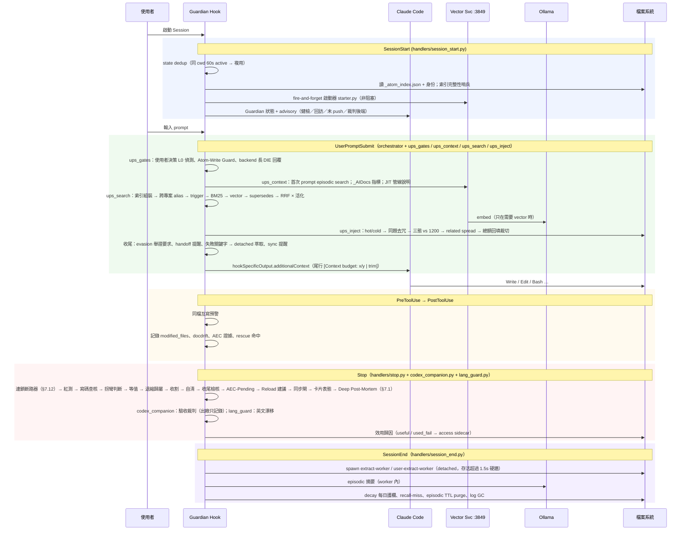
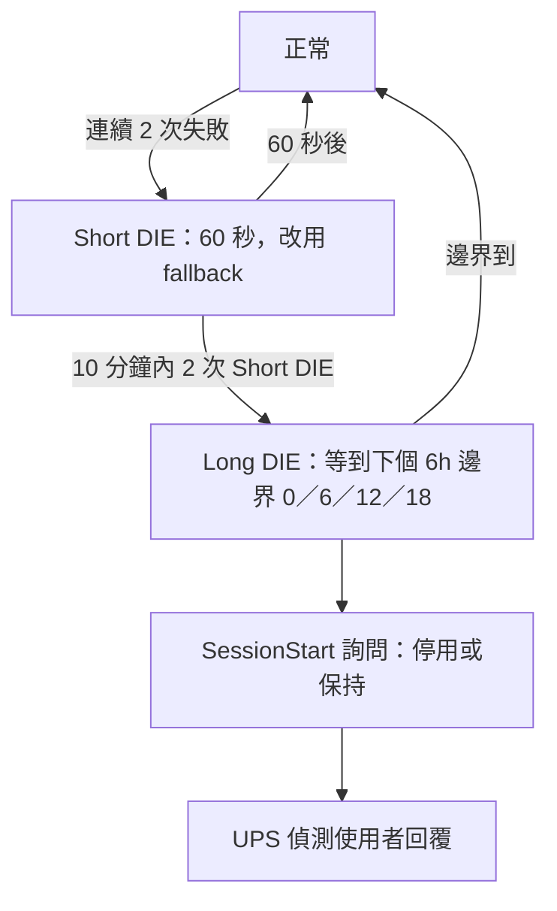
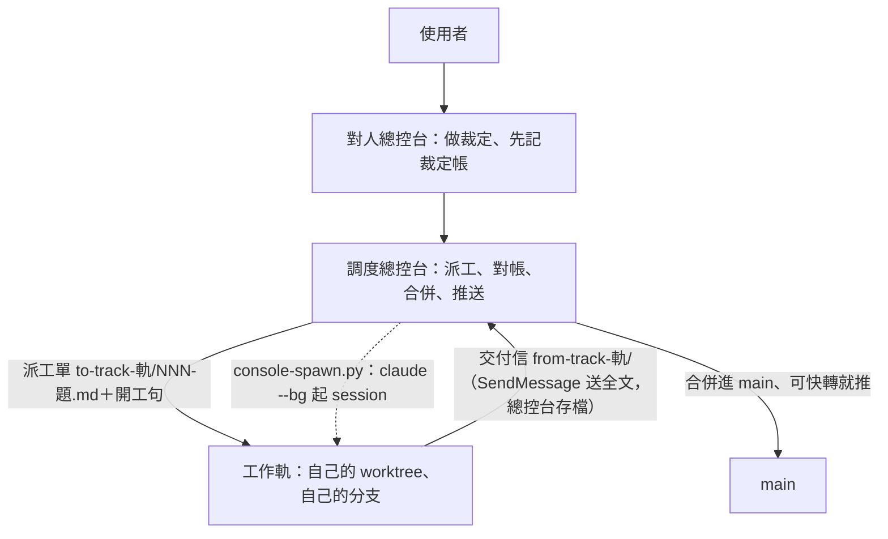

# 原子記憶系統 — 技術深度文件

> 本文件對應系統**當前代碼實況**；與代碼不符以代碼為準並回報修正。版本標識見 [`version.json`](version.json)。
> 讀者：**人讀為主**（想弄懂這套東西怎麼跑、為什麼這樣設計），**Claude Code 讀來建立自我認知為輔**。

## 怎麼讀這份文件

- **主文（[§1](#1-設計理念)–[§15](#15-深度參考)）**：每節第一句說這節解決什麼，接著是要點、流程圖、一句話的「為什麼」。第一次讀只讀主文就夠。
- **細節只跳一次**：主文每節結尾的「細節 →」直接連到那一節的細節，不做「A 見 B、B 見 C」。細節放在：
  - 本檔底部〈附錄〉：[§1](#1-設計理念)–[§6](#6-寫入與積累)、[§8](#8-可觀測與自我維護)、[§9](#9-背景服務與介面)、[§11](#11-流程與耗損token-與延遲)、[§13](#13-團隊協作與大型專案)、[§14](#14-版本歷史與已停產機制) 的細節
  - [TECH/guards.md](TECH/guards.md)：[§7](#7-守門與收尾) 守門與收尾的細節
  - [TECH/release-rules.md](TECH/release-rules.md)：[§7.8](#78-放行欠帳判定規則hookswg_release_rulespy) 放行／欠帳判定規則全表
  - [TECH/config.md](TECH/config.md)：[§12](#12-設定總表workflowconfigjson) 設定總表與功能開關
  - [TECH/file-tree.md](TECH/file-tree.md)：[§10](#10-架構目錄樹) 架構目錄樹
- **只想知道 AI 寫程式時一路會被問什麼、擋什麼** → 直接讀 [§7.0](#70-寫程式時一路會遇到什麼總覽)。
- **路徑可以點**：反引號裡的 repo 路徑都連到檔案本身（GitHub、GitLab 都適用）。執行期才產生、不進版控的路徑（`Logs/`、`workflow/state-<sid>.json` 這類）與帶佔位符的路徑（`{project}/…`、`<sid>`）沒有連結。

### 系統的兩層

這套系統分兩層，開關各自獨立。把「寫碼守門」關掉不會關掉記憶系統。

| 層 | 做什麼 | 開關 | 關掉會怎樣 |
|---|---|---|---|
| 記憶系統本體與基本守門 | 記憶注入、寫入、收割、晉升、版控同步、向量檢索；口令、隱私、同步提醒、舊版紅測閘 | `enabled`，出廠開 | 整個 Guardian 停，所有 hook 直接放行 |
| 寫碼守門 | 寫程式時的檢查：宣告閘、寫碼查核、拐彎判斷、等值證法、病形閘、連鎖斷路器 | `coding_guard.enabled`，出廠關；開了也只在寫碼回合啟動 | 只少這一層，記憶系統照跑 |

- 守門關著時哪些照跑、哪些不跑的逐項清單：[§7](#7-守門與收尾) 開頭〈守門總開關〉。
- 開發期文件與程式裡的「v6」就是寫碼守門的舊代稱（舊鍵 `v6`、環境變數 `WG_V6` 仍相容）。

## 目錄

- [1. 設計理念](#1-設計理念)
  - [1.1 使用者最高原則](#11-使用者最高原則)
  - [1.2 六原則](#12-六原則)
  - [1.3 治理鐵律（rules/core.md）](#13-治理鐵律rulescoremd)
- [2. 與 Claude Code 原生／與業界的差異](#2-與-claude-code-原生與業界的差異)
  - [2.1 與 Claude Code 原生記憶](#21-與-claude-code-原生記憶)
  - [2.2 與業界主流（Zep／Mem0／Mastra／claude-mem 等）](#22-與業界主流zepmem0mastraclaude-mem-等)
- [3. 一個回合發生什麼](#3-一個回合發生什麼)
  - [3.1 settings.json 十一個事件](#31-settingsjson-十一個事件)
  - [3.2 序列圖](#32-序列圖)
- [4. 記憶資料層](#4-記憶資料層)
  - [4.1 atom 卡片格式](#41-atom-卡片格式)
  - [4.2 分類階層（core realm）](#42-分類階層core-realm)
  - [4.3 realm：core vs local](#43-realmcore-vs-local)
  - [4.4 四層 scope](#44-四層-scope)
  - [4.5 索引：JSON 單一真相](#45-索引json-單一真相)
  - [4.6 專案層](#46-專案層)
  - [4.7 原生記憶橋接](#47-原生記憶橋接)
- [5. 檢索與注入（每 prompt）](#5-檢索與注入每-prompt)
  - [5.1 管線逐段](#51-管線逐段)
  - [5.2 深度解說：每個設計的意義](#52-深度解說每個設計的意義)
  - [5.3 關鍵常數總表](#53-關鍵常數總表)
  - [5.4 各檢索路並排比較](#54-各檢索路並排比較)
  - [5.5 降級策略](#55-降級策略)
  - [5.6 回歸評估集](#56-回歸評估集)
  - [5.7 其他注入來源（同一 additionalContext）](#57-其他注入來源同一-additionalcontext)
  - [5.8 讀取端 memory_search 與 atom_source（給其他 AI 與腳本）](#58-讀取端-memory_search-與-atom_source給其他-ai-與腳本)
- [6. 寫入與積累](#6-寫入與積累)
  - [6.1 顯式寫入：atom_write（MCP）](#61-顯式寫入atom_writemcp)
  - [6.2 write gate 評分與去重](#62-write-gate-評分與去重)
  - [6.3 自動萃取：在跑 vs 已停產](#63-自動萃取在跑-vs-已停產)
  - [6.4 晉升／降級／decay](#64-晉升降級decay)
  - [6.5 壞滅緣、證據等級、衝突裁決](#65-壞滅緣證據等級衝突裁決)
  - [6.6 會議轉錄入庫：tools/meeting-transcribe.py](#66-會議轉錄入庫toolsmeeting-transcribepy)
- [7. 守門與收尾](#7-守門與收尾)
  - [7.0 寫程式時一路會遇到什麼（總覽）](#70-寫程式時一路會遇到什麼總覽)
  - [7.1 Stop 閘序](#71-stop-閘序)
  - [7.2 反退避（Anti-Evasion）](#72-反退避anti-evasion)
  - [7.3 擋滿之後怎麼放行（hooks/wg_release.py）](#73-擋滿之後怎麼放行hookswg_releasepy)
  - [7.4 驗收裁判：AI 審查 AI 產出（四段閉環）](#74-驗收裁判ai-審查-ai-產出四段閉環)
  - [7.5 其他守門](#75-其他守門)
  - [7.6 寫碼守門：部位導讀卡（OverviewHub）](#76-寫碼守門部位導讀卡overviewhub)
  - [7.8 放行／欠帳判定規則（hooks/wg_release_rules.py）](#78-放行欠帳判定規則hookswg_release_rulespy)
  - [7.11 文字規格評分（G15，tools/text-score.py）](#711-文字規格評分g15toolstext-scorepy)
  - [7.12 連鎖斷路器（hooks/wg_chain.py 判定、lib/chain_store.py 帳與快照）](#712-連鎖斷路器hookswg_chainpy-判定libchain_storepy-帳與快照)
- [8. 可觀測與自我維護](#8-可觀測與自我維護)
- [9. 背景服務與介面](#9-背景服務與介面)
  - [9.1 Ollama Dual-Backend 三階段退避（tools/ollama_client.py）](#91-ollama-dual-backend-三階段退避toolsollama_clientpy)
  - [9.2 外部依賴：用途、替代、缺了會怎樣](#92-外部依賴用途替代缺了會怎樣)
  - [9.3 MCP 註冊（hooks/ensure-mcp.py）](#93-mcp-註冊hooksensure-mcppy)
  - [9.4 Vector Service 的啟動與手動操作](#94-vector-service-的啟動與手動操作)
  - [9.5 安裝與升級（tools/install.py）](#95-安裝與升級toolsinstallpy)
  - [9.6 疑難排解與手動抽查](#96-疑難排解與手動抽查)
- [10. 架構目錄樹](#10-架構目錄樹)
- [11. 流程與耗損（Token 與延遲）](#11-流程與耗損token-與延遲)
  - [11.1 實測紀錄：hook 全關對全開](#111-實測紀錄hook-全關對全開)
  - [11.2 寫碼守門的減量原則](#112-寫碼守門的減量原則)
  - [11.3 Token Budget（wg_core.compute_token_budget）](#113-token-budgetwg_corecompute_token_budget)
- [12. 設定總表（workflow/config.json）](#12-設定總表workflowconfigjson)
  - [12.1 功能開關（不想要某個功能時逐鍵關）](#121-功能開關不想要某個功能時逐鍵關)
- [13. 團隊協作與大型專案](#13-團隊協作與大型專案)
  - [13.1 USER／IDENTITY 分離](#131-useridentity-分離)
  - [13.2 專案自治層](#132-專案自治層)
  - [13.3 大型計畫](#133-大型計畫)
  - [13.4 多 session 協作：雙總控台與工作軌](#134-多-session-協作雙總控台與工作軌)
- [14. 版本歷史與已停產機制](#14-版本歷史與已停產機制)
  - [14.1 版本表](#141-版本表)
  - [14.2 已停產／除役機制](#142-已停產除役機制)
- [15. 深度參考](#15-深度參考)
- [附錄](#附錄)

---

## 1. 設計理念

這一節回答：這套系統為什麼存在、做取捨時照哪幾條原則。

### 1.1 使用者最高原則

LLM 的 context window 是**工作記憶**，天生沒有**長期記憶**。這套系統要做到的是：

| 原則 | 白話 | 落地在哪 |
|------|------|---------|
| 全積累 | 值得記的知識一顆都不漏，且不刪只歸檔 | atom 卡片 + `_distant/` 封存 + JSONL 審計 |
| 分門別類 | 每顆知識有明確範疇，分不出就不准寫 | Lv1 閉合清單 [`memory/_meta/taxonomy.json`](memory/_meta/taxonomy.json) + 寫入閘 `domain` 必填 |
| 高精準零浪費 | 只注入這一句真正需要的知識，不塞、不重複、不截成廢紙 | trigger/BM25/vector 三路 RRF + 預算三閘 + 同題去冗 |
| 跨 session | 上個 session 學到的，下個 session 自動帶著 | 每 prompt hook 注入 + episodic 摘要 + 回訪機制 |
| 自動分層 | 用過有效就升、久沒用就淡出，人不用手動整理 | [臨]→[觀]→[固] 效用 Wilson 晉升 + ACT-R 活化衰減 |
| 分使用者 | 我的偏好是我的，專案共識是專案的 | 四層 scope（global / shared / role / personal） |

### 1.2 六原則

| # | 原則 | 實際展現 |
|---|------|---------|
| 1 | **精確度 > Token 節省** | 寧多注入確保正確；預算閘裁切時「回填」而非整塊丟 |
| 2 | **漸進式信任** | `[臨]`→`[觀]`→`[固]`，靠效用統計晉升，不靠人工拍腦袋 |
| 3 | **最小侵入** | 全走 Claude Code hooks（11 個事件）+ MCP tool，主程式零修改 |
| 4 | **雙 LLM 分工** | Claude 做決策；本地 Ollama 做萃取、分類、embedding 與文字評分裁判（[§7.11](#711-文字規格評分g15toolstext-scorepy)） |
| 5 | **可審計** | JSONL audit trail 全程記錄；知識只歸檔不刪 |
| 6 | **對齊原生** | 採 skills / MCP / hooks / auto-memory 原生機制，自製只做原生做不到的部分 |

- 原則 4 用的本地模型：萃取、分類用 gemma4:e4b／qwen3:1.7b，embedding（把文字變成可比對的向量）用 qwen3-embedding。
- hook 指 Claude Code 在特定時刻自動呼叫的外掛程式；MCP tool 指 Claude 可主動呼叫的外部工具。

### 1.3 治理鐵律（`rules/core.md`）

- **Native-first**：原生機制優先；自製只做「結構化 · 可稽核 · 跨 session 高價值」的事。
  - 過度工程的正解是誠實化＋修剪，不是推倒重來。
- **可觀測性鐵律**：所有 fail-open（出錯時放行）「不阻斷但要告知」。
  - 降級／靜默失敗必浮出訊號：stderr、advisory、收尾報告、statusline。
  - 不得無聲吞掉。
  - 反例是向量服務曾靜默死 27 天沒人知道。

---

## 2. 與 Claude Code 原生／與業界的差異

這一節回答：已經有 Claude Code 原生記憶和業界產品，為什麼還要自己做、差在哪。

### 2.1 與 Claude Code 原生記憶

| 面向 | Claude Code 原生 | 原子記憶系統 | 差異的意義 |
|------|------|------|------|
| 真源 | MEMORY.md + 自由 md | atom 卡片 + 機器索引 | 有索引、有欄位才能程式化檢索與晉升 |
| 跨專案 | 無，綁 project slug | 全專案注入通用知識 | 通用踩坑不必每專案重學 |
| 載入方式 | 啟動載 MEMORY.md 前段 | 每個 prompt 主動挑選注入 | 主動注入對治「有存無用」 |
| 檢索 | 無 | trigger → BM25 → vector → RRF × 活化 | 模型不必自己想起要讀哪個檔 |
| 品質分級 | 無 | [臨]/[觀]/[固] + Wilson 晉升 | 未驗證猜測不與已驗證事實平起平坐 |
| 回饋迴路 | 無 | access sidecar、rescue-log 等 | 知道哪顆記憶真的被用到 |
| 接點 | — | 核心 atom 索引鏡像進原生目錄 | 原生找得到 atom，且不違反 200 行硬牆 |
| Hook 硬牆 | UPS 預設 30s；SessionEnd 共 1.5s | UPS 實設 8s；LLM 萃取走 detached worker | 60s 上限貼著本地 LLM 耗時，detached 不受預算左右 |

- 原生規格查證版：[`_AIDocs/ClaudeCodeInternals/cc-native-memory-hooks-mcp.md`](_AIDocs/ClaudeCodeInternals/cc-native-memory-hooks-mcp.md)。
- 縮寫：UPS＝UserPromptSubmit；atom 指一張記憶卡片（一個 .md 檔）。

細節 → [附錄 A2.1](#a21-與-claude-code-原生記憶各面向細節)

### 2.2 與業界主流（Zep／Mem0／Mastra／claude-mem 等）

| 面向 | 業界主流 | 原子記憶系統 | 評語 |
|------|------|------|------|
| 檢索 | hybrid BM25+vector+RRF 為共識 | 同款三路 RRF；rerank 不進 hook | 方向一致；rerank 實測後不做 |
| 新鮮度 | 決定性規則勝 LLM 判斷 | `supersedes` 規則式過濾 | 符合 |
| 注入 | 每 prompt ≤6 條、單一干擾項即傷精度 | per-turn 硬頂 1200 tok、同題去冗 | 符合 |
| 積累 | 原文勝萃取物 | 策展 `atom_write` 為主，每顆帶 `- Source:`／`- Quote:` | 已補：原文可回看 |
| 信任 | 多數產品無分級 | 三級 + Wilson | 領先 |
| 回饋 | 多數只有「存了多少」 | 有「用了多少」 | 領先 |
| 部署 | 多數雲端 API | 全本地：Ollama + LanceDB | 無 OAuth／連線故障類問題 |
| prompt cache | Mastra 固定前綴達 SOTA | 注入段變動，前綴仍命中 | 影響限於注入段本身 |

- RRF（把幾路排名合成一個排名的公式）；rerank（拿檢索結果再逐條重新打分排序）。
- **為什麼 rerank 不進 hook**：實測只抬 R@1 +3.4 點、R@3 反降、每句 +1.2 s，收益在前三名內換序。完整數據見附錄。
- 業界調查全文：[`_AIDocs/Research/agent-memory-industry-survey.md`](_AIDocs/Research/agent-memory-industry-survey.md)。
- 三方比對與優缺點判讀：[`_AIDocs/DevHistory/檢視與審查/memory-system-review-2026-08.md`](_AIDocs/DevHistory/檢視與審查/memory-system-review-2026-08.md)。

細節 → [附錄 A2.2](#a22-與業界主流各面向細節)

---

## 3. 一個回合發生什麼

這一節回答：你打一句話到 Claude 回完，背後哪些程式在什麼時刻跑、各做什麼。

### 3.1 settings.json 十一個事件

settings.json 掛了 11 個 hook 事件。每個事件觸發時，由 guardian（主 hook 程式 `workflow-guardian.py`）等腳本接手。

| 事件 | 什麼時候觸發 | 主要做什麼 |
|------|------|------|
| SessionStart | 開 session | 還原身份、建 state、拉取同步、出 advisory |
| UserPromptSubmit | 送出 prompt | **記憶注入主路徑**（[§5](#5-檢索與注入每-prompt)）＋各種 guard 提醒 |
| PreToolUse | 工具執行前 | 各種「改檔前／commit 前」的閘；派子代理時注入記憶 |
| PostToolUse | 工具執行後 | 記錄改檔與讀檔、驗證收據、AEC 證據蒐集 |
| PostToolUseFailure | Bash／PowerShell 失敗後 | 失敗指令的改檔與紅測照樣入帳，只記帳不擋 |
| PreCompact／PostCompact／PostToolBatch | 壓縮前後、一批工具結束 | 存 handoff stub、壓縮後重注入 atom、批次提醒 |
| Stop | Claude 回完一則 | 依序跑紅測、寫碼查核等收尾閘 |
| SubagentStop | 子代理收尾 | 只跑寫碼查核 |
| SessionEnd | 關 session | spawn 萃取 worker、episodic 生成、decay、log GC |

各事件的 matcher、hook 與 timeout、完整職責 → [附錄 A3.1](#a31-settingsjson-十一個事件各事件細節)。

#### hook 指令型式

- Python hook：`"$LOCALAPPDATA/Python/bin/pythonw.exe" -c "import runpy...run_path(~/.claude/hooks/xxx.py)"`。
- bash 類 hook（[`user-init.sh`](hooks/user-init.sh)、[`webfetch-guard.sh`](hooks/webfetch-guard.sh)）：`pythonw.exe "$HOME/.claude/hooks/run-bash-hidden.py" xxx.sh`。
- statusLine：`python.exe` 直接跑 [`tools/statusline.py`](tools/statusline.py)。
- Claude Code 在 Windows 用 Git Bash 跑 hook 與 statusLine 指令。
  - `$VAR`／`~` 會展開，`%VAR%` 不展開（實測）。
  - settings.json 因此不帶機器專屬路徑。
- Python 不在該位置的機器：跑 [`python tools/fix-hook-python.py --write`](tools/fix-hook-python.py)，仍以 `$LOCALAPPDATA/…`／`$HOME/…` 形式寫入。

#### hook 分派流程

```text
settings.json 的 hooks 區塊（真源）
  → workflow-guardian.py（1 行 shim）
  → hooks/dispatcher.py（開頭起表、結尾落帳：分段計時與超時降級，§7.1 表下）
  → hooks/handlers/{event}.py（9 個檔接 11 個事件）

bash 類 hook：
  settings.json → hooks/run-bash-hidden.py → xxx.sh

分支：
  ├─ 裁判子 session（環境變數 CLAUDE_COMPANION_JUDGE=1）
  │    → 走縮減版 JUDGE_HANDLERS（不注入記憶、不跑其他閘）
  └─ 守門總開關關著（出廠，見 §7 開頭）
       → 不分派寫碼守門才有的事件與工具

安裝時：tools/install.py 把 hooks 區塊合併進使用者的 settings.json（§9.5）
```

- 9 個 handler 檔接 11 個事件，有兩個合併對應：
  - PostToolUseFailure 走 [`post_tool_use.py`](hooks/handlers/post_tool_use.py)（[`handlers/post_tool_use.handle_post_tool_use_failure`](hooks/handlers/post_tool_use.py)）。
  - SubagentStop 走 [`stop.py`](hooks/handlers/stop.py)。
- 裁判子 session 的 `JUDGE_HANDLERS` 只留三塊：
  - PreToolUse：寫入目標判不出的指令留帳。
  - PostToolUse／PostToolUseFailure：最小記帳。
  - Stop：只跑寫碼查核。
- 守門總開關關著時，dispatcher 不分派：
  - 寫碼守門才有的事件：PostToolUseFailure、SubagentStop。
  - 寫碼守門才掛的工具：Read、AskUserQuestion…。
  - 裁判子 session 也一律早退。

#### session state 讀寫（規則 STATE_RMW_LOCKED）

**為什麼需要鎖**：同一則回覆平行送出的工具呼叫、共用 session_id 的子代理，會同時起好幾支 hook 讀改寫同一份 `workflow/state-<sid>.json`，不鎖會互相蓋掉。

```text
hook 進 handler 前開 hook 模式（begin_state_rmw）
  → 第一次讀某 session 的 state 就拿鎖 state-<sid>.lock
  → 讀 → 改 → 寫（序號 event_seq 也在鎖裡配）
  → handler 結束放鎖（end_state_rmw）

等不到鎖（超過期限）：
  → 照讀沒上鎖的那份讓閘照判
  → 寫回改留待併帳 state-<sid>.<時間>-<pid>.pending（不無鎖寫、不整份覆蓋）
  → 下一支拿到鎖的行程讀 state 前照時間先後併回、刪帳（STATE_PENDING_MERGED）
```

- 實作在 [`hooks/wg_core.py`](hooks/wg_core.py) 的 State File I/O 段；檔是緊湊 JSON，每行程 tmp 唯一＋`os.replace` 換檔，檔永遠是某一方的完整 JSON。
- 等鎖最多等到 hook 上限的一半（起點＝行程建立）；PostToolUse 上限 5 秒就是 2.5 秒，剩下一半留給 handler 跑完與超時降級。
- 留帳只記「跟基準比改了哪些鍵、改前、改後」；一次最多併回 20 份。
- hook 以外的寫者也守同一把鎖：背景萃取 worker、MCP 伺服器儀表板的 signal 端點，都走 [`lib/state_rmw.update_state_locked`](lib/state_rmw.py)，期限 2 秒。
- 沒進 hook 模式的寫者（測試、工具）寫回時才拿鎖，最多等 2 秒；鎖裡發現檔被別人換過就做三方合併（集合取聯集、計數相加等分型規則）。
- 量測結論：平行 10 支 PostToolUse 最慢一支約 1.2 秒（上限 5 秒的 23%）；別人握鎖 3.5 秒時全部在 2.5 秒期限留帳，下一支併回後紀錄 0 筆掉。

細節（合併分型規則、待併帳細節、stub、fallback、量測數據、案例檔）→ [附錄 A3.1](#a31-settingsjson-十一個事件各事件細節)

### 3.2 序列圖



---

## 4. 記憶資料層

這一節回答：一條知識存成什麼樣子、放在哪、誰看得到。

### 4.1 atom 卡片格式

一顆 atom（一張記憶卡片）= 一個 `.md` 檔，檔名即 slug（[`lib/atom_spec.py slugify`](lib/atom_spec.py)）。

- 頭部：metadata 條列（欄位見下表）。
- 正文：`## 知識` / `## 行動`，可有 `## 印象`。

| 欄位 | 必填 | 一句用途 |
|------|------|---------|
| `Scope` | 是 | 可見範圍（[§4.4](#44-四層-scope)） |
| `Confidence` | 是 | 信任等級 `[固]`／`[觀]`／`[臨]`；注入時 [固]／[觀] 優先保留 |
| `Trigger` | 是 | 逗號分隔關鍵字，檢索主路（[§5.1](#51-管線逐段)） |
| `Author` | 否 | 提出者帳號（[§13.1](#131-useridentity-分離)） |
| `Source` | 否 | 來源可追溯（session／commit／自由值） |
| `Quote` | 否 | 觸發這張卡片的使用者原話（單行 ≤200 字） |
| `Related` | 否 | 連出去的其他 atom；只寫自己連出去的 |
| `Aka` | 否 | 這顆用過的舊檔名，舊連結照樣解析 |
| `Supersedes` | 否 | 被取代的 atom 名，規則式過濾舊版 |
| `Depends` | 否 | 壞滅緣：`path:<路徑>` 消失 → 標 stale；也反向召回 |
| `Entry` | 否 | 判準卡標記：這顆對應哪幾個切入點代號（[§7 代號](#代號)）；綁了的卡留在 core（[§4.3](#43-realmcore-vs-local)） |
| `Evidence` | 否 | `實證`／`引述`／`推測`，衝突裁決權重 3／2／1 |
| `Status`／`Audience`／`Created-at`／`Pending-review-by`／`Merge-strategy`／`Decided-by` | 否 | 狀態、受眾、建立日、待審裁決與合併策略 |
| `Expires-at`／`Tags`／`Quality` | 否 | 輔助 |
| access sidecar | 自動 | `<atom>.access.json`，放每回合在變的使用計數 |

#### Source／Quote／Depends 的 replace 三態

replace（整張覆寫）時，這三個欄位（與 `Supersedes` 同）依呼叫者給的值分三種：

| 呼叫者給的值 | 結果 |
|-------------|------|
| 未給 | 保留原行 |
| `""` 或 `[]` | 清除 |
| 非空 | 替換 |

- replace 只換呼叫者給的部分，其餘檔頭欄位原樣帶回。
- append 只有在呼叫者明給 `provenance`／`quote` 時才改 Source／Quote 那一行。

#### 為什麼這樣設計

- **為什麼反向連結不落檔**：把反向連結也寫進被連的檔，多人共用同一個版控庫時必衝突；索引只存正向，注入端讀進來反轉。
- **為什麼 Depends 與 Evidence 都是 optional**：向後相容鐵則，既有 atom 缺欄靜默通過。
- **為什麼 access 是 sidecar 不是 frontmatter**：計數每回合都在變，寫進 atom 本體會讓 git diff 全是噪音、也會和人手編輯互撞。

細節 → [附錄 A4.1](#a41-atom-卡片格式)

### 4.2 分類階層（core realm）

- 核心 atom 只住 `memory/<Lv1>/[<Lv2>/]`，根下**不容平鋪**（`sync-memory-index --check` 直接 exit 1）。
- Lv1 是**閉合清單**（[`memory/_meta/taxonomy.json`](memory/_meta/taxonomy.json) `core` 節）：版控 / 工作流 / 思考與決策 / 驗證與實證 / dotnet / OS-Windows / 文字與格式 / 設計通則 / 行為契約 / CC與原子記憶契約。
- 別名（如 `vcs/git`）自動 snap 回正名。
- 失敗家族 `memory/Failures/<主題>/`：放 feedback-* 與失敗模式 atom；主題沿用同一套 Lv1 名。
- 每層有自動生成的 `_INDEX.md`；[`memory/MEMORY.md`](memory/MEMORY.md) 只列 Lv1 目錄。

**為什麼 MEMORY.md 只列 Lv1 目錄**：它每 session always-load（行數上限 40），列到 Lv1 只有約 20 行、約 300 tok，atom 再多也不長胖；真正的檢索靠 trigger／BM25，不靠模型讀目錄。

**為什麼分不出範疇就拒寫**：沒有「其他／未分類」桶，否則懶得分的東西都會掉進去、範疇形同虛設；拒寫逼寫手當下決定它屬於哪裡。

細節 → [附錄 A4.2](#a42-分類階層core-realm)

### 4.3 realm：core vs local

realm 決定一張卡「全專案都看得到」還是「只在 `~/.claude` 開發記憶系統時才看得到」。

| | core | local |
|--|------|-------|
| 物理位置 | `memory/<範疇>/`、`memory/Failures/<主題>/` | `_AIDocs/_atoms/<domain 多段路徑>/` |
| 注入範圍 | 全專案 | 只在 cwd ∈ ~/.claude 時 |
| 該放什麼 | 任何專案的 AI 都用得到 | 記憶系統開發、本機特定 |
| 目錄 | [`memory/MEMORY.md`](memory/MEMORY.md) | [`memory/_local_catalog.md`](memory/_local_catalog.md) |

- 兩者共用同一份 [`_atom_index.json`](memory/_atom_index.json)，Scope 欄都是 global（realm 由索引 path 前綴推導，不存欄位）。
- 分類器：[`lib/atom_locations.classify_realm`](lib/atom_locations.py)（決定性詞庫；LLM fallback 預設關）。

**判定三問**：
- 別的專案會碰到嗎？→ core。
- 只有在改記憶系統本身時才用到？→ local。
- 分不出？→ 先 `dry_run`。

看知識段的判準或通則，不看實例；拿不準就放 core。

#### 程式怎麼自動判

只看卡名與 trigger、不看知識內文；建卡時（scope=global、沒給 realm、不是 feedback 路由）與 SessionEnd 的 realm 自動搬移掃描都用它。

```text
卡名命中核心保護清單？（decisions、workflow-、feedback-、atom- 等前綴與精確名單）
  是 → core，永不搬、永不喚 LLM
  否 → 實例詞庫計分（卡名權重大於 trigger）
        命中 local 詞 → local
        沒命中        → core（安全預設）
```

#### 綁 Entry 的卡不自動搬

有名規則 `ENTRY_BOUND_STAYS_CORE`（判定只在 [`lib/atom_locations.entry_bound_ids`](lib/atom_locations.py)）：檔頭 `- Entry:` 非空的卡是判準卡（判 AI 做得對不對的量尺），每個專案都用得到，所以留在 core。

- SessionEnd 自動搬移：遇到本來要照詞庫搬、或要喚 LLM 的卡，改成不搬、不喚，留帳 `memory/_meta/atom_io_audit.jsonl`（`op=realm_hold`）。
- 建卡：`atom_write` create 帶 `entry` 而卡名命中 local 詞時，照樣落 `memory/<範疇>/`。
- 手動 [`atom-set-realm.py set --domain`](tools/atom-set-realm.py) 與 [`atom-categorize.py apply`](tools/atom-categorize.py) 的 `local:` 對映照搬不擋，只警告。

#### 判準卡的建卡出口

- 只能從 MCP `atom_write`（create／replace 帶 `entry`）或 `atom_edit_meta`（改 `entry`）建立或綁定。
- 自動萃取走的 py `write_atom` 不收 `entry`，機器萃取不會自己長出判準卡。

細節 → [附錄 A4.3](#a43-realmcore-vs-local)

### 4.4 四層 scope

scope 決定一張卡「誰看得到」。

| 層 | 誰看得到 | 放什麼 | 在哪 |
|----|---------|-------|------|
| `global` | 跨專案、跨人 | 個人偏好、通用工具決策 | `~/.claude/memory/<範疇>/` |
| `shared` | 同專案全員 | 專案共識、架構決策、踩坑 | `{project}/.claude/memory/shared/<Lv1>/` |
| `org` | 公司全員、所有專案 | 公司級工具卡、跨專案共識 | `<org_root>/.claude/memory/shared/<Lv1>/` |
| `role:{name}` | 同職務者 | 職務專有規範 | `{project}/.claude/memory/roles/<role>/` |
| `personal:{user}` | 只自己 | 個人 scratch、未公開假設 | `{project}/.claude/memory/personal/<user>/` |
| `personal:{user}`（跨專案） | 只自己，每個專案都看得到 | 本人跨專案偏好 | `~/.claude/memory/personal/<user>/` |

#### global
- 另含 local realm（[§4.3](#43-realmcore-vs-local)）。

#### shared
- feedback-* 落 `failures/<主題>/`。

#### org
- `org` 是 MCP／CLI **語法糖**＝「指定根的 shared」：js 改寫成 `scope=shared + project_cwd=org_root`，檔內仍 `Scope: shared`。
- 「這台接上沒、根在哪」各機自己記在本機狀態檔 `workflow/org-memory.local.json`（不進版控）。
- 使用者入口：`/org` skill（join／status／scan，或直接用講的）。
- 新機器：[`python tools/org-memory.py --join [<root>]`](tools/org-memory.py)；對帳：`--status`；工具卡：`--scan-tools`。
- 公司層寫入有範疇閘：內容含專案名或專案路徑就擋（[`lib/realm_gate.check_org_write`](lib/realm_gate.py)）。

接入流程（SessionStart 每次依狀態給一種訊息）：

```text
SessionStart（session_start._org_advisory）
  ├─ 已接上
  │    ├─ 索引完整 → [Org] 公司層 N 顆（<root>）
  │    └─ 索引缺檔 → [Org] 公司層索引缺檔：…（請在該 repo 跑 sync-atom-index）
  ├─ 接過但本機 checkout 不見 → [Org] 公司層記憶尚未接上…
  └─ 沒接上、使用者也還沒回答過、共用 config 有 repo_url
       → ❓ [Org] 指示（每個 session 都出，直到使用者答了）
          → 模型第一則回覆前用 AskUserQuestion 問：預設路徑／指定路徑／先不接
             ├─ 預設或指定路徑 → 跑 --join [路徑]
             └─ 先不接         → 跑 --decline（declined＝不再問）
          答案記在本機檔
```

#### role
- 職能由 AD 群組自動解析（[§13.1](#131-useridentity-分離)）。

#### personal
- 專案內的 personal **進專案版控**（多機才同步）；注入過濾只決定模型搜不搜得到、不是保密，敏感內容不放。
- 跨專案 personal 落 `~/.claude/memory/personal/<user>/`（gitignore）；`atom_write(scope=personal, cross_project=true)` 或從 ~/.claude 寫入即落此。

#### personal 與 shared 的分界
- 「針對專案的規則」就落 shared，`Author:` 記提出者（自動萃取亦同）。
- 只命中「此專案／上傳／發布／必須／禁止」這類線索詞不定案：萃取先落 personal 並留帳 `guard-scope_hint`，由人判（規則 [PROJECT_RULE_WORDS_ARE_HINTS](TECH/release-rules.md#project_rule_words_are_hints)）。
- personal 只留真正的個人偏好。

#### 讀取端候選池

`wg_atoms.build_candidate_pool(cwd, user, roles, org_root=)`：SessionStart 建一次存 state，trigger／BM25／vector／related／AtomAudit 與 [`lib/memory_search`](lib/memory_search.py) 共用。

```text
進池                                       不進池
├─ global                                  ├─ 他專案任何層
├─ 本人跨專案 personal                      ├─ 他人 personal／role
├─ 公司層 org                              └─ user=unknown 時任何 personal
│    （config 啟用，且 cwd 的專案根不是 org 根）
├─ 本專案 shared（含 failures）
├─ 本人 roles
└─ 本人 personal

同名衝突優先序：project > org > global（先到先贏，被遮蔽者列進 memory_search 的 warnings）
```

#### 現況與身份契約
- global／shared／personal 三層已在多人專案實戰（一個 git 庫 2 人以上、一個 svn 庫 4～5 人）。
- roles 層靠 AD 群組自動解析，尚無專案放 `roles/<r>/` atom；`_roles.md` 純登記、程式不讀。
- **身份契約**：`Author`＝`wg_roles.get_current_user()`（`CLAUDE_USER` → OS／AD 帳號；取不到＝`unknown`，不讀任何 personal）。
- 裁決資格＝config `review.deciders`，空即全員。

細節 → [附錄 A4.4](#a44-四層-scope)

### 4.5 索引：JSON 單一真相

- [`memory/_atom_index.json`](memory/_atom_index.json) 是唯一機器源（API：[`lib/atom_index_json.py`](lib/atom_index_json.py)）；[`_ATOM_INDEX.md`](memory/_ATOM_INDEX.md) 是自動生成 mirror，只給 fallback parser。
- 每筆：`name`／`path`／`triggers`／`scope`（realm 由 path 推導）。
- 三個根（[`lib/project_root.py`](lib/project_root.py)）：資料根、程式碼根、Claude Code 設定目錄；工具讀資料一律問資料根，不寫死 `~/.claude`。
- 寫入 funnel：[`lib/atom_io.py write_atom`](lib/atom_io.py) → upsert index → [`tools/sync-memory-index.py --write`](tools/sync-memory-index.py) 重生各層 `_INDEX.md`、[`MEMORY.md`](memory/MEMORY.md)、[`_local_catalog.md`](memory/_local_catalog.md)、[`memory/_by_language/_INDEX.md`](memory/_by_language/_INDEX.md) → 尾端自動重產原生橋接檔並同步文件計數 marker。
- 依程式語言篩選：資料夾只按問題類型分，語言是跨範疇視圖 [`memory/_by_language/_INDEX.md`](memory/_by_language/_INDEX.md)，一張卡可屬多個語言。
- 現況計數：共 <!-- atom-total -->713<!-- /atom-total --> 張＝core <!-- atom-core -->406<!-- /atom-core --> ＋ feedback <!-- atom-feedback -->77<!-- /atom-feedback --> ＋ 失敗模式 <!-- atom-failmode -->2<!-- /atom-failmode --> ＋ local <!-- atom-local -->228<!-- /atom-local -->（數字由標記自動同步，勿手改）。

#### 多機合併的三層防線

索引三檔（[`MEMORY.md`](memory/MEMORY.md)／[`_ATOM_INDEX.md`](memory/_ATOM_INDEX.md)／[`_atom_index.json`](memory/_atom_index.json)）是「一列一 atom」的集合，兩機各自新增後 git 逐行三方必衝突，所以有三層防線：

```text
第 1 層：全 repo LF（行尾一致，不因換行造成假衝突）
   ↓
第 2 層：tools/merge-atom-index.py 當 git merge driver 做語意三方
          （PreToolUse 在合併類 git 指令前自動 --install）
   ↓ git 仍停住時
第 3 層：--resolve 在 rebase --continue 等指令前自動套在三檔 stage 上
          （SVN：同一支 --resolve 在 svn commit / resolve 前自動解）
```

細節（stage 方向矩陣、CLI 契約、失敗模式 SOP、不在保證範圍）→ [`_AIDocs/MultiMachineMemorySync.md`](_AIDocs/MultiMachineMemorySync.md)。

#### 專案記憶庫衍生檔不入版控
- [`lib/vcs_ignore.py`](lib/vcs_ignore.py) 讓衍生檔（[`_atom_index.json`](memory/_atom_index.json)／[`_ATOM_INDEX.md`](memory/_ATOM_INDEX.md)／`_staging`／`episodic`／`vector-db`）自動進 `svn:ignore`／`.gitignore`。
- 已被版控的檔 ignore 無效，改出 `[Guardian:VcsIgnore]` 一次性告警，不自動執行。
- 根層 `~/.claude/memory` 不在此範圍（仍版控索引、靠合併驅動）。

#### 行尾政策
- 整個 `~/.claude` repo 一律 LF，由 `.gitattributes` 與 `.editorconfig` 保證，不需任何機器安裝。
- 守衛：[`hooks/verify/verify_lf_writes.py`](hooks/verify/verify_lf_writes.py) ＋ [`python tools/normalize-eol.py --root --check`](tools/normalize-eol.py)。

細節 → [附錄 A4.5](#a45-索引json-單一真相)

### 4.6 專案層

- 專案記憶放 `{project}/.claude/memory/`：`shared/<Lv1>/`、`failures/<主題>/`、`personal/<user>/`、`roles/<role>/`、`episodic/`、`_staging/`。
- 專案 [`MEMORY.md`](memory/MEMORY.md) 只 upsert `<!-- atom-catalog -->` 區塊，區塊外逐 byte 不動。
- 專案層判定**單一來源** `wg_core.discover_all_project_memory_dirs`（`memory/project-registry.json` 優先）；不自掃 `projects/*/memory`，那是 CC 原生 auto-memory 目錄。
- 專案自訂 Lv1：`shared/_taxonomy.json`（唯一擴充入口）。
- **子專案 cwd 歸根層**：Claude 開在 `C:\GameA\Server\scripts` 這種子專案時，記憶要歸 `C:\GameA\.claude\memory`，靠各層 `.claude/project-tree.json` 宣告。
- 沒有任何宣告時，行為與原本相同（最近四標記、最多 4 層）。
- hook 只讀宣告檔，增刪改一律 [`tools/project-tree.py`](tools/project-tree.py)。

**多子專案佈局（選配）**：專案根（放 `.claude/memory/` 的那層，例 `C:\GameA`）底下有多個可單獨開啟的子專案（`Client/`、`Server/`、`Tools/`…）時，各層放一份 `.claude/project-tree.json`（進版控），任一方宣告即成立：

```jsonc
// C:\GameA\.claude\project-tree.json（根層列子專案）
{ "subs": ["Server", "Client", "Tools"] }
// C:\GameA\Server\.claude\project-tree.json（子層指回根層；可再列自己的子層）
{ "root": "..", "subs": ["scripts"], "root_abs": "C:\\GameA" }
```

| 欄位 | 意思 |
|---|---|
| `root` | 相對本層的根層路徑，**只准指祖先** |
| `root_abs` | 選填、本機用的絕對路徑；目錄存在時優先，不存在就忽略（多機磁碟代號不同也不報錯） |
| `subs` | 相對本層的子專案前綴；`"*"` 表底下全部 |
| `standalone` | `true` ＝ 本層獨立，不認任何上層、也不再提問 |

- **怎麼設**：在子專案目錄執行 [`python ~/.claude/tools/project-tree.py claim --root C:\GameA`](tools/project-tree.py)，一次寫好根層 `subs` 與子層 `root`（子層沒有 [`.claude/`](.claude/) 就只寫根層，不散落新目錄；`--both` 強制）。
- 其他子指令：`show`（看生效結果）、`explain <cwd>`、`set-root`／`unset-root`、`add-sub`／`remove-sub`、`standalone on|off`、`pick`（彈資料夾視窗選根層）；都支援 `--dry-run`。hook 只讀這些檔，永不自動寫。
- **開 session 會看到什麼**：
  - 認到根層 → `📍 [Guardian:ProjectRoot] <cwd> 屬 <根層> 的子專案（宣告：…）→ 記憶歸 <根層>\.claude\memory`。
  - 上層有記憶層但沒宣告關係 → `❓ [Guardian:ProjectRoot] …`，AI 用選單問一次：認領（推薦）／本層獨立／瀏覽選別的資料夾／這次先不決定。選定後由 AI 跑上面的指令，**重開 session 生效**。
  - 只 checkout 了子專案（上層沒有 [`.claude/`](.claude/)）→ `📍 … 上層未 checkout，記憶留本層`，不是錯誤。
  - 宣告檔壞掉／指錯 → `⚠️ …`，退回沒宣告的行為（最近的 `.claude/memory`／`_AIDocs`／`.git`／`.svn`，最多往上 4 層）。
  - 子專案底下已經長出自己的 `.claude/memory`（分叉）→ `⚠️ … N 顆分叉 atom`，用 MCP `atom_move` 併回根層。
  - 沒有宣告、上層也沒有記憶層 → 一個字都不印。
- **注意**：
  - 宣告檔要跟著專案版控走（git 專案若 `.gitignore` 排除了 [`.claude/`](.claude/)，要放行 `.claude/project-tree.json`；SVN 專案 `svn add`）。
  - 專案根的 `_taxonomy.json`、`_roles.md`、`project_hooks.py` 對子專案 session 一併生效；personal 記憶落根層的 `personal/<user>/`。
  - 子專案 session 的 `.claude/settings.json` 仍只讀 git root 那份（Claude Code 原生規則），本系統不橋接。

**存量專案的 scope 整理**：既有專案的存量（過去自動萃取全落 personal、索引 scope 欄錯標）不會自己歸位。

- 打開尚未整理的專案，SessionStart 出 `[Guardian:ScopeLayout]` 提示。
- 使用者說「整理記憶分類」，AI 走 `/memory classify`（[`tools/classify-project-scope.py plan → 使用者確認 personal 去向 → apply`](tools/classify-project-scope.py)）。
- 完成後打上 `_atom_index.json.layout="scope-v2"` 標記，並把 `.claude/memory/` 變動上該專案版控。

細節 → [附錄 A4.6](#a46-專案層)

### 4.7 原生記憶橋接

- [`tools/native-memory-bridge.py`](tools/native-memory-bridge.py) 把核心 atom 索引鏡像成 `projects/<slug>/memory/atom-index-bridge.md`（CC 原生 auto-memory 目錄）。
- 每行「名稱 → Read 路徑 + trigger」，**只有指標無知識本體**。
- 原生 [`MEMORY.md`](memory/MEMORY.md) 只放一行指向它。

細節 → [附錄 A4.7](#a47-原生記憶橋接)

---

## 5. 檢索與注入（每 prompt）

這一節回答：每次你說話時，系統怎麼從幾百張卡裡挑出這句需要的，又怎麼控制不塞太多。

主檔：
- [`hooks/handlers/ups_search.py`](hooks/handlers/ups_search.py)：找
- [`hooks/handlers/ups_inject.py`](hooks/handlers/ups_inject.py)：裝
- [`hooks/wg_atoms.py`](hooks/wg_atoms.py)：演算法
- [`hooks/wg_core.py`](hooks/wg_core.py)：預算常數

### 5.1 管線逐段

整條管線 15 段，由「找」（1–8）、「分級與裁量」（9–14）、「輸出」（15）組成：

```text
候選池（global + org + 當前專案，依 scope 可見性收窄）
  → 跨專案 alias（只帶他專案 MEMORY.md 目錄）
  → 三路並行：trigger ／ BM25 ／ vector（vector 只在條件成立時打）
  → supersedes（剔除被取代的舊 atom）
  → RRF（把三路排名合成一個排名的公式）
  → 活化調節（activation）
  → hot/cold（全文 或 一行摘要）
  → 同題去冗
  → per-turn 三態（ok 全文／fallback 節錄／skip 一行指標）
  → related spread（沿 Related 走 1 層）
  → Section-Level（長 atom 只注入命中章節）
  → 總額裁切（超支由 activation 高到低回填）
  → 輸出 additionalContext
```

| # | 段 | 做什麼（一句） | 關鍵常數 |
|---|-----|--------|------|
| 1 | 索引組裝 | 取 SessionStart 建好的候選池，依 scope 可見性收窄 | 六條檢索路共用此池 |
| 2 | 跨專案 alias | prompt 命中他專案別名 → 只帶該專案 MEMORY.md 目錄 | 上限 20 專案 |
| 3 | trigger | 逐 atom 比 Trigger 欄 | ~10ms |
| 4 | BM25 | 每輪都跑，當獨立排序證據進 RRF | `bm25_min_score` 7.0、top 3 |
| 5 | vector | 兩種情況才打 :3849，且帶 `layers` 白名單 | top_k 5、min_score 0.65、timeout 3500ms |
| 6 | supersedes | 候選池先剔除被 `Supersedes` 指到的舊 atom | 明確要看舊做法才放行 |
| 7 | RRF 融合 | 三路各自排名 → `Σ 1/(60+rank)` | `RRF_K_DEFAULT` 60 |
| 8 | 活化調節 | `final = rrf × exp(gain × activation_rank)`，再減分心懲罰 | gain 0（[為什麼](#為什麼活化增益歸零)） |
| 9 | hot/cold | trigger 命中恆 hot；其餘看近期性；cold → 一行摘要 | `hot_recent_threshold` 3 |
| 10 | 同題去冗 | 與已全文注入者 trigger 精確重疊 ≥3 → 只送節錄 | `min_shared_triggers` 3 |
| 11 | per-turn 三態 | 累計 vs 硬頂：全文／節錄／一行指標 | `TURN_BUDGET_LIMIT` 1200 |
| 12 | related spread | 沿 `Related` 走 1 層，過 relevance 與查詢兩道閘 | `max_related` 6、`query_gate_min` 5 |
| 13 | Section-Level | 長 atom 且 vector 回章節提示 → 只注入命中章節 | `SECTION_INJECT_THRESHOLD` 200 tok |
| 14 | 總額裁切 | 整包 vs 總額，超支回填，犧牲者留 ≤3 行指標 | `truncated_pointer_max` 3 |
| 15 | 輸出 | 寫 `hookSpecificOutput.additionalContext`，並記 `Logs/injection-turns.jsonl` | 尾行 `[Context budget: x/y \| trim: …]` |

- 主路徑約 16ms（BM25 在記憶體內算）。
- vector round-trip 另加 200–500ms，只在第 5 段條件成立時才付。

細節 → [附錄 A5.1](#a51-管線逐段)

### 5.2 深度解說：每個設計的意義

- **為什麼全域層用 BM25 不用向量**：全域索引共 <!-- atom-total -->713<!-- /atom-total --> 顆，trigger + BM25 就夠，省下每次 200–500ms 的 embedding round-trip 與常駐服務依賴。
- **為什麼 BM25 改成每輪跑**：BM25 提供獨立排序證據，R@1 再 +1.2pp；剔除請求框架 bigram 後負例誤注入 31.8% → 4.5%。
- **為什麼 RRF 而不是序列 fallback**：三路都出排名再融合，後段路才有機會補前段漏的；Recall@1 34 → 53.6%、MRR 0.584 → 0.709。
- **為什麼活化增益歸零**：activation 乘進 RRF 會壓過相關性；gain 0.25 → 0 讓 R@1 45.1% → 81.1%、MRR 0.639 → 0.870。
- **為什麼 activation 負值不等於負相關**：`ln(Σ t^-d)` 是對數，負值只代表久沒用；無 access 紀錄的新 atom 回中性 0.0。
- **為什麼 decay 指數要個別化**：`d = clamp(0.5 − 0.3 × wilson_lb, 0.3, 0.5)`，實證有用的 atom 衰減慢（FSRS stability 思想）。
- **為什麼 per-turn 硬頂 1200**：atom 全文中位數 ~360 tok，1200 ≈ 3 顆全文；舊硬頂 500 讓近 14 天 87 顆命中只有 19 顆全文（22%）。
- **為什麼裁切要回填**：舊邏輯預算 359/1000 卻丟了 5 顆；回填後實測 998/1000、1786/1800 用滿。
- **為什麼總額分級看 token 不看字元**：中文 37 字（≈33 tok）是實質問句卻被字元數壓到 1000；`_estimate_tokens` CJK-aware，全管線同一口徑。
- **為什麼同題去冗**：「git 收尾」曾同時命中 3 顆同題全文（~1,000 tok）；全庫 8,515 對只有 4 對精確重疊 ≥3 且皆真同題。
- **為什麼寫碼回合只給 trigger 整段、指標不重印卡名、resume 不重送**：寫碼回合記憶段每次模型呼叫都重讀（第一回合約 20 次），多 1 token 就多約 20 token；一行指標每行省 40～60 token。
- **為什麼 fallback 是節錄不是標題**：節錄保留知識段前 2 條，最肥 atom 537 → 349 tok；只剩標題模型不會去 Read。

細節 → [附錄 A5.2](#a52-深度解說每個設計的意義)

### 5.3 關鍵常數總表

純參考表；最關鍵的幾個如下，完整表在附錄。

| 常數 | 值 | 位置 |
|------|-----|------|
| `TURN_BUDGET_LIMIT` | 1200 | [`hooks/wg_core.py`](hooks/wg_core.py) |
| `TOKEN_BUDGET_TIERS` | ((15,1000),(80,2000))，其餘 3000 | [`hooks/wg_core.py`](hooks/wg_core.py) |
| `BM25_MIN_SCORE_DEFAULT` / `bm25_top_k` | 7.0 / 3 | [`hooks/wg_atoms.py`](hooks/wg_atoms.py) / config |
| `RRF_K_DEFAULT` | 60 | [`hooks/wg_atoms.py`](hooks/wg_atoms.py) |
| vector top_k / min_score / timeout | 5 / 0.65 / 3500ms | config `vector_search` |
| `SECTION_INJECT_THRESHOLD` | 200 tok | [`hooks/wg_atoms.py`](hooks/wg_atoms.py) |

完整表 → [附錄 A5.3](#a53-關鍵常數總表)

### 5.4 各檢索路並排比較

| 路 | 訊號 | 精度／召回 | 成本與觸發條件 |
|----|------|------|---------|
| trigger | 人寫關鍵字 | 精度高；召回低（措辭不同就漏） | ~10ms；恆跑 |
| BM25 | 詞頻統計（卡名＋trigger） | 精度中；召回中 | 中位 ~8ms；每輪跑，只算全域索引 |
| vector | 語意 embedding | 精度中（min_score 0.65 過濾）；召回高 | 200–500ms + 服務依賴；全空 fallback 或專案層補充 |

### 5.5 降級策略

服務掛掉時的原則：能留的檢索路照常、不自動重建、一定浮出訊號。

| 情境 | 降級行為 |
|------|---------|
| Ollama 不在 | 全域 trigger+BM25 照常；向量改本地 embedder |
| Vector Service 掛 | trigger+BM25 照常；UPS 自癒 re-kick |
| lancedb 裝不起來（無 AVX2） | 同 Vector Service 掛 |
| 服務活著但索引重建失敗 | 新卡、搬過的卡語意搜不到；SessionStart 浮 `[Guardian:Vector]` 一行 |
| 索引檔壞／空 | log + 顯著 advisory，不自動重建 |
| UPS 快逾時 | 累計到 8s 的 80% 降級；95% 由背景鬧鐘代送 |
| UPS 被 timeout 砍 | 下輪偵測哨兵殘留 → 告警 |
| 全部掛 | 只剩 always-load 的 MEMORY.md 目錄 |

細節與各情境的訊號 → [附錄 A5.5](#a55-降級策略)

### 5.6 回歸評估集

- 位置：[`tools/memory-eval/`](tools/memory-eval/)；每顆 atom 由本地 LLM 離線生成「應命中 prompt」＋負例，題目在 [`queries.jsonl`](tools/memory-eval/queries.jsonl)（一行一題）。
- 主用 `run.py --online`：呼叫線上同一條管線，凍結時鐘、vector 替身、零副作用。
- 現行線上基線存在 [`baseline_online.json`](tools/memory-eval/baseline_online.json)，量哪幾項與現在的數字見附錄 [A5.6](#現行線上基線)。

細節 → [附錄 A5.6](#a56-回歸評估集)

### 5.7 其他注入來源（同一 additionalContext）

除了記憶卡，同一包 additionalContext 還會帶這些：

- **episodic**：首次 prompt 依內容找相關的過往 session 摘要（最多 3 筆、600 字內）。
- **_AIDocs 指標**：prompt 命中 [`_AIDocs/_INDEX.md`](_AIDocs/_INDEX.md) 關鍵字 → 注入文件路徑。
- **JIT 管線說明**：偵測到在改記憶系統本身 → 注入 [`memory/_reference/internal-pipeline.md`](memory/_reference/internal-pipeline.md)（≤250 tok）。
- **subagent 記憶**：PreToolUse `Agent|Task` 時把相關 atom 緊湊版塞進子 agent prompt（`[WG:SubagentMemory]`），預算 700 tok。
- **建議類**：同錯重複失敗升級（FixEscalation）、失敗關鍵字偵測、多 agent 拆分與研究 fan-out 建議、Proactive 與遷移提示、跨專案別名命中（AliasMatch）。
- **後端與自檢告警**：萃取回報與失敗告警、Ollama backend 進 Long DIE、Atom-Write Guard、UPS 哨兵殘留、state 重建、config 解析失敗。
- **guard 訊息**：上輪退避舉證要求、handoff 六區塊提醒、sync 關鍵字提醒。

**跟手上事情無關的提示，一個 session 只送一次**：送進 context 的提示之後每次模型呼叫都會重讀，重複送的同一段只是重讀成本。分兩組：

寫碼守門開時：
- `[Parallel:Suggest]`：送過就不再送
- `[JIT:InternalPipeline]`：送過就不再送
- `[Guardian:Oscillation]`（開場）：只列這個 session 還沒列過的 atom，全列過就不送

不看寫碼守門開關的瘦身（[`hooks/verify/verify_injection_slim.py`](hooks/verify/verify_injection_slim.py)）：
- `[Parallel:Suggest]`：分數 ≥ `parallel_agents.min_score` 6（滿分 7）才出；`max_per_session` 2 次
- `[Research:Fanout]`：訊號 ≥ `research_fanout.min_signal_hits` 4 才出；`max_per_session` 2 次
- `[Proactive]`：一 session 1 次
- `[Session:Context]`：只第一則，2 筆 × 80 字
- `[Guardian:AIDocs]`：同一份只指一次；每則 ≤ `aidocs.max_prompt_matches` 1 條；關鍵字命中 ≥ `aidocs.min_prompt_hits` 2 才指
- 開場 `[AIDocs]`：只給一行 Read [`_AIDocs/_INDEX.md`](_AIDocs/_INDEX.md)
- 本地範疇 catalog：只給一行路徑
- `[Guardian:ScopeLayout]`：一行
- `[Guardian:覆轍]`：不再開場印（same_file_3x 只寫 episodic 卡）
- `[Guardian:CoordWarn]` 同檔預警：同一檔只一次
- 寫暫時性檔名進 `_AIDocs` 的提醒：同一檔只一次
- Codex 接續單自檢：不觸發

共通規則：
- 命中判法、提示文字不動。
- 每項一個開關（[§12](#12-設定總表workflowconfigjson)），寫 false 退回原樣。
- 寫碼守門關時跟以前一字不差。

細節（state 欄位、案例檔）→ [附錄 A5.7](#a57-其他注入來源同一-additionalcontext)

### 5.8 讀取端 `memory_search` 與 `atom_source`（給其他 AI 與腳本）

同一條管線（[§5.1](#51-管線逐段) 第 1–7 段：候選池 → trigger / BM25 / vector → RRF）包成可呼叫函式 `lib/memory_search.search(prompt, cwd, *, user=None, roles=None, top_k=8, use_vector=True)`，三個入口共用、只讀不寫。

| 入口 | 用法 |
|------|------|
| MCP `memory_search` | `query`、`cwd?`、`top_k?`、`format: table\|json` |
| [`python tools/memory-search.py "問題"`](tools/memory-search.py) | 非 Claude Code 人員直接跑 |
| [`lib/atom_io_cli.py`](lib/atom_io_cli.py) action `search` | MCP 走這條 |
| MCP `atom_source` | 卡片來源回看；唯讀 |
| [`python tools/atom-source.py <atom>`](tools/atom-source.py) | 命令列回看來源 |
| skill [`skills/atom-source/SKILL.md`](skills/atom-source/SKILL.md) | 說「這張卡片哪來的」等 |
| skill [`skills/text-score/SKILL.md`](skills/text-score/SKILL.md) | 說「評一下這則」等 |

#### 回傳契約

- `schema_version=1`：`{mode, warnings, results[{name, path, rel_path, scope, source, provenance, score, excerpt, author, audience, tags, status}]}`。
- `scope` ∈ global／shared／org／personal:<u>／role:<r>（由池分組推導，不讀檔欄）。
- `source`＝命中的檢索路。
- `provenance`＝atom `- Source:` 原值（空字串＝無）。
- 四個 frontmatter 欄與摘要從命中檔同一次讀取。
- 與 hook 注入的差異：BM25 對整池跑（不受 hook 預算）；`use_vector=False` 零觸碰向量服務（不 rekick）。
- 身份：`user=None`／`unknown` 不讀任何 personal，`roles=None` 不讀 role 層；入口預設以現用身份查（`default_identity`）。
- 守門：[`lib/verify/verify_memory_search.py`](lib/verify/verify_memory_search.py)。

#### 來源回看三態

[`lib/provenance.atom_source`](lib/provenance.py) 回 `{atom, path, source, quote, state, context[{role, ts, text}], warnings}`：
- `live`：Source 是 session 指標且 `projects/*/<sid>.jsonl` 還在 → 撈該 uuid 那則與前後各 1 則進 `context`。
- `quote_only`：transcript 已被清（原生保留 30 天）→ 只剩落檔時留的 Quote。
- `unrecoverable`：連 Quote 都沒有（`commit:`／`unknown` 這類 B 級 Source）。
- 原句真源是 transcript，Quote 是它的防腐副本，所以寫入當下就填、不等人問。

#### 其他 AI 客戶端輕量安裝

對象：Codex／Gemini CLI／Antigravity，只接 MCP、不裝 hooks；給不用 Claude Code 的人（企劃／美術）。需要 git、Node.js、Python。把下面這段貼給自己的 AI 工具，它會代跑：

```
請幫我接上公司記憶：
1. 如果 ~/.claude 不存在，執行 git clone <原子記憶 repo 網址> ~/.claude
2. 執行 python ~/.claude/tools/ai-client-setup.py
3. 把輸出的「結果」原樣告訴我；有「失敗」就停下來，不要自己想辦法繞過
```

[`tools/ai-client-setup.py`](tools/ai-client-setup.py) 做四件事、可重跑：
1. 檢查 Node
2. 更新 `~/.claude`（`git pull --ff-only`）
3. 接上公司層（[`org-memory.py --join`](tools/org-memory.py)）
4. 把 workflow-guardian 寫進偵測到的客戶端設定

- Codex：`~/.codex/config.toml`
- Gemini CLI：`~/.gemini/settings.json`
- Antigravity：`~/.gemini/config/mcp_config.json`
- `~/.gemini` 兩者共用，有 `antigravity/` 子目錄算 Antigravity；已註冊不動，既有設定不改。
- 偵測不到客戶端就印出 TOML／JSON 片段供其他支援 MCP 的客戶端（Cursor…）手貼；`--dry-run` 只說會做什麼。
- 裝完重開 AI 工具，用講的：「查公司記憶：〈問題〉」（`memory_search`）、「把這條記到公司層：〈內容〉」（`atom_write scope=org`）。

限制與注意：
- 沒有 hooks 就沒有「每句話自動帶入記憶」，要主動說「查記憶」。
- 身份＝登入 Windows 的 AD 帳號；查不到身份（`unknown`）時不讀任何人的 personal。
- 公司層目前只有「工具」一個範疇；企劃／美術的知識不屬於它時，AI 會在寫入時開新範疇（`allow_new_category`）並回報開了什麼。
- 網頁版 AI（例如瀏覽器裡的 Gemini）碰不到本機工具，這條路接不上。
- 連 MCP 客戶端都沒有的人：`~/.claude` 有了、有 Python 即可（不需 Node），直接跑 [`tools/memory-search.py`](tools/memory-search.py)；這是現階段非 CC 人員的門，不是對外 HTTP 服務。

細節（入口完整用法）→ [附錄 A5.8](#a58-讀取端-memory_search-與-atom_source)

---

## 6. 寫入與積累

這一節回答：知識怎麼寫進來、怎麼擋掉重複和低品質、怎麼隨使用升級或淡出。

### 6.1 顯式寫入：`atom_write`（MCP）

#### 兩條寫入路

- 落點與渲染共用同一份 py。
- **MCP `atom_write`**：AI 主動寫，經 [`lib/atom_io_cli.py`](lib/atom_io_cli.py) 的 `realm_check`／`locate`／`create_atom`／`build`／`append` 幾個 action 落檔。
- **py `write_atom`**：程式寫手（萃取 worker、工具）呼叫 [`lib/atom_io.py write_atom`](lib/atom_io.py)。

哪些閘只在哪條路：

| 閘 | MCP `atom_write` | py `write_atom` |
|----|:---:|:---:|
| write gate（品質評分與去重） | 有 | 無 |
| knowledge 預算 | 有 | 無 |
| 清單形狀閘 | 有 | 無 |
| 衝突偵測 | 有 | 無 |
| 規則型樣式閘 | 無 | 有 |
| 新卡必須 [臨] | 無 | 有 |
| trigger 長度上限 | 無 | 有 |
| 敘事日期閘 | 有 | 有 |
| 繞閘做法拒寫 | 有 | 有 |

#### 閘門順序

```text
domain → realm → cwd-scope → 落點裁決 → supersedes → Source/Quote/Depends → Entry
  → write gate → knowledge 預算與形狀 → 規則型樣式閘(py) → 敘事日期閘
  → 敏感 pending → 索引同步 → receipt
```

| 閘 | 擋什麼 | 為什麼 |
|----|--------|--------|
| domain 必填 | create 缺或未知 Lv1 → 拒並列全部 Lv1 | 沒有未分類桶（[§4.2](#42-分類階層core-realm)） |
| realm 閘 | 根層寫入含專案名、專案路徑 → 拒 | 專案名進根層會被每個專案注入 |
| cwd-scope | 專案 cwd 禁寫 global；`~/.claude` 子樹禁寫 shared／roles／personal | 防跨層誤寫 |
| 落點裁決 | 不擋；回完整路由 | 落點只在 py 算一份 |
| supersedes 檢查 | 目標不存在、自指、循環、核心保護名 → 拒 | 取代鏈不能互滅 |
| Source／Quote／Depends | 選填欄位，不擋；有三態語意 | 工具卡與壞滅緣的地基 |
| Entry | 選填；只從這裡或 `atom_edit_meta` 綁 | 標記判準卡的切入點代號 |
| write gate | 品質分過低、近重複 → 見 6.2 | 擋低品質與重複 |
| knowledge 預算與形狀 | 超 3072 bytes、待辦標記 ≥3 → 拒 | 長清單送不到（注入上限 200 tok） |
| 規則型樣式閘（py） | 規則類與 `feedback-*` 知識行含日期戳 → 拒 | atom 收知識，不收某個當下 |
| 敘事日期閘 | 知識行與行動行含敘事型日期 → 拒 | 寫入當下就擋，不靠 lint 事後抓 |
| 敏感 pending | `Audience: architecture/decision` 寫 shared → 進待審 | 架構決策需人裁決 |
| 索引同步 | 不擋；upsert → sync → 向量增量 → 橋接檔 | 單一真相 |
| receipt | 不擋；成功時結果最後一行回收據 | 用收據對帳，不用 `exists()` |

每道閘的完整規則 → [附錄 A6.1](#a61-顯式寫入atom_writemcp)。

#### 為什麼 atom 落點只在 py 一份

- **為什麼**：js 與 py 各算一份路由會漂移（「MCP 寫到 A、hook 讀 B」）。
- 現在 js 對 create／append／replace／promote／edit_meta 一律 `spawnAtomCli("locate")` 取路由照用。
- 守門測試 [`verify_locate_single_authority.py`](lib/verify/verify_locate_single_authority.py) 確保 js 不再長出鏡像。改 js 需重啟 MCP。

#### 其他要點

- `knowledge` 陣列 block-aware：以 `|`（表格）或三反引號（code fence）開頭的元素整段原樣輸出，不加 bullet。
- **`scope=org`**：js 改寫成 `scope=shared + project_cwd=<org_root>`；config 未啟用即拒並附初始化指令；內容含專案名或專案路徑 → `realm_gate.check_org_write` 拒寫。
- 少用參數：`kind_hint`（給 write gate 分型，見 6.2）、`subdir`、`status`、`merge_strategy`、`pending_review_by`、`skip_conflict_check`；完整清單看 [`tools/workflow-guardian-mcp/lib/mcp.js`](tools/workflow-guardian-mcp/lib/mcp.js)。

細節 → [附錄 A6.1](#a61-顯式寫入atom_writemcp)

### 6.2 write gate 評分與去重

#### 品質評分

| 規則 | 權重 | 條件 |
|------|------|------|
| `length_20` / `length_50` | +0.15 / +0.10 | 長度 ≥20 / ≥50 字（可疊） |
| `tech_terms` | +0.15 | ≥2 項技術術語（含 CJK「架構／設定」） |
| `explicit_user` | +0.35 | 使用者明確要求（「記住」「固定規則」） |
| `concrete_value` | +0.15 | 含版本、路徑、config 值 |
| `non_transient` | +0.10 | 不含 timeout/retry/暫時 等瞬時語意 |
| `actionable` | +0.15 | 行動式句型 |

- `explicit_user` 在 `atom_write` 路徑永遠不加分（MCP 不傳 `explicit_user` 與 trigger_context）。
- 總分 ≥`quality_floor` 0.3 → 寫；<0.3 → skip（audit 記錄）。
- 只分寫／不寫兩級，沒有「0.3–0.5 問」。
- 命中「陷阱／坑／pitfall／gotcha／注意／caution／bug／重入」→ 免品質評分直接寫。
  - 失敗模式優先保留。
  - 去重照跑，新卡仍是 [臨]。

#### 分型

`kind_hint` 或內容推斷：

- **pointer**：指標卡，去重門檻 0.95。
- **complement**。
- **ledger**：帳本型內容不進 atom，改路由到文件。
- **hub**：部位導讀卡，要五段齊＋Depends。
- **plain**。

`write_gate.enabled=false`，或 mode≠create、`skip_gate` 時，只做預算與分型，另附樣式軟警與「這段可從程式重新生成」的訊號。

#### 去重：要宣告，不直接拒

```text
向量相似度 ≥ dedup_score 0.8（pointer 卡 dedup_pointer_score 0.95）
  否 → 照常寫
  是 → 回「要宣告」（action=skip ＋ need_declaration，列最多 3 張候選）
        → AI 帶 dedupe={verdict, of, why} 重送
            ├─ same       → 知識段改走 append 併入那張卡（triggers／actions 不併）
            ├─ supersedes → 寫新卡，並以 Supersedes 標那張
            └─ different  → 照常寫
        → 收下就記 audit dedupe_declared（verdict／of／why／score）
```

- **門檻只決定要不要問，不決定准不准寫。**
- 候選卡資訊：卡名、分數、層、知識段前 2 行。
- 用 `skip` 是讓還沒 Reload 的舊 MCP 照樣拒。
- 判得對不對，靠抽查 `dedupe_declared` 這筆帳。

#### 限層比對

- global 只比 `global`＋`extra:local-atoms`。
- shared／roles／personal 再加**當前專案自己**的層。
- 不跨專案比。
- **為什麼限層**：曾被別專案某人的 personal atom 以 0.807 擋下，既不能 append 過去也不該被它擋。

宣告核對規則、向量服務沒起的退路與併入舊卡已滿的處理 → [附錄 A6.2](#a62-write-gate-評分與去重)

### 6.3 自動萃取：在跑 vs 已停產

| 管線 | 狀態 | 什麼時候跑 | 產出到哪 |
|------|------|-----------|----------|
| 階段收割（KnowledgeHarvest） | **在跑** | Stop：宣告完成＋有實質活動＋過冷卻 | 各自 scope 的 atom；待審候選卡 |
| 記憶庫拉取（vcs-sync 拉段） | **在跑** | SessionStart；worker 每輪 | 工作樹更新；向量增量索引 |
| 失敗關鍵字萃取 | **在跑** | UPS 偵測到失敗詞 | `Failures/<主題>/` |
| SessionEnd 全量萃取 | **未啟動** | SessionEnd | 啟用時寫 [臨] atom |
| episodic 摘要 | **在跑** | SessionEnd；PreCompact | `memory/episodic/`，TTL 24d |
| 使用者決策萃取 | **在跑** | UPS L0 score ≥0.4 → SessionEnd | 直寫／候選檔／丟棄 |
| per-turn 逐輪萃取 | 已停產 | — | — |
| SessionEnd 草稿 flush | 已停產 | — | — |
| quick-extract 快篩 | 已除役 | — | — |
| 跨 session Confirmations | 已除役 | — | — |

- 每條管線的觸發條件、執行者、結果全文 → [附錄 A6.3](#a63-自動萃取在跑-vs-已停產)。
- 停產原因與回滾見 [§14.2](#142-已停產除役機制)。

#### 記憶庫拉取的判斷（簡化版）

```text
fetch 後固定 H／U，incoming 逐 commit 分類（純記憶／含程式碼）
  本地 ahead = 0
    ├─ incoming 純記憶 → 記憶路徑乾淨 → update-ref(CAS) ＋ restore（只動記憶路徑）
    └─ incoming 含程式碼 → 整樹乾淨 → merge --ff-only
  本地 ahead > 0
    └─ 兩邊都純記憶 ∧ 記憶路徑乾淨 → 隔離 worktree rebase
         衝突只接受 merge=atomindex 索引檔（交 merge-atom-index.py --resolve），否則 abort 丟棄
  都不能自動併入 → <hash>.behind ＋ pull_error，人手 pull --rebase
```

- 拉入的 atom **下一個 session** 才進候選池。
- 完整決策圖與 svn 路徑 → [附錄 A6.3](#a63-自動萃取在跑-vs-已停產)。

#### 階段收割 vs 停產的全量萃取

- **全量萃取**：機器讀 transcript 猜知識。每日 34 份草稿、下游消費 0、81% 近重複，故停產不重啟。
- **階段收割**：模型在階段完工時自己盤點，只寫「從程式碼／文件讀不出來、之後會重查或重犯」的。
  - 一次性事實不寫。
  - 沒東西也要回報 `items=[]`。
- 核對靠 atom 工具回的 receipt，不靠 `exists()`。

#### 背景收割（`harvest.background`，預設開，裁定 #62）

- 觸發條件同階段收割（宣告完成＋有實質活動＋冷卻）。
- 一次最多 `background_max_cards` 張。
- 產的是**待審卡**，不入索引、不注入，核可才 `atom_write`。
- 落點：專案 `shared/_pending_review/`，或資料根 `memory/_staging/harvest-candidates/`。
- 消費端一開場就看得到，不再是寫了沒人讀的草稿。
- 寫碼 AI 自己的收割回報照收、照核對。

#### 為什麼萃取走 detached worker

- CC 官方 SessionEnd 全部 hook 預設共 1.5 秒預算，per-hook timeout 最多拉到 60 秒。
- 本地 LLM 萃取要 ~60 秒，貼著上限。
- 脫離的子程序存活超過 hook 生命週期，hook 本身秒回。

#### 為什麼萃取物只落 [臨]

機器萃取沒人驗證，不能和人寫的 [固] 平起平坐；要升要靠效用證據（6.4）。

細節 → [附錄 A6.3](#a63-自動萃取在跑-vs-已停產)

### 6.4 晉升／降級／decay

#### 狀態圖

```text
        新卡（atom_write／萃取）
              │
              ▼
           [臨] ──Wilson 下界 ≥0.6 且 n ≥3──▶ [觀] ──下界 ≥0.6 且 n ≥10，手動 MCP atom_promote──▶ [固]
              │                                  │
              └──下界 ≤0.35 且 n ≥5──▶ 降級候選 ◀─┘
  
  任何時候：
    被證錯但有歷史價值 → Supersedes（不再注入、檔案保留）
    無用／錯誤且無人引用 → atom_retire → _distant/<yyyy_mm>/
    score < 門檻          → selective forget 封存 → 原範疇 _distant/
  每日一次 decay λ=0.97
```

#### 動作與常數

| 動作 | 條件 | 常數 |
|------|------|------|
| 效用歸因 | Stop 時記「有幫助／誤導」 | `usefulness.attribution_policy` |
| 自動晉升 [臨]→[觀] | Wilson 下界 ≥0.6 且 n ≥3 | `wilson_z` 1.28、`promote_lb` 0.6、`min_n` 3 |
| 手動晉升 [觀]→[固] | 同一條下界、證據 n ≥10 | `fix_min_n` 10（MCP `atom_promote`） |
| 降級候選 | Wilson 下界 ≤0.35 且 n ≥5 | `demote_lb` 0.35、`demote_min_n` 5 |
| decay | λ=0.97，每日至多一次 | `decay_lambda`、`last_decay_date` |
| 晉升審計 | `memory/_promotion_audit.jsonl` | `vcs_sync.enabled` / `push` |
| 取代（Supersedes） | 舊 atom 被證錯但仍有歷史價值 | SPEC §3.5 |
| 退役（atom_retire） | 本場證實無用／錯誤且無人引用 | SPEC §3.5 |
| 封存 | score < `archive_score_threshold` 進候選 | `self_iteration.forget` |

#### 要點

- **效用歸因**：只記進**實際送出**的 atom sidecar；判用政策 v2，標註集 57 筆，P 0.35→0.67、R 1.00→0.84。
- **晉升審計**：SessionEnd 晉升 sweep 後 spawn vcs-sync worker（`reason=promotion`）背景 commit＋push。
- **取代**：被取代者不再注入、檔案保留。
- **退役**：護欄全在異動前（[固] 拒、核心保護名拒、被引用拒）；可還原 `memory-audit --restore`。
- **封存**：只有一套 selective forget，分數低於 0.3 才隔離，可逆。

#### 為什麼晉升實際只走 Wilson 軌

- Confirmations（同一條知識在不同 session 被自動萃取器重複抽到的次數）不參與任何晉升：資料源（每輪萃取）停產，數字不會再長。
- `[固]` 跟 `[觀]` 用同一條下界、但要 10 筆證據：常用卡的有用率集中在 0.6～0.8，拉高下界會變成沒人升得上；差在證據量，`[固]` 才是長期被證明有用。
- 效用軌看「注入後真的有幫助」，證據品質高得多。
- z 從 1.96 改 1.28，否則 3 連勝 lb 只有 0.516 過不了 0.6。
- 降級 n≥5 比晉升嚴，因為誤殺真實高效 atom 成本高。
- decay 每日至多一次，否則多 session 日子日衰 ~0.74、α/β 追不上。
- ReadHits 退為純曝光計數：被注入不等於有用。

細節 → [附錄 A6.4](#a64-晉升降級decay)

### 6.5 壞滅緣、證據等級、衝突裁決

- **Depends** path 型：[`tools/atom-health-check.py check_stale_deps`](tools/atom-health-check.py) 驗指向存在性，消失 → 標 stale。decay 是時間函數，這是真值函數。
- **Evidence** 權重：實證 3 > 引述 2 > 推測 1 > 未標 0。
- **衝突裁決**（[`tools/memory-conflict-detector.py`](tools/memory-conflict-detector.py)）：
  - write-time 向量 ≥0.60 送本地 LLM 分類（dry_run 跳過偵測）。
  - 本地標籤與 0.85 門檻只篩候選；是不是衝突由 session 裡的 AI 宣告。
  - atom_write 回「衝突待宣告（這次不寫檔）」→ AI 帶 `conflict=[{of, verdict: conflict|not_conflict, why}]` 重送。
  - 任一 conflict → pending 報告、不寫 shared；全部 not_conflict → 照寫。
  - 都留帳 `guard-conflict_declared`（規則 [CONFLICT_DECLARED_BY_AI](TECH/release-rules.md#conflict_declared_by_ai)）。
  - 衝突偵測只在 create 寫 shared 時跑、排在去重之後：兩邊都要宣告時分兩輪問（先帶 `dedupe` 重送，再帶 `conflict` 重送）。
- **裁決優先序**：證據等級 → recency，取代純「新勝舊」。
- **fast-refute**：新側實證、舊側 [固]／[觀] → 置頂裁決，不等 Wilson 統計窗。
- 偵測器三種模式：write-check（atom_write 時）、pull-audit（[`hooks/post-git-pull.sh --mode=pull-audit`](hooks/post-git-pull.sh)）、full-scan（手動全掃）。

細節 → [附錄 A6.5](#a65-壞滅緣證據等級衝突裁決)

### 6.6 會議轉錄入庫：`tools/meeting-transcribe.py`

會後把錄音整理成記憶，用講的：「整理這場會議 `<音檔>`」（`/meeting`）。流程四步、全在內網：

```text
音檔 → ① 轉檔切段 → ② 逐字稿 → ③ 摘要 → ④ 入庫
       (ffmpeg,      (Ollama     (決議／待辦／  ([臨] atom，
        ≤180s 段)     audio)      未決 JSON)     或 _pending_review)
```

1. **轉檔與切段**：ffmpeg 轉 16kHz 單聲道 wav，在靜音中點切成 ≤180s 的段（不切在句子中間）。
2. **逐字稿**：每段丟 Ollama，模型預設 `gemma4:e4b`，產出 `transcript.md`（含時間戳）。
3. **摘要**：同一 backend 的 `llm_model` 出固定 JSON 三段——決議、待辦、未決問題，寫 `summary.md`。
4. **入庫**：每條決議一顆 `[臨]` atom，`write_atom(scope=shared, source=tool:meeting-transcribe)`。
   - 選得出範疇 → `shared/<Lv1>/`。
   - 選不出 → `audience=decision` 走 `_pending_review`（[§7.4](#74-驗收裁判ai-審查-ai-產出四段閉環)），使用者 `/conflict pending` 核可。

- 必給 `--project <專案根>`；選填 `--title`、`--date`、`--chunk-seconds`。
- 其他旗標：`--check` 查 ffmpeg 與音訊 backend、`--dry-run`、`--no-ingest`、`--json`。
- 失敗一律 exit 1＋stderr 原因。
- 不做即時轉錄；音檔不離開內網。
- 驗證 [`tools/verify/verify_meeting_transcribe.py`](tools/verify/verify_meeting_transcribe.py)。

細節 → [附錄 A6.6](#a66-會議轉錄入庫toolsmeeting-transcribepy)

---

## 7. 守門與收尾

這一節回答：AI 動手改東西、問人、宣告完成、提交時，系統在哪些時刻檢查、擋什麼、怎麼放行。

- 先讀 [§7.0](#70-寫程式時一路會遇到什麼總覽) 的總覽（只想知道 AI 寫程式時一路會被問什麼、擋什麼，直接讀 [§7.0](#70-寫程式時一路會遇到什麼總覽)）。
- 再按需要查後面各節。

### 守門總開關

- **設定鍵**：[`workflow/config.json`](workflow/config.json) 的 `coding_guard.enabled`，出廠關。
  - 判法 `wg_core.v6_enabled`，只認 JSON 的 true。
- **本機開法**：
  - 設環境變數 `WG_CODING_GUARD=1`。
  - 或在不進版控的 `workflow/config.local.json` 寫 `{"coding_guard": {"enabled": true}}`。
- **強制關**：`WG_CODING_GUARD=0`。
- **舊名相容**：舊鍵 `v6` 與舊環境變數 `WG_V6` 仍可用。

關著時哪些守門不跑、哪些照跑：

- **不跑**：
  - 寫碼查核
  - 拐彎判斷
  - 等值閘
  - 動資料檔／改舊測試／病形閘／繞閘宣告
  - 問使用者前的推薦閘
  - Depends 召回
  - 連鎖斷路器
  - 驗收裁判
  - 背景收割
- **照跑**（這套守門加進來以前就有的處理）：
  - 記憶注入
  - 舊版紅測閘：還有沒轉綠的測試又說完成就擋（沒有放行詢問、豁免與基底紅判定）
  - 收割
  - 同步提醒
  - 隱私與口令閘
  - 語言守門
- 手動 `/text-score` 不看這個開關（[§7.11](#711-文字規格評分g15toolstext-scorepy)）。

開著時：

- 每回合的守門只在寫碼回合啟動（[§11.2](#112-寫碼守門的減量原則) [CODING_TURN_ONLY](TECH/release-rules.md#coding_turn_only)）。
  - 涵蓋退避偵測、退縮閘、收尾檢核、閱讀路徑。
- 下面各節寫的是開著時的行為；寫「寫碼守門開時」的條目，寫碼守門關時照舊做法。

### 擋或提醒

- 判定與送法只讀 [`hooks/wg_release_rules.py`](hooks/wg_release_rules.py) 的 `RULE_MODE`，呼叫端一律經 `gate_mode(rule, v6)` 問。
- 寫碼守門開著時，守門照擋的只有三類，其餘一律提醒：

| 類別 | 擋還是提醒 | 例子 |
|---|---|---|
| 病形閘（含防繞） | 照擋 | SmellGate、GateBypass |
| 改資料檔／改舊測試沒先宣告 | 照擋 | DataFileAsk、OldTestDeclare |
| 紅測閘、寫碼查核 (a) | 照擋 | 說修好要有綠收據 |
| 其餘寫碼守門 | 提醒 | 拐彎判斷、等值閘、退縮歸屬、問使用者前附推薦… |
| 安全與權限邊界 | 照擋（不在範圍） | 版控口令、隱私檔、`readonly_paths` |

提醒的規則：

- 第一次提醒一行（規則名＋現象＋做法，`remind_line`）＋留帳。
- 不擋、不讓對話續跑。
- 同一條規則同一個對象同一個 session 只提醒一次（`remind_due`）。
- 提醒掛在前一個動作的工具結果上（PostToolUse），不掛 PreToolUse 的 additionalContext（REMIND_ON_PRIOR_RESULT）。
  - 收尾類的要求掛最後一次改程式檔那批的工具結果，Stop 只留帳。
- 表上沒登的規則名當照擋；寫碼守門關時 `gate_mode` 一律回 block。
- 下面各表每道閘前面標的「照擋」「提醒」就是這張表的現況；標「照擋（不在範圍）」的是安全邊界。
- 各節寫的「擋滿第 3 次放行」「Stop 回 additionalContext 讓對話續跑一回合」只在照擋時成立；寫碼守門開著、判成提醒的規則（例：PickOne、寫碼查核 (e)）在 Stop 只留帳（[A7 擋或提醒](TECH/guards.md#擋或提醒完整)）。

### 代號

- `E<N>`：切入點（程式停下來要 AI 判斷的位置）的編號；記憶卡的 `Entry` 欄用這套號標記判準卡（[§4.1](#41-atom-卡片格式)）。
- `G<N>`：「寫程式碼」這組需求目標的第 N 條。
  - 評分規格卡 `g<N>-評分規格*.md` 與 [`skills/console/scripts/selfscore.py`](skills/console/scripts/selfscore.py) 用同一套號。
- `T2.<N>`：其中一條目標底下的子項。
- 程式裡的註解與設定說明也用這些號，所以表上保留，方便對照。

細節 → [附錄 A7 開頭說明](TECH/guards.md#a7-守門與收尾開頭說明)

### 7.0 寫程式時一路會遇到什麼（總覽）

照 AI 寫程式的先後順序，說每個時刻系統會問什麼、送什麼卡、擋什麼。

- **擋**＝工具呼叫被拒（deny）或收尾被打回（block），AI 補完才能繼續。
- **提醒**＝只多送一段文字、不擋。

```text
① 開場（SessionStart）          列未結追蹤項、公司層與週健檢狀態                        提醒
   ↓
② 收到需求（UserPromptSubmit）   注入記憶卡                                              不擋
   ↓
③ 改檔當下（PreToolUse）         動資料檔、改舊測試要先寫宣告行                           擋
   ↓
④ 改完之後（PostToolUse）        記改了哪些檔；讀到 Depends 指著的檔召回那張卡             提醒
   ↓
⑤ 問使用者之前（AskUserQuestion）每題附推薦選項；問改法前先讀過題目點名的部位            提醒
   ↓
⑥ 跑測試                         哨兵行收成「收據」；紅了記紅測                           只記帳
   ↓
⑦ 宣告完成（Stop）               依序查紅測、寫碼查核、拐彎、等值、退縮、收割…             擋只紅測與 (a)；其餘提醒
   ↓
⑧ 交付                           收尾檢核報告送 HUD；點出最該修的一件進追蹤帳本           提醒
   ↓
⑨ commit 與合併                  口令、隱私檔、病形、繞閘                                 擋
```

| 時刻 | 系統做什麼 | 擋不擋 | 見哪節 |
|---|---|---|---|
| ① 開場 | 列之前沒解的問題與待檢討項 | 提醒 | [§3.1](#31-settingsjson-十一個事件)、[§8](#8-可觀測與自我維護) |
| ② 收到需求 | 注入記憶卡 | 不擋 | [§5](#5-檢索與注入每-prompt) |
| ③ 改檔當下 | 動資料檔、改舊測試要先宣告 | 擋 | [§7.5](#75-其他守門) |
| ④ 改完之後 | 記帳、召回 Depends 卡 | 提醒 | [§7.6](#76-寫碼守門部位導讀卡overviewhub) |
| ⑤ 問使用者之前 | 每題附推薦選項 | 提醒 | [§7.5](#75-其他守門) |
| ⑥ 跑測試 | 收據與紅測記帳 | 只記帳 | [§7.1 收據](#收據) |
| ⑦ 宣告完成 | 依序查紅測、寫碼查核等 | 擋只紅測與 (a) | [§7.1](#71-stop-閘序)、[§7.3](#73-擋滿之後怎麼放行hookswg_releasepy) |
| ⑧ 交付 | 收尾檢核報告、點出最該修一件 | 提醒 | [§7.2](#72-反退避anti-evasion)、[§7.1](#71-stop-閘序) PickOne |
| ⑨ commit 與合併 | 口令、隱私、病形、繞閘 | 擋 | [§7.5](#75-其他守門)、[§7.1](#71-stop-閘序) 同步閘、[§13.4](#134-多-session-協作雙總控台與工作軌) |

每個時刻的完整內容 → [附錄 A7.0](TECH/guards.md#a70-寫程式時一路會遇到什麼總覽)

#### 目前關著的閘

- 以下由使用者拍板關著（[`workflow/config.json`](workflow/config.json)）；開關改回 true、`block_letters` 拿掉即恢復。
- 下面各表寫的是閘開著時的完整行為。

| 閘 | 設定鍵 | 關著時改成 |
|---|---|---|
| 寫碼查核 | `reconcile_gate.block_letters` | 只擋 (a)(d)，其餘照判、只印 stderr |
| 收尾檢核報告 | `aec.scan_report_gate` | 沒交不擋，報告照收 |
| 卡片表態 | `atom_audit.enabled` | 不擋 |
| svn 提交測試路徑閘 | `overview_hub.svn_test_block.enabled` | 要的專案在自己的 [`.claude/overview-hub.json`](.claude/overview-hub.json) 開 |

- 關著時的細節見附錄。

### 7.1 Stop 閘序

這節解決：AI 宣告完成的那一刻，系統依什麼順序查、各擋什麼、擋幾次。入口是 [`hooks/handlers/stop.py handle_stop`](hooks/handlers/stop.py)。

- 一開頭（任何閘之前）：
  - 把最後一句「順手看到最該修：…」段記進追蹤帳本（PickOne 列）。
  - 問一次連鎖斷路器（[§7.12](#712-連鎖斷路器hookswg_chainpy-判定libchain_storepy-帳與快照)）：中止中，這一回合其餘閘只記錄不擋。
- 之後依序查（前者優先）：

```text
斷路器
  → 紅測（TestFailGate）
  → 寫碼查核（ReconcileGate）
  → 拐彎判斷（ReadingPath／TurnJudgment）
  → 等值與熱路徑（Equivalence）
  → 退縮歸屬（Evasion 偵測／DeferralGate）
  → 收割（KnowledgeHarvest／Harvest-Pending）
  → 自清（Cleanup）
  → 收尾檢核（ScanReport／AEC-Pending／HUD fallback）
  → Reload 建議
  → 同步閘（SyncReminder）
  → 卡片表態（AtomAudit）
  → 深度檢討（Deep Post-Mortem）
  → PickOne
```

| 閘 | 擋什麼 | 目前擋不擋 |
|---|---|---|
| TestFailGate | 本 session 有未轉綠的失敗測試 | 照擋 |
| ReconcileGate | 說修好沒有綠收據等四條 | 只 (a) 照擋 |
| ReadingPath／TurnJudgment | 函式拐彎超線沒寫判斷 | 提醒 |
| Equivalence | refactor／perf 缺等值證法與熱路徑答覆 | 提醒 |
| Evasion 偵測／DeferralGate | 把可做的事推給下個 session | 提醒 |
| KnowledgeHarvest | 完成後沒收割知識 | 提醒（預設改背景） |
| Harvest-Pending | 收割回報對不上 receipt | 提醒 |
| Cleanup | 自己建的工作樹與暫存沒清 | 提醒 |
| ScanReport | 動 core 檔沒交十欄檢核 | 目前不擋 |
| AEC-Pending | 報告寫了「尚未寫」的記憶 | 提醒 |
| HUD fallback | HUD 不可達 | 不擋，印 stderr |
| Reload 建議 | 叫人 Reload 但已載入最新 | 提醒 |
| 同步閘（SyncReminder） | 改的檔沒 commit 或沒 push | 提醒 |
| AtomAudit（卡片表態） | 命中的卡只給路標又沒 Read | 目前不擋 |
| 驗收裁判 | 背景審查，下一則附結果 | 永不 block |
| Deep Post-Mortem | 重試多或被糾正多的檢討 | 提醒 |
| PickOne | 交付時點出最該修的一件 | 不擋 |
| 迴歸提示 | 驗收 fail/high 真命中 | 每 session 一次 |

#### 擋次預算

- **共用預算**：退縮歸屬、AEC-Pending、Reload 建議、卡片表態與最底下的一般同步擋共用 `stop_gate_max_blocks` 2，第 3 次放行。
  - 規則 [BLOCK_BUDGET_SHARED](TECH/release-rules.md#block_budget_shared)。
  - 寫碼守門開時每個使用者回合重新計次；關時整個 session 累計。
- **紅測閘與寫碼查核**共用每個使用者回合一份 `reconcile_gate.max_blocks_per_turn`。
- **拐彎判斷**每個使用者回合最多擋一次。
- **等值閘**有自己的預算。
- **擋滿只認使用者放行**（[§7.3](#73-擋滿之後怎麼放行hookswg_releasepy)）；沒人能回答（headless／SDK、子代理、裁判）擋滿就放行並留帳。
- **閘自己判定出錯**：同一個錯誤每個使用者回合擋一次，之後放行並留帳（[GATE_SELF_ERROR](TECH/release-rules.md#gate_self_error)）。
- **子代理與裁判子 session**的 Stop 只跑寫碼查核（`stop._code_gate_no_ask`），不問使用者。

#### 超時降級

- [`hooks/wg_hook_timing.py`](hooks/wg_hook_timing.py) 為 SessionStart、UserPromptSubmit、PreToolUse、PostToolUse、Stop 計時。
- 累計超過該事件 hook 上限的 80%，就寫回 state、放行，後面的段落這次不跑。
- 並寫 `Logs/guard-hook_timing.jsonl` 一筆 kind=degraded。
- [`python tools/hook-timing.py`](tools/hook-timing.py) 看各段中位數。

**為什麼要降級**：不降級的話 Claude Code 時間到直接取消 hook，state 寫不回、什麼訊號都沒有。

#### 其他具名項目

- **ReadingPath**：背景 job 量改到的碼的拐彎數與側面數據，結果在收尾前附上。
- **PickOne**：交付時點出這次最該修的一件，記進追蹤帳本，下個 session 開場列出。
- **規則名格式**：寫碼查核每條擋訊息是 `✗ (<字母>) <規則名>：<一句現象>｜證據：<一行一證據>`（規則表 [§7.8](#78-放行欠帳判定規則hookswg_release_rulespy)）。

#### 收據

紅測閘與寫碼查核認的證據是「收據」，不是 AI 自己說跑過。

```text
跑測試（Bash／PowerShell）
   │  哨兵行（<名>_CHECK PASS／FAIL、<名> DONE k=v）＋完整指令＋exit code
   ▼
收據進 workflow/verify-ledger/<sid>.jsonl；紅了記紅測
   │  超過 10 分鐘的驗證背景跑，印完哨兵後自寫收據
   ▼
Stop 的紅測閘與寫碼查核拿收據對帳
   ├─ (a) 說修好：對得上改檔的 PASS，或改檔部位的量尺／合格自寫收據
   └─ (d) 補案例：本 session 改過的案例要覆蓋改過的程式檔
```

- (a) 是規則 [CLAIM_FIXED_NEEDS_PASS](TECH/release-rules.md#claim_fixed_needs_passclaim_measured_needs_doneclaim_tried_needs_exec)；(d) 是規則 [CASE_COVERS_CHANGE](TECH/release-rules.md#case_covers_change)，「case_for｜<程式檔>：<案例…>」宣告行也算。
- 部位量尺來自部位表（[§7.6](#76-寫碼守門部位導讀卡overviewhub)）；哪些收據算數見 [附錄 收據列](TECH/guards.md#收據收據列)。
- 收據不防偽造：不看指令形狀、不查指令裡寫的哨兵字樣；指令解析不了（heredoc、`$( )`…）只當一般證據。

**為什麼要收據**：「跑過了、綠的」是宣稱；收據是哨兵與指令的紀錄，對帳時兩邊對得上才算。

細節 → [附錄 A7.1](TECH/guards.md#a71-stop-閘序)

### 7.2 反退避（Anti-Evasion）

這節解決：AI 把可做的事推給「下個 session」或用退避語敷衍，系統怎麼偵測、怎麼要求交代。

- **禁語清單**：[`memory/_meta/forbidden-phrases.json`](memory/_meta/forbidden-phrases.json) 是唯一來源，IDENTITY.md 與 `wg_evasion.py` 都讀它。
  - 六類退避語＋三類宣稱（fixed_claim／measured_claim／tried_claim，對帳閘用）。
- **偵測**：Stop 的 `wg_evasion.detect_evasion` 掃本輪最後一段 assistant 文字。
  - 命中 → 記 `evasion_flag`，下輪注入舉證要求。
  - 命中的那一行對到有理由的「不做｜<哪一件>：<理由>」→ 這一處不標、記 `evasion_declared`。
- **收尾報告**：MCP `anti_evasion_report` 一份交完（CLOSING_REPORT_ONE_CALL）。
  - 欄位 a、b、d–k（沒有 c），severity 只看 a/b。
- **HUD**：`http://127.0.0.1:3848/aec/hud` 給人看白話卡片與「這個 session 留下的東西」。
- **產出物帳本**：`workflow/aec-tempfiles/<sid>.jsonl` 記 session 建的檔、工作樹、分支。
- **保留／刪除**：HUD 按鈕經 [`tools/session-artifacts.py act`](tools/session-artifacts.py) 當場執行。
- **全機殘留**：HUD 分頁掃全部帳本，依 session 分組列出還在的東西。
- **遙測**：`Logs/guard-evasion.jsonl`、`workflow/outcome_stats.jsonl`，誤攔率可量測。

```text
AI 最後一段文字
  → detect_evasion（引用先遮蔽）
  → 命中且無對應「不做｜」行？ 是 → evasion_flag → 下輪 UPS 注入舉證要求
                              否 → 記 evasion_declared，不標
  → PostToolUse 只讀旗標做 AEC cross-check（hook 實測退避而模型自評「無」→ 升 real-evasion）
```

**為什麼閘字句不能中詞表**：AI 照抄被擋的訊息時偵測不開引用豁免，所以擋訊息自己不用會中詞表的字句（[GATE_TEXT_AVOIDS_EVASION_WORDS](TECH/release-rules.md#gate_text_avoids_evasion_words)）。

細節 → [附錄 A7.2](TECH/guards.md#a72-反退避anti-evasion)

### 7.3 擋滿之後怎麼放行（`hooks/wg_release.py`）

這節解決：寫碼類查核閘擋滿次數後，AI 不能自己放行、也不能改寫措辭繞過，決定權交回使用者。用在紅測閘、寫碼查核（ReconcileGate）、等值閘。

```text
擋滿 → 記 pending_release → 擋訊息要 AI 用 AskUserQuestion 問【收尾放行確認】
  ├─ 使用者選「放行這一回合」或打字「放行」（在最後一次擋之後）→ 記 user_release（週健檢列紅）→ 放行
  ├─ 使用者選「繼續擋，先修好」→ 繼續擋
  └─ 使用者打字開新回合 → pending 失效、預算重給
沒人能回答（子代理、裁判、headless／SDK）→ 擋滿就放行並留帳
```

- **擋滿訊息**：固定格式，題目含【收尾放行確認】，選項固定兩個「放行這一回合」「繼續擋，先修好」。
- **放行只認兩種**，都要在最後一次擋之後。
- **待放行只在同一個使用者回合有效**（[PENDING_SAME_USER_TURN](TECH/release-rules.md#pending_same_user_turnrelease_covers_shown_itemsnoninteractive_release_at_budget)）。
- **放行的是列過的那幾件**（[RELEASE_COVERS_SHOWN_ITEMS](TECH/release-rules.md#pending_same_user_turnrelease_covers_shown_itemsnoninteractive_release_at_budget)）。
- **沒人能回答**的情境照預算擋、擋滿放行並留帳（[NONINTERACTIVE_RELEASE_AT_BUDGET](TECH/release-rules.md#pending_same_user_turnrelease_covers_shown_itemsnoninteractive_release_at_budget)）。
- 問使用者前的推薦閘（[§7.5](#75-其他守門)）認得放行題：真有待放行紀錄時，放行題整題不查。

細節 → [附錄 A7.3](TECH/guards.md#a73-擋滿之後怎麼放行hookswg_releasepy)

### 7.4 驗收裁判：AI 審查 AI 產出（四段閉環）

這節解決：另一個 AI 依任務專屬驗收標準審查產出，而不是靠通用直覺（通用直覺審必然低精度）。

```text
① 規格工件 ──→ ② 影子裁判 ──→ ③ 背景審 ──→ ④ 迴歸提示
 plan 落驗收規格   完成宣稱觸發   Stop 不等、        fail/high 命中後
 acceptance-*.md   案卷＋verdict  下一則附一行        建議補測試／落 atom
```

- **整段歸守門總開關**：寫碼守門關著（出廠）時，兩個觸發處（收尾宣稱完成、規格檔標 done）都不跑。
- 寫碼守門開著時：裁判只在背景審、記 `workflow/acceptance-audit.jsonl`、advisory 照注，**一律不擋收尾**，沒有改成硬閘的開關。
  - 為什麼不擋：擋收尾會讓「改 → 驗收 → 再改 → 再驗收」無限擴張，所以裁判只記錄、結果交人看。
- **裁判後端鏈**（[`tools/codex-companion/judge_backend.py`](tools/codex-companion/judge_backend.py)）：
  - codex（跨廠）：經 [`tools/codex-call.py`](tools/codex-call.py) 叫 `codex exec`（本系統叫 Codex 的單一入口）；叫不起來、逾時、沒回答都回失敗原因，不當成功。
  - → headless `claude -p --model sonnet`（同廠不同模型）
  - 不論哪個後端，結果都只當 advisory。
  - → 皆無則退 heuristics-only，SessionStart 揭露一次。
- **殺閘寫死在程式**（`promotion_stats()`）：fail ≥10 筆且 precision <50% → 收掉。

**為什麼要案卷**：先給裁判任務專屬驗收標準再談能力。

細節 → [附錄 A7.4](TECH/guards.md#a74-驗收裁判ai-審查-ai-產出四段閉環)

### 7.5 其他守門

這節解決什麼：[§7.1](#71-stop-閘序) 的 Stop 閘序以外，還有一批掛在各個時機的小守門。每道一行：名稱｜擋什麼｜擋還是提醒。

**改檔／執行指令前**
- `DataFileAsk`｜改使用者既有的資料檔（json／yaml／md…）前要先寫一句宣告｜擋（宣告後放行）
- `OldTestDeclare`｜刪、改名、改斷言、加跳過標記等動到既有測試前要先宣告｜擋（宣告後放行）
- `繞閘卡片拒寫`｜寫記憶卡時同時講到閘名與改暫存區的做法（教人繞閘）｜擋（可宣告「不是教繞閘」）
- `plan_bash_guard`｜plan 模式下會觸發 CC 安全檢查的 Bash 指令（碰 `.claude`、寫入類）｜擋（回 deny 並改教 Read／Grep）
- `跨 session 衝突預警`｜另一個 session 剛改過同一檔，或 `git add -A`／`reset --hard`／`clean -f`｜提醒
- `version_guard`｜live 檔裡埋版本、日期、階段敘事｜提醒

**問使用者前**（AskUserQuestion／ExitPlanMode，[`hooks/wg_ask_gate.py`](hooks/wg_ask_gate.py)，留帳 `Logs/guard-ask.jsonl`）
- [`ASK_NEEDS_RECOMMENDATION`](TECH/release-rules.md#ask_needs_recommendation)｜AskUserQuestion 每一題要附推薦選項；【收尾放行確認】題在真有待放行紀錄時整題不查｜提醒
- [`ASK_OVERVIEW_BEFORE_DECISION`](TECH/release-rules.md#ask_overview_before_decision)｜問改法前還沒讀過題目點名的部位裡的檔｜提醒（併在同一則）

**commit 前**
- `SmellGate`｜這次要提交的程式碼帶「病形」（匿名函式多層巢狀、函式巢狀 ≥4 層…）｜擋（`smell-ok:` 可放行）
- `GateBypass`｜病形閘擋過後，用 `restore --staged`／`reset`／`--no-verify` 等把被點名的檔排除｜擋（要宣告「不是繞閘｜理由」）
- `SvnTestBlock`｜svn commit 的路徑含測試目錄或 `*Test.<副檔名>`｜擋（預設關，專案開了才判）
- `SvnEncoding`｜`svn add` 帶非 ASCII 路徑（會建出亂碼目錄）｜提醒（改交 vcs-sync 背景提交）

**抓網頁前**
- `webfetch-guard`｜WebFetch 的前置護欄（[`hooks/webfetch-guard.sh`](hooks/webfetch-guard.sh)）｜護欄

**回合結束／其他**
- `lang_guard`｜終版訊息的英文佔比 ≥0.5（Stop）｜提醒（續跑一回合）
- `Codex Companion`｜背景跑的審查（計畫審、回合證據、交接、驗收裁判）｜不擋，結果下一則附一行
- `Wisdom Engine`｜情境分類與反思統計，不注入｜不擋
- `Fix Escalation`｜同一個錯誤重複失敗｜觸發 6 Agent 精確修正會議
- `DocDrift`｜改了程式檔卻沒同步改對應的 [`_AIDocs/`](_AIDocs/) 文件｜記一筆待補
- `Auto-Handoff`｜壓縮前、token 用到 0.85、session 結束時存交接 stub｜存檔，不擋

**為什麼這樣分**：能判斷的事交程式擋；需要判斷的事（該不該動資料檔、舊測試能不能改）改成「先宣告、事後被對帳」，宣告句本身就是留給健檢抽查的帳。

**宣告型守門的共同模式**：
- 宣告寫在同一則先發的不寫檔指令開頭的 `#` 註解
- 同一使用者回合同一缺件擋滿 2 次，第 3 次放行並留帳（[GATE_DENY_CAP](TECH/release-rules.md#gate_deny_cap)）
- 閘自己出錯＝這次不擋，stderr＋留帳（[GATE_SELF_ERROR](TECH/release-rules.md#gate_self_error)）
- 各閘有 `guard.<名>.enabled` 開關與 `Logs/guard-*.jsonl` 留帳

細節 → [附錄 A7.5](TECH/guards.md#a75-其他守門)

### 7.6 寫碼守門：部位導讀卡（OverviewHub）

這節解決什麼：其他守門要知道「這個檔屬於哪個部位、這個部位用什麼驗」；讀到某張卡指著的檔時，把那張卡召回來。

**核心概念**：
- **部位表**：`<專案根>/.claude/overview-map.md`，一列一個部位，列出路徑樣式、層、導讀卡、病灶文件、量尺、類別（code／knowledge）；新專案用 [`tools/overview-map-scaffold.py`](tools/overview-map-scaffold.py) 掃出骨架
- **導讀卡**：每個部位一張記憶卡，寫「這塊是什麼、已知病灶」；AI 要看就自己 Read
- **專案覆蓋**：`<專案根>/.claude/overview-hub.json` 只寫要改的鍵（合併順序：程式預設 < config < 公司根 < 專案根；未知鍵報錯）

**誰用部位表**：
- 收據的部位量尺：部位表「量尺」欄填的驗證指令，收據裡跑了這串就算這個部位驗過（[§7.1 收據](#收據)）
- 問改法前要讀過題目點名的部位（[§7.5](#75-其他守門) ASK_OVERVIEW_BEFORE_DECISION）
- 病形閘的病灶清單（[§7.5](#75-其他守門) SmellGate）

**Depends 召回**（寫碼守門開時）：讀到某張卡 `Depends` 指著的檔，PostToolUse 附一行 `[Guardian:Depends]`，叫 AI 改它前先讀卡；同一張卡一個 session 只提一次（[`hooks/wg_depends.py`](hooks/wg_depends.py)）。

細節 → [附錄 A7.6](TECH/guards.md#a76-寫碼守門部位導讀卡overviewhub)

### 7.8 放行／欠帳判定規則（`hooks/wg_release_rules.py`）

這節解決什麼：守門閘每次要決定「擋、提醒、放行、還欠」時，判斷理由散在各閘的程式裡就無法稽核。所以每一種情境收成一條有名字的規則。

- **一條規則一個名字**：每種放行或欠帳情境一條，名字會出現在擋訊息、留帳與程式註解裡。
- **一條規則一個會紅的案例**：放在 [`hooks/verify/verify_release_rules.py`](hooks/verify/verify_release_rules.py)。
  - 端到端案例在各閘的 verify 檔。
  - 真 hook 入口探針是 [`hooks/verify/probe_release_rules.py`](hooks/verify/probe_release_rules.py)。
- **呼叫端只蒐集事實**：state、transcript、git、檔案內容交給模組判，呼叫端不自己加例外。
- **不准用「整輪不擋」或「放寬」當解法**：要例外就新增一條有名字的規則。
- 每條規則都登在 `RULES`，全表見 [TECH/release-rules.md](TECH/release-rules.md)。
- 測試或探針把假專案建在系統暫存目錄時，用環境變數 `WG_TEMP_RULES=off` 關掉兩條暫存規則。

判定架構：

```text
呼叫端蒐集事實（state、transcript、git、檔案內容）
  → wg_release_rules 的純函式規則判定（同樣輸入必得同樣結果）
  → Verdict(rule, owed, why, evidence)
      ├─ owed=是 → 擋訊息（帶規則名與缺哪件）／提醒（掛前一個工具結果）／留帳（Logs 的 guard-*.jsonl）
      └─ owed=否 → 放行（必要時仍留帳，說明是哪條規則放的）
```

規則分成這幾大類（第一次讀只需要知道有哪類，細節在全表）：

- **回合與檔案同一性**：「本回合」從哪裡算起、兩種寫法是不是同一個檔、寫碼檢查這回合要不要跑。
- **宣稱與提示詞**：宣稱詞、糾正詞、否決詞只是提示，語意交 AI 用一行宣告回答。
- **退避例外與紅測**：「追蹤」「不做」宣告怎麼放行；紅測的失敗項怎麼取、哪次綠能清哪次紅。
- **寫碼查核**：改了程式要有案例、說修好要有改完之後的收據，哪些改檔作廢哪些收據。
- **改檔事實判定**：檔被刪、搬走、改回原樣、只改註解時算不算改過。
- **擋次預算與放行**：每回合擋幾次、擋滿後怎麼問使用者、閘自己出錯時怎麼辦。
- **指令怎麼讀**：Bash／PowerShell 指令的寫入目標、刪除、唯讀、讀檔證據怎麼認。
- **提問**：問使用者要附推薦、問改法前先讀過題目點名的部位。
- **收尾加檢**：等值證法、拐彎判斷、收尾自清、收尾檢核報告的各段。
- **宣告類閘**：動使用者資料檔、改既有測試、繞閘要先宣告。
- **同步與暫存目錄**：什麼時候要求 push、暫存目錄與一次性腳本怎麼算。
- **注入與擋訊息版面**：記憶卡送多少、擋訊息怎麼排版。

**為什麼這樣設計**：判斷要可稽核、可被案例檢驗；固定規則只是判斷完之後的產物，需要判斷的事交 AI 宣告理由、事後對帳。

完整規則表 → [TECH/release-rules.md](TECH/release-rules.md)

### 7.11 文字規格評分（G15，`tools/text-score.py`）

**這節解決什麼**：照一份「規格」對任何文字逐條判是非、產出評分表；裁判只用開源免費模型（Ollama），付費模型 0 token。

```text
使用者說「評一下這則」「幫我評分」（skill text-score）
  → 要評的回覆寫進暫存檔，或直接給檔案路徑
  → python tools/text-score.py <檔> --goal "<需求一句>" [--spec <代號>]
  → 前處理 → 每條規格各問裁判一次 → 驗收 → 算分
  → 印評分表與一行摘要；結果寫 Logs/guard-text_score.jsonl
```

- **只在叫的時候評**：收尾不自動評、不擋，也不看寫碼守門開關。
- **需求目標**：規格裡的 `{{goal}}` 由 `--goal` 填，skill 一律帶當下的需求一句；規格用了 `{{goal}}` 卻沒給目標就印「不評」、不留帳。出廠規格 [`text-specs/reader-designer.md`](text-specs/reader-designer.md) 用到它。
- **規格**：`text-specs/<代號>.md`，最多 8 條檢核項、來源必填、程式不寫死條目。
- **裁判**：照 [`tools/ollama_client.py`](tools/ollama_client.py) 的 backend 優先序；都不在或逾時就印「裁判不在，未評」，不換付費模型。
- **算分**：過＝是＋不適用；裁判回答裡的分數欄一律不看。
- **留帳不存原文**；寫不進去不擋，stderr 說原因。
- **週彙總**：[`tools/text-score-weekly.py`](tools/text-score-weekly.py)。

**為什麼條目一律正面問**：裁判的判定與理由會自相矛盾（「找得到…就答否」這類反向問法最常見），程式驗不出矛盾本身。

細節 → [附錄 A7.11](TECH/guards.md#a711-文字規格評分g15toolstext-scorepy)

### 7.12 連鎖斷路器（`hooks/wg_chain.py` 判定、`lib/chain_store.py` 帳與快照）

**這節解決什麼**：閘擋了 AI 修、修了又被擋，一路修下去會偏離原本要做的事；連成一串時停下來交使用者決定。

```text
閘擋下／記欠
  → AI 看過擋訊息後動手（改檔、重跑、寫卡、重交報告）
  → 又被任一道閘擋下／記欠 → 記一條邊（帳 Logs/chain-<session>.jsonl）
        ↓
  同一道閘擋同一個對象，這一段第 2 次（max_same_gate），且兩次之間有改到檔、不是原封不動的同一個呼叫
        否 → 不警報，照常擋（深度只記、預設不警報）
        是 → 警報 CHAIN_ALARM_SAME_GATE
        ↓
  中止：這一回合其餘閘只記錄、不擋、不記欠
        ↓
  能互動的 session：停手（只放行讀與 AskUserQuestion）→ 收尾送連鎖過程表 → 問三選一
      ├─ 還原連鎖改動 → 把這一段第一次改之前存的快照寫回，連鎖中新建的檔刪掉
      ├─ 信任後續 AI 審查，繼續 → 開新的一段，次數與深度歸零
      └─ 放行這一回合 → 其餘閘照舊只記錄
  沒人能答（headless／SDK、子代理、裁判）：不問不停手，收尾要 AI 把經過表寫進報告；會改使用者資料的閘照擋
```

- **開關**：寫碼守門開著、`chain_breaker.enabled` 為 true 才跑；設定裡沒寫這段＝不開。
- **判什麼算連鎖**：原樣重試、只改寫回覆就又撞同一道閘、沒改到檔的動作，都不算。
- **同一則回覆算同一步**（CHAIN_SAME_BATCH）：平行送出的工具呼叫沒看到擋訊息，不接成邊。
- **同閘照對象計數**（[CHAIN_SAME_GATE_PER_OBJECT](TECH/release-rules.md#chain_same_gate_per_object)）：擋不同對象各算各的第 1 次，不響。
- **斷路器不逼修補**：不要求任何宣告，只在警報後擋（收尾擋一次、停手中擋讀與問以外的工具呼叫）。
- **出錯照原閘行為**：斷路器自己出錯不中止、不只記錄、不停手，stderr 一行；沒有連鎖時各閘輸出一字不變。

**為什麼警報看同閘第 2 次**：要擋的是繞回原點的修不停；三道各管各的閘各擋一次不是連鎖，所以深度預設不警報。

細節 → [附錄 A7.12](TECH/guards.md#a712-連鎖斷路器hookswg_chainpy-判定libchain_storepy-帳與快照)

---

## 8. 可觀測與自我維護

這一節回答：系統自己出狀況、或某個機制沒效時，人從哪裡看得到。

**原則**：給人看的資訊放**常駐可見面**（零 token），不放 chat 注入。

機制依用途分五組，每組一張「機制｜做什麼｜訊號在哪」對照表；每個機制的完整運作在附錄 A8 的同名小標。

### 常駐可見面與定期健檢

| 機制 | 做什麼 | 訊號在哪 |
|------|--------|---------|
| statusline | 一行顯示模型、ctx%、cache 命中率、改讀數、佇列、向量、AEC | state 壞顯示紅字 `WG:?` |
| 週健檢 | 每週一跑全套檢查，產報告 | `workflow/health-reports/` |
| 亂碼名稱偵測 | 找出名稱疑似亂碼的檔／夾與索引列並跳過 | stderr `⚠ 疑似亂碼名稱:` |
| 週用量截圖 | 每週截 claude.ai 用量頁存進公司記憶庫 | `usage-log.jsonl` |
| 回訪機制 | 「改了東西、一週後看數據」自動到期檢查 | SessionStart advisory |
| 索引完整性哨兵 | SessionStart 檢查索引、skill 數、IDENTITY 是否完整 | advisory |

### 記憶效果量測

| 機制 | 做什麼 | 訊號在哪 |
|------|--------|---------|
| 效果報表 | 統計哪些 atom 有用、哪些是 token 稅、哪些是死重 | `/memory health`、週健檢黃燈 |
| 救援日誌 | 記錄「注入的記憶後來真的被用上」 | `Logs/rescue-log.jsonl` |
| 失念偵測 | 找出庫裡有卡可防、卻沒被注入的失敗 | `Logs/recall-miss.jsonl` |
| 注入回合日誌 | 每回合注入結果計數與 token | `Logs/injection-turns.jsonl` |
| 使用者糾正訊號 | 偵測「你做錯方向」並累計，餵給收尾檢討 | `Logs/guard-friction.jsonl` |

### hook 與工具的成本量測

| 機制 | 做什麼 | 訊號在哪 |
|------|--------|---------|
| 工具結果體積 | 量每筆工具結果字元數，過大時建議改法 | `Logs/guard-tool-result-size.jsonl` |
| hook 分段計時 | 記每個 hook 事件各段耗時，快逾時時降級 | `Logs/guard-hook_timing.jsonl` |
| guard JSONL | 每道閘或護欄觸發就記一筆 | `Logs/guard-<名>.jsonl` |
| 量尺工具（唯讀） | 讀上述帳本印數字 | stdout，尾行 `<NAME> DONE k=v` |
| atom-debug | 檢索過程、盲點、錯誤 | `Logs/atom-debug-*.log` |

### 版控與來源追溯

| 機制 | 做什麼 | 訊號在哪 |
|------|--------|---------|
| 記憶庫上版控（vcs-sync） | 背景把記憶變更 commit、拉、push | `Logs/vcs-sync.log` |
| 收割帳本 | 記每次知識收割核對結果 | `workflow/harvest-ledger/<sid>.jsonl` |
| 來源自動填 | atom 寫入當下自動補 Quote／Source | `Logs/guard-provenance.jsonl` |
| 來源回填 worker | 背景補舊卡缺的 Quote／Source | `Logs/provenance-backfill.log` |
| Quote 清理 | 批次清掉值為指定字樣的 Quote 行 | `memory/_meta/atom_io_audit.jsonl` |

### 服務與檔案維護

| 機制 | 做什麼 | 訊號在哪 |
|------|--------|---------|
| log rotation | log 超過大小就輪替 | 無（靜默維護） |
| vector 啟動器 | 啟動向量服務，port 被占時重啟 | `Logs/vector-service.log`、statusline |
| GC | SessionStart 清過期的 [`workflow/`](workflow/) 執行紀錄 | 刪不掉的列進 `failed` |

### 幾個關鍵數字

- statusline `refreshInterval` 10 秒。
- 週健檢：Task Scheduler `Claude-Memory-WeeklyHealth`，週一 09:00；報告輪替 12 份；缺檔、逾 10 天或 red>0 時 SessionStart 出 advisory。
- 週用量截圖：Task Scheduler `Claude-Usage-WeeklySnapshot`，週二 03:30。
- 工具結果體積：單筆 ≥ `oversized_chars`（20K）出 `[Guardian:ToolResultSize]`，每 session 最多 3 次。
- 糾正訊號：累計 ≥ `friction.min_hits`（2）→ Deep Post-Mortem 視為「費力＋真失敗」同時成立。
- hook 計時：累計過上限 80% 降級（[§7.1](#71-stop-閘序) 表下），到 95% 還沒結束記 overrun。
- log rotation：預設 10MB 保 3 份；guardian-crash.log 曾爆 114GB，所以必須輪替。

**為什麼不採 OTEL**：官方 export 沒有 per-hook 延遲、api_request 無法把注入 token 稅歸因到個別來源，且需常駐 collector——兩個想量的指標都測不到，不實作。

細節 → [附錄 A8](#a8-可觀測與自我維護)

---

## 9. 背景服務與介面

這一節回答：系統背後常駐或按需起的服務有哪些、缺了會怎樣、怎麼安裝與排查。

| 服務 | 位址／入口 | 職責 | 不在時 |
|------|-----------|------|--------|
| MCP server | [`tools/workflow-guardian-mcp/server.js`](tools/workflow-guardian-mcp/server.js)（stdio；Node 18+，零 npm deps） | 9 個 tool：寫／搬／退役 atom、收尾回報、檢索（寫碼守門開或關都是同一份清單） | hooks 照常；atom 可經 [`python lib/atom_io_cli.py`](lib/atom_io_cli.py) 寫 |
| Dashboard | `http://127.0.0.1:3848/` | session 狀態、記憶自癒、API | — |
| AEC HUD | `http://127.0.0.1:3848/aec/hud` | 反退避收尾報告、session 留下的東西、全機殘留 | — |
| 腦內世界 | [`tools/workflow-guardian-mcp/world.html`](tools/workflow-guardian-mcp/world.html) | 記憶可視化（靜態檔，瀏覽器直接開） | — |
| Vector Service | `http://127.0.0.1:3849` | 專案層 ranked-search、episodic search、去重與衝突偵測 | [§5.5](#55-降級策略) 降級 |
| Ollama | 本地 `http://127.0.0.1:11434`；遠端 `rdchat-direct` | embedding、萃取、分類 | 萃取類跳過 |

- Dashboard 與 AEC HUD 和 MCP server 是同一個 [`server.js`](tools/workflow-guardian-mcp/server.js)；port 取 `WG_DASHBOARD_PORT` → config `dashboard_port` → 3848。
- 完整 tool 清單與各服務細節 → [附錄 A9](#a9-背景服務與介面)

### 9.1 Ollama Dual-Backend 三階段退避（`tools/ollama_client.py`）

兩個 backend，priority 小者優先；連續失敗就退避，避免每次都等逾時。

| Backend | priority | LLM | Embedding |
|---------|----------|-----|-----------|
| `rdchat-direct` | 1 | gemma4:e4b | qwen3-embedding:latest |
| `local` | 3 | qwen3:1.7b | qwen3-embedding |



- Long DIE 狀態記在 `workflow/.backend_long_die.json`。
- 靜態停用：`ollama_backends.<name>.enabled=false`。
- 每個 backend 另可設 `think`（是否開思考模式）與 `llm_num_predict`（單次生成上限）。

加遠端 backend：編輯 [`workflow/config.json`](workflow/config.json) → `vector_search.ollama_backends`（不是頂層），priority 小者優先：

```jsonc
"vector_search": {
  "ollama_backends": {
    "rdchat-direct": { "base_url": "http://<gpu-server>:11434", "llm_model": "gemma4:e4b",
                       "embedding_model": "qwen3-embedding:latest", "priority": 1, "enabled": true },
    "local":         { "base_url": "http://127.0.0.1:11434", "llm_model": "qwen3:1.7b",
                       "embedding_model": "qwen3-embedding", "priority": 3 }
  }
}
```

連通自檢與追蹤實際打到哪台：

```bash
curl -s <base_url>/api/tags
python tools/ollama_client.py --trace on      # 旗標檔 workflow/.ollama_trace，預設關
python tools/ollama_client.py --trace status  # 看尾巴
python tools/ollama_client.py --trace off
```

- 開 trace 後每次請求一行寫進 `Logs/ollama-backend.log`；每請求查旗標，常駐的向量服務不用重啟。
- 沒 GPU 也能跑本地 Ollama，有遠端 GPU backend 較佳。

細節 → [附錄 A9.1](#a91-ollama-dual-backend-三階段退避toolsollama_clientpy)

### 9.2 外部依賴：用途、替代、缺了會怎樣

**總則**：所有 hook **fail-open**（自身出錯、逾時、依賴缺席 → 放行工具呼叫並浮出訊號，不阻斷 Claude Code）。

- Claude Code 本體零修改，只靠 [`settings.json`](settings.json) 的 `hooks`／`statusLine` 與 `~/.claude.json` 的 `mcpServers` 掛進去，拔掉就回到原生。
- 最壞情況（只有 Claude Code + Python）＝原生 Claude Code 多一行 `[Workflow Guardian] Active` 與 trigger／BM25 純文字記憶注入。
- 逐項現況：[`python tools/install.py --check`](tools/install.py)（安裝前）／`--verify`（安裝後）。

| 依賴 | 用途 | 缺了會怎樣 |
|------|------|-----------|
| Claude Code | 宿主，hooks／MCP／skills 全掛在它身上 | 不適用 |
| Python 3.10+ | 全部 hook、[`lib/`](lib/)、[`tools/`](tools/)、statusline；唯一硬依賴 | 記憶系統整個不啟動，原生功能不受影響 |
| Node.js ≥ 18 | MCP server、Dashboard、HUD | 不註冊 MCP；網頁介面不可用；hooks 照常 |
| Git | Stop 同步閘、未 push advisory、vcs-sync | 同步閘跳過，其餘閘門不受影響 |
| Ollama（本地 daemon） | 向量嵌入與所有 LLM 萃取 | 向量服務起不來；專案層檢索只剩 trigger／BM25 |
| 模型 `qwen3-embedding` | 向量嵌入 | 向量層跳過 |
| 模型 `qwen3:1.7b` | 本地快篩 LLM | 該類萃取跳過 |
| 模型 `gemma4:e4b` | 主萃取 LLM | 只剩 Claude 顯式寫入與失敗關鍵字偵測 |
| `lancedb`（需 CPU AVX2） | 向量 DB [`memory/_vectordb/`](memory/_vectordb/) | [`service.py`](tools/memory-vector-service/service.py) 起不來；trigger／BM25 照常 |
| `sentence-transformers` | 無 Ollama 時的本地嵌入 | 同 Ollama 列 |
| Codex CLI 與其授權 | 驗收裁判、計畫審查、handoff 自檢（[§7.4](#74-驗收裁判ai-審查-ai-產出四段閉環)） | heuristics-only，SessionStart 揭露一次 |
| Hook 直譯器路徑 | 每條 hook 指令開頭指名的直譯器（[§3.1](#31-settingsjson-十一個事件)） | 全部 hook 起不來，回到原生 |

pip 套件一次裝：

```bash
pip install -r tools/memory-vector-service/requirements.txt
```

沒 admin 權限用 `--user`（Python／Node.js／Ollama 也都有 user-local 安裝）。

降級的可見訊號：

- statusline：`WG:?` 紅字＝Guardian state 壞；`vec✗`＝向量服務未就緒。
- `vec✓` 只代表服務活著；上次索引重建失敗（/status 的 `index_job.error`）由 SessionStart 的 `[Guardian:Vector]` 告知（[`hooks/handlers/session_start._vector_index_advisory`](hooks/handlers/session_start.py)）。
- SessionStart 的 `[Guardian:*]`／`[Codex Companion]`／`[MCP]` advisory。
- `Logs/vector-service.log`。

細節（每項的替代方案與缺席行為）→ [附錄 A9.2](#a92-外部依賴用途替代缺了會怎樣)

### 9.3 MCP 註冊（`hooks/ensure-mcp.py`）

每次 SessionStart 自動跑，正常情況開兩次 session 就齊。

```text
找 node
  → 讀 mcp-servers.template.json
  → JS 入口存在的 server 合併進 ~/.claude.json 的 mcpServers
       （缺整塊才補；已存在且 template _version 沒升則不動）
  → npm 套件不在磁碟的 server：背景 npm i -g（下次 session 才寫入 config）
  → 每 7 天背景 npm outdated／update
```

| 名稱 | 來源 | 入口 |
|------|------|------|
| `workflow-guardian` | repo 內建（`npm_package: null`） | `{claude_dir}/tools/workflow-guardian-mcp/server.js` |
| `MCPControl` | npm `computer-use-mcp` | `<npm 全域>/node_modules/computer-use-mcp/dist/main.js` |
| `playwright` | npm `@playwright/mcp` | `<npm 全域>/node_modules/@playwright/mcp/cli.js` |

- 它**不會建立** `~/.claude.json`（Claude Code 首次啟動自己建），檔案不存在就直接結束。
- MCP server 變更（含新增 tool）要 VS Code **Reload Window** 或重啟 `claude` 才生效。
- MCP 再 spawn Python 時，[`lib/paths.js resolvePythonExe()`](tools/workflow-guardian-mcp/lib/paths.js) 依序找 `WG_PYTHON` → 常見安裝路徑 → 裸 `python`。
- 症狀 `atom_write` 回 `cli parse fail: Unexpected end of JSON input` → 在 `~/.claude.json` 的 `mcpServers.workflow-guardian.env` 加 `WG_PYTHON`（[§9.6](#96-疑難排解與手動抽查)）。

細節 → [附錄 A9.3](#a93-mcp-註冊hooksensure-mcppy)

### 9.4 Vector Service 的啟動與手動操作

不需手動常駐：每次 SessionStart 背景 spawn [`tools/memory-vector-service/starter.py --phase sessionstart`](tools/memory-vector-service/starter.py)（職責見 [§8](#8-可觀測與自我維護)「vector 啟動器」）。

- 就緒後寫 `workflow/vector_ready.flag`，並自動跑一次增量索引：內容或路徑變了的卡才重新嵌入（搬了位置的卡也會更新路徑，`indexer._incremental_unchanged`）。
- 結果一行 JSON 落 `Logs/vector-observation-probe.log`。
- 索引結果與錯誤在 `/status` 的 `index_job`；上次失敗時 SessionStart 出 `[Guardian:Vector]`。

手動：

```bash
curl -s http://127.0.0.1:3849/health                    # 預期 {"status":"ok", ...}
curl -s -X POST http://127.0.0.1:3849/index/incremental # 增量索引（背景跑），預期 {"status":"started", ...}
curl -s -X POST http://127.0.0.1:3849/index             # 全量重建（背景跑，整表重寫）
curl -s http://127.0.0.1:3849/status                    # index_job：running／result／error
```

或在 Claude Code 內用 `/vector`。

細節 → [附錄 A9.4](#a94-vector-service-的啟動與手動操作)

### 9.5 安裝與升級（`tools/install.py`）

單檔、純標準函式庫；目標固定是 `~/.claude`，來源是腳本所在的 git clone。操作步驟寫在 [`Install-forAI.md`](Install-forAI.md)，此處只記它對系統做了什麼。

| 子指令 | 做什麼 | exit code |
|--------|--------|-----------|
| `--check` | 安裝前自檢（唯讀），逐項 `OK` 或「缺」 | 0；Python < 3.10 或缺 git 回 2 |
| `--apply` | 安裝，冪等、可續跑 | 0；3＝別的 repo；1＝其他失敗 |
| `--upgrade` | 已安裝機器升級 | 0／1 |
| `--verify` | 安裝後驗證（唯讀），每項 `PASS`／`DEGRADED`／`FAIL` | 0＝無 FAIL |

#### 原地接上版控（接管）

既有、非 git 的 `~/.claude` 不搬不覆蓋，原地接上版控：

```text
git init
  → 從真正的遠端 fetch
  → reset --mixed（工作目錄零改動）
  → 備份（backups/install-<時間戳>/）
  → git checkout -- .
  → 合併覆蓋檔（settings.json、workflow/config.json）
  → 對兩個覆蓋檔下 skip-worktree
```

- 個人檔與 ignored 檔原樣保留；進度記在 `.git/atom-install-state.json`。
- 已是本系統 clone 的 `~/.claude`（開發機、已安裝機器）走就地模式：不碰覆蓋檔、不下標記。

#### --upgrade 流程

```text
有未提交的版控檔修改？ 是 → 不動任何東西直接中止
否 → 帶標記的覆蓋檔存進 backups/upgrade-<時間戳>/
   → 取消標記、還原成版控版
   → git pull --rebase
   → 重新合併（workflow/config.json 走三方合併）
   → 重新下標記
失敗 → 把存檔寫回
```

- 沒有標記的機器等同 `git pull --rebase` 後校正直譯器。
- 不自動 `pip install`／`npm i`／`ollama pull`，不呼叫 [`ensure-mcp.py`](hooks/ensure-mcp.py)（MCP 註冊留給下次 SessionStart，[§9.3](#93-mcp-註冊hooksensure-mcppy)）。
- 守門 [`tools/verify/verify_install.py`](tools/verify/verify_install.py)。

**為什麼要 skip-worktree**：本機合併結果不算「已修改」，背景記憶同步（[§8](#8-可觀測與自我維護) vcs-sync）才不會因整樹不乾淨而卡住。

細節 → [附錄 A9.5](#a95-安裝與升級toolsinstallpy)

### 9.6 疑難排解與手動抽查

| 症狀 | 查什麼 | 怎麼修 |
|------|--------|--------|
| 沒看到 `[Workflow Guardian] Active` | [`python tools/fix-hook-python.py`](tools/fix-hook-python.py)、[`settings.json`](settings.json) 的 `hooks` 區塊 | 修直譯器路徑；補 `hooks` 區塊 |
| Vector Service 起不來 | `Logs/vector-service.log` | 裝 `lancedb`、補嵌入後端、改 port |
| Ollama embedding timeout | `ollama list`、daemon 狀態 | 首次載入需 5–10 秒；遠端連續失敗會進 Long DIE |
| hook 有跑但 atom 沒注入 | [`memory/_atom_index.json`](memory/_atom_index.json) 的 triggers、`/atom-debug` | 補 trigger 關鍵字 |
| MCP `atom_write` 回 `cli parse fail` | [§9.3](#93-mcp-註冊hooksensure-mcppy) | 設 `WG_PYTHON` |
| 問卡片來源回 `unrecoverable` | `source` 欄日期與 `warnings` | 正常結果；要補須人工 |
| 啟動或每句變慢 | [§11.1](#111-實測紀錄hook-全關對全開) 預期值；[`python tools/hook-timing.py`](tools/hook-timing.py) | 比對預期再逐事件看耗時 |

手動驗 hook（預期輸出 JSON 含 `hookSpecificOutput.additionalContext`）：

```bash
echo '{"hook_event_name":"SessionStart","session_id":"install-test","cwd":"'"$HOME"'"}' | python ~/.claude/hooks/workflow-guardian.py
```

[`install.py --verify`](tools/install.py) 之外可手動抽查：

- [`python tools/memory-audit.py --global-only`](tools/memory-audit.py) 無 ERROR。
- Claude Code 內按 `/` 看得到 `/memory` `/handoff` `/continue` `/vector`。
- 問 Claude「列出 workflow-guardian MCP 工具」對得上 [§9](#9-背景服務與介面) 表。
- 開新 session statusline 無 `WG:?`。
- Dashboard 開得起來。
- [`python tools/merge-atom-index.py --status`](tools/merge-atom-index.py) 末行「已安裝」。
- [`python tools/memory-search.py "git commit" --no-vector --json`](tools/memory-search.py) 輸出含 `"schema_version": 1` 且 `results` 非空。

細節（各症狀的完整原因與處理）→ [附錄 A9.6](#a96-疑難排解與手動抽查)

---

## 10. 架構目錄樹

這一節回答：每支檔案放在哪、負責什麼。

| 目錄或檔 | 放什麼 |
|----------|--------|
| [`CLAUDE.md`](CLAUDE.md) | 只 `@import` 三個啟動檔（`IDENTITY.md`、`USER.md`、[`memory/MEMORY.md`](memory/MEMORY.md)） |
| `IDENTITY.md`／`USER.md` | 行為契約與操作者資料（gitignore，[`templates/`](templates/) 為還原源） |
| [`settings.json`](settings.json) | 10 個 hook 事件＋statusLine |
| [`mcp-servers.template.json`](mcp-servers.template.json) | MCP 註冊範本（[§9.3](#93-mcp-註冊hooksensure-mcppy)） |
| [`run_verify.py`](run_verify.py)／[`conftest.py`](conftest.py) | 全量驗證入口（只留手動排查）／根 conftest |
| [`rules/`](rules/) | 治理原則與寫碼傾向（[`core.md`](rules/core.md)、[`coding-style.md`](rules/coding-style.md)） |
| [`text-specs/`](text-specs/) | G15 文字評分規格（[§7.11](#711-文字規格評分g15toolstext-scorepy)） |
| [`templates/`](templates/) | 還原源與部位表、打包前檢查樣板 |
| [`prompts/`](prompts/) | 決策萃取提示詞（L1／L2） |
| [`hooks/`](hooks/) | hook 本體：dispatcher、handlers、`wg_*` 模組、背景 worker |
| [`lib/`](lib/) | 共用函式庫：atom 寫入讀取、部位表、收據、git 錄製重播 |
| [`tools/`](tools/) | 命令列工具與子系統（向量服務、MCP server、Codex 呼叫入口 [`codex-call.py`](tools/codex-call.py)…） |
| [`skills/`](skills/) | <!-- skill-count -->28<!-- /skill-count --> 個 active skill（另有 `_archived/`） |
| [`memory/`](memory/) | 全域記憶層（core realm）：atom、索引、詞庫 |
| [`_AIDocs/`](_AIDocs/) | 長期知識庫：規格、變更紀錄、local realm atom |
| [`workflow/`](workflow/) | 設定與 runtime state（多數 gitignored） |
| `Logs/` | 各種執行紀錄 |
| `projects/<slug>/memory/` | CC 原生 auto-memory 橋接（不是記憶層） |
| `{project_root}/.claude/` | 專案自治層：專案記憶、部位表、驗收規格 |

完整目錄樹與每支檔案的職責 → [TECH/file-tree.md](TECH/file-tree.md)

---

## 11. 流程與耗損（Token 與延遲）

這一節回答：裝了這套系統，每句話、每次工具呼叫多花多少時間與 token，又從哪裡量到真實數字。

**先分兩層看**（兩層的定義見開頭〈系統的兩層〉）：

| 層 | 什麼時候有代價 | 代價大概多少 |
|---|---|---|
| 記憶系統本體與基本守門（一直開） | 每句話、每次工具呼叫 | 記憶卡段硬頂 1200 tok、整包注入 1000～3000 tok（[§11.3](#113-token-budgetwg_corecompute_token_budget)）；hook 程式本身每次數十到數百毫秒 |
| 寫碼守門（出廠關；開了只在寫碼回合啟動） | 改程式的回合 | 大頭是 AI 收到提醒後多想多寫的輸出，見 [§11.1](#111-實測紀錄hook-全關對全開) |

- **看本機真實耗時**：跑 [`python tools/hook-timing.py`](tools/hook-timing.py)，印每個事件跑幾次、降級幾次、各段中位數與最長。
- **每個事件跑哪些段落**：見 [§3.1](#31-settingsjson-十一個事件)。

### 流程上多出來的工作

```text
每句話      UserPromptSubmit（上限 8s）
            ├─ 記憶檢索與注入（§5）
            └─ 快逾時 → 降級，跳過檢索與注入（§7.1 表下）

每次改檔、跑指令   PreToolUse／PostToolUse（上限各 5s）
            ├─ 寫入目標解析、口令與隱私閘、收據入帳
            └─ ［寫碼守門］宣告閘、Depends 召回

每次收尾    Stop（上限 20s；另有 codex_companion 20s）
            ├─ 同步提醒、知識收割、紅測閘（守門關時跑舊版）
            ├─ ［寫碼守門］§7.1 的其餘閘依序跑
            └─ 閱讀路徑丟背景行程，不佔 hook 時間

背景行程（不佔 hook 時間）
            └─ 萃取 worker、vcs-sync worker、閱讀路徑量測、向量服務啟動器
```

### 11.1 實測紀錄：hook 全關對全開

這節回答：寫碼守門開著時，寫一題程式比「hook 全部關掉」多花多少。

- **量法**：同一題任務，「hook 全關」（連記憶系統本體一起關）對「全開（寫碼守門開）」，比 token（輸入＋輸出）與牆鐘。
  - 量到的是 hook 與 hook 注入的代價，**不是**「守門開 vs 守門關」；出廠狀態（守門關）沒有獨立量過。
- **最新一次**：2026-10-29 跑 010，題 B′（給 sales 專案加一個子命令），全關取 005 那三跑的平均。

| 指標 | hook 全關 | 全開 | 差多少 |
|---|---|---|---|
| token（輸入＋輸出） | 72 萬 | 83 萬 | +15%（線 ≤+40%） |
| 牆鐘 | 3.28 分 | 6.28 分 | +91%（線：不超過約 1 倍） |
| 工具被拒 | 0 | 0 | — |

- **時間多在哪**：AI 多想多寫，回覆字數約全關的 3 倍；hook 程式本身只佔幾秒。
- **文件任務**（整併三份文件）：token +45%／+5%（跑 010、013），時間 +49%／+59%；這類回合寫碼守門什麼都不做，多出的是記憶卡注入與 AI 多寫。
- **品質**：寫程式題「修到根因」「動手前定位」都過，零擋零誤擋。
- **完整報告**：[`_AIDocs/DevHistory/v6.0-寫程式碼的進化-2026-10/v6.0的代價-守門改提醒後.md`](_AIDocs/DevHistory/v6.0-寫程式碼的進化-2026-10/v6.0的代價-守門改提醒後.md)；更早每一輪（減量前 4.4 倍、減量後、005、006…）在同目錄 `v6.0的代價-*.md`。

**固定成本**（估算，未用供應商 tokenizer 實測）：

- always-load（每個 session 都載入的檔）約 4,000～4,500 tok。
- 每輪記憶注入：記憶卡段 ≤1200 硬頂；整包依 prompt 分級（[§11.3](#113-token-budgetwg_corecompute_token_budget)）。
- 磁碟約 5～20MB；背景 RAM 約 100～200MB。

### 11.2 寫碼守門的減量原則

這節回答：寫碼守門為了不拖慢寫程式，目前照哪幾條原則運作。只在寫碼守門開著時適用。

- **只在寫碼回合啟動**：這個使用者回合改過程式檔、或跑了判不出寫入目標的指令才跑；純問答、改文件的回合不跑（規則 [CODING_TURN_ONLY](TECH/release-rules.md#coding_turn_only)，`coding_guard.coding_turn_only`）。
- **只擋三類，其餘提醒一次**：病形、改資料檔／舊測試沒宣告、紅測與「說修好要有綠收據」照擋，其他只提醒一行（[§7](#7-守門與收尾) 開頭「擋或提醒」）。
- **同一件事只問一次**：提醒、擋訊息同一 session 或回合只送一次全文，之後併成一行。
- **記帳交程式或背景免費模型**：收據號碼、收割候選由程式或內網模型做，不叫寫碼 AI 做。
- **要判斷的事入口還在**：動資料檔與改舊測試的宣告、拐彎判斷、等值證法、同步交代仍由 AI 宣告，只拿掉重複與記帳。
- **能退回的做成開關**：各開關見 [TECH/config.md](TECH/config.md) 的〈功能開關〉。

開發期每一項減量（以前／現在、程式位置、規則名、退回開關）與 2026-10-22 的減量前實測 → [`_AIDocs/DevHistory/v6.0-寫程式碼的進化-2026-10/TECH-§11開發期量測與守門減量清單-2026-10.md`](_AIDocs/DevHistory/v6.0-寫程式碼的進化-2026-10/TECH-§11開發期量測與守門減量清單-2026-10.md)

### 11.3 Token Budget（`wg_core.compute_token_budget`）

| prompt 估算 token（CJK-aware） | 總額 | 模式 |
|-------------|--------|------|
| <15 tok（「上GIT」、短英文指令） | 1,000 | 輕量 |
| 15–80 tok（中文一句實質問句 ≈30 字起） | 2,000 | 轉場 |
| ≥80 tok | 3,000 | 深度 |

- 分級表是 `wg_core.TOKEN_BUDGET_TIERS`，上限 `TOKEN_BUDGET_MAX`。
- `TURN_BUDGET_LIMIT` 1200 是 atom 段硬頂，與總額互不推導；短 prompt 總額 1000 時由總額先夾住。
- 全管線 token 估算單一口徑 `_estimate_tokens`（中文 ~1.5 tok/字）。

---

## 12. 設定總表（`workflow/config.json`）

這一節回答：每個行為由哪個設定鍵控制、預設值是什麼、不想要某個功能時關哪個鍵。

### 設定從哪幾層來、誰蓋過誰

```text
程式預設（hooks/wg_core.DEFAULTS 等，config.json 沒寫的鍵值在這）
   ↓ 被蓋過
workflow/config.json            共用，進版控，全公司／全機器相同
   ↓ 被蓋過
workflow/config.local.json      這台機器專屬，不進版控
   ↓ 被蓋過
環境變數（例：WG_CODING_GUARD=1／0）  最優先，只管對應的開關

另外兩條旁路：
  workflow/org-memory.local.json   公司層 org_memory 的本機實際值（同名鍵蓋過 config.json）
  .claude/overview-hub.json        專案層，覆蓋 overview_hub 這段
```

- **合併規則**：頂層同名鍵兩邊都是物件就淺合併、本機的蓋過共用的，否則整個取代。
- **誰讀**：hook 與 codex 稽核都讀；規則只有一份（[`lib/config_local.merge_local`](lib/config_local.py)）。
- **本機檔放什麼**：這台機器專屬的值，例如打開守門總開關、codex 的額外參數。
- **「只在程式預設」**：該鍵 config.json 沒寫、值在程式裡；要改就在 config.json 加這個鍵。
- **一致性檢查**：[`tools/config-consistency.py`](tools/config-consistency.py) 會讀 TECH/config.md 各表格的第一欄，當作「有定義」的來源之一，拿來和實際設定比對。

### 最常需要動的鍵

- `coding_guard.enabled`：寫碼守門總開關，出廠 false；開法見 [§7 守門總開關](#守門總開關)。
- `stop_gate_max_blocks`：Stop 閘一個使用者回合最多擋幾次，預設 2。
- `org_memory.enabled` / `roots`：公司層記憶，實際值寫在 `workflow/org-memory.local.json`，用 [`tools/org-memory.py --join`](tools/org-memory.py) 填。
- `vector_search.enabled`：語意搜尋總開關，預設 true；關了仍保留 trigger 與 BM25。
- `codex_companion.enabled`：AI 裁判（驗收審查、計畫審查、handoff 自檢），預設 true。
- `codex_companion.codex_extra_args`：只有某台機器要的 codex 旗標，寫進 `workflow/config.local.json`。
- `response_capture.enabled`：全部自動萃取總開關。
- `dashboard_port`：Dashboard 與 HUD 的埠，預設 3848。

完整設定表（所有鍵、預設值、各鍵補充說明）見下方連結。

### 12.1 功能開關（不想要某個功能時逐鍵關）

- **怎麼關**：除另註明外，把該鍵設成 `false` 即關；共用的關寫 [`workflow/config.json`](workflow/config.json)，只想關這台就寫 `workflow/config.local.json`。
- **一次全關**：頂層 `enabled` 設 false，整個 Guardian（所有 hook）直接放行。
- **最常關的幾個**：
  - `coding_guard.enabled`：寫碼守門，出廠就關（開法見 [§7 守門總開關](#守門總開關)）。
  - `vector_search.enabled`：語意搜尋，關了仍保留 trigger 與 BM25。
  - `response_capture.enabled`：全部自動萃取。
  - `codex_companion.enabled`：AI 裁判。
  - `privacy.enabled`：git commit 前隱私檔硬閘。
- **只想降負擔不想全關**：例如使用者決策萃取，改 `userExtraction.tokenBudget` 而非關 `userExtraction.enabled`。
- **目前出廠為 false 的閘**：`aec.scan_report_gate`、`atom_audit.enabled`；要用才開。

完整開關表（每個功能一列）見下方連結。

完整設定表 → [TECH/config.md](TECH/config.md)

---

## 13. 團隊協作與大型專案

這一節回答：多人、多專案、大計畫、多個 session 並行時，系統怎麼分工。

### 13.1 USER／IDENTITY 分離

AI 的行為契約與「這個人是誰」分成兩個檔，多人共用同一份 CLAUDE.md，各自一份 USER。

- [`CLAUDE.md`](CLAUDE.md) 只 `@IDENTITY.md`、`@USER.md`、`@memory/MEMORY.md`。
- 多人 onboard ＝ 共用 CLAUDE.md + IDENTITY.md，每人一份 `USER-{user}.md`；`CLAUDE_USER` 環境變數可切帳號。
- **身份＝AD 帳號（Windows 網域登入帳號）**：`wg_roles.get_current_user()`；取不到＝`unknown`，不讀任何 personal、不得冒名。零新建、零成員表、不做 SSO／簽章。
- **職能＝AD 群組**：`load_user_role` 三層解析，任一層失敗 fail-open 走下一層並 stderr。
  - ① `personal/<u>/role.md` 人工覆寫
  - ② `whoami /groups`（依 config `roles.ad_group_map` 對映）
  - ③ `[]`（**不預設 programmer**，查不到職能只看 shared／org／global）
- **裁決資格＝config `review.deciders`**：空即全員可裁決；管理職概念已拿掉，`_roles.md` 純登記、程式不讀。
- **現況**：shared／personal 分層已在兩個多人專案（一個 git、一個 svn）實戰運轉。
- 「伺服器級多使用者總決策」列為未來提醒，當前勿腦補審批佇列。

| 檔案 | 誰寫 | 誰讀 | 進版控 |
|------|------|------|--------|
| [`CLAUDE.md`](CLAUDE.md) | 共用，一份 | Claude Code 啟動載入 | 進 |
| `IDENTITY.md` | 直接維護的單一真相 | CLAUDE.md `@` 載入 | 不進（實例） |
| [`templates/IDENTITY.template.md`](templates/IDENTITY.template.md) | 手動同步 | 還原源 | 進 |
| `USER-{user}.md` | 每人自己一份 | SessionStart 拷出 `USER.md` | 不進 |
| `USER.md` | SessionStart 由 `USER-{user}.md` 拷出 | CLAUDE.md `@` 載入 | 不進（實例） |
| [`memory/MEMORY.md`](memory/MEMORY.md) | 記憶系統 | CLAUDE.md `@` 載入 | 進 |

**為什麼分離**：行為契約要多人共用、個人資料要各自一份；`USER.md` 每次 SessionStart 重拷，換帳號不用動共用檔。

細節 → [附錄 A13.1](#a131-useridentity-分離)

### 13.2 專案自治層

- 每專案 `{project}/.claude/memory/` 是獨立 atom 空間，放架構決策、踩坑、convention。
- 全域層只放跨專案共通。
- 檢索：專案層走 vector（atom 可上百），全域層走 BM25。
- 專案 `hooks/project_hooks.py` 為 delegate。
- 專案自訂 Lv1 只經 `shared/_taxonomy.json`。

### 13.3 大型計畫

- 分階段 session：每階段完成 + 驗證 + 上版控後，`/handoff` 產下一階段 prompt（六區塊 self-sufficient）。
- 等待外部交件的回合寫現況揭露，不硬擊 Stop 閘。
- 驗收規格檔只綁當前 phase。

### 13.4 多 session 協作：雙總控台與工作軌

一件大工作拆給好幾個 Claude session 同時做時，誰負責什麼、東西怎麼傳。入口是 `/console` skill（[`skills/console/SKILL.md`](skills/console/SKILL.md)），只能人手打，模型叫不起來。

- **三種角色**：
  - 對人總控台（`/console 對人`）：只回人、做裁定、轉命令，不派工、不改碼。
  - 調度總控台（`/console 調度`）：派工、收交付信對帳、合併、推送。
  - 工作軌（`track-<名>`）：在自己的 git worktree 做一件派工，commit 在自己的分支、不推。
  - 只有一兩條軌時一個總控台兼兩職，三條以上才分開。
- **派工信箱** `workflow/inbox/`（本機資料、不進版控）：派工單、交付信、裁定帳分夾放。
- **只改文件的軌不開 worktree、不開分支**（裁定 #59）；程式＋文件一起改的才走 worktree。
- **自動開 session**：[`skills/console/scripts/console-spawn.py`](skills/console/scripts/console-spawn.py)（`/console 開工 <軌名> <派工單>`），尾行 `CONSOLE_SPAWN_CHECK PASS|FAIL`。
- **現況一眼看**：[`skills/console/scripts/console-status.py`](skills/console/scripts/console-status.py)（唯讀）。



**為什麼這樣分**：工作軌切進 worktree 後寫不到 worktree 外，所以交付走 SendMessage 由總控台存檔；只推送的人只有調度，軌只 commit 不推。

細節 → [附錄 A13.4](#a134-多-session-協作雙總控台與工作軌)

---

## 14. 版本歷史與已停產機制

這一節回答：版本紀錄去哪查、哪些機制已經拿掉、為什麼、要回滾找哪裡。

### 14.1 版本表

- 版本表見 [`_AIDocs/DevHistory/設定與遷移/version-migrations.md`](_AIDocs/DevHistory/設定與遷移/version-migrations.md)「版本表」節。
- 編年細節：[`_AIDocs/_CHANGELOG.md`](_AIDocs/_CHANGELOG.md)；V5 升版全紀錄 [`_AIDocs/DevHistory/v5-overhaul-2026-05/`](_AIDocs/DevHistory/v5-overhaul-2026-05/)。

### 14.2 已停產／除役機制

| 機制 | 為什麼停 | 怎麼回滾 |
|------|---------|---------|
| per-turn 逐輪萃取（Stop） | 草稿無下游消費 | 無開關；得 revert 拔除 commit |
| SessionEnd 草稿 flush | 同上 | `response_capture.session_end_flush.enabled=true` |
| quick-extract.py 快篩 + Hot Cache | Stop hook 撤除後成孤兒 | 無（從 git 歷史還原） |
| 跨 session Confirmations 晉升軌 | 資料源停產，confirmation_events=0 | 無（`cross_session.*` 值保留） |
| Codex daemon @ 3850 | crash 影響全 session | 無 |
| `/init-roles`、`/conflict-review` skill | 單人環境 dormant | [`skills/_archived/`](skills/_archived/) 復原 |
| 管理職雙向認證 | `is_management` 恆真 | 無 |
| UPS 週期 `[Guardian] Reminder` 注入 | 每次佔 token | 無（config 鍵已移除） |
| MCP 內部 IPC 4 tool | Stop gate 內化偵測 | 無 |
| commands/*.md | 官方併入 skills | 無 |
| PAN 動手前預告閘門 | 漏偵率高、結構上測不到 | 無 |
| Realm LLM fallback 分類 | 保確定性，只跑詞庫 | `realm.llm_fallback.enabled=true` |
| ReadHits 助晉升 | 曝光不等於有用 | 無 |
| [`wg_atom_observation.py`](_AIDocs/DevHistory/v4-archive/wg_atom_observation.py) shim | 觀察採樣已移除 | 無 |
| [`_ATOM_INDEX.md`](memory/_ATOM_INDEX.md) 作為機器源 | 改 JSON SoT，MD 只是 mirror | 無 |
| `session_end._auto_commit_promotions` | 只做根層、不 add 新檔 | 無（`vcs_sync.enabled=false` 即全停） |

**為什麼多數無法回滾**：停產的多是已拆除程式或已被取代的資料流，回頭要從 git 歷史還原。

每項完整原因、回滾條件與細節連結 → [附錄 A14.2](#a142-已停產除役機制)

---

## 15. 深度參考

這一節回答：本文件講到要點為止，要再深入讀哪幾份。

1. [`_AIDocs/SPEC_ATOM_V5.md`](_AIDocs/SPEC_ATOM_V5.md) — atom 規格主檔（格式、路由、block-aware knowledge、py↔js parity）。
2. [`_AIDocs/Architecture.md`](_AIDocs/Architecture.md) — 子系統索引（以本檔與實碼為準）。
3. [`_AIDocs/DevHistory/檢視與審查/memory-system-review-2026-08.md`](_AIDocs/DevHistory/檢視與審查/memory-system-review-2026-08.md) — 三方比對與優缺點判讀、as-built 管線核對。
4. [`_AIDocs/DevHistory/記憶管線演進/injection-budget-investigation-2026-08.md`](_AIDocs/DevHistory/記憶管線演進/injection-budget-investigation-2026-08.md) — 注入變弱調查編年：根因鏈、五次修正、數據。
5. [`_AIDocs/DevHistory/記憶管線演進/核心記憶分類階層化-2026-08.md`](_AIDocs/DevHistory/記憶管線演進/核心記憶分類階層化-2026-08.md) — 範疇資料夾與寫入閘的決策脈絡。
6. [`_AIDocs/DevHistory/工作流與協調/session-coordination-bus.md`](_AIDocs/DevHistory/工作流與協調/session-coordination-bus.md) — 跨 session 衝突預警設計裁決（七席共議）。
7. [`_AIDocs/context-memory-governance.md`](_AIDocs/context-memory-governance.md) — 注入·萃取·遺忘治理憲法（唯識對照）。
8. [`_AIDocs/Tools/hook-injection-probe.md`](_AIDocs/Tools/hook-injection-probe.md) — 真 hook 進程探針操作法（驗證注入時用）。

---

---

## 附錄

這裡收主文各節的細節：邊界條件、實作函式、log／state 欄位、量測數據、驗證案例。每一節開頭有「↑ 主文」連回去。[§7](#7-守門與收尾) 的細節在 [TECH/guards.md](TECH/guards.md)，[§7.8](#78-放行欠帳判定規則hookswg_release_rulespy) 規則全表在 [TECH/release-rules.md](TECH/release-rules.md)，[§10](#10-架構目錄樹) 目錄樹在 [TECH/file-tree.md](TECH/file-tree.md)，[§12](#12-設定總表workflowconfigjson) 設定表在 [TECH/config.md](TECH/config.md)。

### A2.1 與 Claude Code 原生記憶：各面向細節

[↑ 主文 §2.1](#21-與-claude-code-原生記憶)

#### 真源
- **原生**：`projects/<slug>/memory/MEMORY.md` + 自由 md，模型自己決定寫什麼。
- **原子記憶系統**：Markdown atom 卡片 + [`memory/_atom_index.json`](memory/_atom_index.json) 機器索引；每顆有 Trigger / Confidence / Scope。
- **意義**：有索引才能程式化檢索；有欄位才能程式化晉升。

#### 跨專案
- **原生**：**無**——記憶綁 project slug。
- **原子記憶系統**：`memory/<範疇>/` 全專案注入；他專案只在提到其別名時帶入 MEMORY.md 目錄（上限 20 專案）。
- **意義**：個人偏好、通用踩坑不必每個專案重學；專案層知識不外洩。

#### 載入方式
- **原生**：啟動只載 MEMORY.md 前 200 行／25KB，其餘靠模型按需 Read。
- **原子記憶系統**：每個 prompt 由 hook 主動挑選注入。
- **意義**：「有存無用」是業界通病；主動注入直接對治。

#### 檢索
- **原生**：無。
- **原子記憶系統**：trigger → BM25 → vector → RRF 融合 × 活化。
- **意義**：模型不必自己想起要去讀哪個檔。

#### 品質分級
- **原生**：無。
- **原子記憶系統**：[臨]/[觀]/[固] + Wilson 效用晉升。
- **意義**：未驗證的猜測不會和已驗證的事實平起平坐。

#### 回饋迴路
- **原生**：無。
- **原子記憶系統**：access sidecar、rescue-log、recall-miss、效果報表、回訪。
- **意義**：知道「哪顆記憶真的被用到」。

#### 接點
- **原生**：—
- **原子記憶系統**：
  - [`tools/native-memory-bridge.py`](tools/native-memory-bridge.py) 把核心 atom 索引鏡像成 `projects/<slug>/memory/atom-index-bridge.md`（只有指標）。
  - 反向：atom 的 `- Source:` 指回原生 transcript（`session:<sid8>#<uuid8>`），`atom_source` 撈出原句與前後文（[§5.8](#58-讀取端-memory_search-與-atom_source給其他-ai-與腳本)）。
- **意義**：原生路徑找得到 atom、atom 也指得回原對話，且不違反 200 行硬牆。

#### Hook 硬牆
- **原生**：
  - UserPromptSubmit 預設 30s。
  - SessionEnd 全部 hook 預設共 1.5s。
  - settings 設較長 per-hook timeout 可把預算提高到最多 60s——官方規格，本機未實跑。
- **原子記憶系統**：
  - UPS 實設 8s。
  - SessionEnd 的 LLM 萃取（~60s）仍走 detached worker。
- **意義**：60s 上限貼著本地 LLM 耗時，detached 才不受預算左右。

---

### A2.2 與業界主流：各面向細節

[↑ 主文 §2.2](#22-與業界主流zepmem0mastraclaude-mem-等)

#### 檢索
- **業界**：hybrid BM25+vector+RRF 為共識；cross-encoder rerank 再進一步。
- **原子記憶系統**：
  - 同款三路 RRF。
  - rerank 只有離線路徑（[`tools/memory-vector-service/reranker.py`](tools/memory-vector-service/reranker.py)，Ollama 逐條打分），hook 檢索鏈不呼叫。
  - 本機實測（2026-10，175 題回歸集）：cross-encoder 只抬 R@1 +3.4 點、R@3 反降、每句 +1.2 s。
  - 判定不進 hook、只作讀取端可選項。
  - 評估全文：[`_AIDocs/DevHistory/向量與模型評測/rerank-cross-encoder-evaluation-2026-10.md`](_AIDocs/DevHistory/向量與模型評測/rerank-cross-encoder-evaluation-2026-10.md)。
  - hook 直譯器已有 sentence-transformers＋torch CPU（vector service 的 bge-m3 fallback 用），fastembed 未裝。
- **評語**：方向一致；每回合 rerank 實測後判定不做（收益在前三名內換序、每句 +1.2 s），讀取端可選。

#### 新鮮度
- **業界**：決定性規則（timestamp）勝 LLM 判斷（82% vs 18%）。
- **原子記憶系統**：`supersedes` 規則式過濾；衝突裁決先看證據等級再看 recency。
- **評語**：符合。

#### 注入
- **業界**：每 prompt ≤6 條、SessionStart ~1,200 tok；單一干擾項即傷精度。
- **原子記憶系統**：
  - per-turn 硬頂 1200 tok、同題去冗、總額分級。
  - 開場提示各一行：AIDocs／本地 catalog／ScopeLayout 只給指標，覆轍不印。
  - 每則的並行／研究建議只在強訊號出，且一 session ≤2 次。
  - Proactive ≤1 次。
  - Session:Context 只第一則（2 筆×80 字）。
  - AIDocs ≤1 條，且命中 ≥2 關鍵字。
- **評語**：符合。

#### 積累
- **業界**：原文勝萃取物；入場閘以內容型別先驗最有效。
- **原子記憶系統**：
  - 顯式策展 `atom_write` 為主，自動萃取為輔。
  - 每顆 atom 帶 `- Source:`（session 指標）與 `- Quote:`（使用者原話 ≤200 字）。
  - 寫入當下 PostToolUse 自動填，舊顆由回填 worker 補。
  - `atom_source` 回讀原對話（[§5.8](#58-讀取端-memory_search-與-atom_source給其他-ai-與腳本)）。
- **評語**：已補：原文可回看——transcript 還在就撈原句前後文，30 天後被清掉仍有 Quote 留住原句。

#### 信任
- **業界**：多數產品無分級。
- **原子記憶系統**：三級 + Wilson。
- **評語**：領先。

#### 回饋
- **業界**：多數只有「存了多少」。
- **原子記憶系統**：有「用了多少」（rescue-log / useful / used_fail）。
- **評語**：領先。

#### 部署
- **業界**：多數雲端 API。
- **原子記憶系統**：全本地：Ollama + LanceDB。
- **評語**：無 OAuth／連線故障類問題。

#### prompt cache
- **業界**：Mastra 固定前綴達 SOTA。
- **原子記憶系統**：每輪注入段變動不進 cache，但前綴仍命中。
- **評語**：影響限於注入段本身。

---

### A3.1 settings.json 十一個事件：各事件細節

[↑ 主文 §3.1](#31-settingsjson-十一個事件)

各事件的 matcher、掛的 hook（括號內是 timeout 秒）與職責。「—」表示無 matcher。

#### SessionStart
- **matcher**：—
- **掛的 hook**：[`user-init.sh`](hooks/user-init.sh)（12 秒，經 [`run-bash-hidden.py`](hooks/run-bash-hidden.py)）→ `workflow-guardian.py`（20 秒）→ [`ensure-mcp.py`](hooks/ensure-mcp.py)（5 秒）→ `codex_companion.py`（5 秒）。
- **職責**：
  - 還原 USER／IDENTITY。
  - 建立 state。
  - 讀索引前 spawn vcs-sync worker 拉取：`_spawn_pull_sync`，`reason=pull`，detached 不等（[§6.3](#63-自動萃取在跑-vs-已停產)）。
  - 索引完整性哨兵。
  - vector 啟動器。
  - advisory，含五類：
    - 健檢。
    - 回訪。
    - 未 push：`_unpushed_advisory` 查 `workflow/vcs-sync/roots.json` 全部 root，領先 upstream 或有 `.unpushed` 標記。
    - 拉取：`_pull_advisory_lines`，上次拉入 N 筆，候選池以本次載入快照為準；`.behind` 標記或 `pull_error` → 理由。
    - 裁判後端。

#### UserPromptSubmit
- **matcher**：—
- **掛的 hook**：guardian（8 秒）、codex（3 秒）。
- **職責**：
  - **記憶注入主路徑**（[§5](#5-檢索與注入每-prompt)）。
  - 各種 guard 提醒。

#### PreToolUse
有三組 matcher。

##### matcher `WebFetch`
- **掛的 hook**：[`webfetch-guard.sh`](hooks/webfetch-guard.sh)（20 秒）。
- **職責**：抓網頁前置護欄。

##### matcher `Bash`
- **掛的 hook**：[`plan_bash_guard.py`](hooks/plan_bash_guard.py)（5 秒）。
- **職責**：Plan Mode 彈窗攔截：必彈窗寫法 deny＋改寫提示（[§7.5](#75-其他守門)）。

##### matcher `Write|Edit|MultiEdit|NotebookEdit|Bash|PowerShell|Agent|Task|AskUserQuestion|ExitPlanMode|mcp__workflow-guardian__{atom_write,atom_edit_meta,atom_retire,atom_move}`
- **掛的 hook**：guardian（5 秒）。
- **職責**：
  - **連鎖斷路器（最先問）**：
    - 中止停手中，讀與問以外的呼叫先擋下。
    - 連鎖段開著時，放行的改檔先存快照（[§7.12](#712-連鎖斷路器hookswg_chainpy-判定libchain_storepy-帳與快照)）。
    - MCP 的寫卡、搬卡工具掛在這裡，也是為了這兩件。
  - **改檔前的閘**：
    - 改資料檔／改舊測試要先宣告。
    - 繞閘嫌疑要宣告。
    - 這兩項見 [§7.5](#75-其他守門) DataFileAsk／OldTestDeclare／GateBypass。
  - **commit 前的閘**：
    - 隱私硬閘。
    - 口令閘。
    - 病形閘（[§7.5](#75-其他守門) SmellGate）。
    - svn 提交測試路徑閘（[§7.5](#75-其他守門) SvnTestBlock，預設關）。
  - **其他預警與安裝**：
    - 跨 session 同檔互寫預警。
    - `svn add` 中文路徑 SvnEncoding advisory（[§7.5](#75-其他守門)）。
    - 索引三檔合併驅動自動安裝與解衝突（[§4.5](#45-索引json-單一真相)）。
  - **問使用者前**（AskUserQuestion／ExitPlanMode）：查每題附推薦、問改法前讀過部位（[§7.5](#75-其他守門)）。
  - **派子代理時**：注入記憶（預算 700 tok，`_SUBAGENT_INJECT_BUDGET`）。

#### PostToolUse
有兩組 matcher。

##### matcher `Edit|Write|MultiEdit|NotebookEdit|ExitPlanMode|Bash|PowerShell|Read|Agent|Task|mcp__workflow-guardian__{anti_evasion_report,atom_write,atom_retire,knowledge_harvest_report}`
- **掛的 hook**：guardian（5 秒）。
- **職責**：
  - **記錄改檔與讀檔**：
    - 讀到 Depends 指向的檔召回卡片（[§7.6](#76-寫碼守門部位導讀卡overviewhub)）。
    - Bash／PowerShell 寫入目標判不出時記 `unknown_writes`，再從版控狀態補算真的改了哪些檔進 `modified_files`（[§7.8](#78-放行欠帳判定規則hookswg_release_rulespy) [UNKNOWN_WRITE_RECOVERED](TECH/release-rules.md#unknown_write_recovered)）。
  - **驗證與證據**：
    - 驗證收據與紅測入帳（[§7.1 收據](#收據)）。
    - docdrift。
    - AEC 證據蒐集：讀 Stop 留下的 evasion_flag 做 cross-check。
    - late-collision。
    - rescue 命中。
    - 工具結果體積提示（[§8](#8-可觀測與自我維護)）。
  - **atom 工具相關**：
    - atom 工具 receipt 入帳 `state.atom_ops[sid]`。
    - Source／Quote 自動填（[§8](#8-可觀測與自我維護)）。
    - 收割回報 items ↔ receipt 核對（[§6.3](#63-自動萃取在跑-vs-已停產) 階段收割）。
  - **one-writer**：MCP 只回 chip，state／ledger 由此寫。
  - **連鎖斷路器**：連鎖段開著時記這次的 AI 動作（[§7.12](#712-連鎖斷路器hookswg_chainpy-判定libchain_storepy-帳與快照)）。
  - **合併呼叫**：write_state 後同程序呼叫 `version_guard.run()`／`acceptance_spec.run()`；原兩支獨立 hook，併入省每事件兩個 Python 啟動 ≈161ms。
  - **Read 走快路徑**（規則 READ_FAST_PATH，[`hooks/wg_read_fast.py`](hooks/wg_read_fast.py)）：
    - dispatcher 讀完 stdin 看到 Read，就只把這次讀檔追加到 `workflow/read-log-<sid>.jsonl` 結束。
    - 不載 wg_core、不讀 state、不計時；一趟 ≈0.07 秒，完整路徑 ≈0.4 秒。
    - 讀檔相關的事改在下一個非 Read 事件補帳，項目有：
      - 記讀過的檔。
      - 動資料檔讀提示。
      - Depends 召回。
      - 工具結果體積。
      - 救援命中。
    - 補帳時機有兩個：
      - Edit／Write／Bash／PowerShell 的 PreToolUse 先補：閘要讀檔證據；提示存 `state.read_replay_hints`。
      - 任何非 Read 的 PostToolUse 再補，並把提示附在那則工具結果。
    - Bash／PowerShell／Grep 的唯讀照走完整路徑。
    - 平行的 Read 同時追加、補帳同時取走：兩邊都握 `workflow/read-log-<sid>.lock`（Windows msvcrt 鎖 1 byte、其他平台 flock，等不到 2 秒照寫並 stderr）；補帳在鎖裡讀完再刪檔，等不到鎖或清不掉就整份留給下一個事件。不鎖時 Windows 的 append（移到檔尾、再寫兩步）會互蓋。

##### matcher `Edit|Write|Bash|ExitPlanMode|EnterPlanMode`
- **掛的 hook**：codex（3 秒）。
- **職責**：Codex Companion 審計觸發。

#### PostToolUseFailure
- **接線**：dispatcher 接到 [`handlers/post_tool_use.handle_post_tool_use_failure`](hooks/handlers/post_tool_use.py)。
- **matcher**：`Bash|PowerShell`
- **掛的 hook**：guardian（5 秒）。
- **背景**：工具失敗時 Claude Code 不送 PostToolUse、改送這個；`error` 欄＝「Exit code N」＋stderr＋stdout 換行串起（查 2.1.304 執行檔）。
- **職責**：
  - **改檔照記**：
    - 指令非零結束時，前段已寫下去的檔照樣記進 `modified_files`（同一支 `write_paths_from_tool`）。
    - 閱讀路徑量尺與寫碼查核都讀它。
  - **只記錄的檔**的條件：
    - 現在存在。
    - 在這次工具呼叫開始之後才改過。
    - 開始時間取 transcript 那筆 tool_use 的時間。
    - 那筆還沒落盤，就用已落盤的最後一筆紀錄的時間。
    - 沒有 transcript，就只看存在並印 stderr。
  - **目標不明**：跟成功路徑一樣記一筆 `unknown_writes`，再從版控狀態補算真的改了哪些檔（[§7.8](#78-放行欠帳判定規則hookswg_release_rulespy) [UNKNOWN_WRITE_RECOVERED](TECH/release-rules.md#unknown_write_recovered)）。
  - **紅測**：
    - 測試指令紅了記紅測（`failing_tests`）與驗證收據，跟成功路徑同一套函式。
    - `error` 讀不到結束碼（指令沒跑或沒跑完，例：被 hook 擋下）不算測試結果。
    - 紅的重跑也記成連鎖斷路器的 AI 動作（[§7.12](#712-連鎖斷路器hookswg_chainpy-判定libchain_storepy-帳與快照)）。
  - **改舊測試**：事後比對照成功路徑跑（[§7.5](#75-其他守門) OldTestDeclare，[§7.8](#78-放行欠帳判定規則hookswg_release_rulespy) [OLD_TEST_COMPARED_ON_FAILED_COMMAND](TECH/release-rules.md#old_test_compared_on_failed_command)）。
  - **性質**：只記帳不擋；裁判子 session 只記改檔與收據。

#### PreCompact／PostCompact／PostToolBatch
- **matcher**：—
- **掛的 hook**：guardian（5 秒）。
- **職責**：
  - **PreCompact**：壓縮前存 handoff stub、生成 episodic。
  - **PostCompact**：壓縮後 stash。
  - **PostToolBatch**：
    - 一次性重注入 atom。
    - PreToolUse 沒攔到的提問，補查每題附推薦（[§7.5](#75-其他守門)）。
    - 同伴訊息與 handoff 提示。
  - **收尾只跑一輪**（[`hooks/wg_closing_round.py`](hooks/wg_closing_round.py)）：
    - 改了程式檔那批跑完就起跑拐彎判斷量測。
    - 交收尾檢核那批，附上量好的拐彎判斷與「最該修」（[§7.1](#71-stop-閘序) ReadingPath／PickOne）。

#### Stop
- **matcher**：—
- **掛的 hook**：guardian（20 秒）、codex（20 秒）、[`lang_guard.py`](hooks/lang_guard.py)（5 秒）。
- **職責**：
  - **先做**：問連鎖斷路器（[§7.12](#712-連鎖斷路器hookswg_chainpy-判定libchain_storepy-帳與快照)）。
  - **再依序跑**：紅測、寫碼查核、拐彎判斷、等值與熱路徑、退縮歸屬、知識收割、收尾自清、收尾檢核、Reload 建議、同步閘、卡片表態、深度檢討、順手點出最該修。
  - **效用歸因**。
  - **驗收裁判**：在 codex_companion 那支（出廠只記錄不擋，[§7.4](#74-驗收裁判ai-審查-ai-產出四段閉環)）。
  - **英文漂移**：在 lang_guard（閘序與哪些目前關著見 [§7.1](#71-stop-閘序)）。

#### SubagentStop
- **matcher**：—
- **掛的 hook**：guardian（20 秒）。
- **職責**：
  - 子代理收尾只跑寫碼查核：對帳 (a)～(d)＋寫入目標不明。
  - 用該 agent 自己的改檔與收據帳。
  - 沒人能回答放行詢問：跟主 session 同一份預算，擋滿就放行並留帳（[§7.1](#71-stop-閘序)、[§7.3](#73-擋滿之後怎麼放行hookswg_releasepy)）。

#### SessionEnd
- **matcher**：—
- **掛的 hook**：guardian（30 秒）、codex（5 秒）。
- **職責**：
  - 清連鎖斷路器的快照與帳（[§7.12](#712-連鎖斷路器hookswg_chainpy-判定libchain_storepy-帳與快照)）。
  - spawn 萃取 worker。
  - episodic 生成與過期清除。
  - decay。
  - 晉升 sweep。
  - realm 自動搬移掃描（[§4.3](#43-realmcore-vs-local)）。
  - recall-miss。
  - Auto-Handoff 兜底。
  - log GC。
  - 最後 spawn 一次 vcs-sync worker（`reason=promotion|session_end`，[§6.3](#63-自動萃取在跑-vs-已停產) 階段收割）。

#### hook 分派細節
[↑ 主文 §3.1 hook 分派流程](#31-settingsjson-十一個事件)

- **真源**：本節各事件的真源是 [`settings.json`](settings.json) 的 `hooks` 區塊。
- **dispatcher**：開頭起表、結尾落帳（hook 分段計時與超時降級，[§7.1](#71-stop-閘序) 表下）。
- **裁判子 session**：環境變數 `CLAUDE_COMPANION_JUDGE=1`，走縮減版 `JUDGE_HANDLERS`。
  - 只留 PreToolUse（寫入目標判不出的指令留帳）。
  - 只留 PostToolUse／PostToolUseFailure（最小記帳）。
  - 只留 Stop（只跑寫碼查核）。
  - 不注入記憶、不跑其他閘。
- **守門總開關關著時**（出廠，見 [§7](#7-守門與收尾) 開頭）：
  - dispatcher 不分派寫碼守門才有的事件（PostToolUseFailure、SubagentStop）。
  - 也不分派寫碼守門才掛的工具（Read、AskUserQuestion…）。
  - 裁判子 session 也一律早退。
- **安裝**：由 [`tools/install.py`](tools/install.py) 把這段合併進使用者的 [`settings.json`](settings.json)（[§9.5](#95-安裝與升級toolsinstallpy)）。

#### session state 讀寫細節
[↑ 主文 §3.1 session state 讀寫](#31-settingsjson-十一個事件)

位置：[`hooks/wg_core.py`](hooks/wg_core.py) 的 State File I/O 段，規則 [STATE_RMW_LOCKED](TECH/release-rules.md#state_rmw_lockedstate_pending_merged)。

##### 檔案與換檔
- 每個 session 一份 `workflow/state-<sid>.json`。
- 緊湊 JSON。
- tmp 每行程唯一＋`os.replace` 換檔。
- 檔永遠是某一方的完整 JSON。

##### hook 模式與鎖
- 起因：同一則回覆平行送出的工具呼叫、共用 session_id 的子代理，會同時起好幾支 hook 讀改寫同一份 state。
- dispatcher 進 handler 前開 hook 模式（`begin_state_rmw`）。
- handler 第一次讀某個 session 的 state 就拿它的鎖（`state-<sid>.lock`）：
  - Windows 用 msvcrt。
  - 其他平台用 flock。
- 握到 handler 結束（`end_state_rmw`，`sys.exit` 也會走到）。
- 讀→改→寫整段在鎖裡。
- 序號（`event_seq`）也在鎖裡配。
- 別支排隊，不會互相蓋掉。

##### 等鎖期限
- 最多等到 hook 上限的一半，起點＝行程建立。
- PostToolUse 上限 5 秒，就是 2.5 秒。
- 剩下一半留給 handler 跑完與超時降級。

##### 基準
- 每支行程對每個 state 檔記一份基準：讀到的原文與讀到那刻的檔案指紋。
- 讀到檔不在＝空 state。
- 寫回、留帳後推進到自己寫出的那份。

##### 等不到鎖：留待併帳
- 不無鎖寫、不整份覆蓋。
- 照讀沒上鎖的那份，讓閘照判。
- 寫回改留一份待併帳：`state-<sid>.<時間>-<pid>.pending`。
- 待併帳內容與規則：
  - 只記跟基準比改了哪些鍵、改前、改後。
  - 同一支再寫只記之後的變動。
  - 自己留過的帳還沒全部落盤之前，這支再寫回也只能留帳，不直接寫。
  - 完全沒讀過就寫的，記成整份換掉。
  - 副檔名不是 .json，各處掃 `state-*.json` 不會當成 session。
- 訊號：stderr `[state:lock-timeout]`／`[state:pending-written]` 與 `Logs/guard-state_lock.jsonl`。
- 換檔失敗（目標被別的讀者開著）也改留待併帳。

##### 併回待併帳（STATE_PENDING_MERGED）
- 下一支拿到鎖的行程，讀 state 前照時間先後併回、刪帳。
- stderr 訊號：`[state:pending-merged]`。
- 一次最多 20 份。
- 併過的帳名跟合併結果同一次寫進 state 的 `_state_pending_applied`：
  - 帳檔還在就留著。
  - 呼叫端整份重建 state 丟了這欄，寫回時照基準帶回去。
- 刪不掉的帳：下次跳過再刪、不套兩次、也不佔一次 20 份的名額。

##### 特殊 state
- **轉址 stub**（`merged_into`）：
  - 帳照併進 stub 自己，不碰目標，因為帳的基準是這個 session 的歷史。
  - 另浮訊號＋留帳：讀的人轉去目標，看不到這幾筆。
  - stub 只在開場 resume 認領兄弟時寫，那時同 session 沒有別支 hook 在跑。
- **fallback 重建的 state**：
  - 不會因為帳而蓋掉已存在的檔。
  - `_fallback_state_rebuilt` 也不會被帳加到既有的 state 上。
- **state 不在時**：只套整份與「從空的建起」的帳。

##### 沒進 hook 模式的寫者
- 例如測試、工具，寫回時才拿鎖，最多等 2 秒。

##### 三方合併
- 觸發：鎖裡發現檔跟自己的基準比被換過。
  - 原因有：拿鎖時併了別人的帳、不守鎖的寫者寫過（例如背景萃取 worker、MCP 伺服器）。
- 照同一套欄位分型三方合併（`_merge_state`／`_MERGE_TYPES`）：
  - 集合：取聯集，自己刪掉的照刪。
  - `modified_files`：照 (canon 路徑, session_id) 逐筆併；沒有 count 的舊紀錄算 1。
  - 累加計數（`count`、`edit_counts`、`stop_blocked_count`…）：兩邊都沒變小才相加；有一邊歸零取小的。
  - 回合與序號：取大。
  - 時間：取新。
  - `overview_hub`：每個部位照 `injected_turn` 新的整組勝。
  - `commit_snapshot` 這類整組綁定的，與判不出的：留磁碟那份並記進 conflicts。
  - 一方消費掉的一次性鍵，不會被另一方的舊快照救活。

##### hook 以外的寫者
- 也守同一把鎖。
- 範圍：
  - 背景萃取 worker：[`extract-worker.py`](hooks/extract-worker.py) 逐回合寫回與 legacy 模式、[`user-extract-worker.py`](hooks/user-extract-worker.py) 的萃取結果。
  - 兩者共用的 [`lib/ollama_extract_core.ack_then_clear`](lib/ollama_extract_core.py) 清佇列。
  - MCP 伺服器儀表板的 signal 端點：[`server.js`](tools/workflow-guardian-mcp/server.js) → [`lib/state.js applyStateChanges`](tools/workflow-guardian-mcp/lib/state.js)。
- Node 沒有同一種檔案鎖，只送要改的鍵、spawn `python -m lib.state_rmw`。
- 全走 [`lib/state_rmw.update_state_locked`](lib/state_rmw.py)：
  - hook 模式讀（拿鎖）→ 改 → `write_state` 寫回。
  - 拿不到鎖等到期限（2 秒）照樣留待併帳，不無鎖整份覆蓋。
- 回寫入結果：written／pending／unchanged／missing／failed，靠 wg_core 的基準與留帳紀錄判。
- state 與待併帳都沒寫成時，CLI 與儀表板照實回失敗。
- 已在 hook 模式的行程呼叫時不另開也不關，外層握著的鎖照握。
- 已知限制：別支手寫 tmp→rename 的寫者若在同一個 100 奈秒寫出同樣大小的內容，指紋認不出。

##### 量測
- 指令：[`python -X utf8 hooks/verify/probe_state_parallel_perf.py`](hooks/verify/probe_state_parallel_perf.py)。
- 量什麼：
  - 平行 4／10 支 PostToolUse 的牆鐘。
  - 「讀 state」段（等鎖＋併帳＋讀檔）。
  - 紀錄掉了沒。
  - 另兩組：別人握鎖 1.8 秒／3.5 秒時同時起 N 支 Read。
- 結果：
  - 平行 10 支最慢一支約 1.2 秒（上限 5 秒的 23%）。
  - 別人握 1.8 秒時最慢 2.4 秒，照排隊不留帳。
  - 握 3.5 秒時全部在 2.5 秒期限留帳、最慢 2.7 秒結束，下一支併回後紀錄 0 筆掉。

##### 案例檔
- [`hooks/verify/verify_state_parallel_rmw.py`](hooks/verify/verify_state_parallel_rmw.py)：真 hook 子行程並行、待併帳的各種交錯、合併分型。
- [`verify_state_write_concurrency.py`](hooks/verify/verify_state_write_concurrency.py)：寫入原子性與拿不到鎖。

### A4.1 atom 卡片格式

[↑ 主文 §4.1](#41-atom-卡片格式)

#### 欄位值格式與用途細節

##### 必填欄位
- `Scope`：值為 `global` / `shared` / `role:{name}` / `personal:{user}`；可見範圍見 [§4.4](#44-四層-scope)。
- `Confidence`：值為 `[固]` / `[觀]` / `[臨]`；信任等級，注入時 [固]/[觀] 優先保留。
- `Trigger`：逗號分隔關鍵字；檢索主路（[§5.1](#51-管線逐段)）；比對規則為 ASCII 整詞邊界、CJK 子字串。

##### 選填欄位
- `Author`：提出者帳號，取自 `wg_roles.get_current_user()`（AD 帳號；[§13.1](#131-useridentity-分離)）。
- `Source`：標準格式三態。
  - 一般：`session:<sid8>#<uuid8> <YYYY-MM-DD>`（uuid 可缺；寫入時自動填）。
  - B 級（回填補）：`commit:<hash7> <日期>（原對話已逾保留期）` 或 `unknown <日期>（原對話已逾保留期）`。
  - 自由值：檔案路徑、URL、會議逐字稿路徑。
  - 用途：來源可追溯；`atom_write(provenance=)`；渲染在 Author 後；[`lib/provenance.parse_source`](lib/provenance.py) 解析。
- `Quote`：觸發這張卡片的使用者原話。
  - 單行 ≤200 字（`provenance.quote_max_chars`），消毒後以「」包住。
  - 只放使用者原話；AI 自動萃取的顆只補 Source、不寫 Quote。
  - 用途：transcript 被清掉後仍留得住原句。
  - 寫入來源：`atom_write(quote=)`、PostToolUse 自動填（[§8](#8-可觀測與自我維護)）、回填 worker 補舊顆。
  - 渲染在 Source 後、Confidence 前。
  - 不注入：`_FRONTMATTER_KEEP_RE` 不含 Source／Quote，每回合 token 增量 0。
- `Related`：其他 atom 名；用於 related spread（depth 1）與 broken_refs 健檢。
  - **只寫自己連出去的**；反向由索引在注入時反轉（`wg_atoms.load_link_graph`），不寫進被連的那顆檔。
- `Aka`：這顆用過的舊檔名。
  - 連結以檔名為鍵，改名時在**自己這顆**加一行，連進來的舊連結照樣解析（`build_alias_map`）。
  - 不得與現存 atom 同名。
- `Supersedes`：被取代的 atom 名；規則式過濾舊版，不交 LLM 判。
- `Depends`：`path:<路徑>` 或自由文字；壞滅緣。
  - path 型可機器驗存在性，指向消失 → 標 stale。
  - 反向也用：讀到它指的檔時召回這張卡（`[Guardian:Depends]`，[§7.6](#76-寫碼守門部位導讀卡overviewhub)）。
  - `atom_write(depends=)`；渲染在 Created-at 後、Related 前。
- `Entry`：切入點代號（[§7 代號](#代號)），逗號分隔，如 `E04, E08`；標記這顆是哪幾個切入點的判準卡，綁了的卡留在 core（[ENTRY_BOUND_STAYS_CORE](#entry_bound_stays_core-細節)）。
  - `atom_write(entry=)`／`atom_edit_meta(entry=)`；渲染在 Depends 後、Related 前。
  - 索引 `entry` 欄跟著檔走：`write_index` 讀落檔的行、`sync-atom-index` 重建時帶。
  - replace 三態同 Depends；append 忽略。
- `Evidence`：`實證` / `引述` / `推測`；衝突裁決權重 3/2/1（未標 0）。
- `Status` / `Audience` / `Created-at` / `Pending-review-by` / `Merge-strategy` / `Decided-by`：
  - 狀態（如工具卡進入點消失標 `deprecated`）。
  - 受眾（`architecture/decision` 寫 shared 進待審，[§6.1](#61-顯式寫入atom_writemcp)）。
  - 建立日、待審裁決與合併策略。
  - 由 [`lib/atom_spec.py`](lib/atom_spec.py) 定義。
- `Expires-at` / `Tags` / `Quality`：輔助。
- access sidecar：自動產生 `<atom>.access.json`，內容為 read_hits（純曝光）、useful/used_fail（α/β）、Wilson 下界、decay、last_decay_date。

#### Source／Quote／Depends 的讀法與 append／replace 行為（與 Supersedes 同）

##### 檔頭讀法
- 舊卡的檔頭欄位一律只在檔頭找：第一個 `## ` 標題之前；知識段程式碼範例裡長得像欄位的行不算。
- 只讀同一行（`[ 	]*`）。
- py 與 js 是同一種讀法：
  - py：`write_atom`／`read_supersedes`。
  - MCP js：`readSourceLine`／`readQuoteLine`／`readDependsLine`／`readSupersedesLine`。
  - 驗 Confidence 的 py `atom_spec.validate_atom_content` 與 js `atom-render.validateAtomContent` 也是。
- 空的 `- Quote:`／`- Source:` 行讀成空字串（build 不輸出），不把下一行（`## 知識`、別的欄位）讀成值寫回。
- 空的 `- Depends:` 行算清。

##### append 行為
- append 只在呼叫者明給 `provenance`／`quote` 時改 Source／Quote 那一行。
  - 三態同 replace：非空＝換掉整行、沒有就補在檔頭末、`""`＝刪行。
  - 改與刪都只在檔頭範圍。
  - 實作：[`lib/atom_io._append_header_fields`](lib/atom_io.py)，py `write_atom`／`append_atom_file` 與 MCP append 共用。
- 其餘檔頭不動。
- 卡沒有 `## 行動` 段（導讀卡、索引卡、手寫舊卡）→ 先在檔尾補最低要求的行動段當拼接錨點（[`lib/atom_io._build_append_content`](lib/atom_io.py)，py `write_atom` 與 MCP append 共用）。

##### replace 行為（`carry_replace_header`）
- **replace 只換呼叫者給的部分**：[`lib/atom_io.carry_replace_header`](lib/atom_io.py)，py `write_atom` 與 MCP js 經 `atom_io_cli build existing_path` 共用。
- 舊格式卡（標題 slug≠檔名，例：標題中文、檔名英文）沿用舊標題；新格式照舊用 title 參數。
- 舊卡沒有 Created-at 就不補。
- Related／Status／Audience 沒給 → 原行帶回。
- build 不認得的舊鍵（Confirmations、Last-used、Tags、Type…）→ 原行帶回（同鍵多行全帶）。

##### 渲染順序與 py↔js byte parity
- 單一來源：[`lib/atom_spec.build_atom_content`](lib/atom_spec.py) ↔ [`atom-render.js buildAtomContent`](tools/workflow-guardian-mcp/lib/atom-render.js)。
- 驗證：[`verify_atom_io_equivalence.py`](lib/verify/verify_atom_io_equivalence.py) test_31–33。
- 已知渲染位置：Source／Quote 在 Author 後（Quote 在 Source 後、Confidence 前）；Depends 在 Created-at 後、Related 前；Entry 在 Depends 後、Related 前。

#### 三個「為什麼」的完整論證
- **為什麼反向連結不落檔**：A → B 就代表兩顆相連，把它也寫進 B 的檔等於每新增一顆連到 hub 的 atom 就要改 hub 那個檔——那是別人的檔，多人共用同一個版控庫時必衝突。
  - 索引（`related` 欄）只存正向，注入端讀進來反轉。
  - 索引沒有 `related` 欄的舊版本退回讀檔解析，行為不變。
- **為什麼 Depends 與 Evidence 都是 optional**：向後相容鐵則——既有 atom 缺欄靜默通過。
- **為什麼 access 是 sidecar 不是 frontmatter**：計數每回合都在變，寫回 atom 本體會讓 git diff 全是噪音、也會和人手編輯互撞。

### A4.2 分類階層（core realm）

[↑ 主文 §4.2](#42-分類階層core-realm)

#### MEMORY.md 上限與成本數字
- [`memory/MEMORY.md`](memory/MEMORY.md) 經 [`CLAUDE.md @memory/MEMORY.md`](CLAUDE.md) 每 session always-load。
- 行數上限 40（`atom_spec.INDEX_MAX_LINES`）。
- 專案層上限 150（`PROJECT_INDEX_MAX_LINES`）：專案層不生成各範疇 _INDEX.md，逐顆列表住在 MEMORY.md 本身。
- 列到 atom 明細，always-load 會隨 atom 數線性膨脹（百顆 atom ≈ 數千 tok 每輪白付）。
- 列到 Lv1 只有約 20 行、約 300 tok，且 atom 再多也不長胖：
  - Lv1 加 Failures 一列一個範疇。
  - 另兩行指向 [`_local_catalog.md`](memory/_local_catalog.md) 與 `_by_language/`。
- 真正的檢索靠 trigger/BM25，不靠模型讀目錄。

#### 為什麼分不出範疇就拒寫
- 沒有「其他／未分類」桶。
- 一旦有 Else，所有懶得分的東西都會掉進去，範疇就形同虛設。
- 拒寫逼寫手當下決定它屬於哪裡。

### A4.3 realm：core vs local

[↑ 主文 §4.3](#43-realmcore-vs-local)

#### 對照表補充
- local 物理位置 `_AIDocs/_atoms/<domain 多段路徑>/`：詞庫已知根 World／Tools／MemDev，分不出歸 `Else`；磁碟上另有 OS、Vision、工作流等手動建的根。
- local 注入判斷：`wg_core._is_under_claude_dir`。
- Scope 欄：local 仍是 global；realm 由索引 path 前綴推導，不存欄位。
- 索引：core 與 local 同一份 [`_atom_index.json`](memory/_atom_index.json)。
- 判定時看知識段的判準或通則，不看實例：例子取自記憶系統開發、Source 裡有 `~/.claude` 路徑，都不代表它是 local。

#### classify_realm 判定細節
- 入口：[`lib/atom_locations.classify_realm`](lib/atom_locations.py)。
- 使用時機：
  - 建卡時 scope=global、沒給 realm、不是 feedback 路由。
  - SessionEnd 的 realm 自動搬移掃描。
- realm 不存欄位，看索引路徑前綴：[`_AIDocs/_atoms/`](_AIDocs/_atoms/) 是 local，其餘 core。
- 只看卡名與 trigger、不看知識內文。
- 步驟：
  1. 卡名命中核心保護清單（decisions、workflow-、feedback-、atom- 等前綴與精確名單）→ core 且永不搬、永不喚 LLM。
  2. 其餘用實例詞庫計分（卡名權重大於 trigger），沒命中 → core（安全預設）。
- 詞庫與保護清單：[`memory/_meta/realm-lexicon.json`](memory/_meta/realm-lexicon.json)（py 與 js 共用；壞了退內建最小清單、全判 core）。
- 自學詞庫 [`realm-lexicon-learned.json`](memory/_meta/realm-lexicon-learned.json) 只有 SessionEnd 掃描用。
- SessionEnd 掃描設定：
  - `realm.auto_migrate`（true）。
  - `realm.llm_fallback.enabled`（false：詞庫沒命中就不判）。
  - 每 session 最多搬 `max_per_session` 5 顆。
- 另一道獨立的閘 [`lib/realm_gate.py`](lib/realm_gate.py) 管「專案專名不得落 global」（[§6.1](#61-顯式寫入atom_writemcp)）。

#### ENTRY_BOUND_STAYS_CORE 細節
- 判定只在 [`lib/atom_locations.entry_bound_ids`](lib/atom_locations.py)。
- 綁定判斷：檔頭 `- Entry:` 非空；讀不到檔才看索引 `entry` 欄。
- 留帳內容：`memory/_meta/atom_io_audit.jsonl` 一行 `op=realm_hold`，含規則名、卡名、Entry 代號、本來會怎麼搬。
- 建卡時的自動 realm 同一條規則：
  - `atom_write` create 帶 `entry` 而卡名命中 local 詞時，照樣落 `memory/<範疇>/`（要給 core 的 `domain`）。
  - 卡建成才留帳（`source=atom_io:create`），dry-run 不留。
- 手動 [`atom-set-realm.py set --domain`](tools/atom-set-realm.py)：照搬不擋，只在 stderr 印一行警告。
- [`atom-categorize.py apply`](tools/atom-categorize.py) 的 `local:` 對映：照搬，警告列在結果的 `warnings`。

#### 判準卡建卡出口細節
- 判準卡只能從 MCP `atom_write`（create／replace 帶 `entry`）或 `atom_edit_meta`（改 `entry`）建立或綁定。
- 自動萃取走的 py `write_atom` 不收 `entry`，所以機器萃取不會自己長出判準卡。

### A4.4 四層 scope

[↑ 主文 §4.4](#44-四層-scope)

#### org 層完整機制
- `org_root`＝本機狀態檔 `workflow/org-memory.local.json`（不進版控）的 `roots[0].root`；只認一根，>1 停用並 stderr。
- 共用 [`workflow/config.json`](workflow/config.json) `org_memory` 只放全公司相同的 `repo_url`／`default_root`。
- 「這台接上沒、根在哪」各機自己記；本機檔同名鍵蓋過共用區段（py `wg_core.org_memory_root`／js `realm.orgMemoryRoot` 同規則）。
- 沒接上且使用者沒回答過的機器：SessionStart 每次都給模型一行 `❓ [Org]` 指示。
  - 要它用 AskUserQuestion 問使用者放哪裡（預設路徑／指定路徑／先不接）。
  - 照答案跑 `--join [路徑]` 或 `--decline`。
  - 答案記在本機檔（`declined`＝不再問）。
- 語法糖細節：
  - js 改寫成 `scope=shared + project_cwd=org_root`。
  - 檔內仍 `Scope: shared`，不進 `VALID_SCOPES`，py 落點零改。
- 使用者入口 `/org` skill（join／status／scan，或直接用講的）。
- 新機器 [`python tools/org-memory.py --join [<root>]`](tools/org-memory.py)：
  - 省略路徑用 `org_memory.default_root`＝`~/CompanyAtomsMem`（家目錄相對、不寫磁碟代號，`--join` 自己 expanduser）。
  - 根不存在就從 `org_memory.repo_url` clone，再 `--init`。
- 對帳 `--status`。
- 工具卡 `--scan-tools`：
  - skills／MCP → `shared/工具/skill-<name>`／`mcp-<name>`。
  - Author＝負責人、Source＝進入點、Depends: path:進入點；進入點消失自動 `Status: deprecated`。
  - 觸發詞只放卡名與「名稱＋種類」片語，不放裸名與種類單字——工具名多是 memory／handoff 這類日常字，放了每句話都會把整批工具卡注入。
- vcs-sync 目標集含此根。

#### 公司層的日常操作
- 已自行 checkout 公司記憶 repo 的機器跑一次 [`python tools/org-memory.py --init <repo 根>`](tools/org-memory.py)：
  - 佈 `<root>/.claude/memory`（含一張工具卡）。
  - 寫本機狀態檔與 registry。
  - 冪等。
- `--scan-tools --project <專案根>`：另掃該專案 `.claude/tools/*.py`。
- 查工具卡：[`python tools/memory-search.py "<工具名>"`](tools/memory-search.py)。
- SessionStart 四種訊息（`session_start._org_advisory`）：
  - 已接上 → `[Org] 公司層 N 顆（<root>）`。
  - 沒接上、使用者也還沒回答過、共用 config 有 `repo_url` → 每個 session 都出 `❓ [Org]` 指示，要模型第一則回覆前用 AskUserQuestion 問（預設路徑／指定路徑／先不接），直到使用者答了（`--join` 或 `--decline`）。
  - 接過但本機 checkout 不見 → `[Org] 公司層記憶尚未接上…`。
  - 接上了但索引缺檔 → `[Org] 公司層索引缺檔：…（請在該 repo 跑 sync-atom-index）`。
- 公司層寫入另有範疇閘：內容含專案名或專案路徑就擋（[`lib/realm_gate.check_org_write`](lib/realm_gate.py)）。
- 對帳看 `--status` 的 `ready`。

#### 各層補充
- `global`：`~/.claude/memory/<範疇>/`（+ local realm）。
- `shared`：`{project}/.claude/memory/shared/<Lv1>/`；feedback-* 落 `failures/<主題>/`。
- `role:{name}`：`{project}/.claude/memory/roles/<role>/`；職能由 AD 群組自動解析（[§13.1](#131-useridentity-分離)）。
- `personal:{user}`（專案內）：
  - `{project}/.claude/memory/personal/<user>/`，**進專案版控**，多機才同步。
  - 注入過濾只決定模型搜不搜得到、不是保密——repo 任何讀者都能開檔，敏感內容不放。
  - SessionStart `_personal_sync_advisory` 見被 ignore／未 commit 會提示。
- `personal:{user}`（跨專案）：
  - `~/.claude/memory/personal/<user>/`（gitignore）。
  - `atom_write(scope=personal, cross_project=true)` 或從 ~/.claude 寫入即落此。

#### personal 與 shared 的分界細節
- 內容是「針對專案的規則」（L2 由 LLM 判 shared，或帶目前專案的專名／路徑）就落 shared，`Author:` 記提出者（自動萃取亦同）。
- 只命中「此專案／上傳／發布／必須／禁止」這類線索詞不定案：
  - 萃取先落 personal 並留帳 `guard-scope_hint`。
  - `/memory classify` 建議表列 `review`（疑似專案專屬，待確認）由人判（規則 [PROJECT_RULE_WORDS_ARE_HINTS](TECH/release-rules.md#project_rule_words_are_hints)）。
- 有異議找 Author。
- 待審草稿（`shared/_pending_review/`）由裁決者核准／退回（config `review.deciders`，空＝全員）。
- personal 只留真正的個人偏好。

#### 讀取端候選池細節
- 函式：`wg_atoms.build_candidate_pool(cwd, user, roles, org_root=)`，純函式。
- SessionStart 建一次存 state；[`lib/memory_search`](lib/memory_search.py) 同用。
- UPS 的 trigger／BM25／vector／related／AtomAudit 共用。
- 進池：global + 本人跨專案 personal + 公司層 org（config 啟用且 cwd 的專案根不是 org 根時）+ 本專案 shared（含 failures）+ 本人 roles + 本人 personal。
- 不進池：他專案任何層；他人 personal／role；`user=unknown` 不進任何 personal。
- scope 由索引 path 推導（`personal/<u>/`、`roles/<r>/`；org 組由分組推導回 `org`），不信 index 的 scope 欄。
- 同名跨層 project > org > global 先到先贏（`memory_search` 把被遮蔽者列進 `warnings`）。
- 向量路帶同一套 layers 白名單：org 以 `visible_vector_layers(extra_layers=["shared:<org slug>"])` 附加，裁決者不豁免。

#### 現況與身份契約
- global／shared／personal 三層已在多人專案實戰：一個 git 庫 2 人以上、一個 svn 庫 4～5 人，各自寫 shared 與 personal atom，Author 記提出者。
- roles 層靠 AD 群組自動解析（[§13.1](#131-useridentity-分離)），尚無專案放 `roles/<r>/` atom；`_roles.md` 純登記、程式不讀。
- **身份契約**：`Author`＝`wg_roles.get_current_user()`（`CLAUDE_USER` → OS／AD 帳號；取不到＝`unknown`，不讀任何 personal）。
- 裁決資格＝config `review.deciders`，空即全員。

### A4.5 索引：JSON 單一真相

[↑ 主文 §4.5](#45-索引json-單一真相)

#### 三個根
- 一般安裝三者都是 `~/.claude`（[`lib/project_root.py`](lib/project_root.py)）。
- 資料根：memory、workflow、config、Logs、projects；`claude_data_dir`，環境變數 `WG_CLAUDE_DIR` 有值就用它。
- 程式碼根：hooks、lib、tools 所在的樹，各檔由自己的路徑推。
- Claude Code 設定目錄：settings.json、`.claude.json`；`claude_config_dir`，環境變數 `CLAUDE_CONFIG_DIR`。
- worktree 開發、驗收實跑時會把資料根指到別處，所以工具讀資料一律問資料根，不寫死 `~/.claude`。

#### 索引檔
- API：[`lib/atom_index_json.py`](lib/atom_index_json.py) load／save／upsert／delete／validate。
- [`_ATOM_INDEX.md`](memory/_ATOM_INDEX.md) 是自動生成 mirror，只給 fallback parser。
- 每筆欄位：`name`／`path`／`triggers`／`scope`（+ realm 由 path 推導）。

#### 多機合併三層防線細節
- 三檔：[`MEMORY.md`](memory/MEMORY.md)／[`_ATOM_INDEX.md`](memory/_ATOM_INDEX.md)／[`_atom_index.json`](memory/_atom_index.json)，是「一列一 atom」的集合，兩機各自新增後 git 逐行三方必衝突。
- 第 1 層：全 repo LF。
- 第 2 層：[`tools/merge-atom-index.py`](tools/merge-atom-index.py) 當 git merge driver 做語意三方；PreToolUse 在合併類 git 指令前自動 `--install`。
- 第 3 層：git 仍停住時，`--resolve` 在 `rebase --continue` 等指令前自動套在三檔 stage 上。
- SVN 工作副本：
  - 同一支 `--resolve` 在 `svn commit / resolve` 前自動解。
  - 拿 svn 留下的 `.mine`／`.r舊`／`.r新` 當三方輸入，`svn resolve --accept working`。
  - `svn update` 本身不自動。
- 細節（stage 方向矩陣、CLI 契約、失敗模式 SOP、不在保證範圍）→ [`_AIDocs/MultiMachineMemorySync.md`](_AIDocs/MultiMachineMemorySync.md)。

#### 專案記憶庫的衍生檔不入版控
- 實作：[`lib/vcs_ignore.py`](lib/vcs_ignore.py)。
- 範圍：[`_atom_index.json`](memory/_atom_index.json)／[`_ATOM_INDEX.md`](memory/_ATOM_INDEX.md)／`_staging`／`episodic`／`vector-db`。
- 時機：SessionStart 偵測到 `{proj}/.claude/memory`、或索引首次落檔時，自動進 `svn:ignore`（併入既有值）／`{mem}/.gitignore`。
- ignore 對已版控檔無效，所以另偵測「已被版控」：
  - 出 `[Guardian:VcsIgnore]` 一次性告警（marker `workflow/vcs-ignore.json`）。
  - 附 `svn rm --keep-local --force`／`git rm --cached` 指令與隊友端 resolve 說明，不自動執行。
- SessionStart 索引不在即從磁碟重建（[`_ATOM_INDEX.md`](memory/_ATOM_INDEX.md) 缺檔亦重生）；舊版手動 [`sync-atom-index.py --rebuild --memory-dir <mem>`](tools/sync-atom-index.py)。
- SVN 的 IndexConflict 自動合併只是暫時處置，訊息先指退出版控。
- 根層 `~/.claude/memory` 不在此範圍（根層 repo 仍版控索引、靠合併驅動）。

#### 行尾政策細節
- 整個 `~/.claude` repo 一律 LF：
  - `.gitattributes`：`* text=auto eol=lf` + 各文字副檔名明釘 `text eol=lf`。
  - `.editorconfig`：`end_of_line = lf`。
  - 兩者進版控，不需任何機器安裝。
- 工具層所有寫檔走 `lib.atom_io.write_text_lf()`／`normalize_lf()` 或 `newline="\n"`，只吐 LF、不沿用原檔行尾。
- 守衛：
  - [`hooks/verify/verify_lf_writes.py`](hooks/verify/verify_lf_writes.py)：AST 掃無 newline 控制的寫檔即 fail，`# lf-exempt: <原因>` 標三個合法例外。
  - [`python tools/normalize-eol.py --root --check`](tools/normalize-eol.py)：index 與工作樹殘留 CRLF 即 exit 1。
- 專案記憶樹：[`sync-memory-index.py`](tools/sync-memory-index.py) 專案模式 `--write` 後自動轉 LF＋VCS 屬性（git `.gitattributes` 區塊／svn `svn:eol-style=LF`；`normalize-eol.auto_project_eol`），不靠人貼 prompt。

#### 寫入 funnel 與語言視圖
- 寫入 funnel：[`lib/atom_io.py write_atom`](lib/atom_io.py) → upsert index → [`tools/sync-memory-index.py --write`](tools/sync-memory-index.py) 重生各層 `_INDEX.md` + [`MEMORY.md`](memory/MEMORY.md) + [`_local_catalog.md`](memory/_local_catalog.md) + [`memory/_by_language/_INDEX.md`](memory/_by_language/_INDEX.md) → 尾端自動重產原生橋接檔 + [`tools/sync_doc_counts.py`](tools/sync_doc_counts.py) 同步文件計數 marker。
- 依程式語言篩選：
  - 資料夾只按問題類型分（Lv1 閉合清單），不另開語言資料夾；語言是跨範疇視圖，一張卡可屬多個語言。
  - 判定詞庫是 [`memory/_meta/taxonomy.json`](memory/_meta/taxonomy.json) 的 `languages` 段：卡名＋Trigger 命中詞，或卡在綁定的範疇資料夾（例 `dotnet/` 綁 C#）。
  - 只收核心層。
  - 有命中才產檔，同時在 MEMORY.md 末尾放一行指標，所以每個 session 都知道它在哪。
  - 檔名沿用 `_INDEX.md`，合併驅動、背景同步、索引檔名單不用另外登記。
  - 驗證 [`tools/verify/verify_language_view.py`](tools/verify/verify_language_view.py)。

### A4.6 專案層

[↑ 主文 §4.6](#46-專案層)

#### 專案層結構與判定
- 專案層判定單一來源 `wg_core.discover_all_project_memory_dirs`（`memory/project-registry.json` 優先）。
- memory-audit／conflict-detector／向量索引都問它，不自掃 `projects/*/memory`——那是 CC 原生 auto-memory 目錄，不是記憶層。

#### 子專案 cwd 歸根層：尋根細節
- 宣告：根層列 `subs`、子層指 `root`；任一方宣告即成立；`root_abs` 本機覆寫、`standalone` 表獨立。
- 尋根單一來源 [`lib/project_root.py`](lib/project_root.py)：`wg_core.find_project_root` 與 `atom_io._find_project_root` 都委派。
- 沿字面路徑往上讀宣告，優先序：standalone → 本層 root → 本層即根 → 祖先 subs。
- 沒有任何宣告時退回舊規則「最近四標記、最多 4 層」，行為不變。
- 家目錄、`~/.claude`、磁碟根永不當專案根。
- 宣告認領的根：`get_project_memory_dir` 直接回 `root/.claude/memory`（可尚未存在，寫入時才建）。
- SessionStart 印 `📍 [Guardian:ProjectRoot]` 宣告行。
- 上層有記憶層但沒宣告 → `❓` 引導 AI 用 AskUserQuestion 問使用者（認領／獨立／瀏覽選資料夾／先不決定）。
- hook 只讀宣告檔，增刪改一律 [`tools/project-tree.py`](tools/project-tree.py)（show／explain／set-root／add-sub／standalone／claim／pick）。
- resume 時專案根指紋不符 → atom index 重建。

#### 存量專案的 scope 整理細節
- 記憶可見性規則（[`_AIDocs/SPEC_ATOM_V5.md`](_AIDocs/SPEC_ATOM_V5.md) [§2](#2-與-claude-code-原生與業界的差異)）：personal 只給本人、針對專案的規則進 shared 並以 Author 記提出者、他專案的 atom 不注入。
- 既有專案的存量（過去自動萃取全落 personal、索引 scope 欄錯標）不會自己歸位。
- 打開尚未整理的專案，SessionStart 出 `[Guardian:ScopeLayout]` 提示。
- 使用者說「整理記憶分類」，AI 走 `/memory classify`（[`tools/classify-project-scope.py plan → 使用者確認 personal 去向 → apply`](tools/classify-project-scope.py)）。
- 完成後打上 `_atom_index.json.layout="scope-v2"` 標記，並把 `.claude/memory/` 變動上該專案版控。
- 「已整理」判定＝上述標記，或專案已有 `shared/_taxonomy.json`。
- 只想先修程式能判的部分（索引 scope、懸空條目），可從 `~/.claude` 一次掃全部登記專案：[`python tools/sync-atom-index.py --all-projects --fix-scope-from-path`](tools/sync-atom-index.py)。

### A4.7 原生記憶橋接

[↑ 主文 §4.7](#47-原生記憶橋接)

- [`tools/native-memory-bridge.py`](tools/native-memory-bridge.py) 鏡像核心 atom 索引成 `projects/<slug>/memory/atom-index-bridge.md`。
- slug 規則對拍 harness：每個非英數字元各轉一個 `-`、整串轉小寫，與 `wg_core.cwd_to_project_slug` 同一規則。
- 橋接目錄不得被 atom 掃描誤納（[`verify_native_bridge.py`](hooks/verify/verify_native_bridge.py) 守門）。

### A5.1 管線逐段

[↑ 主文 §5.1](#51-管線逐段)

#### 第 1 段：索引組裝
- **候選池**：SessionStart 經 `wg_atoms.build_candidate_pool` 建好的 global + org（公司層，[§4.4](#44-四層-scope)）+ 當前專案索引。
- **可見性收窄**：
  - 已依 scope 可見性收窄：personal 只本人、role 只持有者。
  - scope 由 path 推導，不信 index 欄。
- **local realm**：只在 ~/.claude 才納入；`CROSS_PROJECT_LOCAL_DOMAINS` 列的根例外，目前清單是空的。
- **關鍵常數**：六條檢索路共用此池，不各自過濾。

#### 第 2 段：跨專案 alias
- prompt 命中其他已登記專案的別名 → 只帶入該專案 MEMORY.md 目錄（去表格列、去 personal/roles 行）。
- **他專案 atom 不進候選池**。
- 上限 20 專案；`workflow/cross-project-index-cache.json` 只快取 alias。

#### 第 3 段：trigger
- 逐 atom 比 Trigger 欄：ASCII 整詞邊界、CJK 子字串。
- 耗時 ~10ms。

#### 第 4 段：BM25
- **每輪都跑**：`bm25_gate_max_trigger_hits` 999；設 2 回到「只在 trigger ≤2 命中時補位」。
- 當獨立排序證據進 RRF。
- 只算全域索引（core＋local）；公司層與專案層不跑 BM25，靠 trigger 與 vector。
- 每顆的文件內容是卡名＋Trigger 清單，不是知識全文。
- 參數：`bm25_min_score` 7.0、top 3；k1=1.2、b=0.75。
- 斷詞：ASCII word + CJK char-bigram。
- **剔除請求框架 bigram**（幫我／我想／請你／一下…，`_BM25_CJK_STOP`）。

#### 第 5 段：vector
- **兩種情況才打 :3849**：
  - (a) trigger+BM25 全空 → 全域 fallback。
  - (b) 有專案層 atom 且 trigger 命中 <3 → 只補專案層。
- 一律帶 `layers` 白名單：候選池同一套可見性；org 另以 `extra_layers` 帶 `shared:<org slug>`。
- 池外名字合併時直接丟。
- 參數：top_k 5、min_score 0.65、timeout 3500ms。

#### 第 6 段：supersedes
- **候選池層**先剔除被 `Supersedes` 指到的舊 atom。
  - 集合每 session 在 SessionStart 算一次，存 `atom_index.superseded`。
  - trigger／BM25／vector／Related 共用同一池。
  - 子代理注入用另一個只含全域索引的池，但套同一套被取代規則。
- **候選層**再掃一次，補中途新增的取代聲明。
- **歷史詞放行**：明確要看舊做法才放行。
  - 條件：同時有歷史詞（以前／舊版／之前…）與查閱或比較動詞（怎麼做／比較／列出…）。
  - 且歷史詞前面沒有否定：「不要用舊的」「舊版已被取代」不放行。
- 實作：`wg_atoms.collect_superseded_names`、`superseded_names_cached`；`ups_search._HISTORY_QUERY_RE`。

#### 第 7 段：RRF 融合
- 三路各自排名 → `Σ 1/(60+rank)`。
- `RRF_K_DEFAULT` 60；`fusion:"legacy"` 可回退。

#### 第 8 段：活化調節
- `final = rrf × exp(gain × activation_rank)`，再減分心懲罰。
- activation 用 ACT-R `ln(Σ t^-d)`。
- gain 現為 0：設定值與回滾值見 [A5.3](#a53-關鍵常數總表)，為什麼歸零見 [A5.2](#為什麼活化增益歸零)。

#### 第 9 段：hot/cold
- trigger 命中恆 hot；其餘看 access 近期性；cold → 一行摘要。`hot_recent_threshold` 3。
- **寫碼回合瘦身**（[CODING_TURN_FULL_ONLY_ON_TRIGGER](TECH/release-rules.md#coding_turn_full_only_on_trigger)）：
  - 判定：守門總開關開、這個使用者回合已改過程式檔或宣告了寫碼樹（`wg_core.coding_turn`，`ups_inject._lean_turn` 看它）。
  - 關鍵字意圖不算：所以使用者打字開的第一則不瘦身，同回合排隊進來的後續 prompt 在改過碼之後才瘦身。
  - 效果：只有 trigger 命中算 hot，bm25／vector／related 一律 cold 一行。
- **[POINTER_NO_NAME_ECHO](TECH/release-rules.md#pointer_no_name_echo)**：一行指標的摘要只是卡名再寫一次就不重印。
- **[NO_RESEND_AFTER_RESUME](TECH/release-rules.md#no_resend_after_resume)**：本 session 最近一次壓縮之後已整段送過的卡再命中，只給一行指回（見 [§5.2](#52-深度解說每個設計的意義)）。

#### 第 10 段：同題去冗
- 與本 turn 已全文注入者 trigger **精確**重疊 ≥3 → 只送節錄。
- `injection.redundancy_gate.min_shared_triggers` 3。

#### 第 11 段：per-turn 三態
- 累計 vs 硬頂：ok（全文）／fallback（節錄）／skip（一行指標）。
- **全文＝注入版**（`wg_atoms._strip_atom_for_injection`）：
  - 標題＋Confidence／Trigger／Status＋印象段＋知識段＋行動段，HTML 註解剝掉。
  - 知識段超過 200 tok 截斷並標「已截斷，原 N tokens」。
- 冷行、路標、標頭都算進硬頂。
- 連續 2 次塞不下（`_BUDGET_SKIP_STREAK_MAX`）才停。
- `wg_core.TURN_BUDGET_LIMIT` 1200。

#### 第 12 段：related spread
- 沿 `Related` 走 1 層。
- relevance gate 只留最小高訊號集。
- **查詢閘**：對全池跑 BM25，分數低於 `query_gate_min` 的鄰居不擴散。
- 參數：`max_related` 6、`skip_demoted`、`query_gate_min` 5（程式預設 3.5）。

#### 第 13 段：Section-Level
- 長 atom（內容 >`SECTION_INJECT_THRESHOLD` 200 tok）且 vector 回傳章節提示 → 只注入命中章節。
- 實作：`wg_atoms._extract_sections`。

#### 第 14 段：總額裁切
- 整包 additionalContext vs 總額；超支由 activation 高→低**回填**，犧牲者留 ≤3 行指標。
- `compute_token_budget`：<15 tok→1000、<80→2000、其餘 3000；`truncated_pointer_max` 3。

#### 第 15 段：輸出
- `hookSpecificOutput.additionalContext`，尾行 `[Context budget: x/y | trim: …]`。
- 每回合追加 `Logs/injection-turns.jsonl`。

### A5.2 深度解說：每個設計的意義

[↑ 主文 §5.2](#52-深度解說每個設計的意義)

#### 為什麼全域層用 BM25 不用向量
- 全域索引共 682 顆（含 local realm），向量檢索是殺雞用牛刀。
- 每次 prompt 多一次 embedding round-trip（200–500ms）與一個常駐服務依賴。
- 換來的語意召回在這個規模下，用 trigger + BM25 就夠。
- BM25 純 Python stdlib、~80 行手刻、無外部依賴；向量服務掛了全域檢索照常。
- 專案層 atom 可上百且措辭多樣，才值得付向量的成本。

#### 為什麼 BM25 改成每輪跑
- 以前只在 trigger 命中 ≤2 時補位，理由是「命中 ≥3 代表訊號充足、再加 BM25 只引噪音」。
- 對齊評估器（[§5.6](#56-回歸評估集)）在同一凍結時鐘下量：
  - R@1 再 +1.2pp、MRR +0.005。
  - R@3 不變、負例不變。
  - 耗時中位 8ms。
- BM25 提供的是**獨立排序證據**：三顆 trigger 命中不代表三顆都相關，BM25 幫忙分高下；不是漏召回補位。
- 負例真正的來源是請求框架 bigram：
  - 「幫我」「我想」「請你」在卡名與 trigger 罕見 → IDF 高，兩個就越過 7.0。
  - 剔除後負例誤注入從 31.8% 降到 4.5%（22 條負例，含 8 條「幫我／我想」類）。
- `min_score` 7.0 不放寬。

#### 為什麼 RRF 而不是序列 fallback
- 舊做法「trigger 有就不跑 BM25、BM25 有就不跑 vector」讓後段路永遠沒機會補前段漏掉的。
- 三路都出排名再融合，一顆 atom 在兩路都靠前就自然浮上來。
- RRF 只看名次不看分數，三路分數量綱不同也不用正規化。
- 實測 Recall@1 34→53.6%、MRR 0.584→0.709。

#### 為什麼活化增益歸零
- 原設計「相關性為主、記憶強度為輔」的前提是 `exp(0.25×rank)` 只做小幅調整。
- 但 RRF 的 k=60 讓相鄰名次差只有 1.016 倍（第 1／3 名 1.033），activation 差 0.065 就能翻轉名次。
- 實際上是 activation 在主宰排序：快照裡 rank 落在 −7.6～0，乘數差 6.7 倍。
- 對齊評估器同凍結時鐘，gain 0.25→0：
  - R@1 45.1%→81.1%
  - MRR 0.639→0.870
  - 期望 atom 全文送達 78.9%→88.0%
  - 負例不變
- activation 仍在 hot/cold 分級與最終裁切（誰先被犧牲）起作用，只是不再左右「跟這題相不相關」的排序。
- config 一鍵回滾，觀察一週 usefulness 切點資料。

#### 為什麼 activation 負值不等於負相關
- `ln(Σ t^-d)` 是對數，久沒用的 atom 自然落到負值，那只是「久沒用」，不是「這顆有害」。
- 曾有誤判把負值當黑名單。
- 無 access 紀錄的新 atom 回**中性 0.0**。
- 舊行為給 −10，讓新 atom 永遠墊底、截斷先死，等於新知識永遠沒機會被驗證。

#### 為什麼 decay 指數要個別化
- `d = clamp(0.5 − 0.3 × wilson_lb, 0.3, 0.5)`。
- 實證有用的 atom（Wilson 下界高）衰減慢，沒證據的維持 0.5。
- 這是 FSRS「stability」思想：記憶強度該由「用了有沒有效」決定，不是單純看時間。

#### 為什麼 per-turn 硬頂 1200
- atom 全文中位數 ~360 tok。
- 硬頂曾是 500，結果每輪只裝得下 1 顆全文、其餘全被降成標題。
- 近 14 天 87 顆命中只有 19 顆全文（22%），總額 2800 只用了 1070，記憶注入實質失效。
- 1200 ≈ 3 顆全文，是「精確度 > token 節省」的具體數字。

#### 為什麼裁切要回填
- 舊裁切邏輯超支時只留 3 顆指標、其餘整塊丟，省得比估算多：預算 359/1000 卻丟了 5 顆。
- 改成由 activation 高到低回填：塞得下全文→全文，否則指標，再否則丟。
- 實測 998/1000、1786/1800 用滿。
- 截到只剩標題等於零效用。

#### 為什麼總額分級看 token 不看字元
- 中文 37 字（≈33 tok）是一句實質問句，卻被字元數分級壓到 1000。
- 英文 76 字（19 tok）反而拿 2000。
- `_estimate_tokens` CJK-aware（中文 ~1.5 tok/字），全管線同一口徑。

#### 為什麼同題去冗
- 一句「git 收尾」曾同時命中 3 顆同題 atom 全文（~1,000 tok 講同一件事）。
- trigger 精確重疊 ≥3 的 atom 對，全庫 8,515 對只有 4 對、且皆真同題：門檻是校準過的。
- 子字串重疊不採計（泛 trigger 噪音）。
- 被判冗餘者不是丟，是降成「表頭 + 知識前兩句」並標 `same-topic → 代表者`。

#### 為什麼寫碼回合只給 trigger 整段、指標不重印卡名、resume 不重送
- **成本**：寫碼回合的記憶卡段每一次模型呼叫都在輸入裡；改程式題第一回合約 20 次呼叫，段裡每多 1 token 第一回合就多約 20 token。
- **只給 trigger 整段**：
  - trigger 命中＝卡的觸發詞出現在使用者原話裡，是「該想起的」。
  - bm25／vector／related 只是沾邊。
  - hot（7 天內讀過 ≥3 次）是常用不是對題。
  - 所以寫碼回合給一行路徑，要用再 Read。
- **一行送過的卡再被 trigger 命中仍補整段**：
  - 它還在 `injected_atoms`，搜尋段不會再給它，由組裝段從全池補回。
  - 否則先沾邊的卡會把之後真的對題的那次擋掉。
- **指標不重印卡名**：
  - 一行指標原本把卡名寫三次：`[Atom:卡名]`、摘要＝標題、路徑。
  - 摘要跟卡名去掉標點後相同或是它的開頭時不重印，每行省 40～60 token。
  - 摘要是印象行、或比卡名多資訊的照留。
- **resume 不重送**：
  - 同一段 session 內已注入的卡本來就由 `injected_atoms` 排除。
  - SessionStart 在 resume／compact 都會清空它。
  - 但 resume 後對話還在 context 裡（實測 resume 第一次呼叫的輸入＝上一回合最後一次呼叫的輸入＋輸出＋新進）。
  - 所以用 `injection_log` 的送出時間（`at`，只在總開關開時記）判「最近一次壓縮（`pre_compact_snapshot`／`post_compact_at`）之後整段送過」→ 一行指回（form `seen`，取用端稽核不追問）。
  - 壓縮之後原文已不在 context，照送。
  - 只抽了命中章節送的（紀錄 `sections`）不算整段，照送。
  - 判不出先後的也照送。
- **等值驗證**：trigger 命中的卡送的整段跟以前一字不差（拿改程式題實跑紀錄重播，三張 trigger 卡兩版逐字相同）。

#### 為什麼 fallback 是節錄不是標題
- 降級版保留知識段前 2 條（[固]/[觀] 優先、每條 160 字），最肥 atom 537→349 tok。
- 只剩標題的降級版，模型看了也不會去 Read。

### A5.3 關鍵常數總表

[↑ 主文 §5.3](#53-關鍵常數總表)

| 常數 | 值 | 位置 |
|------|-----|------|
| `TURN_BUDGET_LIMIT` | 1200 | [`hooks/wg_core.py`](hooks/wg_core.py) |
| `TOKEN_BUDGET_TIERS` | ((15,1000),(80,2000))，其餘 3000 | [`hooks/wg_core.py`](hooks/wg_core.py) |
| `BM25_MIN_SCORE_DEFAULT` / `bm25_top_k` | 7.0 / 3 | [`hooks/wg_atoms.py`](hooks/wg_atoms.py) / config |
| BM25 k1 / b | 1.2 / 0.75 | [`hooks/wg_atoms.py`](hooks/wg_atoms.py) |
| `RRF_K_DEFAULT` / `RRF_ACTIVATION_GAIN` | 60 / 0.25（程式預設；config `vector_search.rrf_activation_gain` 覆寫為 **0**） | [`hooks/wg_atoms.py`](hooks/wg_atoms.py)、[`workflow/config.json`](workflow/config.json) |
| `vector_search.bm25_gate_max_trigger_hits` | 999（每輪跑；2＝舊行為只補位） | [`workflow/config.json`](workflow/config.json)、[`handlers/ups_search.py`](hooks/handlers/ups_search.py) |
| `injection.related_depth` | 1（0＝關閉 Related 擴散） | [`handlers/ups_inject.py`](hooks/handlers/ups_inject.py) |
| ACT-R d | clamp(0.5 − γ·wilson_lb, 0.3, 0.5)，γ=`stability_gamma` 0.3 | `wg_atoms.compute_activation` / config `usefulness` |
| 分心懲罰 | `distraction_weight` 0.5 × log10(read_hits+1) × (1−lb)；核心策展 atom 豁免 | `wg_atoms.compute_injection_rank` |
| vector top_k / min_score / timeout | 5 / 0.65 / 3500ms | config `vector_search` |
| `min_shared_triggers` | 3 | config `injection.redundancy_gate` |
| `max_related` | 6 | config `injection.related_gate` |
| `truncated_pointer_max` | 3 | config `injection` |
| `SECTION_INJECT_THRESHOLD` | 200 tok | [`hooks/wg_atoms.py`](hooks/wg_atoms.py) |
| 跨專案 alias | 只帶 MEMORY.md 目錄、上限 20 專案 | [`hooks/handlers/ups_search.py`](hooks/handlers/ups_search.py) |
| `query_gate_min` | 5（程式預設 3.5） | config `injection.related_gate` |
| 知識段注入上限 | 200 tok（超過截斷並標原長） | `wg_atoms._strip_atom_for_injection` |
| `_BUDGET_SKIP_STREAK_MAX` | 2（連續塞不下幾次才停） | [`handlers/ups_inject.py`](hooks/handlers/ups_inject.py) |
| `session_context.max_episodic` / `reserved_tokens` / `min_score` / `search_timeout_ms` | 3 / 200 / 0.35 / 1500 | `wg_core.DEFAULTS`（config 沒寫） |
| 子代理注入預算 | 700 tok | [`handlers/pre_tool_use._SUBAGENT_INJECT_BUDGET`](hooks/handlers/pre_tool_use.py) |
| 向量服務 re-kick 冷卻 | 120s | [§5.5](#55-降級策略) |

### A5.5 降級策略

[↑ 主文 §5.5](#55-降級策略)

#### Ollama 不在
- **檢索行為**：全域 trigger+BM25 照常；向量服務改 `sentence-transformers` BAAI/bge-m3 本地 embedder；萃取類跳過。
- **訊號**：audit/log；[`tools/ollama_client.py`](tools/ollama_client.py) 三階段退避。

#### Vector Service 掛
- **檢索行為**：
  - trigger+BM25 照常；專案層只剩 trigger/BM25。
  - UPS re-kick 自癒：flag 缺失 → spawn starter，cooldown 120s，≤300ms 短等。
- **訊號**：statusline `vec✗`、`Logs/vector-service.log`、SessionStart advisory。

#### lancedb 裝不起來（無 AVX2）
- 檢索行為與訊號同「Vector Service 掛」。

#### 索引檔壞／空
- **檢索行為**：log + 顯著 advisory，不自動重建。
- **訊號**：SessionStart。

#### UPS 快逾時
- **檢索行為**：
  - 累計到上限 8s 的 80% 就降級：跳過脈絡、檢索與注入組裝。
  - 前置閘、記原話、寫 state 照做。
  - 到 95% 還沒結束由背景鬧鐘代送已備好的部分（[§7.1](#71-stop-閘序) 表下「超時降級」）。
- **訊號**：注入附一行說明；`Logs/guard-hook_timing.jsonl`。

#### UPS 被 timeout 砍
- **檢索行為**：下輪偵測哨兵殘留 → 告警。
- **訊號**：`workflow/ups-sentinel/`。

#### 全部掛
- **檢索行為**：只剩 always-load 的 MEMORY.md 目錄。
- **訊號**：statusline `WG:?`。

### A5.6 回歸評估集

[↑ 主文 §5.6](#56-回歸評估集)

#### 題庫
- 位置：[`tools/memory-eval/`](tools/memory-eval/)。
- 每顆 atom 由本地 LLM 離線生成「應命中 prompt」＋負例，一行一題（[`queries.jsonl`](tools/memory-eval/queries.jsonl)）。
- expect 指到的卡已被 selective forget 封存的題，跑時自動跳過並標 archived。

#### 主用 `run.py --online`
- `online_replay.Replayer` 呼叫線上同一條管線：collect_matched_atoms → assemble_injection → 最終裁切 → 送達結算。
- 凍結時鐘、vector 替身、零副作用。
- 量三層：
  - 候選 R@1／@3／MRR。
  - 期望 atom 送達形式（full／pointer／missing）。
  - 正例額外送出顆數。
- 負例量「有候選」與「有送出內容」。
- `--set key=value` 覆寫 config 做排序實驗。
- `--baseline baseline_online.json` 退步回 exit 2。

#### 舊路徑
- 不帶 `--online` 的舊路徑只驗 trigger／BM25 層，保留為診斷欄（[`baseline.json`](tools/memory-eval/baseline.json)）。

#### 現行線上基線
- 正本是 [`baseline_online.json`](tools/memory-eval/baseline_online.json)（`generated_at` 記量測時間）；量的設定是 gain 0＋BM25 每輪＋停用詞。
- R@1 81.1%、R@3 93.1%、MRR 0.870、全文送達 88.0%、負例 4.5%（重量之後以檔案為準）。

### A5.7 其他注入來源（同一 additionalContext）

[↑ 主文 §5.7](#57-其他注入來源同一-additionalcontext)

#### episodic
- 首次 prompt 打 `/search/episodic`，依 prompt 找相關的過往 session 摘要。
- 最多 3 筆、min_score 0.35、逾時 1500ms、600 字內。
- 那一輪從預算先扣 200；TTL 24d，不列目錄。

#### subagent 記憶（`[WG:SubagentMemory]`）
- PreToolUse `Agent|Task` 時把相關 atom 緊湊版塞進子 agent prompt。
- 只用全域索引；BM25 只在 trigger 命中 ≤2 時補；ACT-R 排序；預算 700 tok。

#### 一次性提示的 state 欄位與案例
- 紀錄放 state：
  - `aidocs_pointed`
  - `jit_pipeline_sent`
  - `oscillation_notice_sent`
  - `rut_notice_sent`
  - `aidocs_advisory_sent`
- 並行建議沿用 `parallel_last_inject_turn`；同檔預警沿用 warn-cache。
- 專案根換了重建 state 時歸零，可再送一次。
- 案例：[`hooks/verify/verify_notice_once.py`](hooks/verify/verify_notice_once.py)。

#### 開場提示補充
- `[Guardian:Oscillation]` 每次 SessionStart 都算，含 resume、compact。
- 瘦身項（[`hooks/verify/verify_injection_slim.py`](hooks/verify/verify_injection_slim.py)）不看寫碼守門開關；一次性項（`[Parallel:Suggest]`、`[JIT:InternalPipeline]`、`[Guardian:Oscillation]`）只在寫碼守門開時生效。

### A5.8 讀取端 `memory_search` 與 `atom_source`

[↑ 主文 §5.8](#58-讀取端-memory_search-與-atom_source給其他-ai-與腳本)

#### 入口完整用法與備註

| 入口 | 備註 |
|------|------|
| MCP `memory_search` | 任何註冊 workflow-guardian server 的 MCP 客戶端（Codex／Cursor…）都拿得到；不寫 state、無 receipt；新 tool 要重啟 Claude Code 才看得到 |
| [`python tools/memory-search.py "問題" [--cwd --json --no-vector --top-k --user]`](tools/memory-search.py) | 非 Claude Code 人員：裝好 `~/.claude`（Python 即可）直接跑；與 [`rag-engine.py search`](tools/rag-engine.py)（純向量、不看可見性、不融合）分工 |
| [`lib/atom_io_cli.py`](lib/atom_io_cli.py) action `search` | stdin `{query, cwd?, user?, roles?, top_k?, use_vector?}`；MCP 走這條；user／roles 缺省以現用身份補 |
| MCP `atom_source` | `atom`、`cwd?`、`format: table\|json`；卡片來源回看（主文「來源回看三態」）；唯讀 |
| [`python tools/atom-source.py <atom> [--cwd --json]`](tools/atom-source.py) | 命令列回看來源；與 [`lib/atom_io_cli.py`](lib/atom_io_cli.py) action `source`（MCP 走這條）同一函式 [`lib/provenance.atom_source`](lib/provenance.py) |
| skill [`skills/atom-source/SKILL.md`](skills/atom-source/SKILL.md) | 使用者說「這張卡片哪來的」「誰說的」「你哪裡看到的」「這條記憶的來源」；模型呼叫 MCP `atom_source` 後白話回報 |
| skill [`skills/text-score/SKILL.md`](skills/text-score/SKILL.md) | 使用者說「評一下這則」「幫我評分」「評分上一則」；由這裡叫 [`tools/text-score.py`](tools/text-score.py)，帶 `--goal "<需求一句>"`（[§7.11](#711-文字規格評分g15toolstext-scorepy)）；收尾不自動評 |

### A6.1 顯式寫入：`atom_write`（MCP）

[↑ 主文 §6.1](#61-顯式寫入atom_writemcp)

#### 兩條路的完整說明

- 寫入有兩條路，落點與渲染共用同一份 py。
- MCP `atom_write`（AI 主動寫）：經 [`lib/atom_io_cli.py`](lib/atom_io_cli.py) 的 `realm_check`／`locate`／`create_atom`／`build`／`append` 幾個 action 落檔。
- 程式寫手（萃取 worker、工具）：呼叫 [`lib/atom_io.py write_atom`](lib/atom_io.py)。
- 只在 MCP 路徑：write gate（品質評分與去重）、knowledge 預算、清單形狀閘、衝突偵測。
- 只在 py `write_atom`：規則型樣式閘、新卡必須 [臨]、trigger 長度上限。
- 兩條路都有：敘事日期閘、繞閘做法拒寫。

#### 閘：domain 必填

- **規則**：
  - `mode=create` 對 global／feedback-*／shared 一律給 `<Lv1>[/<Lv2>]`。
  - 缺或未知 Lv1 → 拒並列全部 Lv1。
  - `allow_new_category` 才准開新類。
  - `dry_run` 預覽落點。
- **為什麼**：沒有未分類桶（[§4.2](#42-分類階層core-realm)）。

#### 閘：realm 閘

- **實作**：[`lib/realm_gate.py`](lib/realm_gate.py)。根層寫入（scope=global、本人跨專案 personal）時掃 title／triggers／knowledge／actions。
- **兩類專名**：
  - ①從 cwd 專案 root 機械化推導：頂層資料夾、Workspace_Map 成員、repo-paths 代號、專案絕對路徑、「此專案」字面。
  - ②本機已登記專案名：`memory/project-registry.json` 的專案根資料夾名、ASCII 別名、`project_names` 手列名單，加上已登記專案根底下的絕對路徑；根層 cwd 也掃。
- **命中即拒**：訊息附去專案化四原則與改寫落點；`skip_gate` 跳不過。
- **字面「此專案」只是提示**：
  - 命中的只有字樣時，AI 帶 `scope_reason`（一句：為什麼是跨專案的）照寫。
  - 留帳 `guard-realm_declared`（規則 [PROJECT_LITERAL_IS_HINT](TECH/release-rules.md#project_literal_is_hint)；scope=org 同一條）。
  - 專名與路徑照擋。
- **自動補的 Quote**：寫進根層卡片前也經 `anonymize_projects` 換掉專案名與路徑。
- **為什麼**：根層只放跨專案經驗；專案名進根層會被每個專案注入，也讓根層版控檔帶上專案資訊。

#### 閘：cwd-scope

- **規則**：專案 cwd 禁寫 global；`~/.claude` 子樹禁寫 shared／roles／personal。
- **為什麼**：防跨層誤寫。

#### 閘：落點裁決

- **規則**：`atom_io.locate_atom` 回完整路由。
- **路由欄位**：target_dir／index_dir／scope_label／slug／routed_to_failures|pending|local／realm／domain。
- **為什麼**：見主文「為什麼 atom 落點只在 py 一份」與下方補充。

#### 閘：supersedes 檢查

- **規則**：
  - create／replace 給 `supersedes` 時走 `atom_io.check_supersedes`。
  - 檢查：目標可解析、非自指、無循環、非核心保護名。
  - replace 未給＝保留原行；`[]`＝清除（SPEC §3.5）。
- **為什麼**：取代鏈不能互滅、不能指到不存在的顆。

#### 閘：Source／Quote／Depends

- **規則**：
  - 選填 `provenance`（來源路徑／URL／commit／`session:<sid8>#<uuid8> <日期>`）→ `- Source:`。
  - 選填 `quote`（使用者原話，單行 ≤200 字）→ `- Quote:`。
  - 選填 `depends`（`["path:<絕對路徑>", …]`）→ `- Depends:`。
  - replace 三態同 Supersedes（[§4.1](#41-atom-卡片格式)）。
  - append 帶 `provenance`／`quote` 同樣三態：換掉整行，要留舊來源就寫進值裡。
- **py 側**：
  - `atom_io.edit_metadata` 另有 `provenance`／`quote` 兩 label。
  - MCP `atom_edit_meta` 只收 triggers／related／tags／entry；要改 Quote 用 `atom_write` replace 帶 `quote`。
  - `VALID_SOURCES` 含 `hook:provenance`／`tool:provenance-backfill`。
- **為什麼**：工具卡與壞滅緣的地基。呼叫者沒給 Source／Quote 時由 PostToolUse `wg_provenance.autofill_from_receipt` 補（[§8](#8-可觀測與自我維護)）；MCP 進程不知道 session id，自動填只能放 hook 端。

#### 閘：Entry

- **規則**：選填 `entry`（切入點代號清單，如 `["E04"]`）→ `- Entry:`；replace 三態同 Depends、append 忽略（[§4.1](#41-atom-卡片格式)）。
- **為什麼**：判準卡只從這裡（或 `atom_edit_meta`）綁；綁了的卡留在 core（[§4.3](#43-realmcore-vs-local)）。

#### 閘：write gate

- **實作**：[`tools/memory-write-gate.py`](tools/memory-write-gate.py) 品質評分＋去重。
- 規則見主文 6.2、附錄 A6.2。

#### 閘：knowledge 預算與形狀

- **規則**：
  - knowledge 區 render 後 ≤ `KNOWLEDGE_BUDGET_BYTES` 3072 bytes。
  - 部位導讀卡上限 4096（[`lib/hub_card.HUB_CARD_BUDGET`](lib/hub_card.py)）。
  - append 也預檢。
  - 待辦標記（`- [ ]`／`- [x]`）≥3 個＝清單型內容 → 拒，訊息指向 `memory/_staging/<主題>.md`。
- **為什麼**：atom 隨 trigger 整顆注入，知識段注入上限 200 tok，長清單送不到。

#### 閘：規則型樣式閘（py `write_atom`）

- **實作**：[`lib/atom_io.rule_atom_style_violation`](lib/atom_io.py)。
- **擋誰**：
  - 落點在 [`memory/行為契約/`](memory/行為契約/)／[`memory/工作流/`](memory/工作流/)（不含 Failures）的 atom。
  - 任何 `feedback-*` atom。
  - 知識行含日期戳 → 拒寫。
- **細節**：
  - dotted config 鍵名只擋前者。
  - `skip_gate` 不能繞。
- **存量檢查**：
  - [`tools/atom-date-lint.py`](tools/atom-date-lint.py) 掃：`--fix` 清、`--check` 給驗證。
  - [`tools/verify/verify_atom_date_lint.py`](tools/verify/verify_atom_date_lint.py) 活體守門索引內 atom 零敘事型日期（episodic／_distant 不掃）。
- **為什麼**：atom 收的是知識與經驗，不是某個當下；日期只留 metadata，或日期本身就是知識（EOL、發布日）。

#### 閘：敘事日期閘

- **規則名**：`KNOWLEDGE_LINE_NO_NARRATIVE_DATE`。
- **規則**：這次寫進卡的知識行與行動行有敘事型日期就拒。
- **涵蓋的寫入路徑**：
  - py `write_atom` 三種模式。
  - MCP 經 `atom_io_cli` 的 create_atom／build／append。
  - extract-worker 失敗回寫。
  - `org-memory --scan-tools` 建工具卡。
  - `memory-audit --restore` 從 `_distant` 恢復時（看整卡）。
- **判定細節**：
  - 多行知識元素攤成逐行再判。
  - 訊息印規則名與命中行（截 120 字）。
  - 判式 [`lib/narrative_date`](lib/narrative_date.py) 與 [`tools/atom-date-lint.py`](tools/atom-date-lint.py) 同一份。
  - 不算敘事日期：檔頭欄位、code fence、反引號、參照點、日期本身是知識的句子。
  - `skip_gate` 不能繞。
- **為什麼**：寫入當下就擋，不靠 lint 事後抓；判式只有一份，閘與 lint 不會一邊改了另一邊沒跟。

#### 閘：敏感 pending

- **規則**：`Audience: architecture/decision` 寫 shared → 進 `shared/_pending_review/`，不直接生效。
- **為什麼**：架構決策需人裁決（`review.deciders`，空＝全員可裁決）。

#### 閘：索引同步

- **流程**：upsert JSON → sync-memory-index → 向量增量 → 橋接檔重產。
- **為什麼**：單一真相。

#### 閘：receipt

- **規則**：
  - 成功時結果最後一行 `receipt: {op, atom, path, index_ok, supersedes}`。
  - PostToolUse 入帳 `state.atom_ops[sid]`，供階段收割核對（[§6.3](#63-自動萃取在跑-vs-已停產)）。
- **為什麼**：寫沒寫成、索引有沒有進，用收據對帳而不是 `exists()`。

#### 補充：為什麼 atom 落點只在 py 一份

- 曾經 js（MCP server）與 py 各自算路由，js 90 行鏡像了 py 的規則。
- 兩邊漂移就出現「MCP 寫到 A、hook 讀 B」。
- 現在 js 對 create／append／replace／promote／edit_meta 一律 `spawnAtomCli("locate")` 取回路由照用。
- [`realm.js`](tools/workflow-guardian-mcp/lib/realm.js) 只剩 `getCurrentUser`／`dedupLayersFor`／`orgMemoryRoot`（鏡像 `wg_core.org_memory_root`）／`projectSlugOf`。
- 守門測試 [`verify_locate_single_authority.py`](lib/verify/verify_locate_single_authority.py) 確保 js 不再長出鏡像。
- 改 js 需重啟 MCP。

#### 補充：`knowledge` 陣列與 `scope=org`

- `knowledge` 陣列 block-aware：元素以 `|`（表格）或三反引號（code fence）開頭者整段原樣輸出，不加 bullet。
- `scope=org`：
  - js 把它改寫成 `scope=shared + project_cwd=<org_root>`。
  - `atom_write`／`atom_retire`／harvest items 的 scope enum 同加 `org`。
  - 去重層 `dedupLayersFor("org")`＝global＋`shared:<org slug>`。
  - config 未啟用即拒並附初始化指令。
  - 內容含專案名或專案路徑 → `realm_gate.check_org_write` 拒寫。

#### 補充：少用參數

- `kind_hint`（pointer／complement／ledger／hub／plain，給 write gate 分型，見 6.2）。
- `subdir`、`status`、`merge_strategy`、`pending_review_by`、`skip_conflict_check`。
- 完整清單看 [`tools/workflow-guardian-mcp/lib/mcp.js`](tools/workflow-guardian-mcp/lib/mcp.js)。

### A6.2 write gate 評分與去重

[↑ 主文 §6.2](#62-write-gate-評分與去重)

#### 評分補充

- 沒設 `quality_floor` 的舊 config 沿用 `ask_threshold`。
- 舊的「0.3–0.5 問」一級 MCP 端從沒接過、一律照寫，已拿掉；線留在實際生效的 0.3。
- 失敗模式關鍵字命中時：免品質評分直接寫，去重照跑，新卡仍是 [臨]。

#### 去重宣告的完整流程

- 相似度 ≥`dedup_score` 0.8（指標卡 `dedup_pointer_score` 0.95）→ 不直接判拒寫，回「要宣告」。
  - 結果為 `action=skip`＋`need_declaration`；用 skip 是讓還沒 Reload 的舊 MCP 照樣拒。
  - 列最多 3 張候選卡：卡名、分數、層、知識段前 2 行，附三種寫法。
- AI 帶 `dedupe={verdict, of, why}` 重送：
  - `same`：知識段改走 append 併入那張卡（triggers／actions 不併）。
  - `supersedes`：寫新卡並以 Supersedes 標那張。
  - `different`：照常寫。

#### 程式核什麼

- verdict 三選一。
- `of` 指得到卡：
  - 這次列出的候選。
  - 不在候選但在這次比對的層裡有同名卡也收。
  - 不同層同名寫 `<layer>:<卡名>`。
- `supersedes` 遇到比對層裡有兩張同名卡就拒，改宣告 `same` 或 `different`。
- `why` 有字。
- 收下就記 audit `dedupe_declared`（verdict／of／why／score）；判得對不對靠抽查這筆帳。

#### 例外與退路

- 併入的舊卡知識段已滿 → 訊息直接給「壓縮舊卡（mode=replace）」或「把這次的內容改寫進文件」兩條路。
- 沒命中或向量服務沒起 → 照舊直接寫。
  - 這時帶了 `same`／`supersedes` 宣告就照宣告併入或取代。
  - 那張卡找不到就拒寫說明，不另建新卡。
  - `different` 照常寫。
- `write_gate.dedupe_declaration=false` 退回舊行為：>0.95 skip、0.80–0.95 建議 append。
- `write_gate.enabled=false`，或 mode≠create、`skip_gate` 時：只做預算與分型，另附樣式軟警與「這段可從程式重新生成」的訊號。

### A6.3 自動萃取：在跑 vs 已停產

[↑ 主文 §6.3](#63-自動萃取在跑-vs-已停產)

#### 階段收割（KnowledgeHarvest）

- **狀態**：**在跑**。
- **觸發**：Stop 時同時滿足：
  - 宣告完成。
  - 有實質活動：`turn_seq≥harvest.min_turns`，或本 session 有改檔，或 accessed_files≥`min_accessed`。
  - 距上次 validated 收割 ≥`min_turns_between`。
  - 判定函式 [`hooks/wg_harvest.harvest_gate_reason`](hooks/wg_harvest.py)。
- **執行者**：
  - `harvest.background=true`（預設）：交背景的內網免費模型產待審候選卡，不擋（[§11.2](#112-寫碼守門的減量原則)，[`hooks/wg_bg_harvest.py`](hooks/wg_bg_harvest.py)）。
  - 關掉或背景起不來：由**模型本人**盤點六來源，再 `atom_write`／`atom_retire` → MCP `knowledge_harvest_report(items)`。
  - 六來源：指正／機制坑／外查事實／取捨契約／舊 atom 補正或 Supersedes／無用 atom 退役。
  - PostToolUse 逐 item 核對 receipt（`validate_items`），不符落 `pending`，由 Harvest-Pending 閘擋。
- **結果**：
  - atom 落各自 scope。
  - 帳本 `workflow/harvest-ledger/<sid>.jsonl`。
  - validated → spawn vcs-sync worker 背景 commit／push（[§8](#8-可觀測與自我維護)）。

#### 記憶庫拉取（vcs-sync 拉段）

- **狀態**：**在跑**。
- **觸發**：
  - SessionStart `_spawn_pull_sync`（讀索引前，`reason=pull`）。
  - worker 每輪 git 順序 commit → **拉** → push。
  - `vcs_sync.pull.enabled`，與 `push` 開關獨立。
- **執行者**：[`hooks/wg_vcs_sync._git_pull`](hooks/wg_vcs_sync.py)（決策圖見下）。
- **結果（成功）**：
  - 向量增量索引＋`sync-atom-index --check`。
  - roots.json `last_pull`／`pulled_commits`。
  - 清 `.behind`。
- **結果（不能自動併入）**：`<hash>.behind` ＋ `pull_error`（[§8](#8-可觀測與自我維護)），人手 `pull --rebase`。
- **拉入的 atom 下一個 session 才進候選池。**
- 流程細節見 [`_AIDocs/MultiMachineMemorySync.md`](_AIDocs/MultiMachineMemorySync.md) 自動拉取節。

完整決策圖：

```text
fetch 後一次固定 H（本地 HEAD）／U（upstream）
incoming 逐 commit 分類
  純記憶：全部路徑在記憶 pathspec 內且不被 exclude
  merge commit 一律非純

本地 ahead = 0
  ├─ incoming 純記憶
  │    記憶路徑乾淨？
  │      是 → update-ref（CAS）
  │            ＋ restore --source=U --staged --worktree -- <pathspecs>
  │            （主工作樹只動記憶路徑）
  │      否 → 不自動併入
  └─ incoming 含程式碼
       整樹乾淨？
         是 → merge --ff-only（關 autoStash）
         否 → 不自動併入

本地 ahead > 0
  本地 ahead 純記憶 ∧ incoming 純記憶 ∧ 記憶路徑乾淨？
    是 → _git_isolated_rebase（隔離暫時 worktree）
          衝突？
            只有 merge=atomindex 索引檔 → 交 merge-atom-index.py --resolve
            其他 → abort 丟棄
    否 → 不自動併入

不自動併入 → <hash>.behind ＋ pull_error

svn：svn_update_targets
  先 schedule-delete 已驗證退役的 missing；其他 missing 不 update
  只有索引檔 text 衝突交 resolver
```

#### 失敗關鍵字萃取

- **狀態**：**在跑**。
- **觸發**：
  - UPS 偵測失敗詞：任一 strong 詞，或 weak 詞命中 ≥`weak_min_match`（config 3）。
  - cooldown 180s、max 2 items。
- **執行者**：
  - `wg_extraction._detect_failure_keywords`／`_maybe_spawn_failure_extraction` → `_spawn_extract_worker`。
  - 以 Popen 直接起 pythonw（DETACHED、不開視窗），stderr 寫 `workflow/extract-worker.log`，跑 [`extract-worker.py`](hooks/extract-worker.py)。
  - 產出五段失敗骨架加「待補」標記。
  - 知識段留 `<!-- src: sid8#uuid8 -->`：AI 片段、無使用者原話，不寫 Quote；注入時剝掉 HTML 註解。
- **結果**：`Failures/<主題>/`，永不拒寫（`failure_type_fallback`）。

#### SessionEnd 全量萃取

- **狀態**：**未啟動**。
  - `response_capture.session_end_flush.enabled=false` 時 [`session_end.py`](hooks/handlers/session_end.py) 不 spawn；改 true 會恢復。
  - 連帶 `cross_session` 觀察也是死路。
- **觸發**：SessionEnd。
- **執行者（啟用時）**：同上 spawn [`extract-worker.py`](hooks/extract-worker.py)（gemma4:e4b；transcript ≤20000 chars、max 5 items）。
- **結果**：寫成 [臨] atom。
- 停產原因見 [§14.2](#142-已停產除役機制)。

#### episodic 摘要

- **狀態**：**在跑**。
- **觸發**：
  - SessionEnd：（改檔 ≥1 或知識佇列有東西或讀檔 ≥5）且時長 ≥120s。
  - 壓縮前（PreCompact）也生成一次。
- **執行者**：SessionEnd handler 內同步跑 `wg_episodic._generate_episodic_atom`（不在 worker）；`_purge_expired_episodic` 執行 TTL。
- **結果**：
  - 有專案記憶的 cwd → `{專案}/.claude/memory/episodic/`；其餘 → `memory/episodic/`（`wg_core.resolve_episodic_dir`）；TTL 24d。
  - SessionStart 覆轍／振盪提示只讀本 session 自己的池（`wg_evasion._session_episodic_pool`）；cwd 沒有專案記憶就不提示。
  - 振盪狀態 `workflow/oscillation_state.json` 依池分格存讀。

#### 使用者決策萃取

- **狀態**：**在跑**。
- **觸發**：UPS L0 規則偵測 score ≥0.4 → SessionEnd spawn。
- **執行者**：[`user-extract-worker.py`](hooks/user-extract-worker.py)。
  - L1 backend 預設模型 yes/no：rdchat gemma4:e4b，掛了換 local qwen3:1.7b。
  - L2 gemma4 結構化。
  - budget 240 tok/session（>220 切 L1-only）。
- **結果**：
  - conf ≥0.92 直寫／0.70–0.92 `_pending.candidates.md`／<0.70 丟。
  - 候選帶使用者原文 `prompt` 進 confirmed。
  - `write_atom(provenance="session:<sid8> <日期>", quote=原話)`。

#### 已停產與已除役

- **per-turn 逐輪萃取**（已停產）：`response_capture.per_turn.enabled=false`。
- **SessionEnd 草稿 flush**（已停產）：`session_end_flush.enabled=false`。
- **quick-extract 快篩**（已除役）：腳本已刪。
- **跨 session Confirmations**（已除役）：資料源停產。
- 停產原因與回滾見 [§14.2](#142-已停產除役機制)。

#### 階段收割 vs 停產的全量萃取（完整說明）

- 全量萃取是機器讀 transcript 猜知識：每日 34 份草稿、下游消費 0、81% 近重複，故停產不重啟。
- 階段收割是**模型在階段完工時自己盤點**：
  - 只寫「從程式碼／文件讀不出來、之後會重查或重犯」的。
  - 一次性事實不寫。
  - 沒東西也要回報 `items=[]`。
- 每個 item 可帶 `route` 與 `part`：
  - `route`：part_doc／global／org／local／shared／candidate_global。
  - 寫碼部位的踩坑可路由進部位病灶文件（part_doc）。
  - 拿不準是否跨專案的先標 `candidate_global`。
- 核對：
  - 不靠 `exists()`／全域 resolver（驗不出 append 與專案層 atom）。
  - 靠 atom 工具回的 receipt（`op/path/index_ok/supersedes/old_path`）。
- 行為特性：
  - 不增 `stop_blocked_count`。
  - 每 turn 擋一次。
  - 冷卻只認 validated。
  - 觸發沿用 `claims_completion` 詞表，「待補做」類中途訊息也會命中（已知特性）。
- config `harvest.*`（[§12](#12-設定總表workflowconfigjson)）；守門 [`hooks/verify/verify_knowledge_harvest_gate.py`](hooks/verify/verify_knowledge_harvest_gate.py)。

#### 背景收割 vs 停產的全量萃取（完整說明）

- `harvest.background`，預設開，裁定 #62。
- 只在階段收割同一組觸發條件成立時跑（宣告完成＋有實質活動＋冷卻），一次最多 `background_max_cards` 張。
- 產的是**待審卡**不是卡，兩個落點：
  - 專案 `shared/_pending_review/`：開場「[Pending Review] N 件待裁決」，`/conflict pending` 審。
  - 資料根 `memory/_staging/harvest-candidates/`：開場一行「[Harvest] N 張背景收割候選待審」。
- 開場提示寫明要不要現在處理由使用者決定；使用者這回合要別的事就只轉述（[§7.8](#78-放行欠帳判定規則hookswg_release_rulespy) [OPENING_NOTICE_NOT_TODO](TECH/release-rules.md#opening_notice_not_todo)）。
- 不入索引、不注入，核可才 `atom_write`。
- 消費端一開場就看得到，不再是寫了沒人讀的草稿。
- 寫碼 AI 自己的收割回報照收、照核對。

#### 為什麼萃取走 detached worker（完整說明）

- CC 官方 SessionEnd 全部 hook 預設共 1.5 秒預算。
- settings 的 per-hook timeout 最多只能拉到 60 秒。
- 本地 LLM 萃取要 ~60 秒，貼著上限。
- `wg_extraction._spawn_extract_worker` 以脫離的子程序起 worker，存活超過 hook 生命週期，hook 本身秒回。

#### 為什麼萃取物只落 [臨]（完整說明）

- 機器萃取沒有人驗證，不能和人寫的 [固] 平起平坐。
- 要升要靠效用證據（6.4）。

### A6.4 晉升／降級／decay

[↑ 主文 §6.4](#64-晉升降級decay)

#### 效用歸因

- **時機**：Stop 時，把「本輪有幫助／反而誤導」記進**實際送出**的 atom sidecar。
- **判用政策 v2**（`usefulness.attribution_policy`，`v1` 可回滾）：
  - 否定線索緊鄰 atom 錨點 → rejected。
  - rescue 特異 token 命中 → used。
  - 引用線索 → cited。
  - 只送路標／cold 且未 Read → 不算。
  - 去路徑噪音後共享 token ≥6（Read 過 ≥2）。
- **多來源**：
  - 同 atom 多來源（主回合／子代理）先收齊再寫一筆。
  - 結果衝突 → unknown，不動 α/β。
  - 子代理紀錄只結算本 turn。
- **量測**：標註集 57 筆：P 0.35→0.67、R 1.00→0.84。
- **實作**：[`hooks/handlers/stop.py _attribute_usefulness`](hooks/handlers/stop.py)、`wg_atoms.detect_atom_use_v2`、`wg_rescue.rescue_hits_for_turn`；[`tools/memory-eval/eval_usage_v2.py`](tools/memory-eval/eval_usage_v2.py)。

#### 自動晉升 [臨]→[觀]

- 條件：Wilson 下界 ≥0.6 且 n ≥3。
- 常數：`wilson_z` 1.28、`promote_lb` 0.6、`min_n` 3；`[觀]→[固]` 另看 `fix_min_n` 10。

#### 降級候選

- 條件：Wilson 下界 ≤0.35 且 n ≥5。
- 常數：`demote_lb` 0.35、`demote_min_n` 5。

#### decay

- λ=0.97，**每日至多一次**（`last_decay_date`）。
- 常數：`decay_lambda`。

#### 晉升審計

- 檔案：`memory/_promotion_audit.jsonl`。
- SessionEnd 晉升 sweep 後 spawn vcs-sync worker（`reason=promotion`）背景 commit＋push 守門（[§8](#8-可觀測與自我維護)）。
- 開關：`vcs_sync.enabled` / `push`；舊鍵 `auto_commit_promotions` 已接管。

#### 取代（Supersedes）

- **何時用**：舊 atom 被證錯但仍有歷史價值。
- **做法**：新顆 `atom_write(supersedes=[舊])`，或 replace 帶 `supersedes`。
- **效果**：被取代者不再注入（SessionStart 算 `atom_index.superseded` 集合），檔案保留。
- **三態**：replace 時分未給／清除／替換三種，跟 [§4.1](#41-atom-卡片格式) Source／Quote／Depends 那張表相同。
- **寫前檢查**：[`lib/atom_io.check_supersedes`](lib/atom_io.py)——目標可解析、非自指、沿鏈無循環、非核心保護名。
- **格式**：內容 `- Supersedes:` 列 Related 之後；缺省 byte 不變（py `atom_spec.build_atom_content` ↔ js [`atom-render.js`](tools/workflow-guardian-mcp/lib/atom-render.js) parity）。
- 依據：SPEC §3.5。

#### 退役（atom_retire）

- **何時用**：本場證實無用／錯誤且無人引用。
- **入口**：MCP `atom_retire(atom_name, scope, reason)`。
- **護欄全在異動前**：
  - [固] 拒 → 改用 Supersedes。
  - 核心保護名拒。
  - 被 Related／Supersedes 引用拒。
  - 不存在算失敗。
- **步驟**：①護欄 ②向量 ③Related ④索引 ⑤搬 `_distant/<yyyy_mm>/`。
  - ①–④ 冪等。
  - 任一步失敗 `ok=false`，不搬檔。
- **還原**：`memory-audit --restore`。
- **實作**：[`lib/atom_io_cli`](lib/atom_io_cli.py) action=retire → `tools/memory-audit.delete_atom(project_dir=)`；SPEC §3.5。

#### 封存

- **機制**：只有一套 selective forget。
  - score = 0.5·recency ＋ 0.5·usage。
  - < `archive_score_threshold` 進候選。
  - < `forget.isolate_threshold` 0.3 才隔離。
  - 核心保護清單除外。
  - `forget.enabled` false、`dry_run` true。
- **兩個入口**：
  - SessionEnd 自我迭代：預設 dry-run，只寫 `_staging/forget-candidates.md`。
  - [`tools/memory-audit.py --enforce`](tools/memory-audit.py)（`enforce_decay`）：呼叫同一機制，實際隔離到「原範疇資料夾」下的 `_distant/`（可逆，`--restore` 回原範疇）。
- **索引收斂**：
  - `apply_selective_forget` 回逐檔 `moved[{atom,src_path,dst_path,ok,index}]`。
  - 搬成功者由 `_forget_drop_index_entries` 按 `src_path` 刪該 `atoms_dir` 的 [`_atom_index.json`](memory/_atom_index.json) 條目（跨層同名不誤刪）。
  - 再 `_trigger_sync_memory_index(atoms_dir)` 重產該根 catalog。
  - 刪不掉的落 `index_errors`，留下次重建索引收斂。
- **設定鍵**：`self_iteration.forget`、`self_iteration.archive_score_threshold`。

#### 為什麼晉升實際只走 Wilson 軌（完整論證）

- 本來有兩條路：Confirmations（跨 session 重複萃取到就 +1）和效用統計。
- Confirmations 已從晉升判定拿掉（SessionEnd 掃描與 `atom_promote` 都不看）：資料源（per-turn 萃取）停產，數字不會再長；計數本身仍記在 sidecar，只用在封存分數。
- `[觀]→[固]` 只能手動 `atom_promote`，下界同 `promote_lb`、證據數要 `usefulness.fix_min_n`（10）。
- SessionEnd 自動晉升另排除未確認的 auto-capture 碎片。
- 效用軌看的是「注入後真的有幫助」，證據品質高得多。
- z 從 1.96 改 1.28：舊值下 3 連勝 lb 只有 0.516 過不了 0.6，`min_n=3` 形同虛設。
- 降級 n≥5 比晉升嚴：誤殺真實高效 atom 成本高。
- decay 每日護欄：舊行為每 SessionEnd 衰減一次，多 session 日子日衰 ~0.74、α/β 追不上。
- ReadHits 退為純曝光計數，不助晉升——被注入不等於有用。

### A6.5 壞滅緣、證據等級、衝突裁決

[↑ 主文 §6.5](#65-壞滅緣證據等級衝突裁決)

#### 衝突宣告流程完整說明

- **偵測**：write-time 向量 ≥0.60 送本地 LLM 分類（dry_run 跳過偵測）。
- **篩候選**：本地標籤與 0.85 門檻只篩候選——CONTRADICT 複驗一致，或 EXTEND 且相似度 ≥0.85。
- **誰判**：是不是衝突由 session 裡的 AI 宣告。
- **atom_write 回應**：「衝突待宣告（這次不寫檔）」。
  - 列這次向量前幾名，不隨本地標籤翻面。
  - 不同層同名寫 `<layer>:<卡名>`。
- **AI 重送**：帶 `conflict=[{of, verdict: conflict|not_conflict, why}]`。
  - 只收陣列。
  - 名單每張一條。
  - 同一張不得兩種判法。
  - 多寫不在名單的略過、不算錯。
- **結果**：
  - 任一 conflict → pending 報告、不寫 shared。
    - 重送時本地模型改判沒標、或全部判不出，也照宣告。
    - 同名報告未審就另起 `<slug>.<n>.conflict.md`。
  - 全部 not_conflict → 照寫。
  - 都留帳 `guard-conflict_declared`（規則 [CONFLICT_DECLARED_BY_AI](TECH/release-rules.md#conflict_declared_by_ai)）。
  - 判式載不起來時照 AI 的宣告處置、不核理由。
- **守門總開關關時**：不要求宣告，照門檻判。
  - CONTRADICT → pending 報告。
  - EXTEND≥0.85 → 整張改落 `_pending_review` 草稿（同名草稿已在就拒寫）。
- **拉取稽核**：本地模型沒判出（ERROR）時，報告標 candidate、不標 contradict。

#### 裁決優先序與 fast-refute

- 裁決優先序 **證據等級 → recency**，取代純「新勝舊」。
- **fast-refute**：新側實證、舊側 [固]／[觀] → 置頂裁決，不等 Wilson 統計窗。

#### 偵測器三種模式

- write-check：atom_write 時。
- pull-audit：[`hooks/post-git-pull.sh --mode=pull-audit`](hooks/post-git-pull.sh)。
- full-scan：手動全掃。

### A6.6 會議轉錄入庫：`tools/meeting-transcribe.py`

[↑ 主文 §6.6](#66-會議轉錄入庫toolsmeeting-transcribepy)

#### ① 轉檔與切段

- ffmpeg 把任何音檔轉 16kHz 單聲道 wav。
- `silencedetect` 找靜音，在靜音中點切成 ≤180s 的段（不切在句子中間）。
- 實測 gemma4:e4b 單次 284s 全文無漏，180s 是留餘裕。

#### ② 逐字稿

- 每段 base64 丟 Ollama `/api/chat`，模型用 `--audio-model`（預設 `gemma4:e4b`）。
- backend 挑選：
  - 依 [`workflow/config.json`](workflow/config.json) `vector_search.ollama_backends` 優先序。
  - 挑第一個「`/api/show` 有該模型且 `capabilities` 含 `audio`」的。
  - 本機沒顯卡也能跑；現況是 `rdchat-direct` 192.168.199.130。
  - 帶 `auth` 的 backend 不支援、略過。
- 音訊走 `images` 欄位：Ollama 0.30 的 API 文件沒寫 audio，實測 `audio`／`files` 欄位模型看不到、`images` 看得到。
- `--glossary a,b` 把人名術語放進提示，辨識與摘要都用它校正同音錯字。
- 模型偶爾在段尾回音指令文字，`clean_transcript` 截掉。
- 產出 `<專案>/.claude/memory/_staging/meetings/<日期-標題>/transcript.md`（含時間戳）。`_staging` 不進索引、不注入、不進版控。

#### ③ 摘要

- 逐字稿交同一 backend 的 `llm_model`，固定 JSON 三段：
  - 決議：標題／內容／負責人／範疇／觸發詞／`quote`（逐字稿裡直接說出該決議的原句，找不到留空）。
  - 待辦：事項／負責人／期限。
  - 未決問題。
- 容忍 code fence；不是 JSON 就失敗、不補。
- 寫 `summary.md`。

#### ④ 入庫

- 每條決議一顆 `[臨]` atom：`write_atom(scope=shared, source=tool:meeting-transcribe)`。
- 範疇候選＝專案 `shared/_taxonomy.json` 的 Lv1（含 desc，優先）∪ 核心 Lv1。
- 摘要模型選得出 → `shared/<Lv1>/`。
- 選不出 → 以 `audience=decision` 走既有的 `_pending_review` 待審路由（[§7.4](#74-驗收裁判ai-審查-ai-產出四段閉環)），使用者 `/conflict pending` 核可。
- 逐字稿路徑記在 atom 的 `Source:` 行；`quote` 非空就寫 `- Quote:`（逐字稿原句，消毒規則同 [§4.1](#41-atom-卡片格式)）。
- 不 commit，記憶層由背景 vcs-sync 同步。

#### 參數與旗標

- 必給 `--project <專案根>`；選填 `--title`、`--date`、`--chunk-seconds`。
- `--check`：查 ffmpeg 與音訊 backend。
- `--dry-run`：全跑但 atom 只預覽。
- `--no-ingest`：只要逐字稿與摘要。
- `--json`：給 skill 讀。
- 失敗一律 exit 1＋stderr 原因。
- 驗證 [`tools/verify/verify_meeting_transcribe.py`](tools/verify/verify_meeting_transcribe.py)（mock 辨識與摘要，不碰 GPU）。
- 不做即時轉錄；音檔不離開內網。

### A8 可觀測與自我維護

[↑ 主文 §8](#8-可觀測與自我維護)

#### statusline
- **位置**：[`tools/statusline.py`](tools/statusline.py)（settings `statusLine`，refreshInterval 10）
- **做什麼**：讀 `workflow/state-<sid>.json`、`vector_ready.flag`、`aec-report/`，輸出一行：
  - 模型
  - ctx%
  - cacheN%（prompt cache 命中率，首次回應前不顯示）
  - 改N 讀M
  - 佇N（知識佇列，有才顯示）
  - vec✓／✗
  - AEC:sev
- **訊號出口**：
  - state 壞 → 紅字 `WG:?`
  - 兜底：任何錯誤仍印一行

#### 週健檢
- **位置**：[`tools/health-weekly.py`](tools/health-weekly.py)（Task Scheduler `Claude-Memory-WeeklyHealth` 週一 09:00）
- **檢查項目**：
  - memory-audit
  - atom-health-check
  - index --check（含全專案索引 drift）
  - skill-index
  - vector
  - 管線鮮度：
    - promotion 看 SessionEnd 掃描事件；無事件時落 `heartbeat` 一筆／日，避免「無事件」被當「停擺」
    - episodic 看產物（含專案層），再用 `Logs/guard-episodic.jsonl` 分辨正常跳過、失敗、沒被呼叫
    - 只有失敗，或有產生事件卻找不到產物，才紅
  - 效果報表
  - 工具自測：`tool_selftests` 列的指令每週跑一次，例：[`tools/config-consistency.py`](tools/config-consistency.py) 量設定鍵在各執行端是否一致
  - 寫碼查核擋滿與使用者放行（列紅）
  - 換行殘留
  - Depends 覆蓋率（`depends_coverage_min`）
  - 來源防腐
- **訊號出口**：
  - `workflow/health-reports/`（輪替 12）+ `health-last-run.json`
  - SessionStart 死人開關：缺檔／逾 10 天／red>0 → advisory

#### 亂碼名稱偵測
- **位置**：[`tools/atom-health-check.py mojibake_names`](tools/atom-health-check.py)、[`tools/sync-memory-index.py drop_mojibake_rows`](tools/sync-memory-index.py)
- **做什麼**：
  - 名稱含 U+0080–U+00FF（Big5 位元組被當 cp1252 解碼的典型）的檔／夾與索引列，stderr 印一行 `⚠ 疑似亂碼名稱:` 並跳過
  - 不計 issues、不嘗試修
  - 寫入端 `slugify`／`_clean_segment` 本就拒收這段字元，樹上出現必是外部工具帶進來的
- **訊號出口**：health-check 報告 `mojibake_names` 項；守門 [`tools/verify/verify_mojibake_detect.py`](tools/verify/verify_mojibake_detect.py)

#### 週用量截圖
- **位置**：[`tools/usage-snapshot/usage_snapshot.py`](tools/usage-snapshot/usage_snapshot.py)（Task Scheduler `Claude-Usage-WeeklySnapshot` 週二 03:30，喚醒電腦、錯過補跑）
- **做什麼**：
  - 專屬 Chrome profile（`--login` 一次登入；headless 會被 Cloudflare 擋）開 claude.ai/settings/usage
  - 等 `% used` 出現後截全頁
- **截圖去向**：
  - 公司記憶庫（`org_memory` repo）`usage-snapshots/usage-YYYYMMDD-<帳號>.png`，隨即走 `wg_vcs_sync` commit／push
  - 帳號＝這台 Claude Code 登入信箱 @ 前段；讀不到報錯不截
  - 沒接上公司記憶庫退本機 `workflow/usage-snapshots/`
  - 推不上去留在 clone
  - 以上兩種皆在 last-run 標 repo_error
- **本機紀錄**：`usage-log.jsonl` + `usage-last-run.json`
- **失敗**：本機留 `*-FAILED.png`，不靜默

#### 效果報表
- **位置**：[`tools/memory-effect-report.py`](tools/memory-effect-report.py)
- **做什麼**：
  - access sidecar + rescue-log → top 有用／高曝光零使用（token 稅）／零曝光死重
  - 週趨勢含「有注入回合／全文／回合／熱 atom 全文率」
- **訊號出口**：`/memory health`、週健檢黃燈

#### 救援日誌
- **位置**：[`hooks/wg_rescue.py`](hooks/wg_rescue.py)
- **做什麼**：
  - 注入 atom 時抽高特異 token（路徑／inline-code／ALL_CAPS／snake_case）
  - 後續 tool_input 命中 → 記「記憶真的被用上」
- **訊號出口**：`Logs/rescue-log.jsonl`

#### 失念偵測
- **位置**：[`hooks/wg_recall_miss.py`](hooks/wg_recall_miss.py)（SessionEnd）
- **做什麼**：本 session 有失敗證據、庫中有 atom 可防（trigger ≥2 非泛用詞命中）卻未注入
- **訊號出口**：`Logs/recall-miss.jsonl`；14 天 ≥3 次 → 週健檢黃

#### 工具結果體積
- **位置**：[`hooks/wg_friction.py`](hooks/wg_friction.py)（PostToolUse → SessionEnd）
- **量什麼**：每筆工具結果「模型看得到」的字元數
  - Bash 取 stdout+stderr
  - Read 取檔內容
  - Edit／Write 只看到 ack，不算
- **記錄**：append 到 `workflow/tool-results/<sid>.jsonl`（不進 state）
- **提示**：單筆 ≥ `oversized_chars`（20K）→ `[Guardian:ToolResultSize]` 一行，建議改 offset／limit、grep、Explore（每 session ≤3 次）
- **聚合**：SessionEnd 把 per-tool 次數／總量／最大值聚成一筆，之後刪暫存
- **訊號出口**：
  - `Logs/guard-tool-result-size.jsonl`（單筆）
  - `Logs/guard-tool-result-stats.jsonl`（每 session 一筆）

#### 使用者糾正訊號
- **位置**：[`hooks/wg_friction.py`](hooks/wg_friction.py)（UserPromptSubmit → Stop）
- **做什麼**：
  - 比對「你做錯方向」類詞：不對、我說過、重來、改回來…
  - 「對不對？」提問先剔除
  - bug／測試詞另屬失敗萃取
- **判定流程**：
  - 詞表只是提示（規則 [CORRECTION_WORDS_ARE_HINTS](TECH/release-rules.md#correction_words_are_hints)）
  - 命中先記待判，UPS 問 AI
  - AI 回「糾正｜是：<理由>」才計
  - 「糾正｜不是：<理由>」不計；沒回也不計，記成沒回
  - `user_correction_count` 跨 turn 累計
- **效果**：
  - ≥ `friction.min_hits`（2）→ Deep Post-Mortem 視為 effort＋真失敗同時成立
  - 補上「測試全綠、已宣告完成、但人一路在糾正」這種原本三個訊號都抓不到的失敗
- **訊號出口**：`Logs/guard-friction.jsonl`；DPM 指令句寫出糾正次數與關鍵字

#### 記憶庫上版控（vcs-sync）
- **位置**：
  - [`hooks/wg_vcs_sync.py`](hooks/wg_vcs_sync.py)：目標集、鎖、標記、拉段、spawn
  - [`hooks/vcs-sync-worker.py`](hooks/vcs-sync-worker.py)：detached；pythonw、`GIT_TERMINAL_PROMPT=0`
- **觸發**：SessionStart（`reason=pull`）、收割 validated、SessionEnd
- **目標集**：
  - 根層 `vcs_sync.root_pathspecs` + 專案 `project_pathspecs`
  - 各以記憶目錄找最近 VCS root，寫 `workflow/vcs-sync/roots.json`
- **合併請求**：同 root 以 `<hash>.lock`（OS 互斥）+ `.req/<uuid>.json` 請求檔合併（持鎖者消費）
- **git 路線**：
  - 真 index pathspec add＋commit
  - 會把同 repo 其他 session 對記憶路徑的未提交改動一起帶上；記憶目錄由系統擁有，屬可接受
  - 根層的計數標記文件（`root_extra_pathspecs`：TECH.md、[`_AIDocs/_INDEX.md`](_AIDocs/_INDEX.md)、[`_AIDocs/DocIndex-System.md`](_AIDocs/DocIndex-System.md)）只代上標記數字的變動；別處也改了就留在工作樹等上GIT，log 印 `EXTRA_DOC_MARKER_ONLY`
  - **push 守門**：待推歷史任一 commit 觸及記憶 pathspec 以外路徑 → 不 push，留 `.unpushed`（程式碼等使用者上GIT）
  - 每輪 commit → **拉** → push；拉段見 [§6.3](#63-自動萃取在跑-vs-已停產)：`_git_pull`／`_git_isolated_rebase`／svn `svn_update_targets`
- **svn 路線**：
  - `--xml` 逐檔 add 套 `exclude`
  - retire 的 old_path 才 delete
  - `commit --encoding UTF-8`
- **拒跑**：merge／rebase／cherry-pick 中、detached HEAD、unborn
- **不支援**：首版不支援 sparse checkout／submodule 內記憶目錄
- **排除**：`vcs_sync.exclude` 含 `memory/_meta/**`（設定檔隨程式碼上GIT）
- **pathspec 外的檔**：atom 寫入連帶更新的 [`_AIDocs/_INDEX.md`](_AIDocs/_INDEX.md)／[`DocIndex-System.md`](_AIDocs/DocIndex-System.md) 計數標記在 pathspec 外，留到下次上GIT
- **roots.json 欄位**：拉側 `last_pull`／`pulled_commits`／`pull_error` 與推側 `last_sync`／`last_error` 分欄，互不清除
- **訊號出口**：
  - `Logs/vcs-sync.log`（stderr）
  - `Logs/guard-worker-runs.jsonl` 起訖帳
  - `<hash>.unpushed` 標記 → 下個 SessionStart `_unpushed_advisory`
  - `<hash>.behind` 標記（JSON：reason／at；`write_behind`／`clear_behind`／`read_behind_record`）+ `pull_error` → `_pull_advisory_lines`
  - 守門 [`hooks/verify/verify_vcs_sync_worker.py`](hooks/verify/verify_vcs_sync_worker.py)

#### 收割帳本
- **位置**：`workflow/harvest-ledger/<sid>.jsonl`（gitignore；PostToolUse 唯一寫者）
- **做什麼**：
  - 每次 `knowledge_harvest_report` 核對結果一筆（items／pending／validated）
  - spawn 端 `wg_vcs_sync.read_retired_paths` 只採 `validated:true` 紀錄裡 `action=retired` 的 path，帶給 worker 當 svn delete 清單
- **訊號出口**：`Logs/guard-knowledge_harvest.jsonl`／`guard-harvest_pending.jsonl`（閘觸發）

#### 來源自動填
- **位置**：[`hooks/wg_provenance.py autofill_from_receipt`](hooks/wg_provenance.py)（PostToolUse，`atom_write` receipt 入帳後）
- **填的條件**：op∈{create,replace} 且 ok，且檔內無 Quote。
- **Quote 來源**：`state.turn_prompts[-1]` 經 [`lib/provenance.usable_quote`](lib/provenance.py)。
  - 規則 [QUOTE_FROM_USER_OPENED_TURN](TECH/release-rules.md#quote_from_user_opened_turn)：只取寫卡那一回合是使用者本人打字開的原話（與回填的 `not_user_turn` 同一條）。
- **不填的情況**：
  - 主 session 的 `state.turn_typed` 是 False（同伴訊息、背景通知開的續跑回合）→ `quote_skipped=not_user_turn`
    - `turn_prompts` 在續跑回合沿用前一回合原話給口令閘用
  - 子代理（hook input 帶 `agent_id`，session_id 與 state 是主 session 的）
    - 不看 state，也不拿子代理檔裡的 user 訊息（那是主 session 的 AI 寫給它的任務）
    - 改看派它的那一回合：子代理檔第一筆的 `promptId` 對主檔第一筆同 promptId 的 user 紀錄（`_subagent_opener`）
    - `is_human_record` 是才取那則原話，Source 的 uuid 也指它
    - 同伴訊息、背景通知、對不到 → 不填
  - 整則是貼上的內容 → `pasted`
    - `sanitize_quote` 先過 [`lib/harness_text.strip_pasted`](lib/harness_text.py)，剔掉 `<pasted_content id=…>…</pasted_content id=…>`
    - 閉合的 id 要逐字相同（`data-id` 不算）；沒閉合吃到尾；殘留標籤字樣整則不認
    - 口令等判斷仍吃 `user_typed_text`，不剔
  - `sanitize_quote` 清完短於 `QUOTE_MIN_CHARS`＝6 字 → `quote_skipped=too_short`（「A」「好」這種回覆說不出卡從哪來）
  - 呼叫者明傳 `quote=""`（要清空）→ `caller_cleared`
  - 開工句 → `kickoff`
    - [`lib/harness_text.is_kickoff_prompt`](lib/harness_text.py)：角色句認「你是工作 session｜工作軌 <名>」、開頭可帶「<名>：」，後面要有一個派工子句
- **Source**：hook input 的 session_id + transcript 尾端最後一則真人訊息 uuid，格式 `session:<sid8>#<uuid8> <日期>`
  - 呼叫者已給 Source 只補 Quote
- **開關**：
  - 守門總開關開關都套（這不是閘）
  - `provenance.enabled=false` 全停
- **訊號出口**：失敗落 `Logs/guard-provenance.jsonl`，不阻斷寫入

#### 來源回填 worker
- **位置**：[`tools/atom-provenance-backfill.py`](tools/atom-provenance-backfill.py)
  - 預設 dry-run
  - 參數：`--apply`／`--json`／`--layer root|aidocs|project|org|all`／`--only <glob>`／`--quiet`
- **觸發**：
  - SessionStart `_maybe_spawn_provenance_backfill`：見有比 marker 更新的 transcript 才 detached 跑 `--apply --quiet`（`wg_vcs_sync._gui_python`＋CREATE_NO_WINDOW）
  - 週健檢 `_provenance_anti_rot`：對 Source 為 session、距今 ≥`provenance.anti_rot_days`、無 Quote、transcript 仍在的顆，再跑一次 `backfill(apply=True, only=[…])`
- **建索引**：一趟掃 `projects/*/*.jsonl`
  - atom_write tool_use ↔ 成功 tool_result 的 path
  - 沿 parentUuid 回溯最近真人訊息
  - sidechain 退同 session 主線
- **每顆 atom 的分級**：
  - 有 Quote → skip
  - title／檔名 stem 命中且 basename 相同 → **A**
    - 既有 Source 非空 → 只補 Quote
  - **A_noquote**（只補 Source）的情況：
    - 找到的原話是開工句
    - 清完太短
    - 寫卡那回合不是認得出的真人訊息開的（`not_user_turn`）
    - 整則是貼上的內容
    - 寫這張卡的那次 atom_write 明傳 `quote=""`
  - 同 basename 多層且無精確路徑命中 → ambiguous，不寫
  - `<!-- src -->` 自動萃取顆 → **A_ai**（只補 Source，不寫 Quote）
  - 無命中 → **B**，日期序：Created-at → `memory/_meta/atom_io_audit.jsonl` → git 首 commit → mtime
- **`not_user_turn` 判定細節**：
  - 沿 parentUuid 走到真人訊息之前，越過了開回合但 `is_human_record` 否的紀錄：同伴訊息 peer、背景任務通知 task-notification、沒有 origin 的純字串提示、子代理的任務 prompt
  - `is_human_record`：`isSidechain` 一律不算；純字串內容只認 `origin.kind=human`
  - Stop hook 回饋、附圖這類沒有 origin 的 meta 紀錄算同一回合
  - 斷鏈退主線時看 ts≤hit 最近一則開回合的紀錄；回溯途中越過別人回合也照算
  - 開工句樣板認不全，也不會被同伴訊息回合帶進 Quote
- **其他規則**：
  - 空的 `- Quote:`／`- Source:` 行不算已有
  - 不做同日最近訊息弱匹配
  - 改動由既有 vcs-sync 背景 commit／push
- **訊號出口**：
  - `Logs/provenance-backfill.log`
  - 鎖 `Logs/provenance-backfill.lock`（>1h 視殘留）
  - marker `workflow/provenance-backfill-last.json`（記最新 transcript mtime）
  - 週健檢 info

#### Quote 清理
- **位置**：[`tools/quote-cleanup.py`](tools/quote-cleanup.py)（預設 dry-run）
- **參數**：
  - `--apply`
  - `--value`（預設 A）
  - `--empty-entry`（改清空的 `- Entry:` 行）
  - `--memory-dir`（可重複）
  - `--only-given`
  - `--json`
- **做什麼**：
  - 掃資料根 [`memory/`](memory/) 與 [`_AIDocs/_atoms/`](_AIDocs/_atoms/)（加 `--memory-dir` 給的層）
  - 中繼資料區 `- Quote: 「<值>」` 的值整個等於 `--value` 的卡列出
  - `--apply` 只刪那一行（BOM 照留、知識段同字樣不動）
  - 走 [`lib/atom_io.write_raw`](lib/atom_io.py)（`source=tool:quote-cleanup`）
  - 索引與 MEMORY.md 不存 Quote，不必重建
- **訊號出口**：
  - 稽核帳 `memory/_meta/atom_io_audit.jsonl`
  - 尾行 `QUOTE_CLEANUP DONE matched= changed= failed= dry_run=`
  - 有寫失敗 exit 1

#### 回訪機制
- **位置**：[`tools/followup-check.py`](tools/followup-check.py) + [`workflow/followups.json`](workflow/followups.json)
- **做什麼**：把「改了東西、一週後看數據」程式化。每項登記含到期日、檢查名、通過線、**零記憶交接**。
- **SessionStart 到期自動跑**：
  - INSUFFICIENT 只說明
  - FAIL 每日一次附交接
  - PASS 自動結案
- **檢查名**：
  - `injection-budget`（注入預算）
  - `closing-gates`（收尾被擋次數／回合、擋下後重跑測試／回合，讀根層專案的對話紀錄）
- **登記項欄位**：
  - `on_fail`：一句改寫未過時的處理指引
  - `owner`（帳號）／`host`（電腦代號＝電腦名小寫後 sha256 前 12 碼）：選填，有填只對那個人／那台機器跑和顯示
- **寫入位置**：每次跑的結果、提醒日、自動結案寫本機 `workflow/followups.local.json`（不進版控）；登記表只在 `--add`／`--done` 時寫
- **訊號出口**：SessionStart advisory；CLI `--list/--run/--done/--add/--host-id`

#### 注入回合日誌
- **位置**：[`hooks/handlers/ups_inject.py`](hooks/handlers/ups_inject.py)
- **做什麼**：每回合 ok／fallback／skip／cold／redundant 計數與 token
- **訊號出口**：`Logs/injection-turns.jsonl`

#### hook 分段計時
- **位置**：
  - [`hooks/wg_hook_timing.py`](hooks/wg_hook_timing.py)：dispatcher 開頭起表、結尾落帳
  - 唯讀量尺 [`tools/hook-timing.py`](tools/hook-timing.py)（`--days`、`--event`、`--logs`、`--json`）
- **打點位置**：
  - SessionStart、UserPromptSubmit、PreToolUse、PostToolUse：主要段落之間
  - Stop：每道閘之間
  - SessionStart／UserPromptSubmit 另登記鬧鐘代送輸出
- **計時方式**：
  - 起點是行程建立時間（Windows `GetProcessTimes`）
  - pythonw 啟動器殼本身的時間算不到，所以比 Claude Code 的計時略少
- **降級與逾時**：
  - 累計過上限 80% 降級（[§7.1](#71-stop-閘序) 表下）
  - 到上限 95% 還沒結束的背景鬧鐘另記 kind=overrun：卡在哪一段之後、有沒有代送
  - 代送成功另記一筆 run，ended_by=fallback
  - 上限照這次的工具名整串比對 settings.json 各組 matcher（資料根沒有 settings.json 讀程式碼根那份）
- **run 欄位 ended_after**：結束前最後打到的段名
  - Stop 某道閘擋下就直接返回，它的耗時落在「其餘」
  - 看這欄知道是哪一段之後的閘
- **量尺輸出**：
  - 每個事件跑幾次、降級幾次、快逾時幾次、總耗時與各段中位數／最長
  - 沒帳印「沒有計時帳」，不印 0
  - 尾行 `HOOK_TIMING DONE events= runs= degraded= overrun=`
- **訊號出口**：
  - `Logs/guard-hook_timing.jsonl`（kind=run／degraded／overrun）
  - 降級與快逾時時 stderr `[Guardian:HookTiming]`

#### atom-debug
- **位置**：`Logs/atom-debug-*.log`
- **內容**：檢索過程、盲點（無命中）、錯誤
- **開關**：config `atom_debug`

#### guard JSONL
- **位置**：`Logs/guard-<名>.jsonl`（`wg_core.append_guard_log`）
- **做什麼**：每道閘或護欄一份，每個護欄觸發一筆
- **已有的名字**：hook_timing、reconcile、ask、selfscore、text_score、equivalence、data_file、old_test、gate_bypass、evasion、harvest_pending、harvest_waived、friction、extract_veto、conflict_declared、realm_declared、provenance
- **用途**：誤攔率可量測；週健檢讀

#### 量尺工具（唯讀）
- **清單**：
  - [`skills/console/scripts/selfscore.py --summary`](skills/console/scripts/selfscore.py)：自檢評分走勢
  - [`tools/text-score-weekly.py`](tools/text-score-weekly.py)：文字評分週彙總（[§7.11](#711-文字規格評分g15toolstext-scorepy)）
  - [`tools/hook-timing.py`](tools/hook-timing.py)：hook 耗時
  - [`tools/config-consistency.py`](tools/config-consistency.py)：設定鍵一致性
- **輸出約定**：尾行一律 `<NAME> DONE k=v`，數字是尺，不是判決
- **出口**：stdout

#### log rotation
- **位置**：`wg_core.rotate_log_if_oversized`
- **大小與份數**：
  - 預設 10MB 保 3 份；extract-worker.log 同
  - guard log 與跨 session 協調 log：5MB 保 2
- **起因**：guardian-crash.log 曾爆 114GB

#### vector 啟動器
- **位置**：[`tools/memory-vector-service/starter.py`](tools/memory-vector-service/starter.py)
- **做什麼**：
  - stdout／stderr 落 `Logs/vector-service.log`
  - health timeout + port 被占 → kill 舊 pid 重啟
  - 等待窗 120s
  - spawn lock 防多 session 重複載
- **訊號出口**：log + statusline

#### 索引完整性哨兵
- **位置**：[`handlers/session_start.py`](hooks/handlers/session_start.py)
- **檢查**：
  - 索引空／截斷
  - skill 數與 [`_skill_index.json`](skills/_skill_index.json) 不符
  - IDENTITY 被截
- **路徑約定**：IDENTITY 與必載檔契約看 Claude Code 設定目錄 `CLAUDE_CONFIG_DIR` 或 `~/.claude`，不看資料根 `WG_CLAUDE_DIR`
- **訊號出口**：advisory

#### GC
- **位置**：[`handlers/_shared.py`](hooks/handlers/_shared.py) 的 `WORKFLOW_RETENTION` 表＋`prune_workflow_records`（SessionStart 跑一次）
- **表的內容**：[`workflow/`](workflow/) 每類執行紀錄一列：資料夾、檔名樣式、保留多久、為什麼刪了不會壞事
- **規則**：
  - 檔名含目前 session id 的不動
  - 在表上登記、由原程式清：`state-*.json` 分級、`verify-ledger/_runs`、`tool-results`、`health-reports`、`se-sentinel`
  - 另有 episodic TTL 24d
- **訊號出口**：刪不掉的檔列進回傳 `failed`，並寫 atom-debug 一行

#### 不採 OTEL（理由）
- 官方 export 無 per-hook 延遲
- api_request 無法把注入 token 稅歸因到個別來源
- 需常駐 collector
- 兩個想量的指標（per-hook 延遲、注入 token 稅歸因）都測不到，不實作

---

### A9 背景服務與介面

[↑ 主文 §9](#9-背景服務與介面)

#### MCP server
- **入口**：[`tools/workflow-guardian-mcp/server.js`](tools/workflow-guardian-mcp/server.js)（stdio；Node 18+，零 npm deps）
- **9 個 tool**（寫碼守門開或關都是同一份清單）：
  - 寫入類：`atom_write`／`atom_promote`／`atom_move`／`atom_edit_meta`／`atom_retire`
  - 收尾回報類：`anti_evasion_report`／`knowledge_harvest_report`
    - 這兩者只驗參數回 chip，state 由 Python PostToolUse 寫
  - 檢索類：`memory_search`／`atom_source`
    - 這兩者唯讀（[§5.8](#58-讀取端-memory_search-與-atom_source給其他-ai-與腳本)）
- **完整參數**：以 [`tools/workflow-guardian-mcp/lib/mcp.js`](tools/workflow-guardian-mcp/lib/mcp.js) 為準
- **不在時**：hooks 照常；atom 可經 [`python lib/atom_io_cli.py`](lib/atom_io_cli.py) 寫

#### Dashboard
- **位址**：`http://127.0.0.1:3848/`（同一 server.js）
- **port 取值順序**：`WG_DASHBOARD_PORT` → config `dashboard_port` → 3848
- **職責**：session 狀態、記憶自癒（[`tools/atom-heal.py`](tools/atom-heal.py)）、API

#### AEC HUD
- **位址**：`http://127.0.0.1:3848/aec/hud`
- **職責**：
  - 反退避收尾報告
  - 這個 session 留下的東西（保留／刪除）
  - 全機殘留（依 session 分組、整組清）

#### 腦內世界
- **檔案**：[`tools/workflow-guardian-mcp/world.html`](tools/workflow-guardian-mcp/world.html)
- **用法**：靜態檔，用瀏覽器直接開檔；頁面自己輪詢 `http://127.0.0.1:3848/api/*`
- **職責**：記憶可視化

#### Vector Service
- **位址**：`http://127.0.0.1:3849`（[`tools/memory-vector-service/service.py`](tools/memory-vector-service/service.py)；LanceDB [`memory/_vectordb/`](memory/_vectordb/)）
- **職責**：專案層 ranked-search、episodic search、去重／衝突偵測、`/index/incremental`
- **不在時**：[§5.5](#55-降級策略) 降級

#### Ollama
- **位址**：本地 `http://127.0.0.1:11434`；遠端 `rdchat-direct`（config `vector_search.ollama_backends`）
- **職責**：embedding、萃取、分類
- **不在時**：萃取類跳過

### A9.1 Ollama Dual-Backend 三階段退避（`tools/ollama_client.py`）

[↑ 主文 §9.1](#91-ollama-dual-backend-三階段退避toolsollama_clientpy)

- **Long DIE 互動**：Long DIE 時 SessionStart 詢問「停用／保持」，UPS 偵測回覆。
- **狀態檔**：`workflow/.backend_long_die.json`。
- **trace 輸出格式**：每次請求一行 `ok|fail|skip:<原因> backend= model= endpoint= 耗時 caller=`，寫進 `Logs/ollama-backend.log`。
- **trace 旗標**：
  - `--trace on`：開，旗標檔 `workflow/.ollama_trace`，預設關
  - `--trace status`：看尾巴
  - `--trace off`：關
  - 每請求查旗標，常駐的向量服務不用重啟
- **認證型 backend**（OAuth／LDAP／bearer）：`auth` 區塊私下取得範本，憑證走 gitignored 路徑。
- **本地效能**：沒 GPU 也能跑本地 Ollama；CPU 下 embedding 約 200–500 ms、qwen3:1.7b 約 1–3 s；有遠端 GPU backend 較佳。

### A9.2 外部依賴：用途、替代、缺了會怎樣

[↑ 主文 §9.2](#92-外部依賴用途替代缺了會怎樣)

#### 總則補充
- 所有 hook fail-open：自身出錯、逾時、依賴缺席 → 放行工具呼叫並浮出訊號，不阻斷 Claude Code。
- Claude Code 本體零修改；系統只靠 [`settings.json`](settings.json) 的 `hooks`／`statusLine` 與 `~/.claude.json` 的 `mcpServers` 掛進去，拔掉就回到原生。
- 最壞情況（只有 Claude Code + Python）：
  - 原生 Claude Code 多一行 `[Workflow Guardian] Active`
  - trigger／BM25 純文字記憶注入
  - 沒有向量搜尋、MCP 寫入工具、Dashboard、LLM 萃取與 AI 裁判
- 降級的可見訊號：
  - statusline：`WG:?` 紅字＝Guardian state 壞、`vec✗`＝向量服務未就緒
  - SessionStart 的 `[Guardian:*]`／`[Codex Companion]`／`[MCP]` advisory
  - `Logs/vector-service.log`
- 逐項現況由 [`python tools/install.py --check`](tools/install.py)（安裝前）／`--verify`（安裝後）當場列出。

#### Claude Code
- **系統哪部分靠它**：宿主；hooks／MCP／skills 全掛在它身上
- **替代**：無（讀取端另有 [§5.8](#58-讀取端-memory_search-與-atom_source給其他-ai-與腳本) 給其他 AI 客戶端）
- **完全沒有時**：不適用

#### Python 3.10+（hook 純標準函式庫）
- **系統哪部分靠它**：全部 hook、[`lib/`](lib/)、[`tools/`](tools/)、statusline
- **替代**：無，唯一硬依賴
  - [`tools/fix-hook-python.py`](tools/fix-hook-python.py) 實跑候選直譯器驗版本，下限 3.10（`MIN_VERSION`），與安裝器同一條
- **完全沒有時**：
  - hook 指令執行失敗 → Claude Code 視為 hook 錯誤放行，原生功能不受影響
  - 記憶系統整個不啟動

#### Node.js ≥ 18（零 npm 依賴）
- **系統哪部分靠它**：只有 MCP server 與同進程的 Dashboard／HUD（[§9](#9-背景服務與介面) 表）
- **替代**：atom 仍可經 Python 寫入
  - 在 `~/.claude` 下跑 `python -m lib.atom_io_cli`，stdin 餵 `{"action": "...", ...}`（stdin JSON 橋接，不是 argparse）
  - action 清單：
    - `locate`（算落點）
    - `realm_check`
    - `build`（只組內容驗證）
    - `create_atom`（`dry_run: true` 只預覽）
    - `append`
    - `write_raw`
    - `write_atom`
    - `write_index`／`write_index_full`
    - `check_supersedes`
    - `retire`
    - `scrub`
    - `search`／`source`（後兩者唯讀，[§5.8](#58-讀取端-memory_search-與-atom_source給其他-ai-與腳本)）
- **完全沒有時**：
  - [`hooks/ensure-mcp.py`](hooks/ensure-mcp.py) 找不到 node → 寫 `workflow/mcp-needs-node.flag` 並結束，不註冊 MCP
  - `anti_evasion_report`／`knowledge_harvest_report` 無法提交（Stop 閘 fail-open 放行）
  - 網頁介面皆不可用
  - hooks、注入、萃取照常

#### Git
- **系統哪部分靠它**：
  - Stop 同步閘
  - 未 push advisory
  - 記憶庫背景上版控（[§8](#8-可觀測與自我維護) vcs-sync）
  - [`hooks/post-git-pull.sh`](hooks/post-git-pull.sh) 是 pull 後稽核的 post-merge 樣板，手動裝到**專案** repo，根層不裝（worker 已負責拉）
- **替代**：SVN 工作區同樣被同步閘辨識（`.svn`），vcs-sync 對 svn 走 `--xml` 逐檔
- **完全沒有時**：
  - [`stop.py _detect_uncommitted_files`](hooks/handlers/stop.py) 對非 git／svn 目錄回 `None`＝整個同步閘跳過（不提醒也不阻斷）
  - git 執行檔不存在時 `FileNotFoundError` → 同樣跳過
  - 其餘閘門不受影響

#### Ollama（本地 daemon）
- **系統哪部分靠它**：向量嵌入與所有 LLM 萃取；**全域層檢索不用它**
- **替代**：
  - 遠端 backend（[§9.1](#91-ollama-dual-backend-三階段退避toolsollama_clientpy)）
  - 嵌入改走本地 `sentence-transformers` + `BAAI/bge-m3`（config 已預設 `fallback_backend`；冷啟動可到分鐘級）
- **完全沒有時**：
  - `indexer.create_embedder` 拋 `RuntimeError`，向量服務起不來（連續 3 session 未就緒，SessionStart 出 `[Guardian:Vector⚠]`）
  - 專案層檢索只剩 trigger／BM25
  - 萃取器跳過並落 atom-debug log／audit
  - 顯式 `atom_write` 不受影響（[§5.5](#55-降級策略)）

#### 模型 `qwen3-embedding`
- **用途**：向量嵌入
- **替代**：bge-m3 fallback
- **缺了**：向量層跳過

#### 模型 `qwen3:1.7b`
- **用途**：本地快篩 LLM（rdchat 不可用時的使用者決策萃取 L1、失敗分類）
- **替代**：該 backend 進退避、改試其他 backend
- **缺了**：該類萃取跳過

#### 模型 `gemma4:e4b`
- **用途**：主萃取 LLM（決策萃取 L2、SessionEnd 全量萃取）
- **替代**：同上
- **缺了**：只剩 Claude 顯式寫入與失敗關鍵字偵測

#### `lancedb`（需 CPU AVX2）
- **用途**：向量 DB [`memory/_vectordb/`](memory/_vectordb/)
- **替代**：無（`fallback_backend` 只管 embedder）
- **缺了**：[`service.py`](tools/memory-vector-service/service.py) 起不來 → `Logs/vector-service.log`、statusline `vec✗`、SessionStart advisory；trigger／BM25 照常

#### `sentence-transformers`
- **用途**：無 Ollama 時的本地嵌入
- **替代**：Ollama
- **缺了**：同 Ollama 列

#### Codex CLI 與其授權
- **用途**：驗收裁判、計畫審查、handoff 自檢（[§7.4](#74-驗收裁判ai-審查-ai-產出四段閉環)）
- **呼叫入口**：一律經 [`tools/codex-call.py`](tools/codex-call.py)（把提示詞交給 `codex exec`，回答案或明確失敗；`--help` 看參數）
- **替代**：自動退 headless `claude -p`（預設只有 advisory 權）；授權失敗抑制 24h
- **缺了**：heuristics-only；SessionStart 揭露一次 `[Codex Companion] 已停用：…`（每台機器一次）
- **整個不要**：`codex_companion.enabled=false`

#### Hook 直譯器路徑
- **用途**：[`settings.json`](settings.json) 每條 hook 指令開頭指名直譯器（[§3.1](#31-settingsjson-十一個事件)）
- **替代**（[`tools/fix-hook-python.py`](tools/fix-hook-python.py)）：
  - 無參數：只檢查
  - `--write`：用跑這行的這支 python 改寫全部 hook 與 statusLine 指令，備份 `settings.json.bak`
  - `--use <path>`
  - 對象是 Claude Code 讀的 [`settings.json`](settings.json)（`CLAUDE_CONFIG_DIR`，沒設就 `~/.claude`），不跟資料根
  - `pythonw` 維持 w 版
  - 已全部存在則零改動
  - Windows 以外沒有 `pythonw` 就改成同一支 `python`
- **缺了**：全部 hook 起不來 → 回到原生，不會壞
- **注意**：**不要改成裸 `python`**，PATH 首位未必是預期那支

### A9.3 MCP 註冊（`hooks/ensure-mcp.py`）

[↑ 主文 §9.3](#93-mcp-註冊hooksensure-mcppy)

- **設了 `CLAUDE_CONFIG_DIR` 時**：
  - 它和 Claude Code 一樣改用該目錄底下的 `.claude.json`
  - 清理工具與繞閘掃描找的 shell-snapshots、debug、plugins 也跟這個目錄（[`lib/project_root.py`](lib/project_root.py) 的 `claude_config_dir`、`claude_global_config`）
- **手動合併**（要立刻可用、不等下個 session）：
  - entry 形式：`{"type":"stdio","command":"<node 絕對路徑>","args":["<入口絕對路徑>"]}`
  - **全域安裝 + 絕對路徑**，不要 `cmd /c npx`
  - npm 全域位置：Windows `%APPDATA%\npm\node_modules\{pkg}`；Unix `$(npm root -g)/{pkg}`
  - 已有同名 server 不覆蓋
- **生效時機**：MCP server 變更（含新增 tool）要 VS Code **Reload Window** 或重啟 `claude`。
- **MCP 再 spawn Python**：
  - [`lib/paths.js resolvePythonExe()`](tools/workflow-guardian-mcp/lib/paths.js) 依序找 `WG_PYTHON` 環境變數 → 常見安裝路徑 → 裸 `python`（並在 stderr 留 WARN）
  - 症狀：`atom_write` 回 `cli parse fail: Unexpected end of JSON input`、stderr 空白
  - 原因：裸 `python` 被 Windows 的 Microsoft Store 佔位 `python.exe`（`%LOCALAPPDATA%\Microsoft\WindowsApps\python.exe`，零輸出 exit 9009）攔走
  - 修法：在 `~/.claude.json` 的 `mcpServers.workflow-guardian.env` 加 `"WG_PYTHON": "<與 hooks 相同的 python.exe 絕對路徑>"` 後 Reload Window

### A9.4 Vector Service 的啟動與手動操作

[↑ 主文 §9.4](#94-vector-service-的啟動與手動操作)

- 啟動由 [`hooks/handlers/session_start.py`](hooks/handlers/session_start.py) 背景 spawn [`tools/memory-vector-service/starter.py --phase sessionstart`](tools/memory-vector-service/starter.py)。
- 啟動器職責見 [§8](#8-可觀測與自我維護)「vector 啟動器」（附錄 A8 同名小標）。
- 就緒旗標 `workflow/vector_ready.flag`；結果一行 JSON 落 `Logs/vector-observation-probe.log`。
- 手動指令與 `/vector` 見主文。

### A9.5 安裝與升級（`tools/install.py`）

[↑ 主文 §9.5](#95-安裝與升級toolsinstallpy)

#### 通則
- 單檔、純標準函式庫。
- 目標固定是 `~/.claude`；來源是腳本所在的 git clone（不是 git clone 就報錯）。
- 它叫起的目標樹工具（直譯器校正、索引檢查、記憶檢索）一律以目標當資料根與 Claude Code 設定目錄；環境另設的 `WG_CLAUDE_DIR`、`CLAUDE_CONFIG_DIR` 不影響安裝與驗證。
- 操作步驟寫在 [`Install-forAI.md`](Install-forAI.md)，此處只記它對系統做了什麼。

#### 子指令補充
- `--check`：安裝前自檢（唯讀）；[§9.2](#92-外部依賴用途替代缺了會怎樣) 表各依賴逐項 `OK` 或「缺：少什麼功能＋補裝指令」；exit 0，Python < 3.10 或缺 git 回 2。
- `--apply`：安裝，冪等可重跑、可從中斷處續跑；exit 0；3＝`~/.claude` 是別的 repo（零改動）；1＝其他失敗。
- `--upgrade`：已安裝機器升級；exit 0／1。
- `--verify`：安裝後驗證（唯讀）；每項 `PASS`／`DEGRADED`／`FAIL`，末尾印三層記憶現況；exit 0＝無 FAIL。

#### 原地接上版控（接管）
- 對象：既有、非 git 的 `~/.claude`（不存在就先建立空的）。
- 不搬不覆蓋，直接在原地 `git init` → 從真正的遠端 fetch → `reset --mixed`（工作目錄零改動）→ 備份 → `git checkout -- .`。
- 個人檔與 ignored 檔原樣保留。
- 進度記在 `.git/atom-install-state.json`。

#### 備份
- 位置：`~/.claude/backups/install-<時間戳>/`
- 備份內容：
  - 與版控檔同名但內容不同的檔：複製進去
  - 型別衝突（同名的目錄、擋路的檔）：整個移進去
  - 指向檔案的 symlink：存其實際內容
  - `USER.md`、`IDENTITY.md` 與兩個覆蓋檔：無條件備份
- 使用者的覆蓋檔若不是合法 JSON，在任何改動之前就中止。

#### 覆蓋檔合併（`settings.json`、`workflow/config.json`）
- **[`settings.json`](settings.json)**：
  - `hooks` 取系統整段，使用者原有且不屬於本系統的 hook 保留
  - 「屬於本系統」＝指向家目錄 `.claude/hooks|tools/` 下的版控追蹤檔，或已不存在的舊檔
  - 別的專案的 hook 與使用者自己放的腳本都保留
  - 被丟掉的逐條印出
  - `statusLine`：使用者有就用使用者的
  - 其餘頂層鍵只用使用者的
  - 使用者原本沒有 [`settings.json`](settings.json) 時，只帶入 `hooks` 與 `statusLine`，不帶入 repo 內的 `permissions`／`model`／預設權限模式
- **[`workflow/config.json`](workflow/config.json)**：深度合併，使用者值優先、新鍵補系統預設。

#### skip-worktree
- 接管的機器對兩個覆蓋檔下 `git update-index --skip-worktree`。
- 目的：本機合併結果不算「已修改」，背景記憶同步（[§8](#8-可觀測與自我維護) vcs-sync）才不會因整樹不乾淨而卡住。
- 已是本系統 clone 的 `~/.claude`（開發機、已安裝機器）走就地模式：不碰覆蓋檔、不下標記。

#### `--upgrade`
- 步驟：
  - 帶標記的覆蓋檔先存進 `backups/upgrade-<時間戳>/`
  - 取消標記、還原成版控版
  - `git pull --rebase`
  - 重新合併（[`workflow/config.json`](workflow/config.json) 走三方合併：只有使用者改過的鍵壓過新預設）
  - 重新下標記
- 失敗：把存檔寫回；被強制中斷的升級在下次 `--upgrade` 開頭先還原。
- 有未提交的版控檔修改時，不動任何東西直接中止。
- 沒有標記的機器等同 `git pull --rebase` 後校正直譯器。

#### 不做的事
- 不自動 `pip install`／`npm i`／`ollama pull`。
- 不呼叫 [`ensure-mcp.py`](hooks/ensure-mcp.py)（MCP 註冊留給下次 SessionStart，[§9.3](#93-mcp-註冊hooksensure-mcppy)）。
- 守門：[`tools/verify/verify_install.py`](tools/verify/verify_install.py)。

### A9.6 疑難排解與手動抽查

[↑ 主文 §9.6](#96-疑難排解與手動抽查)

#### 沒看到 `[Workflow Guardian] Active`
- 跑 [`python tools/fix-hook-python.py`](tools/fix-hook-python.py) 看直譯器路徑。
- 再確認 [`settings.json`](settings.json) 有 `hooks` 區塊。
- 手動驗 hook 的指令見主文；預期輸出 JSON 含 `hookSpecificOutput.additionalContext`。

#### Vector Service 起不來
- 看 `Logs/vector-service.log`。
- 常見原因：
  - `lancedb` 未裝或無 AVX2
  - Ollama 與 sentence-transformers 都不可用（`No embedding backend available`）
  - port 3849 被佔（改 `vector_search.service_port`）
- 全域層不依賴它。

#### Ollama embedding timeout
- 模型首次載入 5–10 秒。
- 確認 `ollama list` 有模型。
- daemon 沒回應：查 `systemctl status ollama` 或 Windows 工作管理員。
- 遠端 backend 連續失敗會進 Long DIE（[§9.1](#91-ollama-dual-backend-三階段退避toolsollama_clientpy)）。

#### hook 有跑但 atom 沒注入
- 確認 [`memory/_atom_index.json`](memory/_atom_index.json) 的 triggers 含 prompt 關鍵字（ASCII 整詞、CJK 子字串）。
- 開 `/atom-debug` 看注入 log。
- 每次注入尾行 `[Context budget: x/y | trim: …]` 顯示預算裁切。

#### MCP `atom_write` 回 `cli parse fail`
- 見 [§9.3](#93-mcp-註冊hooksensure-mcppy) `WG_PYTHON`（附錄 A9.3）。

#### 問卡片來源回 `unrecoverable`
- **這是正常結果，不是故障**：
  - 該顆 Source 是 B 級（`commit:`／`unknown`＋「原對話已逾保留期」）且無 Quote
  - 落檔當時沒有自動填，回填時 transcript 也已被清
- 看 `source` 欄的日期與 `warnings`。
- 要補只能人工：
  - `atom_write` 用 replace 帶 `quote`
  - 或 py `lib/atom_io.edit_metadata(label="quote")`
  - MCP `atom_edit_meta` 不收 quote
- 若 Source 明明是 `session:` 卻回 `unrecoverable`：
  - 查 `projects/*/<sid>.jsonl` 是否存在
  - 查 `Logs/guard-provenance.jsonl` 有無當時的自動填失敗

#### 啟動或每句變慢
- 預期值見 [§11.1](#111-實測紀錄hook-全關對全開)：同一題寫程式任務，現況比 hook 全關多等約 8.6 分。
- hook 程式本身只佔約兩成；其餘是被提醒或擋下後多跑的模型呼叫。
- 本機逐事件耗時：[`python tools/hook-timing.py`](tools/hook-timing.py)。

### A13.1 USER／IDENTITY 分離

[↑ 主文 §13.1](#131-useridentity-分離)

#### 載入與還原

- [`CLAUDE.md`](CLAUDE.md) 只 `@IDENTITY.md`、`@USER.md`、`@memory/MEMORY.md`。
- `@IDENTITY.md`：AI 行為契約，直接維護的單一真相。
  - [`templates/IDENTITY.template.md`](templates/IDENTITY.template.md) 為 tracked 還原源，需手動同步。
- `@USER.md`：每 SessionStart 由 `USER-{user}.md` 拷出；不存在時從 template 建。
- 多人 onboard ＝ 共用 CLAUDE.md + IDENTITY.md，每人一份 USER-{user}.md。
- `CLAUDE_USER` 環境變數可切帳號。

#### 身份＝AD 帳號

- `wg_roles.get_current_user()`：`CLAUDE_USER` → OS 登入帳號（＝AD 帳號去網域）。
- 取不到＝`unknown`：不讀任何 personal、不得冒名。
- 零新建、零成員表、不做 SSO／簽章。

#### 職能＝AD 群組（`load_user_role` 三層解析）

任一層失敗 fail-open 走下一層並 stderr。

1. `personal/<u>/role.md` 人工覆寫
   - 查找順序：專案層 → `~/.claude` 全域。
   - 只看 `- Role: a, b`。
   - 寫入：[`python tools/init-roles.py --project-cwd <根> --me art`](tools/init-roles.py)。
2. `whoami /groups`
   - 只在 Windows 且有 USERDOMAIN 時跑，行程內查一次。
   - OEM 碼頁解碼。
   - 群組名 `<網域>\<專案代碼>_<序號>_<職能名>`，依 config `roles.ad_group_map` 子字串對映。
   - 專案 [`MEMORY.md`](memory/MEMORY.md) 的 `> Project-Code: XXX` 限定只取該專案群組。
3. `[]`
   - **不預設 programmer**：查不到職能只看 shared／org／global，不擴大 role 層可見範圍。

`--status` 印三層各自解析到什麼。

#### 裁決資格

- config `review.deciders`：空即全員可裁決。
- 管理職概念已拿掉：`_roles.md` 純登記、程式不讀。
- `[Pending Review] N 件` 對所有人顯示。
- [`conflict-review.py`](tools/conflict-review.py) 拒絕時指向 config。
- `/init-roles`、`/conflict-review` skill 仍在 [`skills/_archived/`](skills/_archived/)，[`tools/`](tools/) 版可直接跑。

#### 現況與未來

- shared／personal 分層已在兩個多人專案（一個 git、一個 svn）實戰運轉。
- 「伺服器級多使用者總決策」列為未來提醒，當前勿腦補審批佇列。

---

### A13.4 多 session 協作：雙總控台與工作軌

[↑ 主文 §13.4](#134-多-session-協作雙總控台與工作軌)

#### 入口與角色

- 入口 `/console` skill（[`skills/console/SKILL.md`](skills/console/SKILL.md)）：`disable-model-invocation: true`，只能人手打，模型叫不起來。
- 要別的 session 當總控台，就叫它先用 Read 讀這份 SKILL.md 照用法做。
- 對人總控台（`/console 對人`）：只回人、做裁定（先記裁定帳）、把命令轉給調度，不派工、不改碼。
- 調度總控台（`/console 調度`）：派工、收交付信對帳、合併、推送。
- 工作軌（`track-<名>`）：在自己的 git worktree 做一件派工，commit 在自己的分支、不推。
- 只有一兩條軌時一個總控台兼兩職，三條以上才分開。

#### 派工信箱 `workflow/inbox/`

本機資料、不進版控。

- `to-track-<軌>/NNN-<題>.md`：派工單。
- `from-track-<軌>/`：交付信。
- `_console/`：裁定帳、交接備忘、開工句檔 `kickoff-<軌名>.txt`。
- 工作軌切進 worktree 後寫不到 worktree 外，交付改用 SendMessage 送全文，由總控台存進 `from-track-<軌>/`。

#### 開工句

第一個詞是軌名。內容依序：

- 切進已建好的 worktree、讀派工單、只用 worktree 路徑。
- 含 git 字樣的指令，寫成 worktree 根目錄的 python 啟動器再跑。
  - 只跑 git 的一次性啟動器建、刪不算改程式（規則 [LAUNCHER_NOT_CODE](TECH/release-rules.md#launcher_not_code)）。
- CHANGELOG 只寫 `_AIDocs/_changelog.d/<軌>-<NNN>.md`。
  - 合併時 [`skills/console/scripts/changelog-fold.py --write`](skills/console/scripts/changelog-fold.py) 收進主檔。
- 只跑跟這件有關的驗證、commit 不推。
- 先回「<軌名> 收到開工」。

舊軌派下一件時：

- SendMessage 第一行寫「派工 NNN：to-track-<軌>/<檔>.md」。
- 同伴訊息不開新回合（產品不認派工字樣）。

#### worktree 慣例

- 調度先 `git worktree add <路徑> -b <分支> main`。
- 路徑慣例 `~/.claude-wt/<軌名>`（或 `.claude/worktrees/<名>`）。
- 在 worktree 裡同步閘不要求 push（規則 [WORKTREE_NO_PUSH](TECH/release-rules.md#worktree_no_push)）。
- 記憶系統 repo 的 worktree 裡 commit 不等口令（[§12](#12-設定總表workflowconfigjson) `guard.commit_order`）。
- 深度檢討不分在不在 worktree，一律叫 atom_write 寫到資料根。
- **只改文件的軌不開 worktree、不開分支**（裁定 #59；開工句用 [`skills/console/references/kickoff.md`](skills/console/references/kickoff.md) [§3](#3-一個回合發生什麼)b）：
  - 直接在 live 改，派工單寫死「只准動這幾個檔」。
  - 不 commit、不跑 codex。
  - 總控台看 diff 後在 main commit＋推。
  - 程式＋文件一起改的才走 worktree。

#### 總控台自動開 session

[`skills/console/scripts/console-spawn.py`](skills/console/scripts/console-spawn.py)（`/console 開工 <軌名> <派工單>`）：

1. 前置檢查，全部要過：
   - 開工句檔在。
   - worktree 已登記在主 repo。
   - kill switch `workflow/console-spawn.STOP` 不存在。
   - 由它起且還活著的 session 未達 [`skills/console/spawn.json`](skills/console/spawn.json) 的 `max_parallel`。
2. 必要時補 worktree 的信任紀錄。
3. `claude --bg "<開工句>"` 起 session。
   - `--settings <檔>` 有給就轉絕對路徑透傳；檔不存在 FAIL 不起。
4. 輪詢 transcript，等「<軌名> 收到開工」並核對實際模型。
5. 逾時（[`spawn.json`](skills/console/spawn.json) 的 `timeout_sec`，90 秒）：FAIL 並印出開工句退回人貼，session 不殺。
6. 模型對不上或 API 錯誤也 FAIL，但不退人貼。

尾行 `CONSOLE_SPAWN_CHECK PASS|FAIL`。

#### 現況一眼看

[`skills/console/scripts/console-status.py`](skills/console/scripts/console-status.py)（唯讀）印每條 worktree、未推 commit 數、各軌最新來信、驗證紀錄。

---

### A14.2 已停產／除役機制

[↑ 主文 §14.2](#142-已停產除役機制)

#### per-turn 逐輪萃取（Stop）

- **停產原因**：auto-capture 草稿 write-only 死路。
  - 0 下游消費。
  - DedupStage 實跑 0/16。
- **回滾**：已無呼叫端。
  - worker 裡的 per_turn 分支還在、沒有 handler 叫它。
  - `per_turn.enabled` 改 true 無效。
  - 要回滾得 revert 拔除那次 commit。
- **細節**：[`_AIDocs/DevHistory/記憶管線演進/auto-memory-writeback.md`](_AIDocs/DevHistory/記憶管線演進/auto-memory-writeback.md)。

#### SessionEnd 草稿 flush

- **停產原因**：同 per-turn 逐輪萃取。
- **回滾**：`response_capture.session_end_flush.enabled=true`。
- **細節**：同上。

#### quick-extract.py 快篩 + Hot Cache

- **停產原因**：Stop hook 撤除後成孤兒，腳本已刪。
  - hooks 已無 hot cache 讀寫路徑（只剩關鍵字清單殘留）。
  - `workflow/hot_cache.json` 不再產生。
- **回滾**：無（需從 git 歷史還原）。
- **細節**：[`_AIDocs/DevHistory/記憶管線演進/memory-pipeline.md`](_AIDocs/DevHistory/記憶管線演進/memory-pipeline.md)。

#### 跨 session Confirmations 晉升軌

- **停產原因**：資料源（per-turn 萃取）停產，全庫 confirmation_events=0。
- **回滾**：`cross_session.*` 值保留。
  - 唯一消費端在未啟動的全量 worker 內，開關無行為差異。
- **細節**：[§6.4](#64-晉升降級decay)。

#### Codex daemon @ 3850

- **停產原因**：daemon crash 影響全 session；改 subprocess 單 turn 隔離。
- **回滾**：無。
- **細節**：[`_AIDocs/DevHistory/v5-overhaul-2026-05/`](_AIDocs/DevHistory/v5-overhaul-2026-05/)。

#### `/init-roles`、`/conflict-review` skill

- **停產原因**：單人環境 dormant。
- **回滾**：[`skills/_archived/`](skills/_archived/) 復原；[`tools/`](tools/) 版仍在。
- **細節**：[§13.1](#131-useridentity-分離)。

#### 管理職雙向認證

範圍：personal `role.md` management ＋ shared `_roles.md` 白名單。

- **停產原因**：
  - 現場 `is_management` 恆真。
  - 多人專案成員早已自行裁決。
  - 改 config `review.deciders`（空＝全員），職能改 AD 群組自動解析。
- **回滾**：無。
- **細節**：[§13.1](#131-useridentity-分離)。

#### UPS 週期 `[Guardian] Reminder` 注入

- **停產原因**：每次佔 token；改 statusline 零 token 常駐。
- **回滾**：無（config 鍵已移除）。
- **細節**：[§8](#8-可觀測與自我維護)。

#### MCP 內部 IPC 4 tool

範圍：workflow_signal/status、memory_queue_add/flush。

- **停產原因**：Stop gate 內化偵測。
- **回滾**：無。
- **細節**：[`_AIDocs/DevHistory/v5-overhaul-2026-05/`](_AIDocs/DevHistory/v5-overhaul-2026-05/)。

#### commands/*.md

- **停產原因**：官方併入 skills。
- **回滾**：無。
- **細節**：同上（[`_AIDocs/DevHistory/v5-overhaul-2026-05/`](_AIDocs/DevHistory/v5-overhaul-2026-05/)）。

#### PAN 動手前預告閘門

範圍：整個——程式、config 段、verify、`workflow/pan-pass`、`workflow/pan-deny`。

- **停產原因**：
  - deny 已因漏偵率 14–33% 否決。
  - warn 模式 `Logs/guard-pre-action-notice.jsonl` 2336 筆 miss 62%、工具照跑、文案「已暫擋」失實。
  - 預告文字與回合首個 tool call 在同一則訊息，閘門讀 transcript 時文字多半還沒落盤，結構上測不到。
  - 結論：拆除，預告只留 IDENTITY 行為契約。
- **回滾**：無。
- **細節**：[`_AIDocs/DevHistory/工作流與協調/pan-deny-judgement-2026-08-06.md`](_AIDocs/DevHistory/工作流與協調/pan-deny-judgement-2026-08-06.md)。

#### Realm LLM fallback 分類

- **停產原因**：保確定性，只跑詞庫。
- **回滾**：`realm.llm_fallback.enabled=true`。
- **細節**：[`_AIDocs/DevHistory/記憶管線演進/核心記憶分類階層化-2026-08.md`](_AIDocs/DevHistory/記憶管線演進/核心記憶分類階層化-2026-08.md)。

#### ReadHits 助晉升

- **停產原因**：曝光≠有用；退為純計數。
- **回滾**：無。
- **細節**：[§6.4](#64-晉升降級decay)。

#### `wg_atom_observation.py` shim

- **停產原因**：觀察採樣已移除，檔案已刪。
- **回滾**：無。

#### `_ATOM_INDEX.md` 作為機器源

- **停產原因**：改 JSON SoT；MD 只是 mirror。
- **回滾**：無。
- **細節**：[§4.5](#45-索引json-單一真相)。

#### `session_end._auto_commit_promotions`

範圍：晉升後直接 git commit+push。

- **停產原因**：
  - 只做根層。
  - 寫死 `origin main`。
  - 不 add 新檔（untracked 新 atom 不納入）。
  - 與收割 commit 兩套不協調。
  - 整段移除，併入 vcs-sync worker（pathspec add、push 守門、專案層一併）。
- **回滾**：無（`vcs_sync.enabled=false` 即全停）。
- **細節**：[§8](#8-可觀測與自我維護)、[`hooks/wg_vcs_sync.py`](hooks/wg_vcs_sync.py)。

---

## License

GNU General Public License v3.0 — 見 `LICENSE`
